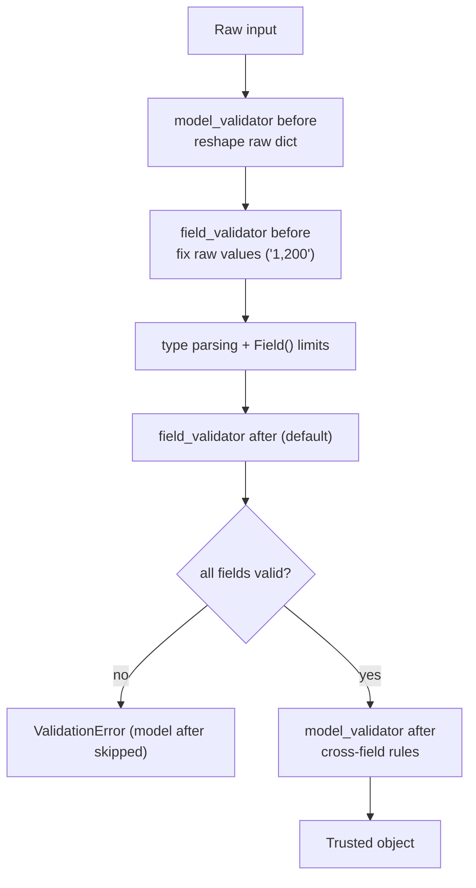

# Chapter 3: `field_validator` and `model_validator`

*When a limit isn't enough, write the rule yourself: on one field, or across the whole object.*

> [!NOTE]
> **📍 At a glance**
> - **You will learn:** field and model validators, `before` vs `after`, the run order, computed fields, and turning errors into `{field, problem}`
> - **You will build:** the class's job application that blocks disposable emails, a signup form that checks two passwords match, and a computed experience tier
> - **Level:** beginner to intermediate · **Time:** about 30 minutes
> - **Builds on:** [Chapter 2](02-field-and-special-types.md)

**After this chapter you can:**

- Write a `field_validator` that cleans or rejects one field, and a `model_validator` for rules across fields
- Choose `mode="before"` or `mode="after"`, and predict the run order
- Spot the classic validator bugs: duplicate names, raising the wrong exception, the wrong mode
- Add computed fields to the output
- Turn a `ValidationError` into `{field, problem}` pairs an API or an LLM can act on

---

## 3.1 One field, or the whole object

```python
class SignupForm(BaseModel):
    email: EmailStr
    password: str
    confirm_password: str

    @field_validator("email")
    @classmethod
    def no_disposable(cls, v: str) -> str:
        if v.split("@")[-1].lower() in {"yopmail.com", "mailinator.com"}:
            raise ValueError("disposable email domains are not accepted")
        return v.lower()                         # validators can clean, not only reject

    @model_validator(mode="after")
    def passwords_match(self):
        if self.password != self.confirm_password:
            raise ValueError("Passwords do not match")
        return self                              # must return self
```

- `field_validator` sees one value (`@classmethod`: no object yet); `model_validator(mode="after")` sees `self`
- `Field()` is configuration written on the field itself; `@field_validator` is a decorated method for rules `Field` can't express (class 03). `cls` is the class itself, as `self` is the object
- One validator can cover several fields: `@field_validator("from_currency", "to_currency")`
  - It still runs **once per field**, and each call sees only that field's value. *Tested:* with `@field_validator("password", "confirm_password")`, the method was called twice, once per field, so it cannot check that the two match. That needs a model validator
- The class's version blocks disposable domains on a job application (`Pydantic_From_Scratch.ipynb`):

```python
class JobApplication(BaseModel):
    full_name: str
    email: EmailStr
    years_experience: int = 0

    @field_validator("email")
    @classmethod
    def reject_disposable_domains(cls, value: str) -> str:
        blocked_domain = {"yopmail.com", "tempmail.com", "mailinator.com"}
        user_domain = value.split("@")[-1].lower()       # last part after "@"
        if user_domain in blocked_domain:
            raise ValueError(f"disposable email domains are not accepted ({user_domain})")
        return value.lower()

JobApplication(full_name="Rohan", email="rohan@yopmail.com")
# email  Value error, disposable email domains are not accepted (yopmail.com) [type=value_error]
```

- Pydantic prefixes your message with `Value error,` and sets `type=value_error`
- The class's password check needs **both** fields, which a `field_validator` can't see, so it is a `model_validator`:

```python
@model_validator(mode="after")
def passwords_must_match(self):
    """Cross-field rule: a single field_validator only ever sees one field's value."""
    if self.password != self.confirm_password:
        raise ValueError("password and confirm_password do not match")
    return self
```

- The class's business rule needs two fields as well: an applicant with an `@infosys.com` email needs at least 5 years of experience. A field validator sees either the email or the years, "like Schrödinger's cat", never both:

```python
class JobApplication(BaseModel):
    email: EmailStr
    years_experience: int = Field(ge=0, le=50)

    @model_validator(mode="after")
    def infosys_needs_five_years(self):
        if self.email.lower().endswith("@infosys.com") and self.years_experience < 5:
            raise ValueError("Infosys applicants need at least 5 years of experience")
        return self
```

- *Tested:* `a@gmail.com` with 2 years passed; `a@infosys.com` with 2 years failed with one error whose `loc` is `()`; with 6 years it passed
- More cross-field rules from class: height and weight together for a health check; password and confirm password
- Why not check these in a constructor? Pydantic calls validators for you on every object; you never call them yourself
- Use a model validator **only** when a rule needs several fields; for one field, a field validator is shorter and clearer

> [!WARNING]
> **Two classic bugs:** (1) two validator methods with the **same name**: the first silently disappears; (2) `raise ValidationError` inside a validator: raise **`ValueError`**, Pydantic wraps it with the field path.
> Both are in the class notebook's `SignupForm`, which names its two password validators `reject_disposable_domains` and raises `ValidationError` for a short password. *Tested on Pydantic 2.14.3:*
> - Pydantic warned "`reject_disposable_domains` overrides an existing Pydantic `@field_validator`", and the `password` check was gone: a 3-character `password` was never rejected
> - Only `confirm_password` was lower-cased, so a user who typed the **same** password, `"Abcdefgh1"`, in both boxes got "password and confirm_password do not match"
> - A short `confirm_password` raised **`TypeError`** (`ValidationError.__new__() missing 2 required positional arguments`), not a validation error, so `except ValidationError` doesn't catch it

```python
class SignupForm(BaseModel):                          # fixed (added by Claude)
    username: str
    password: str = Field(min_length=8)               # a limit needs no validator
    confirm_password: str

    @model_validator(mode="after")
    def passwords_must_match(self):
        if self.password != self.confirm_password:
            raise ValueError("password and confirm_password do not match")
        return self
```

- Don't lower-case passwords at all: it throws away half the possible characters

## 3.2 Run order



```python
@field_validator("n", mode="before")
@classmethod
def strip_commas(cls, v):
    return v.replace(",", "") if isinstance(v, str) else v     # before = any type: check isinstance
```

- `before`: normalise messy input (LLM output!) · `after`: business rules on clean values
- `info.data` (via `ValidationInfo`) gives earlier fields when you want the error on one specific field

> [!WARNING]
> **The class's `strip_years_suffix` needs `mode="before"`.** Its docstring says it strips "5 years" to `5` *"BEFORE the int type-check runs"*, but it is declared without a mode, so it runs **after**. *Tested:* `years_experience="5 years"` failed with `int_parsing` and the validator never ran. With `mode="before"`, `"5 years"` and `"5yrs"` both became `5`.

```python
@field_validator("years_experience", mode="before")       # the fix
@classmethod
def strip_years_suffix(cls, value):
    if isinstance(value, str):
        digits_only = "".join(ch for ch in value if ch.isdigit())
        return int(digits_only) if digits_only else value
    return value
```

## 3.3 Computed fields

```python
@computed_field
@property
def experience_tier(self) -> str:
    return "junior" if self.years_experience < 2 else "mid" if self.years_experience < 7 else "senior"
```

- Output only; appears in dumps and the serialization schema
- The class's reasoning: never ask users for a value you can calculate. BMI comes from height and weight; an experience tier is the company's rule, not the candidate's claim
- The method's name **is** the field's name, so call it `bmi`, not `get_bmi`

```python
class Person(BaseModel):
    height_m: float = Field(gt=0)
    weight_kg: float = Field(gt=0)

    @computed_field
    @property
    def bmi(self) -> float:
        return round(self.weight_kg / self.height_m ** 2, 1)

Person(height_m=1.75, weight_kg=70).model_dump()   # {'height_m': 1.75, 'weight_kg': 70.0, 'bmi': 22.9}
```

- *Tested:* the dump shown in the comment
- *Tested (the class's `JobApplication`):* `years_experience=6` printed `experience_tier='mid'` in the `repr` and in `model_dump()`; passing `experience_tier="senior"` as input was ignored; the tier appeared in `model_json_schema(mode="serialization")` but not in the validation schema

## 3.4 Errors you can act on

| Key | Example | Use |
|---|---|---|
| `loc` | `('items', 1, 'amount')` | which field |
| `msg` | `Input should be greater than 0` | human text, or text for an LLM retry |
| `type` | `greater_than` | stable code for branching and metrics |
| `input` | `-5` | what arrived (may hold personal data) |

- `[{"field": ".".join(map(str, x["loc"])), "problem": x["msg"]} for x in e.errors()]` is how APIs answer and how agents ask a model to fix its reply ([Chapter 5](05-validating-llm-output.md))
- A cross-field error from a `model_validator` has an **empty** `loc` (`()`): it belongs to the whole object (tested)
- Messages that print a `set` (the class's `{KNOWN_CURRENCIES}`) list it in a different order each run. Print `sorted(...)` so logs and tests stay stable (*added by Claude*)

> [!IMPORTANT]
> **🏭 In production:** validators stay **pure and fast** (no DB or HTTP calls); one rule per validator with a clear message; count failures by `type`; never log `input` blindly. *Added by Claude.*

## Questions from the class (class 03)

Asked during the teaching part of the class; the after-class doubt session is not included.

| Question | Answer |
|---|---|
| What is the difference between `Field` and `field_validator`? | `Field` puts limits on the field itself; `field_validator` is your own rule, written as a decorated method |
| What is `cls`? | The class itself, just as `self` is the object |
| Can a validator be a static method instead? | It can, but keep all validation inside the Pydantic model |
| Why pass two fields to one `field_validator`? | To reuse the same rule on both; each call still gets only one value |
| Why not always use a model validator? | Use it only when a rule needs several fields; otherwise it is longer and less clear |
| Can we block particular companies' email domains? | Yes, but that is your business logic: you list the domains |
| Does `Annotated` have a benefit over `Field`? | Not in behaviour; the mentor prefers `Field`. *Added by Claude:* `Annotated` lets you reuse one type in many models |
| What does `ge` mean? | Greater than or equal to |
| Where does `model_dump` save the data? | Nowhere: it returns a dict in memory. Write a file yourself |
| Should I practise in Colab or VS Code? | Beginners: Colab, to see each result at once. Experienced: VS Code, which the course uses from here on |

## 3.5 Added by Claude, not from the sources

- **Use the simplest tool first:** a type, then `Field()`, then a validator. A length check is `min_length`, not a validator
- **Give each validator a unique, descriptive name**: `password_long_enough`, not a copied name
- **Validators raise `ValueError`** (or `AssertionError`); Pydantic turns them into one `ValidationError`
- **Don't change secrets in validators.** Lower-casing a password or trimming a key changes what the user meant

## Interview corner

**What interviewers listen for:** you pick the right validator and mode, you know what runs when, and you can explain a silent validator bug.

### 🟢 Basic

<details class="qa"><summary>1. <code>before</code> vs <code>after</code> validator?</summary>

- `before` gets the raw value (any type) for normalising; `after` gets the parsed, typed value for rules
- *Stronger answer:* a cleaner like "5 years" → 5 must be `before`, or the type check fails first and the validator never runs

</details>

### 🟡 Intermediate

<details class="qa"><summary>2. Where does a "passwords match" rule go?</summary>

- `model_validator(mode="after")`; it only runs if every field passed
- *Stronger answer:* its error has an empty `loc`, so if the UI needs it on `confirm_password`, raise it from a field validator using `info.data`

</details>

<details class="qa"><summary>3. Why not query the database in a validator?</summary>

- Runs on every object, slow and hard to test; check existence/permissions in the service layer
- *Stronger answer:* validators should give the same answer for the same input; a database answer changes over time

</details>

### 🔴 Senior

<details class="qa"><summary>4. A teammate's password validator never fires, and matching passwords are rejected. What do you look for?</summary>

- Two validators with the same method name: the second replaces the first (Pydantic warns at class creation)
- A validator that changes one field (lower-casing) but not its pair
- `raise ValidationError` instead of `ValueError`, which escapes as `TypeError`
- *Stronger answer:* turn Pydantic's warnings into errors in tests (`-W error`), so an overridden validator fails CI

</details>

> [!TIP]
> **🧩 Design question to practise:** *"Validate a hotel booking: check-in before check-out, at most 30 nights, adults ≥ 1, a promo code that may be blank."* Say which rules are types, which are `Field()` limits, which are field validators and which need a model validator, and what each error looks like.

## Cheat sheet

```python
class Booking(BaseModel):
    nights: int = Field(gt=0, le=30)
    @field_validator("promo", mode="before")
    @classmethod
    def blank_to_none(cls, v): return v or None          # clean raw input
    promo: str | None = None
    @model_validator(mode="after")
    def check(self):                                     # cross-field rule
        if self.nights > 7 and self.promo: raise ValueError("promo not valid for long stays")
        return self
```

## Recap

- `field_validator`: one field, `@classmethod`; `model_validator(mode="after")`: whole object, returns `self`
- `before` cleans raw input; `after` (the default) checks typed values
- Order: model before → field before → parsing and limits → field after → model after
- Raise `ValueError`; unique validator names; don't lower-case passwords
- `computed_field` adds output only
- Turn errors into `{field, problem}` for APIs and LLM retries

## Practice

1. Rebuild the class `SignupForm` with its duplicate names and reproduce both bugs
2. Fix it with `Field(min_length=8)` and one `model_validator`
3. Make `strip_years_suffix` work for `"5 years"`, `"5yrs"` and `5`
4. Add a computed `is_senior` field and print `model_dump()`

## How this chapter was checked

- **Run offline** with `pydantic` 2.14.3 and `email-validator` 2.4.0: every code block, and the class notebook's `JobApplication`, `SignupForm` and computed-field cells as written
- **3.1:** `yopmail.com` rejected with `value_error`; the duplicate-name warning, the missing password check, the "do not match" failure for identical passwords, and the `TypeError` from `raise ValidationError`, all reproduced; the fixed form accepted matching 8-character passwords
- **3.2:** `strip_years_suffix` without a mode: `int_parsing`; with `mode="before"`: `5`
- **3.3, 3.4:** the results stated in each section
- **Class transcript** (4 Jul, teaching part, read in full 2026-11-15): the `Field` vs `field_validator` and `cls` points, the Infosys rule, the two-field validator caveat, the BMI example and the questions table. The Infosys model, the two-field validator and the BMI model were run on Pydantic 2.14.3

## Sources and further reading

- Live-Class-2026, `8_Pydantic/Pydantic_From_Scratch.ipynb` (validator cells) and `_8_pydantic_with_ai.py` Part 4 (re-read in full 2026-11-15)
- Live-Class-2026 whiteboard `Class-3-4.pdf` ("email → field validator", "YOE → field validator")
- Class recording's transcript, 4 Jul 2026 (uploaded by you; teaching part only)
- [Pydantic docs: Validators](https://docs.pydantic.dev/latest/concepts/validators/)
- Added by Claude: the fixed `SignupForm`, 3.5, the sorted-set tip, interview question 4. v1's `@validator` / `@root_validator` are the deprecated equivalents

Previous: [Chapter 2](02-field-and-special-types.md) · Next: [Chapter 4](04-nested-models-and-inheritance.md)
