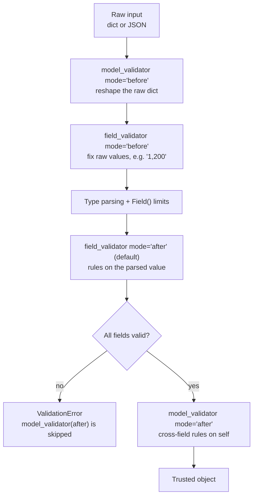

# Chapter 3: `field_validator` and `model_validator`

*When a limit is not enough, write the rule yourself: one field, or the whole object.*

> [!NOTE]
> **📍 At a glance**
> - **You will learn:** custom rules on one field and across fields, the order they run in, `before` vs `after` modes, computed fields and structured errors
> - **You will build:** a signup form with password rules, a disposable-email filter and an experience tier
> - **Level:** beginner to intermediate · **Time:** about 40 minutes
> - **Builds on:** [Chapter 2](02-field-and-special-types.md), and decorators in [Python Ch 2](../python/02-python-refresher.md)

**After this chapter you can:**

- Write a `field_validator` that rejects and cleans one field
- Write a `model_validator` for a rule across fields
- Explain the full validation order, including `mode="before"`
- Avoid two classic traps: duplicate method names, and `raise ValidationError`
- Add a `computed_field`, and turn `ValidationError.errors()` into a useful response

## 3.1 `field_validator` and `model_validator`

A `field_validator` adds a custom rule for one field:

```python
from pydantic import BaseModel, Field, field_validator, model_validator

KNOWN_CURRENCIES = {"USD", "INR", "EUR", "GBP", "JPY"}

class StrictAmount(BaseModel):
    amount: float = Field(gt=0)
    currency: str

    @field_validator("currency")
    @classmethod
    def must_be_known(cls, value: str) -> str:
        value = value.upper().strip()
        if value not in KNOWN_CURRENCIES:
            raise ValueError(f"{value!r} isn't a recognized currency: {KNOWN_CURRENCIES}")
        return value

StrictAmount(amount=100, currency="usd")   # "usd" becomes "USD"
```

- A validator can **reject** (raise `ValueError`) and **clean** (return a changed value)
- ✅ *Verified: `" usd "` became `USD`; `dollars` was rejected.*
- It sees **one field**. A rule like "an `@infosys.com` email needs 5+ years of experience" needs both values

A `model_validator` sees the whole object:

```python
class SignupForm(BaseModel):
    password: str
    confirm_password: str

    @field_validator("password")
    @classmethod
    def check_length(cls, value):
        if len(value) < 8:
            raise ValueError("Password must be at least 8 characters")
        return value

    @model_validator(mode="after")
    def check_passwords_match(self):
        if self.password != self.confirm_password:
            raise ValueError("Passwords do not match")
        return self
```

- `mode="after"` gets the built object (`self`) and must **return** it
- `@classmethod` stays under `@field_validator`: the object does not exist yet, so there is no `self`

## 3.2 A validator on real data: rejecting disposable emails

```python
from pydantic import EmailStr

class JobApplication(BaseModel):
    full_name: str
    email: EmailStr
    years_experience: int = 0

    @field_validator("email")
    @classmethod
    def reject_disposable_domains(cls, value: str) -> str:
        blocked_domain = {"yopmail.com", "tempmail.com", "mailinator.com"}
        user_domain = value.split("@")[-1].lower()
        if user_domain in blocked_domain:
            raise ValueError(f"disposable email domains are not accepted ({user_domain})")
        return value.lower()
```

- `value.split("@")[-1]` takes the part after the last `@`
- It returns the lower-cased email, so it **cleans as well as checks**
- ✅ *Verified: `rohan@yopmail.com` rejected; `Rohan@Example.COM` became `rohan@example.com`.*
- The notebook's next cell builds `rohan@yopmail.com` and prints "Valid:", but has no recorded output. By this rule it would be rejected

*Source: `Pydantic_From_Scratch.ipynb` (`reject_disposable_domains` cell).*

### Two traps in the notebook's `SignupForm`

> [!WARNING]
> **⚠️ Pitfall 1: two validators with the same method name**
> - The notebook defines `reject_disposable_domains` twice, for `password` and `confirm_password`
> - A class keeps only the last method with a name, so the first rule **silently disappears**. Pydantic only warns: "`check` overrides an existing Pydantic `@field_validator` decorator"
> - ✅ *Verified:* with the same mistake, a 3-letter password was accepted
> - Fix: one unique name per validator, or one validator listing several fields: `@field_validator("password", "confirm_password")`

> [!WARNING]
> **⚠️ Pitfall 2: `raise ValidationError` inside a validator**
> - The notebook raises `ValidationError` for a short password. ✅ *Verified:* it fails with `TypeError` (`ValidationError.__new__() missing ... argument`)
> - Raise `ValueError` (or `AssertionError`). Pydantic wraps it into a proper `ValidationError` with the field path

*Source: `Pydantic_From_Scratch.ipynb` (`SignupForm` cell and its warning output).*

## 3.3 Computed fields

A `@computed_field` on a property adds a value worked out from other fields:

```python
from pydantic import computed_field

class JobApplication(BaseModel):
    full_name: str
    years_experience: int

    @computed_field
    @property
    def experience_tier(self) -> str:
        if self.years_experience < 2:
            return "junior"
        elif self.years_experience < 7:
            return "mid"
        return "senior"

print(JobApplication(full_name="Aditi Sharma", years_experience=6))
# full_name='Aditi Sharma' years_experience=6 experience_tier='mid'
```

- ✅ *Verified: 1 gives `junior`, 2 and 6 give `mid`, 7 gives `senior`; `model_dump()` includes `experience_tier`.*
- Output only: you cannot pass it in. It also appears in the serialization schema, so API clients see it

*Source: `Pydantic_From_Scratch.ipynb` (`computed_field` cells).*

## 3.4 The validation pipeline: `before`, parse, `after`



| Mode | Runs | Receives | Use for |
|---|---|---|---|
| `field_validator(mode="before")` | before type parsing | the raw value (any type) | normalising messy input: `"1,200"`, `"yes"`, `" USD "` |
| `field_validator` (default `after`) | after parsing and limits | the typed value | business rules on a clean value |
| `model_validator(mode="before")` | first of all | the raw dict (or anything passed in) | renaming or reshaping legacy payloads |
| `model_validator(mode="after")` | last | the built object (`self`) | rules across fields |

```python
class Quantity(BaseModel):
    n: int

    @field_validator("n", mode="before")
    @classmethod
    def strip_commas(cls, v):
        return v.replace(",", "") if isinstance(v, str) else v

Quantity(n="1,200").n      # 1200
```

- ✅ *Verified: order was `field:password` then `model`; with a **short** password the `model_validator` **never ran**; `"1,200"` became `1200`.*
- A `before` validator must handle **any** input type: check with `isinstance` before calling string methods

### Reading earlier fields inside a field validator

```python
from pydantic import ValidationInfo

class Booking(BaseModel):
    start: int
    end: int

    @field_validator("end")
    @classmethod
    def after_start(cls, v, info: ValidationInfo):
        if "start" in info.data and v <= info.data["start"]:
            raise ValueError("end must be after start")
        return v
```

- `info.data` holds fields **already validated**, in declaration order. A field that failed is missing, hence the `in` check
- ✅ *Verified: `start=5, end=3` gave `value_error` on `('end',)`.*
- Prefer a `model_validator(mode="after")` for cross-field rules; use `info.data` when you want the error attached to one specific field

## 3.5 Turning errors into a useful response

```python
from pydantic import ValidationError

try:
    StrictAmount(amount=-5, currency="dollars")
except ValidationError as e:
    e.error_count()        # 2
    e.errors()             # list of dicts
```

| Key | Example | Use |
|---|---|---|
| `loc` | `('amount',)` or `('items', 1, 'amount')` | which field: send it to a form or a model |
| `msg` | `Input should be greater than 0` | human text |
| `type` | `greater_than` | stable code to branch on or count in metrics |
| `input` | `-5` | what was received (careful: may contain personal data) |

- ✅ *Verified on Pydantic 2.13.5.*
- Turning `errors()` into a short list of `{field, problem}` is how APIs answer a bad request and how agents ask a model to fix its reply ([Chapter 5](05-validating-llm-output.md))

> [!IMPORTANT]
> **🏭 In production**
> - **Keep validators pure and fast:** no database lookups or HTTP calls. They run on every object and are hard to test with I/O inside. Check "does this user exist?" in the service layer
> - **One rule per validator, with a clear message.** The message is what a user, a log reader or an LLM sees
> - **Count errors by `type`** in your metrics to spot a bad client or a model that keeps failing the same field
> - **Do not log `input` blindly:** it may hold emails, passwords or tokens
>
> *Added by Claude.*

## 3.6 Added by Claude, not from the sources

- **Cross-field rule worked as described in class.** ✅ *Verified:* `a@infosys.com` with 2 years rejected; `a@other.com` with 2 years passed
- **`mode="wrap"` exists** for validators that run code both before and after the default parsing (for example, catching an error and returning a fallback). Rarely needed; reach for `before` or `after` first
- **A validator can cover several fields:** `@field_validator("from_currency", "to_currency")`. Used in [Chapter 5](05-validating-llm-output.md), 5.2
- **v1 names:** older code uses `@validator` and `@root_validator`. Same idea, deprecated in v2

## 3.7 Interview corner

**What interviewers listen for:** the order validators run in, when to use `before` vs `after`, and that validators stay free of side effects.

### 🟢 Basic

<details class="qa"><summary>1. <code>field_validator</code> or <code>model_validator</code>?</summary>

- One field, or the whole object
- *Stronger answer:* cross-field rules ("passwords match", "end after start") need `model_validator(mode="after")`

</details>

<details class="qa"><summary>2. Can a validator change the value?</summary>

- Yes: whatever it returns is stored. Raise `ValueError` to reject
- *Stronger answer:* cleaning (strip, lower-case) and checking in one place keeps the rest of the code simple

</details>

<details class="qa"><summary>3. Why <code>@classmethod</code> under <code>@field_validator</code>?</summary>

- The object does not exist yet, so the validator receives the class and the value

</details>

### 🟡 Intermediate

<details class="qa"><summary>4. In what order do validators run?</summary>

- Model `before`, field `before`, parsing and limits, field `after`, model `after`
- *Stronger answer:* if any field fails, the model `after` validator is skipped, so it can assume every field is valid

</details>

<details class="qa"><summary>5. When do you use <code>mode="before"</code>?</summary>

- To fix raw input before type parsing, such as `"1,200"` for an `int`
- *Stronger answer:* it receives any type, so guard with `isinstance`; the default `after` mode gets a clean, typed value

</details>

<details class="qa"><summary>6. Why does a duplicate validator name cause a bug, and why not raise <code>ValidationError</code>?</summary>

- Python keeps the last method with a name, so the first rule is lost (only a warning)
- *Stronger answer:* raise `ValueError`; Pydantic builds the `ValidationError` with the field path for you

</details>

### 🔴 Senior

<details class="qa"><summary>7. Should a validator check the database for a duplicate email?</summary>

- No: validators should be pure and fast
- *Stronger answer:* shape and format in the model; existence, uniqueness and permissions in the service layer, where you can handle races (a unique constraint in the database is the real guarantee)

</details>

<details class="qa"><summary>8. How do you return validation errors from an API?</summary>

- Map `errors()` to `{field, problem}` using `loc` and `msg`, with HTTP 422
- *Stronger answer:* keep `type` for clients to branch on, drop `input` when it may contain personal data, and log counts by `type`

</details>

> [!TIP]
> **🧩 Design question**
> - *"A partner sends orders where quantity is sometimes `"1,200"`, sometimes `1200`, and the old format uses `qty` instead of `quantity`. Design the model."*
> - Talk about: `model_validator(mode="before")` to rename `qty`, a `before` field validator for commas, `Field(gt=0)`, a cross-field rule for totals, and logging which format each partner uses

## Cheat sheet

```python
from pydantic import BaseModel, field_validator, model_validator, computed_field, ValidationInfo
class Form(BaseModel):
    qty: int
    start: int
    end: int
    @field_validator("qty", mode="before")
    @classmethod
    def no_commas(cls, v): return v.replace(",", "") if isinstance(v, str) else v
    @model_validator(mode="after")
    def order_ok(self):
        if self.end <= self.start: raise ValueError("end must be after start")
        return self
    @computed_field
    @property
    def length(self) -> int: return self.end - self.start
```

## Recap

- `field_validator`: one field, can reject and clean; `model_validator(mode="after")`: whole object
- Order: model `before`, field `before`, parsing, field `after`, model `after`; a failing field skips model `after`
- `before` receives raw input of any type; `after` receives clean typed values
- Unique method names; raise `ValueError`, never `ValidationError`
- `computed_field` adds output-only values; `errors()` gives `loc`, `msg`, `type`, `input`
- Validators stay pure: no I/O

## Practice

1. Write a `field_validator` and a `model_validator` from memory and say why each exists
2. Print the order validators run in, with a valid and an invalid password
3. Write two validators with the same method name, read the warning, then fix it
4. Make a `before` validator that accepts `"1,200"` for an `int`
5. Rename a legacy key with `model_validator(mode="before")`
6. Catch a `ValidationError` and turn `errors()` into a list of `{field, problem}`

## How this chapter was checked

- **Run** (Pydantic 2.13.5, `email-validator` installed): the currency validator, validator order with a matching and a short password, the duplicate-name warning and its effect, `raise ValidationError`, the disposable-email rule, computed tiers, a `before` field validator, a `before` model validator, `ValidationInfo.data`, `errors()` and `error_count()`, the cross-field rule
- **Cheat sheet:** run as written
- The pipeline diagram, 3.4, 3.5 and the production box were added in the 2026 review (Added by Claude)

## Sources and further reading

- Live-Class-2026, `classes_summary/03` and `classes_transcription_summary/03` (Pydantic Deep Dive)
- Live-Class-2026, notebook `8_Pydantic/Pydantic_From_Scratch.ipynb`
- Pydantic docs: [Validators](https://docs.pydantic.dev/latest/concepts/validators/), [Validation errors](https://docs.pydantic.dev/latest/errors/validation_errors/)

Previous: [Chapter 2](02-field-and-special-types.md) · Next: [Chapter 4](04-nested-models-and-inheritance.md)
