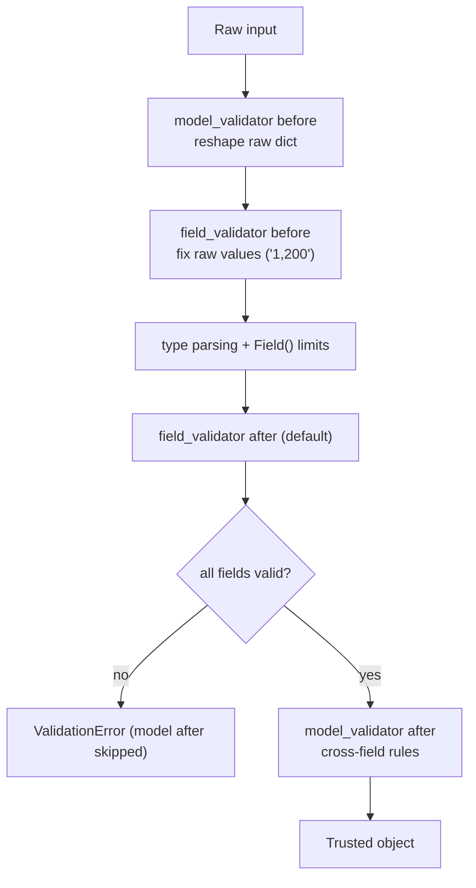

# Chapter 3: `field_validator` and `model_validator`

*When a limit isn't enough, write the rule yourself: on one field, or across the whole object.*

> [!NOTE]
> **📍 At a glance**
> - **You will learn:** field and model validators, `before` vs `after`, the run order, computed fields, and turning errors into `{field, problem}`
> - **Level:** beginner to intermediate · **Time:** about 15 minutes
> - **Builds on:** [Chapter 2](02-field-and-special-types.md)

---

## 3.1 One field, or the whole object

```python
class SignupForm(BaseModel):
    email: EmailStr
    password: str
    confirm_password: str

    @field_validator("email")
    @classmethod
    def no_disposable(cls, v: str) -> str:
        if v.split("@")[-1].lower() in {"yopmail.com", "mailinator.com"}:
            raise ValueError("disposable email domains are not accepted")
        return v.lower()                         # validators can clean, not only reject

    @model_validator(mode="after")
    def passwords_match(self):
        if self.password != self.confirm_password:
            raise ValueError("Passwords do not match")
        return self                              # must return self
```

- `field_validator` sees one value (`@classmethod`: no object yet); `model_validator(mode="after")` sees `self`
- One validator can cover several fields: `@field_validator("from_currency", "to_currency")`

> [!WARNING]
> **Two classic bugs:** (1) two validator methods with the **same name**: the first silently disappears; (2) `raise ValidationError` inside a validator: raise **`ValueError`**, Pydantic wraps it with the field path.

## 3.2 Run order



```python
@field_validator("n", mode="before")
@classmethod
def strip_commas(cls, v):
    return v.replace(",", "") if isinstance(v, str) else v     # before = any type: check isinstance
```

- `before`: normalise messy input (LLM output!) · `after`: business rules on clean values
- `info.data` (via `ValidationInfo`) gives earlier fields when you want the error on one specific field

## 3.3 Computed fields

```python
@computed_field
@property
def experience_tier(self) -> str:
    return "junior" if self.years_experience < 2 else "mid" if self.years_experience < 7 else "senior"
```

- Output only; appears in dumps and the serialization schema

## 3.4 Errors you can act on

| Key | Example | Use |
|---|---|---|
| `loc` | `('items', 1, 'amount')` | which field |
| `msg` | `Input should be greater than 0` | human text, or text for an LLM retry |
| `type` | `greater_than` | stable code for branching and metrics |
| `input` | `-5` | what arrived (may hold personal data) |

- `[{"field": ".".join(map(str, x["loc"])), "problem": x["msg"]} for x in e.errors()]` is how APIs answer and how agents ask a model to fix its reply ([Chapter 5](05-validating-llm-output.md))

> [!IMPORTANT]
> **🏭 In production:** validators stay **pure and fast** (no DB or HTTP calls); one rule per validator with a clear message; count failures by `type`; never log `input` blindly.

## Interview corner

<details class="qa"><summary>1. <code>before</code> vs <code>after</code> validator?</summary>

- `before` gets the raw value (any type) for normalising; `after` gets the parsed, typed value for rules

</details>

<details class="qa"><summary>2. Where does a "passwords match" rule go?</summary>

- `model_validator(mode="after")`; it only runs if every field passed

</details>

<details class="qa"><summary>3. Why not query the database in a validator?</summary>

- Runs on every object, slow and hard to test; check existence/permissions in the service layer

</details>

---

*Source: Live-Class-2026 class 03 notebook; run order, `before` mode, error handling and production notes added by Claude (tested with Pydantic 2.13). v1's `@validator` / `@root_validator` are the deprecated equivalents.*

Previous: [Chapter 2](02-field-and-special-types.md) · Next: [Chapter 4](04-nested-models-and-inheritance.md)
