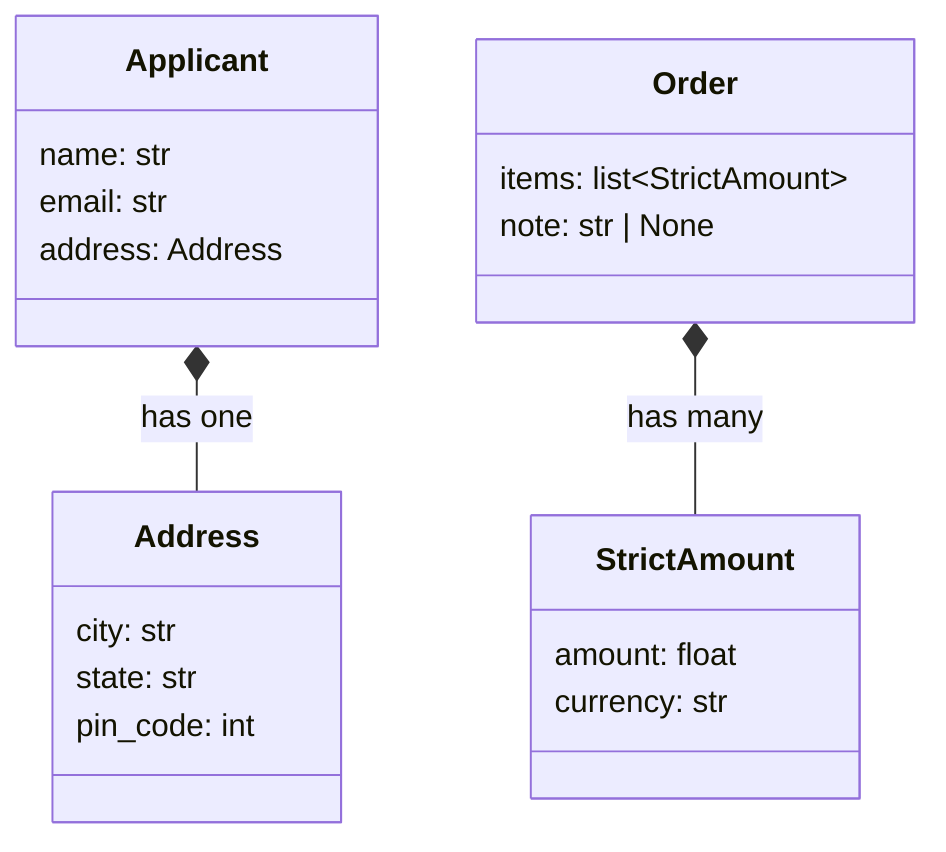

# Chapter 4: Nested models, unions and inheritance

*Real payloads and LLM replies are trees, not flat forms. Models nest the same way.*

> [!NOTE]
> **📍 At a glance**
> - **You will learn:** nested models, lists of models, inheritance, discriminated unions, recursive models, and shaping nested output
> - **You will build:** an order with line items, an applicant with an address, and an event stream with several message types
> - **Level:** intermediate · **Time:** about 40 minutes
> - **Builds on:** [Chapter 3](03-validators.md)

**After this chapter you can:**

- Nest one model inside another and pass a plain dict for the inner one
- Read a nested error path such as `('items', 1, 'amount')`
- Reuse fields and validators through inheritance, and know when composition is better
- Validate "one of several shapes" with a discriminated union
- Model a tree (comments, folders, plan steps) with a self-referencing model
- Avoid the notebook's `pin_code` constraint mistake

## 4.1 Nested models

```python
class ConversionRequest(BaseModel):
    source: StrictAmount                 # from Chapter 3
    target_currency: str

request = ConversionRequest(source={"amount": 250, "currency": "eur"}, target_currency="GBP")
print(f"{request.source.amount} {request.source.currency} -> {request.target_currency}")
```

- A plain **dict** is accepted for the inner model and validated: `"eur"` is cleaned to `"EUR"`
- ✅ *Verified: `model_dump()` gives a nested dict `{'source': {'amount': 250.0, 'currency': 'EUR'}, 'target_currency': 'GBP'}`; a bad inner value gave paths `('source', 'amount')` and `('source', 'currency')`.*

*Source: `classes_summary/03`, `classes_transcription_summary/03`.*



## 4.2 Inheritance

- A child model keeps the parent's fields, limits **and** validators, and can add or override fields
- ✅ *Verified: a child of a base with `amount: float = Field(gt=0)` and a rounding validator rejected `-1` (`greater_than`), rounded `1.236` to `1.24`, and had fields `['amount', 'note']`.*
- Good for shared fields (`id`, `created_at`) and shared rules

| Inheritance | Composition (a model as a field) |
|---|---|
| "is a": `AdminUser` is a `User` | "has a": `Order` has `items` |
| Shares fields and validators | Keeps each model small and reusable |
| Deep chains get hard to follow | Easy to test each part alone |

- Rule of thumb: one level of inheritance for shared base fields; composition for everything else

## 4.3 Lists of models

```python
class Order(BaseModel):
    items: list[StrictAmount]
    note: str | None = None
```

- ✅ *Verified: each dict in `items` was validated and cleaned (`usd` to `USD`, `eur` to `EUR`); a bad second item gave paths `('items', 1, 'amount')` and `('items', 1, 'currency')`.*
- Add `Field(min_length=1)` when an empty list is not allowed

## 4.4 A constraint that does not fit the type

The notebook's nested example:

```python
class Address(BaseModel):
    city: str
    state: str
    pin_code: str = Field(gt=1000, lt=43125315)   # as written

class Applicant(BaseModel):
    name: str
    email: str
    address: Address
```

> [!WARNING]
> **⚠️ Pitfall: number limits on a text field**
> - The notebook only defines the classes; it never builds an `Address`, so the bug never shows
> - `gt` and `lt` are **number** limits. ✅ *Verified:* building an `Address` with a text `pin_code` fails with `TypeError: Unable to apply constraint 'gt'`
> - Fix as a number: `pin_code: int = Field(gt=1000, lt=43125315)`
> - Better for Indian PIN codes: `pin_code: str = Field(pattern=r"^\d{6}$")`. A code is an identifier, not a quantity, and a leading zero must survive

*Source: `Pydantic_From_Scratch.ipynb` (last cell).*

## 4.5 Discriminated unions: one of several shapes

Event streams, tool calls and LLM "actions" often come in several shapes. A **tag field** says which one.

```python
from typing import Annotated, Literal, Union
from pydantic import BaseModel, Field

class SearchAction(BaseModel):
    kind: Literal["search"]
    query: str

class EmailAction(BaseModel):
    kind: Literal["email"]
    to: str
    body: str

Action = Annotated[Union[SearchAction, EmailAction], Field(discriminator="kind")]

class Step(BaseModel):
    action: Action

Step(action={"kind": "email", "to": "a@b.c", "body": "hi"}).action   # EmailAction(...)
```

- Pydantic reads `kind` first and validates against **that one** model
- ✅ *Verified: `kind="email"` built an `EmailAction`; an unknown `kind` gave `union_tag_invalid`; a missing field gave the path `('action', 'email', 'body')`, naming the branch.*
- Without `discriminator`, Pydantic tries each model in turn: slower, and errors list every branch, which is hard to read

> [!IMPORTANT]
> **🏭 In production**
> - Use tagged unions for **webhooks, message queues and agent actions**: one endpoint, many event types, each validated strictly
> - Add new types as new branches; old clients keep working
> - LLM structured output with a tag field works well: the model picks `kind` first, then fills only that branch's fields
>
> *Added by Claude.*

## 4.6 Recursive models: trees

```python
class Node(BaseModel):
    name: str
    children: list["Node"] = []

tree = Node(name="root", children=[{"name": "a", "children": [{"name": "a1"}]}])
tree.children[0].children[0].name      # 'a1'
```

- The quoted `"Node"` refers to the class being defined. ✅ *Verified: three levels deep built correctly.*
- Use for comment threads, folder trees, nested plan steps
- In the JSON schema, nested and recursive models appear under `$defs` and are referenced with `$ref`

## 4.7 Shaping nested output

```python
order.model_dump(include={"items": {0: {"amount"}}})   # pick fields, even inside lists
order.model_dump(exclude={"note"})                    # drop fields
order.model_dump(exclude_none=True)                    # drop None values
order.model_dump(by_alias=True)                        # outside key names (Chapter 2)
```

- `include` and `exclude` take nested sets and dicts, so you can trim deep fields without copying the model
- `exclude_none=True` keeps API responses short; `exclude_unset=True` drops fields the caller never sent (useful for PATCH updates)

## 4.8 Added by Claude, not from the sources

- **Optional nested model:** `address: Address | None = None` makes the whole block optional. ✅ *Verified:* absent gave `None`; a bad value inside a given address was still rejected with path `('address', 'pin')`
- **Keep schemas for a model to fill shallow.** Deeply nested schemas are harder for an LLM to follow and fail more often (general experience, not tested here). Flatten where you can
- **Rebuild from a dump to test validators.** `Model(**m.model_dump()) == m` should be `True` (✅ *verified*). If it is not, a validator is not safe to run twice

## 4.9 Interview corner

**What interviewers listen for:** nested error paths, when to use a discriminated union, and composition over deep inheritance.

### 🟢 Basic

<details class="qa"><summary>1. How do you model nested JSON?</summary>

- A model as the type of a field; pass a dict and Pydantic builds and validates the inner model
- *Stronger answer:* each level is validated with its own rules, and errors carry the full path

</details>

<details class="qa"><summary>2. How do you find which nested field failed?</summary>

- `e.errors()` gives `loc` as a path, like `('items', 1, 'amount')`

</details>

<details class="qa"><summary>3. What does a child model inherit?</summary>

- Fields, limits and validators; it can add or override fields

</details>

### 🟡 Intermediate

<details class="qa"><summary>4. Inheritance or composition?</summary>

- Inheritance for "is a" and shared base fields; composition for "has a"
- *Stronger answer:* keep inheritance shallow (one level); composition keeps models small and testable

</details>

<details class="qa"><summary>5. A <code>Field(gt=...)</code> on a string field. What happens?</summary>

- A `TypeError` when a value is checked
- *Stronger answer:* identifiers like PIN codes are strings with a `pattern`, not numbers, so leading zeros survive

</details>

<details class="qa"><summary>6. What is <code>exclude_unset</code> good for?</summary>

- Dumping only the fields the caller actually sent
- *Stronger answer:* the standard trick for PATCH endpoints: update only what changed

</details>

### 🔴 Senior

<details class="qa"><summary>7. A webhook endpoint receives 12 event types. How do you validate it?</summary>

- A discriminated union on the event-type field
- *Stronger answer:* one model per event, `Field(discriminator="type")`, clear errors naming the branch, and an unknown type rejected or routed to a dead-letter queue

</details>

<details class="qa"><summary>8. Why might an LLM fail to fill a nested schema, and what do you do?</summary>

- Deep trees, optional branches and vague field names confuse it
- *Stronger answer:* flatten, use tags (`Literal`) for branches, write clear `description`s, and validate with retry ([Chapter 5](05-validating-llm-output.md))

</details>

> [!TIP]
> **🧩 Design question**
> - *"An agent returns a plan: a list of steps, each either a search, an API call or a question to the user, and steps can have sub-steps."*
> - Talk about: a recursive `Step` with `children`, a discriminated union on `kind`, `min_length=1`, a maximum depth check in a `model_validator`, and the schema handed to the model

## Cheat sheet

```python
from typing import Annotated, Literal, Union
from pydantic import BaseModel, Field
class Item(BaseModel): sku: str; qty: int = Field(gt=0)
class Order(BaseModel): items: list[Item] = Field(min_length=1); note: str | None = None
class Cat(BaseModel): kind: Literal["cat"]; meows: int
class Dog(BaseModel): kind: Literal["dog"]; barks: int
class Pet(BaseModel): pet: Annotated[Union[Cat, Dog], Field(discriminator="kind")]
class Node(BaseModel): name: str; children: list["Node"] = []
Order(items=[{"sku": "A", "qty": 2}]).model_dump(exclude_none=True)
```

## Recap

- A model as a field type: nested JSON in, validated tree out; errors carry the full path
- Inheritance shares fields and validators; prefer composition for "has a"
- `list[Model]` validates every item, with the index in the error path
- Discriminated unions validate one of several shapes by a tag field
- Recursive models handle trees; `include`, `exclude`, `exclude_none`, `exclude_unset` shape output
- Number limits on numbers; identifiers are strings with a `pattern`

## Practice

1. Nest an `Address` in an `Applicant` and read the error path for a bad PIN code
2. Fix the notebook's `pin_code` field both ways and say which is better
3. Make an `Order` with `list[Item]` and read the error path for a bad second item
4. Build a discriminated union for three event types and send an unknown type
5. Model a comment thread with replies and dump it with `exclude_none=True`

## How this chapter was checked

- **Run** (Pydantic 2.13.5): nested dict, dump and error paths, inheritance with a limit and a validator, a list of models with a bad item, the `pin_code` `TypeError` and both fixes, a discriminated union (valid, unknown tag, missing field), a three-level recursive model, `$defs` in the schema, `include`/`exclude`/`exclude_none`/`exclude_unset`, optional nested model, rebuild from dump
- **Cheat sheet:** run as written
- **Not checked:** that deep schemas make LLMs fail more often is general experience
- 4.5 to 4.7, the diagram and the production box were added in the 2026 review (Added by Claude)

## Sources and further reading

- Live-Class-2026, `classes_summary/03` and `classes_transcription_summary/03` (Pydantic Deep Dive)
- Live-Class-2026, notebook `8_Pydantic/Pydantic_From_Scratch.ipynb`
- Pydantic docs: [Unions](https://docs.pydantic.dev/latest/concepts/unions/), [Serialization](https://docs.pydantic.dev/latest/concepts/serialization/)

Previous: [Chapter 3](03-validators.md) · Next: [Chapter 5](05-validating-llm-output.md)
