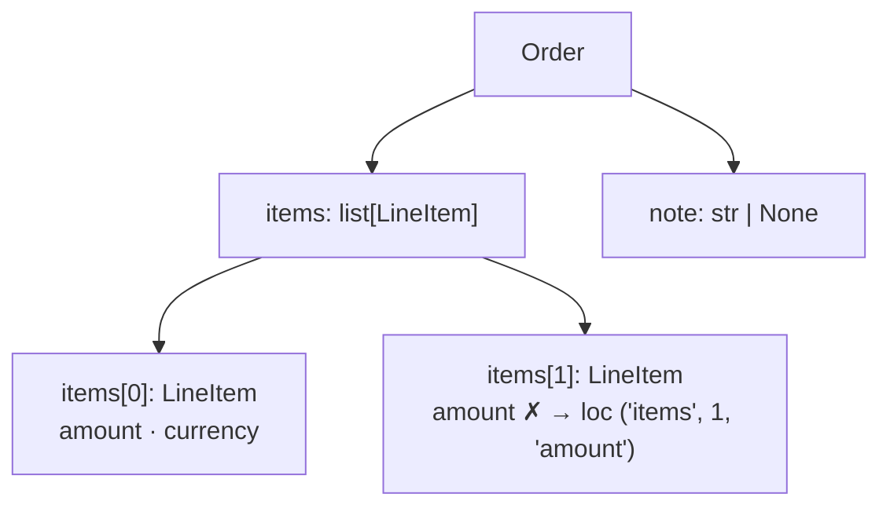
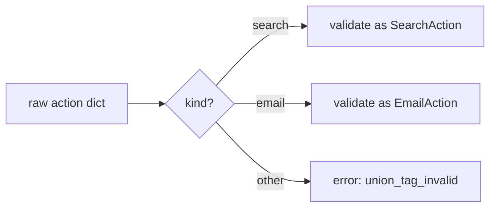

# Chapter 4: Nested models, unions and inheritance

*Real payloads and LLM replies are trees, not flat forms. Models nest the same way.*

> [!NOTE]
> **📍 At a glance**
> - **You will learn:** nested and list models, inheritance vs composition, discriminated unions for agent actions, recursive models, shaping nested output
> - **You will build:** the class's applicant with an address, a currency conversion request, and an agent action that is one of several shapes
> - **Level:** intermediate · **Time:** about 25 minutes
> - **Builds on:** [Chapter 3](03-validators.md)

**After this chapter you can:**

- Nest models and lists of models, and read error paths like `('items', 1, 'amount')`
- Choose inheritance or composition
- Model "one of several shapes" with a discriminated union
- Write recursive models, and shape nested output with `include`, `exclude_none` and `exclude_unset`

---

## 4.1 Nesting and lists

- The class nests a currency amount inside a request (`_8_pydantic_with_ai.py`, Part 5):

```python
KNOWN_CURRENCIES = {"USD", "INR", "EUR", "GBP", "JPY"}

class StrictAmount(BaseModel):
    amount: float = Field(gt=0)
    currency: str

    @field_validator("currency")
    @classmethod
    def must_be_known(cls, value: str) -> str:
        value = value.upper().strip()
        if value not in KNOWN_CURRENCIES:
            raise ValueError(f"{value!r} isn't a recognized currency: {sorted(KNOWN_CURRENCIES)}")
        return value

class ConversionRequest(BaseModel):
    source: StrictAmount
    target_currency: str

request = ConversionRequest(source={"amount": 250, "currency": "eur"}, target_currency="GBP")
print(f"{request.source.amount} {request.source.currency} -> {request.target_currency}")   # 250.0 EUR -> GBP
```

- A plain dict for `source` is turned into a `StrictAmount` and runs its validators: `"eur"` became `"EUR"` (tested)
- Lists of models work the same way:

```python
class LineItem(BaseModel):
    amount: Decimal = Field(gt=0)
    currency: str

class Order(BaseModel):
    items: list[LineItem] = Field(min_length=1)
    note: str | None = None

Order(items=[{"amount": "9.50", "currency": "EUR"}])      # inner dicts are validated too
```

- Errors carry the full path: `('items', 1, 'amount')`



- A code like an Indian PIN is an **identifier**: `str = Field(pattern=r"^\d{6}$")`, not an `int` (leading zeros), and never number limits on a `str`

> [!WARNING]
> **Number limits on a `str` crash at validation, not at definition.** The class notebook's address uses `pin_code: str = Field(gt=1000, lt=43125315)`. *Tested on Pydantic 2.14.3:* the class defined fine, then **every** applicant raised `TypeError: Unable to apply constraint 'gt' to supplied value 411001`. A `TypeError` is not a `ValidationError`, so the usual `except ValidationError` doesn't catch it.

```python
class Address(BaseModel):                         # the class model, fixed
    city: str
    state: str
    pin_code: str = Field(pattern=r"^\d{6}$")     # six digits, kept as text

class Applicant(BaseModel):
    name: str
    email: str
    address: Address
```

## 4.2 Inheritance vs composition

| Inheritance ("is a") | Composition ("has a") |
|---|---|
| `AdminUser(User)` gets fields **and** validators | `Order` has `items` |
| Good for shared base fields (`id`, `created_at`) | Small, reusable, testable parts |

- Rule of thumb: one level of inheritance; compose everything else
- `Applicant` **has an** `Address`: composition. An `AdminUser` **is a** `User`: inheritance

## 4.3 Discriminated unions: one of several shapes

*Sections 4.3 to 4.5 are added by Claude: the class code doesn't use unions yet.*

```python
class SearchAction(BaseModel):
    kind: Literal["search"]
    query: str

class EmailAction(BaseModel):
    kind: Literal["email"]
    to: str
    body: str

Action = Annotated[Union[SearchAction, EmailAction], Field(discriminator="kind")]

class Step(BaseModel):
    action: Action

Step(action={"kind": "email", "to": "a@b.c", "body": "hi"}).action   # EmailAction
```



- Pydantic reads `kind` first and validates **only** that branch: faster, with readable errors
- *Tested:* `{"kind": "fly"}` failed with one `union_tag_invalid` error that lists the allowed tags
- The pattern for **agent actions, webhooks and queue events**: one entry point, many types; add a branch to extend
- In LLM structured output the model picks `kind` first, then fills only that branch

## 4.4 Recursive models

```python
class Node(BaseModel):
    name: str
    children: list["Node"] = []
```

- Plan steps, comment threads, folder trees; shown as `$defs` + `$ref` in the JSON schema

## 4.5 Shaping output

```python
order.model_dump(include={"items": {0: {"amount"}}})   # nested include
order.model_dump(exclude_none=True)                    # shorter API responses
order.model_dump(exclude_unset=True)                   # only what the caller sent (PATCH)
```

> [!IMPORTANT]
> **🏭 In production:** keep schemas an LLM must fill **shallow**; deep nesting fails more often. Flatten where you can, and use a tagged union rather than many optional fields. *Added by Claude.*

## 4.6 Added by Claude, not from the sources

- **Store codes as text with a `pattern`**: PIN codes, phone numbers, account numbers, IDs
- **Test the whole tree once**: one bad leaf deep inside should give one clear `loc`
- **Prefer a tagged union over `Optional` everywhere**: the tag says which fields must be present
- **Read error paths from the left**: `('items', 1, 'amount')` = the second item's amount

## Interview corner

**What interviewers listen for:** you model real payloads as trees, you use tagged unions for "one of several", and you keep identifiers as strings.

### 🟢 Basic

<details class="qa"><summary>1. Inheritance or composition?</summary>

- Inheritance for a shared base; composition for "has a"; avoid deep chains
- *Stronger answer:* in the class, `Applicant` has an `Address`; that is composition, and the address model is reusable in other forms

</details>

### 🟡 Intermediate

<details class="qa"><summary>2. Why a discriminated union instead of a plain <code>Union</code>?</summary>

- The tag picks one branch directly: faster, deterministic, clear errors; a plain union tries every branch
- *Stronger answer:* a plain union can silently match the wrong branch when shapes overlap; the tag removes that guess

</details>

<details class="qa"><summary>3. Why is a PIN code a <code>str</code>, and what happens if you put <code>gt=1000</code> on it?</summary>

- Codes keep leading zeros and are never used for maths; validate with `pattern`
- Number limits on a `str` raise `TypeError` on every input, which escapes `except ValidationError`
- *Stronger answer:* ask "will I ever add or compare these?" If no, it is text

</details>

### 🔴 Senior

<details class="qa"><summary>4. Model an agent that can search, email or finish.</summary>

- One `Literal` tag per action model, a discriminated `Action` union, strict validation, approval on the email branch
- *Stronger answer:* version the union (new tags are additive), log the tag of every step, and make the "finish" branch carry the final answer, so the loop has one clear exit

</details>

> [!TIP]
> **🧩 Design question to practise:** *"An LLM extracts a resume into structured data: contact, education list, jobs list, skills."* Cover: nesting depth, which fields are text vs numbers, where unions help, and how a validation error for the third job reaches the model.

## Cheat sheet

```python
class Address(BaseModel):
    pin_code: str = Field(pattern=r"^\d{6}$")              # codes are text
class Applicant(BaseModel):
    address: Address                                       # nested: dicts validated too
    jobs: list[Job] = []                                   # list of models
Action = Annotated[Union[Search, Email], Field(discriminator="kind")]
obj.model_dump(exclude_none=True)                          # shape the output
```

## Recap

- Nested models validate inner dicts; errors carry the full path
- Composition for "has a", one level of inheritance for "is a"
- Codes and IDs are strings with a `pattern`; number limits on a `str` crash with `TypeError`
- Discriminated unions route by a tag and give one clear error
- Recursive models use a string annotation; output shaping uses `include` / `exclude_*`

## Practice

1. Build the class `Applicant` with the original `pin_code` field, reproduce the `TypeError`, then fix it
2. Create an `Order` with three items and make the second one invalid. Read the `loc`
3. Add a `FinishAction` branch to `Action` and send an unknown `kind`
4. Dump an order with and without `exclude_unset`

## How this chapter was checked

- **Run offline** with `pydantic` 2.14.3: every code block in this chapter, plus `_8_pydantic_with_ai.py` Part 5 and the notebook's `Address` / `Applicant` cell
- **4.1:** `250.0 EUR -> GBP`; the original `pin_code` field raised `TypeError` for `"411001"` and `"011001"`; the fixed field accepted `"011001"` and rejected `"4110"`
- **4.3:** an email action parsed as `EmailAction`; `{"kind": "fly"}` gave one `union_tag_invalid` error

## Sources and further reading

- Live-Class-2026, `8_Pydantic/Pydantic_From_Scratch.ipynb` (the `Address` / `Applicant` cell) and `_8_pydantic_with_ai.py` Part 5 (re-read in full 2026-11-15)
- [Pydantic docs: Unions](https://docs.pydantic.dev/latest/concepts/unions/), [Serialization](https://docs.pydantic.dev/latest/concepts/serialization/)
- Added by Claude: 4.3 to 4.6, interview questions 3–4

Previous: [Chapter 3](03-validators.md) · Next: [Chapter 5](05-validating-llm-output.md)
