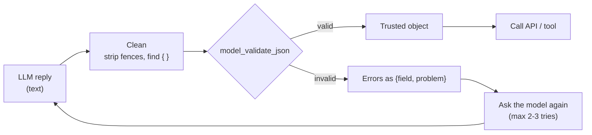
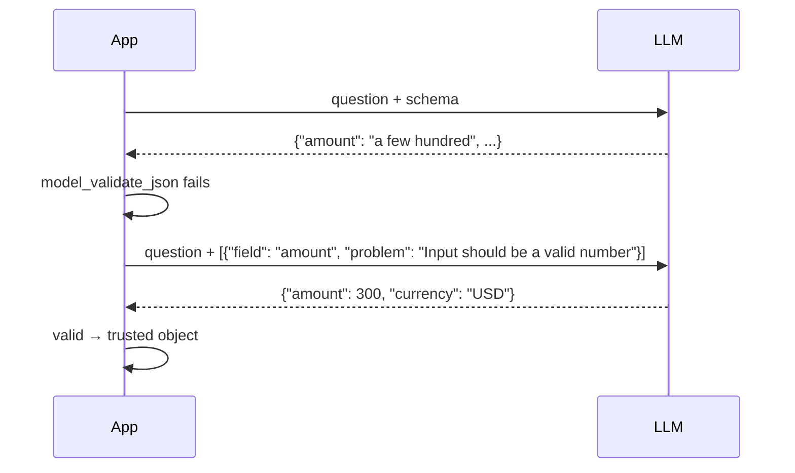

# Chapter 5: Validating LLM output

*A model returns text. Pydantic decides whether your code may trust it.*

> [!NOTE]
> **📍 At a glance**
> - **You will learn:** validating raw model text, checking tool arguments before an API call, retrying with structured errors, and native structured output with strict schemas
> - **You will build:** a currency tool that rejects bad arguments without a network call, a request extractor, and a self-correcting retry loop
> - **Level:** intermediate · **Time:** about 45 minutes
> - **Builds on:** [Chapters 1 to 4](01-why-pydantic-and-basemodel.md). **Leads to:** [Langchain Ch 4](../langchain/04-structured-output.md) and [LLM Ch 2](../llm/02-the-agentic-loop-in-pure-python.md)

**After this chapter you can:**

- Validate a model's raw JSON text with `model_validate_json`
- Check a tool's arguments before calling an API
- Extract a structured request from a user message, and handle bad replies
- Retry by feeding validation errors back to the model, with a cap
- Get a JSON schema from a model, and explain what "strict" structured output changes

## 5.1 Validating an LLM's raw text

```python
llm_clean_output = '{"amount": 300, "currency": "usd"}'
print(StrictAmount.model_validate_json(llm_clean_output))       # works

llm_messy_output = '{"amount": "a few hundred", "currency": "dollars"}'
try:
    StrictAmount.model_validate_json(llm_messy_output)
except ValidationError as exc:
    print(f"Caught before it could break anything downstream:\n{exc}")
```



- `model_validate_json` is the bridge between "an LLM said something" and "my code can trust it"
- ✅ *Verified: the clean text passed; the messy one was rejected; the same call also rejects non-JSON text (`json_invalid`), a trailing comma and trailing characters.*
- Pydantic models also define the request and response shapes of the FastAPI servers built later

*Source: `classes_summary/03`, `classes_transcription_summary/02` (Q&A).*

## 5.2 Validate the arguments before calling an API

`_9_api_call_with_structure.py` revisits `convert_currency` ([Python Ch 2](../python/02-python-refresher.md), 2.6). The call is unchanged. New: its **arguments** go through Pydantic first. The file says this is where "Pydantic" and "API call" stop being separate lessons.

```python
KNOWN_CURRENCIES = {"USD", "INR", "EUR", "GBP", "JPY"}

class ConvertCurrencyArgs(BaseModel):
    """The trusted shape for this function's arguments."""
    amount: float = Field(gt=0)
    from_currency: str
    to_currency: str

    @field_validator("from_currency", "to_currency")
    @classmethod
    def must_be_known_currency(cls, value: str) -> str:
        value = value.upper().strip()
        if value not in KNOWN_CURRENCIES:
            raise ValueError(f"{value!r} isn't a currency this function recognizes: {KNOWN_CURRENCIES}")
        return value

def convert_currency_validated(raw_arguments: dict) -> float | str:
    """Validate BEFORE calling. Untrusted dict in, trusted call out."""
    try:
        validated = ConvertCurrencyArgs(**raw_arguments)
    except ValidationError as exc:
        return f"Rejected before the API was ever called: {exc}"
    return convert_currency(
        amount=validated.amount,
        from_currency=validated.from_currency,
        to_currency=validated.to_currency,
    )
```

- One `field_validator` can cover several fields (`"from_currency", "to_currency"`)
- `convert_currency` stays an ordinary function that knows nothing about Pydantic
- ✅ *Verified:* `{"amount": -50, "from_currency": "dollars", "to_currency": "inr"}` returned "Rejected before the API was ever called" with **2 errors** (amount must be greater than 0; `'DOLLARS'` unknown). No network call
- The good-arguments call needs the live API. My sandbox could not reach it (a proxy error came back), so I did not see a rate

*Source: `_9_api_call_with_structure.py`.*

## 5.3 A validated tool next to an AI call

`_10_tool_with_ai_call.py` puts a validated tool (from `_9`) beside a real AI call (from `_7`). New: the `@tool` decorator from [Python Ch 1](../python/01-setup-and-api-basics.md) (1.4) used for real. It registers the function by name and logs the call.

```python
@tool
def convert_currency(amount: float, from_currency: str, to_currency: str) -> float | str:
    """Convert `amount` between currencies using real, live ECB rates."""
    ...

def call_tool_safely(raw_arguments: dict) -> float | str:
    try:
        validated = ConvertCurrencyArgs(**raw_arguments)
    except ValidationError as exc:
        return f"Rejected before the tool ran: {exc}"
    return convert_currency(amount=validated.amount, from_currency=validated.from_currency,
                            to_currency=validated.to_currency)
```

- `ask_ai` uses Groq if `GROQ_API_KEY` is set, else a fake client from the Python book
- The file's point (its closing message): both parts work, but **neither knows the other exists**. The AI did not choose the tool; the code called both by hand
- Connecting them is the agent loop: [LLM Ch 2](../llm/02-the-agentic-loop-in-pure-python.md). Files `_11` to `_14` put them into one `Agent` class but still call the tool by hand: [Python Ch 3](../python/03-anatomy-of-an-agent.md), 3.7
- ✅ *Verified:* with no key, the AI part printed the fake client's reply. The tool logged `[tool call] convert_currency({'amount': 100.0, 'from_currency': 'USD', 'to_currency': 'INR'}) -> ...`. Validated values are upper-cased and the amount became a float. `Tools registered so far` printed `['convert_currency']`. The tool's own result was "Couldn't reach the currency service" (no network)

*Source: `_10_tool_with_ai_call.py`.*

## 5.4 Structuring the reply with Pydantic

`_03_structuring_with_pydantic.py` (Project Zero) asks for **only** a JSON object and validates it before trusting any field:

```python
class WeatherQuestion(BaseModel):
    city: str
    wants_fahrenheit: bool = False

def extract_weather_question(user_message: str) -> WeatherQuestion | str:
    instruction = (
        "Read the user's message and reply with ONLY a JSON object -- no other text -- "
        'in this exact shape: {"city": "<city name>", "wants_fahrenheit": <true or false>}. '
        f"User's message: {user_message!r}"
    )
    raw_reply = ask_ai(instruction)
    try:
        cleaned = raw_reply.strip().removeprefix("```json").removesuffix("```").strip()
        data = json.loads(cleaned)
        return WeatherQuestion(**data)
    except (json.JSONDecodeError, ValidationError) as exc:
        return f"Rejected: {exc}"
```

- `ask_ai` picks the first key found in `.env`: `GROQ_API_KEY`, `OPENROUTER_API_KEY`, `OPENAI_API_KEY`, then `ANTHROPIC_API_KEY`. None set: a `RuntimeError` listing all four (✅ *verified*)
- Provider calls: [Python Ch 3](../python/03-anatomy-of-an-agent.md), 3.4
- `__main__` runs two messages (Tokyo; Delhi in Fahrenheit) and prints the raw reply, then the model or "Rejected: ..."
- The repo copy has leftover debugging `print` calls
- Why strip ` ```json `: models often wrap JSON in a code fence, and `json.loads` fails on it

✅ *Verified with scripted replies (the real function, `ask_ai` replaced):*

| Reply | Result |
|---|---|
| clean JSON | `WeatherQuestion(city='Tokyo', wants_fahrenheit=False)` |
| fenced JSON | parsed correctly |
| `"wants_fahrenheit":"true"` (string) | converted to `True` |
| extra key `mood` | ignored |
| `Sure! {...}` (text before JSON) | `Rejected: Expecting value` |
| missing `city` / `"maybe"` for the bool | `Rejected` (validation error) |
| a JSON **list** `[{"city":"Tokyo"}]` | **crashes** with `TypeError`: only `JSONDecodeError` and `ValidationError` are caught |

*Source: `classes_summary/04`, `Project 0/_03_structuring_with_pydantic.py`.*

## 5.5 The code folder for this class

| File | What it covers |
|---|---|
| `_5_calling_a_real_api.py` | The Frankfurter API as a reusable function with error handling |
| `_6_fake_ai_call.py` | A no-dependency stand-in shaped like an OpenAI client |
| `_7_ai_call_free_and_paid.py` | Real calls to Groq, OpenRouter and OpenAI |
| `_8_pydantic_with_ai.py` | The Pydantic walkthrough (5.1) |
| `_9_api_call_with_structure.py` | The API call, validated (5.2) |
| `_10_tool_with_ai_call.py` | `@tool` and an AI call, not yet connected (5.3) |
| `8_Pydantic/` | A standalone mini project |

- `_8` printed its walkthrough here: the valid amount, the caught `five hundred`, `'100'` becoming `100.0`, the `Field` constraint and the custom validator
- The AI vocabulary from this class (LLM, tokens, embeddings, context window, parameters) is in [LLM Ch 3](../llm/03-inside-the-model.md)

## 5.6 Retry with the error

When validation fails, send the **structured** errors back and ask again.

```python
import json
from pydantic import ValidationError

def ask_validated(question: str, Model, ask_model, max_tries: int = 3):
    prompt = question
    for attempt in range(max_tries):
        raw = ask_model(prompt)
        try:
            return Model.model_validate_json(raw)
        except ValidationError as e:
            problems = [{"field": ".".join(map(str, x["loc"])), "problem": x["msg"]} for x in e.errors()]
            prompt = question + "\nYour last reply was invalid. Fix these and reply with JSON only:\n" + json.dumps(problems)
    raise RuntimeError(f"No valid reply after {max_tries} tries")
```



- ✅ *Verified with a scripted model: the first reply failed on `amount`, the second passed; 2 tries.*
- Send `loc` and `msg`, not the whole exception text: shorter, clearer, cheaper in tokens
- **Cap the tries** (2 or 3). A model that cannot fix it in a few tries needs a better prompt or a simpler schema

## 5.7 Native structured output and strict schemas

Most providers can now **constrain** the model to a JSON schema instead of only asking for one.

```python
from openai import OpenAI
client = OpenAI()

completion = client.chat.completions.parse(
    model="gpt-4o-mini",
    messages=[{"role": "user", "content": "Weather in Tokyo, in Fahrenheit?"}],
    response_format=WeatherQuestion,          # your Pydantic model
)
completion.choices[0].message.parsed         # a WeatherQuestion, or None if the model refused
```

- The SDK turns the model into a JSON schema, the provider constrains decoding to it, and the SDK validates the reply into your class
- ✅ *Verified (openai 3.42.1, no network): `chat.completions.parse(response_format=...)` and `responses.parse(text_format=...)` exist; the call itself was not made.*
- **Strict schemas change your model's meaning.** ✅ *Verified:* the SDK's strict schema for `WeatherQuestion` listed **both** fields as `required` (even the one with a default) and set `additionalProperties: false`
  - The model must always send every field; a "default" only applies when **you** build the object
  - Use `str | None` for fields the model may leave empty
- LangChain wraps the same idea: `with_structured_output(Model)` and `response_format=` on agents ([Langchain Ch 4](../langchain/04-structured-output.md))

| Approach | Guarantees | Still needed |
|---|---|---|
| "Reply with JSON" in the prompt (5.4) | nothing | cleaning, validation, retry |
| Tool / function calling | arguments shaped by a schema, usually | validation of values |
| Native strict structured output | reply matches the schema | validation of **values and business rules**, refusal handling |

> [!IMPORTANT]
> **🏭 In production**
> - **Validate even with strict mode.** The schema covers shape; your `Field()` limits and validators cover values and rules
> - **Handle refusals and truncation:** a parsed result can be `None`, or the reply can stop at the token limit mid-JSON
> - **Log the raw reply and the error `type`** for every failure; count failures per field to find a confusing schema
> - **Version your schemas.** Changing a field name silently breaks prompts, stored outputs and downstream code
>
> *Added by Claude.*

> [!CAUTION]
> **🔒 Security**
> - Treat model output as **untrusted input**, like a form from the internet: a prompt-injected document can make the model return valid-looking but malicious arguments
> - Validation stops wrong shapes; it does not stop a valid `to="attacker@example.com"`. Add allow-lists and human approval for risky tools
>
> *Added by Claude.*

## 5.8 Added by Claude, not from the sources

- **Hand the model the schema.** `WeatherQuestion.model_json_schema()` gives `properties` (with `title`, `type`, `default` and any `description`) and `required: ["city"]`. Frameworks send this for you
- **Use `extra="forbid"`** when an unexpected key should be an error, not ignored ([Chapter 1](01-why-pydantic-and-basemodel.md))
- **Validate non-model data** with `TypeAdapter`: `TypeAdapter(list[int]).validate_python(["1","2"])` gave `[1, 2]`; a bad item gave path `(0,)` and type `int_parsing` (✅ *verified*)
- **Catch the wrong top-level type** in `_03`: add `TypeError` (or check `isinstance(data, dict)`) before `WeatherQuestion(**data)`
- **Strip text before JSON** if the model adds "Sure!": take the slice from the first `{` to the last `}`
- **Valid does not mean true.** A correctly shaped `city` can still be the wrong city: validation checks shape and rules, not facts

## 5.9 Interview corner

**What interviewers listen for:** model output is untrusted input, you validate **before** side effects, you retry with structured errors and a cap, and you know what strict structured output does and does not guarantee.

### 🟢 Basic

<details class="qa"><summary>1. Why validate an LLM's output?</summary>

- The text may be malformed, off-type or out of range
- *Stronger answer:* treat it like any external input: validate at the boundary before it reaches your code or an API

</details>

<details class="qa"><summary>2. <code>model_validate_json</code> or <code>json.loads</code> plus <code>Model(**data)</code>?</summary>

- `model_validate_json` parses and validates in one step and reports JSON errors as validation errors
- *Stronger answer:* the two-step form lets you clean text first (code fences); then catch JSON errors, `ValidationError` and a wrong top-level type

</details>

<details class="qa"><summary>3. Why validate tool arguments before calling an API?</summary>

- The model chose them. Bad ones should fail fast: no network call, no cost, no side effect

</details>

### 🟡 Intermediate

<details class="qa"><summary>4. Validation failed. What do you do?</summary>

- Retry with the errors as `{field, problem}`, capped at 2 or 3 tries, then fail clearly
- *Stronger answer:* log the raw reply and error `type`; repeated failures on one field mean the schema or its `description` needs work

</details>

<details class="qa"><summary>5. How does a Pydantic model help structured output?</summary>

- Its JSON schema tells the model the shape; validation checks the reply matches
- *Stronger answer:* one class is both the contract and the check, so they cannot drift apart

</details>

<details class="qa"><summary>6. The JSON passed validation but the answer is wrong. How?</summary>

- Validation proves shape and rules, not truth
- *Stronger answer:* add business checks (look-ups, allow-lists) and evaluations on real examples

</details>

### 🔴 Senior

<details class="qa"><summary>7. With native strict structured output, do you still need Pydantic validation?</summary>

- Yes: strict mode guarantees the shape, not value limits, cross-field rules or truth
- *Stronger answer:* strict schemas also force every field to be required and forbid extras, so model optional fields as `X | None`, and handle refusals and truncated replies

</details>

<details class="qa"><summary>8. How would an attacker abuse an agent whose tool arguments are validated?</summary>

- Prompt injection in a document makes the model produce **valid** but harmful arguments
- *Stronger answer:* validation is necessary, not sufficient: allow-lists, least-privilege tools, and human approval for irreversible actions

</details>

> [!TIP]
> **🧩 Design question**
> - *"Extract invoice data (vendor, date, line items, total) from emailed PDFs for an accounting system."*
> - Talk about: a nested model with `Decimal` and `date`, a `model_validator` that line items add up to the total, strict structured output plus validation, a capped retry, a human review queue for low-confidence or failed extractions, and logging for audit

## Cheat sheet

```python
from pydantic import BaseModel, ValidationError
class WeatherQuestion(BaseModel):
    city: str
    wants_fahrenheit: bool | None = None          # optional for strict schemas too
schema = WeatherQuestion.model_json_schema()       # hand to the model
try:
    q = WeatherQuestion.model_validate_json(raw)   # raw = model text
except ValidationError as e:
    fix = [{"field": ".".join(map(str, x["loc"])), "problem": x["msg"]} for x in e.errors()]
    # send `fix` back, retry at most 2-3 times
```

## Recap

- `model_validate_json` turns model text into a trusted object or a clear error
- Validate tool arguments **before** calling the API: no cost on bad input
- Strip code fences, catch JSON and validation errors, and a wrong top-level type
- Retry by sending the structured errors back; cap the tries
- Strict structured output fixes the shape; you still validate values and rules
- Valid does not mean true. Validation checks shape and rules

## Practice

1. Validate a clean and a messy JSON string with `model_validate_json`
2. Trace the extraction function and say why the code-fence markers are stripped
3. Run `_10_tool_with_ai_call.py` and check that tool and AI call are separate
4. Send `_9`'s validated function a bad currency and confirm no network call is made
5. Add the `TypeError` fix to `_03` and test it with a JSON list
6. Write the retry loop with a scripted model that fails once, then succeeds
7. Print the strict schema the OpenAI SDK builds from a model with a default, and explain `required`

## How this chapter was checked

- **Run earlier** (Pydantic 2.12.5): `_8`, `_9` and `_10` from the repo with no keys; `_03` with no key (the `RuntimeError`) and with eight scripted replies
- **Re-run in this review** (Pydantic 2.13.5): `model_validate_json` on the five texts, the retry loop (2 tries, and the cap), `TypeAdapter`, the JSON schema
- **Run** (openai 3.42.1, offline): the `parse` methods exist; `to_strict_json_schema` on `WeatherQuestion`
- **Not run:** the live currency API (no network), any real model call (including `chat.completions.parse`), files `_5`, `_6`, `_7`
- **Cheat sheet:** run with a scripted model
- 5.6 (moved from the old Added by Claude), 5.7, the diagrams and the production and security boxes were added in the 2026 review (Added by Claude)
- **Rewritten** from the earlier chapter; the class summaries were not re-opened in this pass

## Sources and further reading

- Live-Class-2026, `classes_summary/03` and `classes_transcription_summary/03` (Pydantic Deep Dive)
- Live-Class-2026, `classes_summary/04 - 5 Jul - Anatomy of an Agent.md` (5.4)
- OpenAI docs: [Structured outputs](https://platform.openai.com/docs/guides/structured-outputs)
- Live-Class-2026, code files `_8`, `_9`, `_10` in `Weekend 01 - 27-28 Jun/02-03 - .../`, and `_03_structuring_with_pydantic.py` in `Weekend 02 - 4-5 Jul/04-05 - .../Project 0/`

Previous: [Chapter 4](04-nested-models-and-inheritance.md)
