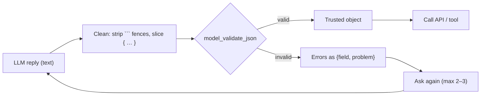

# Chapter 5: Validating LLM output

*A model returns text. Pydantic decides whether your code may trust it.*

> [!NOTE]
> **📍 At a glance**
> - **You will learn:** validating raw model JSON, checking tool arguments before side effects, retry-with-errors, and native strict structured output
> - **Level:** intermediate · **Time:** about 20 minutes
> - **Builds on:** [Chapters 1 to 4](01-why-pydantic-and-basemodel.md) · **Leads to:** [Langchain Ch 4](../langchain/04-structured-output.md), [LLM Ch 2](../llm/02-the-agentic-loop-in-pure-python.md)

---

## 5.1 Model output is untrusted input



```python
class WeatherQuestion(BaseModel):
    city: str
    wants_fahrenheit: bool = False

WeatherQuestion.model_validate_json('{"city": "Tokyo"}')          # ok
WeatherQuestion.model_validate_json('{"city": 3, "x": }')         # ValidationError (json_invalid)
```

- `model_validate_json` parses **and** validates; JSON errors arrive as validation errors
- Common real-world replies to handle:

| Reply | What happens |
|---|---|
| ` ```json {...}``` ` | fails unless you strip the fence first |
| `Sure! {...}` | fails; slice from first `{` to last `}` |
| `"wants_fahrenheit": "true"` | coerced to `True` (lax mode) |
| extra key | ignored by default; `extra="forbid"` to reject |
| a JSON **list** instead of an object | `Model(**data)` raises `TypeError`, so catch it or use `model_validate_json` |

- Non-model shapes: `TypeAdapter(list[int]).validate_python(["1", "2"])` → `[1, 2]`

## 5.2 Validate tool arguments before the call

```python
KNOWN = {"USD", "INR", "EUR", "GBP", "JPY"}

class ConvertArgs(BaseModel):
    amount: float = Field(gt=0)
    from_currency: str
    to_currency: str

    @field_validator("from_currency", "to_currency")
    @classmethod
    def known(cls, v: str) -> str:
        v = v.upper().strip()
        if v not in KNOWN:
            raise ValueError(f"{v!r} not in {KNOWN}")
        return v

def convert_safely(raw: dict) -> float | str:
    try:
        a = ConvertArgs(**raw)
    except ValidationError as e:
        return f"Rejected before the API call: {e}"      # goes back to the model as the tool result
    return convert_currency(a.amount, a.from_currency, a.to_currency)
```

- Bad arguments fail fast: **no network call, no cost, no side effect**
- One `field_validator` can cover several fields; the tool itself stays a plain function

## 5.3 Retry with structured errors

```python
def ask_validated(question, Model, ask_model, max_tries=3):
    prompt = question
    for _ in range(max_tries):
        raw = ask_model(prompt)
        try:
            return Model.model_validate_json(raw)
        except ValidationError as e:
            problems = [{"field": ".".join(map(str, x["loc"])), "problem": x["msg"]} for x in e.errors()]
            prompt = f"{question}\nYour last reply was invalid. Fix and reply with JSON only:\n{json.dumps(problems)}"
    raise RuntimeError(f"No valid reply after {max_tries} tries")
```

- Send `loc` + `msg`, not the whole exception: shorter, clearer, fewer tokens
- **Cap at 2–3 tries.** Repeated failure on one field = fix the schema or its `description`

## 5.4 Native structured output (strict schemas)

```python
completion = client.chat.completions.parse(
    model="gpt-4o-mini",
    messages=[{"role": "user", "content": "Weather in Tokyo, in Fahrenheit?"}],
    response_format=WeatherQuestion,
)
completion.choices[0].message.parsed     # WeatherQuestion, or None on refusal
```

- The SDK sends `Model.model_json_schema()`, the provider **constrains decoding**, the SDK validates into your class
- **Strict mode changes meaning:** every field becomes `required` and `additionalProperties: false`; a default only applies when *you* build the object, so use `X | None` for optional fields
- LangChain equivalent: `with_structured_output(Model)` / `response_format=` ([Langchain Ch 4](../langchain/04-structured-output.md))

| Approach | Guarantees | You still need |
|---|---|---|
| "Reply with JSON" in prompt | nothing | cleaning, validation, retry |
| Tool calling | args roughly match schema | value validation |
| Strict structured output | reply matches schema | value + business-rule validation, refusal and truncation handling |

> [!IMPORTANT]
> **🏭 In production**
> - **Validate even in strict mode:** schema = shape; `Field()` and validators = values and rules
> - **Handle refusals and truncation** (`parsed is None`, or JSON cut at `max_tokens`)
> - **Log raw reply + error `type`**; count failures per field
> - **Version schemas:** renaming a field silently breaks prompts, stored outputs and consumers

> [!CAUTION]
> **🔒 Security:** prompt injection can make a model return *valid* but harmful arguments (`to="attacker@example.com"`). Validation is necessary, not sufficient: add allow-lists, least privilege and human approval for irreversible tools. **Valid ≠ true.**

## Interview corner

<details class="qa"><summary>1. Why validate LLM output, and where?</summary>

- It is untrusted external input; validate at the boundary, before any side effect

</details>

<details class="qa"><summary>2. Validation failed. Now what?</summary>

- Retry with `{field, problem}` errors, capped at 2–3; log the raw reply; recurring failures mean the schema needs work

</details>

<details class="qa"><summary>3. With strict structured output, do you still need Pydantic?</summary>

- Yes: strict guarantees shape, not value limits, cross-field rules or truth; it also makes all fields required, so model optionals as `X | None`

</details>

<details class="qa"><summary>4. How can an attacker abuse validated tool arguments?</summary>

- Prompt injection yields valid-but-malicious values; add allow-lists, least-privilege tools, human approval

</details>

> [!TIP]
> **🧩 Design question:** extract invoices (vendor, date, line items, total) from PDFs. Cover: nested model with `Decimal`/`date`, a `model_validator` that items sum to total, strict output + validation, capped retry, human review queue, audit logs.

## Cheat sheet

```python
schema = Model.model_json_schema()            # hand to the model
try:
    obj = Model.model_validate_json(raw)
except ValidationError as e:
    fix = [{"field": ".".join(map(str, x["loc"])), "problem": x["msg"]} for x in e.errors()]
    # resend fix, max 2–3 tries
```

## Practice

1. Validate a fenced, a prefixed ("Sure! …") and a list reply; make all three behave
2. Write `ask_validated` against a scripted model that fails once
3. Print the strict schema for a model with a default and explain `required`

---

*Source: Live-Class-2026 classes 03–04 and files `_8`–`_10`, `Project 0/_03`; retry, strict-schema, production and security sections added by Claude (tested with Pydantic 2.13 and openai SDK offline). Docs: [OpenAI structured outputs](https://platform.openai.com/docs/guides/structured-outputs).*

Previous: [Chapter 4](04-nested-models-and-inheritance.md)
