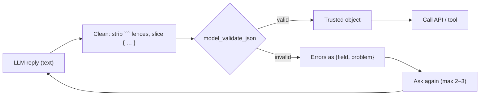

# Chapter 5: Validating LLM output

*A model returns text. Pydantic decides whether your code may trust it.*

> [!NOTE]
> **📍 At a glance**
> - **You will learn:** validating raw model JSON, checking tool arguments before side effects, retry-with-errors, and native strict structured output
> - **You will build:** the class's currency validator for raw LLM JSON, a validated tool that never calls the API with bad arguments, a retry loop, and a strict structured-output call
> - **Level:** intermediate · **Time:** about 30 minutes
> - **Builds on:** [Chapters 1 to 4](01-why-pydantic-and-basemodel.md) · **Leads to:** [Langchain Ch 4](../langchain/04-structured-output.md), [LLM Ch 2](../llm/02-the-agentic-loop-in-pure-python.md)

**After this chapter you can:**

- Validate a model's raw JSON reply, and clean the common broken forms first
- Check tool arguments before any network call or side effect
- Send `{field, problem}` errors back to the model and retry, with a cap
- Use native strict structured output, and say what it does and doesn't guarantee

---

## 5.1 Model output is untrusted input



```python
class WeatherQuestion(BaseModel):
    city: str
    wants_fahrenheit: bool = False

WeatherQuestion.model_validate_json('{"city": "Tokyo"}')          # ok
WeatherQuestion.model_validate_json('{"city": 3, "x": }')         # ValidationError (json_invalid)
```

- `model_validate_json` parses **and** validates; JSON errors arrive as validation errors
- The class's version (`_8_pydantic_with_ai.py`, Part 6). Its `StrictAmount` has `amount: float = Field(gt=0)` and a currency validator like the one in 5.2:

```python
llm_clean_output = '{"amount": 300, "currency": "usd"}'
StrictAmount.model_validate_json(llm_clean_output)        # amount=300.0 currency='USD'

llm_messy_output = '{"amount": "a few hundred", "currency": "dollars"}'
StrictAmount.model_validate_json(llm_messy_output)
# 2 validation errors: amount  float_parsing · currency  'DOLLARS' isn't a recognized currency
```

- *Tested:* both errors came back in one exception, before any code used the values
- Common real-world replies to handle:

| Reply | What happens |
|---|---|
| ` ```json {...}``` ` | fails unless you strip the fence first |
| `Sure! {...}` | fails; slice from first `{` to last `}` |
| `"wants_fahrenheit": "true"` | coerced to `True` (lax mode) |
| extra key | ignored by default; `extra="forbid"` to reject |
| a JSON **list** instead of an object | `Model(**data)` raises `TypeError`, so catch it or use `model_validate_json` |

- Non-model shapes: `TypeAdapter(list[int]).validate_python(["1", "2"])` → `[1, 2]`

## 5.2 Validate tool arguments before the call

```python
KNOWN = {"USD", "INR", "EUR", "GBP", "JPY"}

class ConvertArgs(BaseModel):
    amount: float = Field(gt=0)
    from_currency: str
    to_currency: str

    @field_validator("from_currency", "to_currency")
    @classmethod
    def known(cls, v: str) -> str:
        v = v.upper().strip()
        if v not in KNOWN:
            raise ValueError(f"{v!r} not in {KNOWN}")
        return v

def convert_safely(raw: dict) -> float | str:
    try:
        a = ConvertArgs(**raw)
    except ValidationError as e:
        return f"Rejected before the API call: {e}"      # goes back to the model as the tool result
    return convert_currency(a.amount, a.from_currency, a.to_currency)
```

- Bad arguments fail fast: **no network call, no cost, no side effect**
- This is the class's `_9_api_call_with_structure.py` (`convert_currency_validated`), and `_10` wraps the same tool in the `@tool` registry
- *Tested with a counting stand-in for `requests.get`:* `{"amount": -50, "from_currency": "dollars", "to_currency": "inr"}` was rejected with 2 errors and made **0** network calls; good arguments made 1
- One `field_validator` can cover several fields; the tool itself stays a plain function

## 5.3 Retry with structured errors

```python
def ask_validated(question, Model, ask_model, max_tries=3):
    prompt = question
    for _ in range(max_tries):
        raw = ask_model(prompt)
        try:
            return Model.model_validate_json(raw)
        except ValidationError as e:
            problems = [{"field": ".".join(map(str, x["loc"])), "problem": x["msg"]} for x in e.errors()]
            prompt = f"{question}\nYour last reply was invalid. Fix and reply with JSON only:\n{json.dumps(problems)}"
    raise RuntimeError(f"No valid reply after {max_tries} tries")
```

- Send `loc` + `msg`, not the whole exception: shorter, clearer, fewer tokens
- **Cap at 2–3 tries.** Repeated failure on one field = fix the schema or its `description`

## 5.4 Native structured output (strict schemas)

```python
completion = client.chat.completions.parse(
    model="gpt-4o-mini",
    messages=[{"role": "user", "content": "Weather in Tokyo, in Fahrenheit?"}],
    response_format=WeatherQuestion,
)
completion.choices[0].message.parsed     # WeatherQuestion, or None on refusal
```

- The SDK sends `Model.model_json_schema()`, the provider **constrains decoding**, the SDK validates into your class
- *Tested (`openai` 3.51.0) against a local server speaking the OpenAI API:* `parse()` returned `WeatherQuestion(city='Tokyo', wants_fahrenheit=True)`. The strict schema the SDK built listed **both** fields as `required`, though `wants_fahrenheit` has a default
- **Strict mode changes meaning:** every field becomes `required` and `additionalProperties: false`; a default only applies when *you* build the object, so use `X | None` for optional fields
- LangChain equivalent: `with_structured_output(Model)` / `response_format=` ([Langchain Ch 4](../langchain/04-structured-output.md))

| Approach | Guarantees | You still need |
|---|---|---|
| "Reply with JSON" in prompt | nothing | cleaning, validation, retry |
| Tool calling | args roughly match schema | value validation |
| Strict structured output | reply matches schema | value + business-rule validation, refusal and truncation handling |

> [!IMPORTANT]
> **🏭 In production**
> - **Validate even in strict mode:** schema = shape; `Field()` and validators = values and rules
> - **Handle refusals and truncation** (`parsed is None`, or JSON cut at `max_tokens`)
> - **Log raw reply + error `type`**; count failures per field
> - **Version schemas:** renaming a field silently breaks prompts, stored outputs and consumers

> [!CAUTION]
> **🔒 Security:** prompt injection can make a model return *valid* but harmful arguments (`to="attacker@example.com"`). Validation is necessary, not sufficient: add allow-lists, least privilege and human approval for irreversible tools. **Valid ≠ true.**

## 5.5 Added by Claude, not from the sources

- **Log the raw reply next to the error**, so a failure can be reproduced without calling the model again
- **Keep the error message short when you retry**: field and problem, never the whole traceback
- **Treat a refusal as an answer**, not a parsing failure; don't retry it blindly
- **Never let validated arguments skip authorisation.** A valid `account_id` may still belong to someone else

## Interview corner

**What interviewers listen for:** you treat model output as untrusted input, you validate before side effects, and you know what strict structured output does not guarantee.

### 🟢 Basic

<details class="qa"><summary>1. Why validate LLM output, and where?</summary>

- It is untrusted external input; validate at the boundary, before any side effect
- *Stronger answer:* validate tool arguments too, not just final answers, because they cause the side effects

</details>

### 🟡 Intermediate

<details class="qa"><summary>2. Validation failed. Now what?</summary>

- Retry with `{field, problem}` errors, capped at 2–3; log the raw reply; recurring failures mean the schema needs work
- *Stronger answer:* count failures per field; one field failing often means its `description` or type is unclear

</details>

<details class="qa"><summary>3. With strict structured output, do you still need Pydantic?</summary>

- Yes: strict guarantees shape, not value limits, cross-field rules or truth; it also makes all fields required, so model optionals as `X | None`
- *Stronger answer:* strict mode supports only a subset of JSON Schema, which differs by provider, so check its list; Pydantic still enforces every limit afterwards

</details>

### 🔴 Senior

<details class="qa"><summary>4. How can an attacker abuse validated tool arguments?</summary>

- Prompt injection yields valid-but-malicious values; add allow-lists, least-privilege tools, human approval
- *Stronger answer:* scope each tool to the current user (the user id comes from your app, never from the model) and require approval for anything irreversible

</details>

> [!TIP]
> **🧩 Design question:** extract invoices (vendor, date, line items, total) from PDFs. Cover: nested model with `Decimal`/`date`, a `model_validator` that items sum to total, strict output + validation, capped retry, human review queue, audit logs.

## Cheat sheet

```python
schema = Model.model_json_schema()            # hand to the model
try:
    obj = Model.model_validate_json(raw)
except ValidationError as e:
    fix = [{"field": ".".join(map(str, x["loc"])), "problem": x["msg"]} for x in e.errors()]
    # resend fix, max 2–3 tries
```

## Recap

- Model output is untrusted input: clean, then `model_validate_json`
- Validate tool arguments before the call: no network, no cost, no side effect on bad input
- Retry with `{field, problem}` pairs, at most 2–3 times
- Strict structured output guarantees shape, not values; every field becomes required
- Valid is not true and not allowed: add allow-lists, scoping and approval

## Practice

1. Validate a fenced, a prefixed ("Sure! …") and a list reply; make all three behave
2. Write `ask_validated` against a scripted model that fails once
3. Print the strict schema for a model with a default and explain `required`
4. Run the class's `_9` with bad arguments and prove no network call happened

## How this chapter was checked

- **Run offline** with `pydantic` 2.14.3 and `openai` 3.51.0
- **5.1:** the reply table and `TypeAdapter` in the 2026 review (Pydantic 2.13); `_8` Part 6 as written on 2.14.3: the clean reply parsed, the messy one gave 2 errors
- **5.2:** `_9` and `_10` as written, with `requests.get` replaced by a counting stand-in: 0 calls for bad arguments, 1 for good
- **5.3:** `ask_validated` against a scripted model that failed once, in the 2026 review
- **5.4:** `client.chat.completions.parse(...)` against a local fake OpenAI server returned the parsed object; `openai.lib._pydantic.to_strict_json_schema` listed every field as required with `additionalProperties: false`
- **Not run:** a real provider call

## Sources and further reading

- Live-Class-2026, `Weekend 01 .../_8_pydantic_with_ai.py` (Part 6), `_9_api_call_with_structure.py`, `_10_tool_with_ai_call.py` (re-read in full 2026-11-15)
- Live-Class-2026, Weekend 02 `Project 0/_03_structuring_with_pydantic.py` and the Class 03–04 summaries (earlier batches)
- [OpenAI structured outputs](https://platform.openai.com/docs/guides/structured-outputs)
- Added by Claude: retry (5.3), the strict-schema section, the 🏭 and 🔒 boxes, 5.5

Previous: [Chapter 4](04-nested-models-and-inheritance.md)
