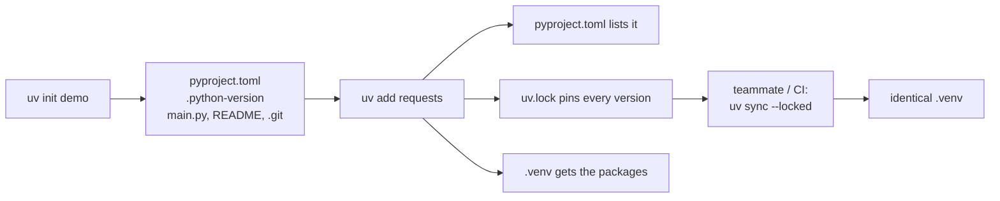
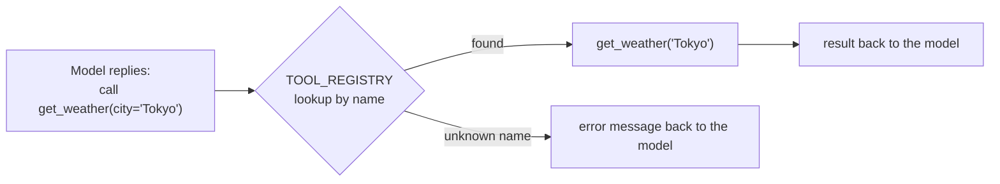

# Chapter 1: Setup and API basics

*Everything an agent is built from, before any AI: a clean project, plain Python, and a safe API call.*

> [!NOTE]
> **📍 At a glance**
> - **You will learn:** UV projects and virtual environments, Python basics with their agent meaning, safe HTTP calls, and what a "tool" really is
> - **You will build:** a `uv` project, a currency API call with timeout and error handling, and a `@tool` registry
> - **Level:** beginner · **Time:** about 45 minutes
> - **Builds on:** [LLM Ch 1](../llm/01-course-roadmap-and-prerequisites.md) (the setup checklist). **Leads to:** [Chapter 2](02-python-refresher.md)

**After this chapter you can:**

- Set up a Python project with UV and explain each file it creates
- Write the basic Python an agent is built from
- Call a web API with `requests`, with a timeout and error handling
- Make that call production-ready: a session, retries with backoff, and keys from `.env`
- Explain what a "tool" is in plain Python, and why the registry exists

## 1.1 The development environment

- Pick your terminal first. Mac and Linux already have a good one
- On Windows use **Git Bash** or **Windows Terminal**, not plain CMD or PowerShell
  - Many Linux-style commands fail on CMD. Almost every cloud machine runs Linux
- Install in this order: Python 3.10 or newer, **UV**, **VS Code**

*Source: Live-Class-2026, `classes_summary/01` and `classes_transcription_summary/01`.*

### Why UV

- One fast tool replacing `pip`, `venv` and `conda`/`poetry`
- A single file records the exact Python version and libraries, so a teammate rebuilds the same setup. The same job `package.json` does in Node
- UV is a **package manager** (installs packages) and a **project manager** (keeps the Python version and package list together)
- The slide says UV is "10-100x faster than pip etc." That is the slide's claim; it was not measured here
- The slide crosses out Anaconda, Miniconda and Conda. The transcript is gentler: keep conda if you already use it, but do not mix conda and UV commands in one project

### What you need installed

- Python, UV, VS Code and a terminal
- Develop in a terminal. Windows has no real one by default, hence Git Bash or Windows Terminal
- The class advised against using an office laptop

### Check your Python version

- Run `python3 --version` **and** `python --version`
- The slide's example shows two answers on one machine (3.13.2 and 3.12.9). Both should be 3.10 or newer
- Versions live side by side, like Windows or Office versions

*Source: `Class-1-Python-and-AI.pdf` (class 01 whiteboard), `classes_transcription_summary/01`.*

### Virtual environments: the "room" idea

- A virtual environment is a room
  - `uv venv` builds it. Activating it (`source .venv/bin/activate`) walks you in
  - What you install inside stays inside. `deactivate` walks you out
- Outside: your base Python and global packages. Inside: starts empty until you install something
- Each project can have its own Python version and packages, so projects never conflict
- The slide draws one machine with several rooms: a venv on 3.12 with no packages, one on 3.13 with a few, and a terminal Python (3.12.9) beside a venv Python (3.13.2) holding `requests`

```bash
uv venv                      # build the room
source .venv/bin/activate    # walk in (Windows: .venv\Scripts\activate)
uv add requests              # install inside the room (or: uv pip install requests)
deactivate                   # walk out
```

### Project mode: `uv init`

`uv init my-first-project` makes a project folder. The slide's table:

| File or folder | Created by `uv init`? | Purpose | Edit it? |
|---|---|---|---|
| `.venv/` | No. `uv venv` or `uv sync` | The environment: interpreter, packages, activation scripts | No |
| `.python-version` | Yes | The Python version the project should use (such as `3.12`) | Rarely |
| `main.py` | Yes | Starter file, the entry point | Yes |
| `pyproject.toml` | Yes | The heart of the project: name, version, dependencies, build and tool settings | Yes |
| `README.md` | Yes | What the project does and how to run it | Yes |
| `uv.lock` | Only after you add dependencies or run `uv sync` | The exact version of every dependency, including indirect ones | No (generated) |

*Source: the class 01 whiteboard. An earlier version of this chapter said `uv.lock` comes from `uv init`; the slide says otherwise, so that line was corrected.*

✅ *Verified with uv 0.11.32:* `uv init` created `.git`, `.gitignore`, `.python-version`, `README.md`, `main.py` and `pyproject.toml`, and **no** `.venv` or `uv.lock`. The first `uv run main.py` then created both `.venv` and `uv.lock`, even with no dependencies. `requires-python` in `pyproject.toml` was `>=3.13`, matching `.python-version`.



To run the class scaffold `my-first-project` on a fresh machine:

```bash
uv sync          # install what pyproject.toml lists
uv run main.py   # run the script
```

Starter `main.py`:

```python
def main():
    print("Hello from my-first-project!")

if __name__ == "__main__":
    main()
```

- The class asked you to look up `if __name__ == "__main__":` yourself and promised an explanation later
- The block runs only when the file is **run directly**, not when it is imported. ✅ *Verified:* a file printing `__name__` showed `__main__` when run and `nm` when imported

| Question | Answer |
|---|---|
| `requirements.txt` or `pyproject.toml`? | UV reads only `pyproject.toml`, and honours whichever command (`uv add` or `pip install -r requirements.txt`) was run **last**. Pick one workflow; do not mix them |
| Must I activate the environment? | No. `uv run` in project mode also works. Both are valid |
| Change the Python version? | `uv python upgrade` (the command exists in uv 0.11.32) |
| Already use conda? | Keep it if you like; do not mix with UV in one project |

### Why VS Code and not Jupyter notebooks

- The course is about agents, not data science
- The work is `.py` scripts, a real terminal (you will log into cloud machines) and debugging. VS Code gives all three
- Notebooks still appear in some demos

## 1.2 Python fundamentals, with the agent meaning attached

- A variable is a labelled box. The type says what may go inside
- `Python_foundamentals.py` captions each basic line with its role in an agent:

```python
city = "Tokyo"                    # str   -- a tool ARGUMENT looks like this
temperature = 22.5                # float -- a tool RESULT often looks like this
is_raining = False                # bool  -- a DECISION inside an agent looks like this
forecast = [22.5, 23.1, 21.8]     # list  -- a sequence of readings, in order

print(f"That's {temperature * 9 / 5 + 32:.1f}°F.")   # math works inside { }; :.1f rounds to 1 decimal

for day_temp in forecast:
    if day_temp > 23:
        print(f"{day_temp}°C — warm day")
    else:
        print(f"{day_temp}°C — mild day")
```

- ✅ *Verified:* it prints the four types, `That's 72.5°F.`, `No umbrella needed.`, then mild, warm, mild. The closing line prints only when run directly
- `notebook.ipynb` repeats the variables (with `city = "Delhi"`) and the f-string demo
- **No type declarations:** `x = 5`, not `int x = 5`
- **f-strings** put variables, even small calculations, into text
- **Functions need docstrings.** Agent tooling reads the docstring to tell the model what a function does

*Source: `classes_summary/01`, `Python_foundamentals.py`.*

## 1.3 APIs, before any framework

- An API call: your code asks a service for data and gets a response
- Class analogy: a keypad phone with no internet, you phone a travel agent for a Dubai flight price, and they call back
  - You are the code, the agent is the API, the data source is where the agent looks

`currency.py` calls a free API that needs no key:

```python
import requests

BASE = "https://api.frankfurter.app"
params = {"from": "USD", "to": "INR", "amount": 100}

try:
    response = requests.get(f"{BASE}/latest", params=params, timeout=10)  # hang up after 10 s
    response.raise_for_status()
    converted_amount = response.json()["rates"]["INR"]
    print(f"100 USD = {converted_amount:.2f} INR")
except requests.exceptions.RequestException as e:
    print("Request failed:", e)
```

- `timeout=10`: stops waiting forever, like hanging up when nobody answers
- `raise_for_status()`: turns an HTTP error (404, 500) into an exception
- `try/except`: handles a failed call
- Every LLM call later (OpenAI, Anthropic, Groq) has this shape: send a request, get structured data, handle failure
- In class the live rate was checked against a web search

*Source: `classes_summary/01`, `classes_transcription_summary/01`, `currency.py`. Copied from the class code; not run here (no network to the API).*

## 1.4 The first idea of a "tool"

A tool is a function with a docstring and a return value. From `functions or tools.py`:

```python
def get_current_time() -> str:
    """Return the current time as a human-readable string."""
    return time.strftime("%Y-%m-%d %H:%M:%S")

def get_weather(city: str) -> str:
    """Return the current weather for `city`. (Mock data for teaching.)"""
    return fake_weather_data.get(city.lower(), f"No weather data for {city!r}")
```

`tools.py` adds a `@tool` decorator that times each call and registers the function by name (decorators: [Chapter 2](02-python-refresher.md)):

```python
TOOL_REGISTRY: dict[str, Callable] = {}

def tool(func: Callable) -> Callable:
    @functools.wraps(func)
    def wrapper(*args, **kwargs):
        start = time.perf_counter()
        result = func(*args, **kwargs)
        elapsed_ms = (time.perf_counter() - start) * 1000
        print(f"[tool call] {func.__name__}({args}, {kwargs}) -> {result!r}  ({elapsed_ms:.2f} ms)")
        return result
    TOOL_REGISTRY[func.__name__] = wrapper
    return wrapper

@tool
def calculator(expression: str) -> float:
    """Safely evaluate a simple arithmetic expression, e.g. '12 * (4 + 1)'."""
    allowed_characters = set("0123456789+-*/(). ")
    if not set(expression) <= allowed_characters:
        raise ValueError(f"Expression contains characters that aren't allowed: {expression!r}")
    return eval(expression)  # safe here ONLY because of the character check above
```

> [!CAUTION]
> **🔒 Security: `eval` on text a model chose**
> - `eval` runs any Python. It is acceptable here only because the character check runs first
> - The class feeds it `"12 + ; DROP TABLE users;"` to show the guard rejects it
> - Even with the guard, `9**9**9` passes and hangs the process (1.8). In real tools use a proper expression parser, never `eval`


- **Why the registry exists:** when a model answers "call `get_weather`", your code must find the real function by name. The registry is the lookup
- Three tools are registered: `get_current_time`, `calculator`, `get_weather`

The demo at the bottom:

```python
if __name__ == "__main__":
    get_current_time(); calculator("12 * (4 + 1)"); get_weather("Tokyo")
    print("\nRegistered tools:", list(TOOL_REGISTRY.keys()))
    try:
        calculator("12 + ; DROP TABLE users;")
    except ValueError as exc:
        print(f"Caught cleanly, nothing crashed: {exc}")
```

- Why the `try/except`: a tool that crashes the program on bad input cannot be trusted when an AI calls it
- ✅ *Verified:* three `[tool call]` lines (the calculator returned `60`, the weather tool `22°C, partly cloudy`), then `Registered tools: ['get_current_time', 'calculator', 'get_weather']`, then the "Caught cleanly" line

*Source: `classes_summary/01`, `functions or tools.py`, `tools.py`. A comment in `tools.py` names the agent loop as "Class 4"; the course index puts it in Class 05, so that number is not repeated.*

## 1.5 Why frameworks come last

- Rule of thumb: an agent is a concept. Learn it in plain Python first, then use LangChain
- This book and the [Pydantic book](../pydantic/01-why-pydantic-and-basemodel.md) are that plain-Python phase

## 1.6 Run the class code

```bash
uv venv && source .venv/bin/activate   # Windows: .venv\Scripts\activate
uv add requests
uv run currency.py
```

| File | What it is |
|---|---|
| `Python_foundamentals.py` | Variables, types, f-strings, control flow, functions, docstrings |
| `OOPS.py` | An OOP outline, comments only ([Chapter 2](02-python-refresher.md)) |
| `currency.py` | Live currency API call with `requests` |
| `functions or tools.py`, `tools.py` | Plain functions that preview tools, then the `@tool` registry |
| `notebook.ipynb` | Companion exploration notebook |
| `my-first-project/` | A real `uv init` project |

*Source: the folder's `README.md`.*

## Questions from the class (class 01)

| Question | Answer |
|---|---|
| Is the course right for non-tech or semi-tech people? | Doable, but expect roughly **double the class time** in self-effort. It assumes basic developer comfort |
| GitHub Copilot or Claude Code? | The mentor personally finds Claude Code better for development (his view). GitHub Copilot is covered in the course |
| Is there a tool to understand an unfamiliar codebase? | No magic tool. Feed the repo and docs to Claude or ChatGPT (for example through a GitHub MCP) and ask for a summary |
| Help finding AI use cases at work? | A handbook mapping AI opportunities across industries is to be shared (see [LLM Ch 1](../llm/01-course-roadmap-and-prerequisites.md), 1.8) |
| Should I code along in class? | No. Watch and understand live, then practise with the recording |
| Do I need Python experience? | Helpful, not mandatory. Beginners should reinforce basics fast |
| Will Microsoft Copilot Studio be covered? | Only if the mentor can get access |

- After class: install Python 3.10+, UV and VS Code; Windows users install Git Bash or Windows Terminal; redo the commands from the recording
- Left out: ground rules and two job referrals (not teaching content)

*Source: `classes_transcription_summary/01`, Q&A and action items.*

## 1.7 Production-grade HTTP calls

The class call is correct for learning. In a service that runs all day, add four things.

```python
import os
import requests
from dotenv import load_dotenv
from requests.adapters import HTTPAdapter
from urllib3.util.retry import Retry

load_dotenv()                                   # reads .env into os.environ
API_KEY = os.environ["WEATHER_API_KEY"]         # fails at start-up if missing

session = requests.Session()                    # reuses connections between calls
retry = Retry(total=3, backoff_factor=0.5,      # waits 0.5 s, 1 s, 2 s between tries
              status_forcelist=[429, 500, 502, 503, 504],
              allowed_methods=["GET"])          # only retry calls that are safe to repeat
session.mount("https://", HTTPAdapter(max_retries=retry))

r = session.get("https://api.example.com/weather", params={"city": "Tokyo"},
                headers={"Authorization": f"Bearer {API_KEY}"},
                timeout=(3.05, 10))             # (connect, read) seconds
r.raise_for_status()
```

- **Session:** one connection pool instead of a new handshake per call, noticeably faster for many calls
- **Retries with backoff:** temporary failures (rate limits, a busy server) usually pass on a second try. `Retry` also honours a server's `Retry-After` header by default
- **Two timeouts:** a short one for connecting, a longer one for reading the answer
- **Keys from `.env`** via `python-dotenv` (`uv add python-dotenv`), never in the code
- ✅ *Verified (requests 2.34.2, urllib3 2.8.0): the session and retry policy build as written, and `respect_retry_after_header` is `True`; no live call was made.*

| Response | Retry? | What to do |
|---|---|---|
| Timeout, connection error | Yes, if the call is safe to repeat | Backoff, then return a clear message |
| `429` Too Many Requests | Yes | Wait (`Retry-After`), then retry; reduce your call rate |
| `500`, `502`, `503`, `504` | Yes, a few times | Backoff; alert if it continues |
| `400`, `422` | No | Your request is wrong: fix the arguments |
| `401`, `403` | No | Key missing, wrong or without permission |
| `404` | No | Wrong URL or the item does not exist |

> [!IMPORTANT]
> **🏭 In production**
> - **Only retry idempotent calls** (reads, or writes with an idempotency key). Retrying a payment `POST` can charge twice
> - **Many calls at once?** `httpx.AsyncClient` with `asyncio.gather` runs them in parallel ([Chapter 2](02-python-refresher.md), 2.9)
> - **Log the status code and duration**, never the `Authorization` header
> - **Pin dependencies in deployment:** `uv sync --locked` fails if `uv.lock` is out of date, so CI and Docker install exactly what you tested
>
> *Added by Claude.*

## 1.8 Added by Claude, not from the sources

- **`uv init` does not ignore `.env`.** ✅ *Verified:* the generated `.gitignore` lists only Python build files and `.venv`. The "`.env` is git-ignored" line in the prerequisites is about the **course repo's** root file. In your own project, add `.env` to `.gitignore` before the first commit
- **`uv init --no-vcs` is rejected.** ✅ *verified* with uv 0.11.32: "unexpected argument '--no-vcs'". The working form is `uv init --vcs none`, which made a project with no `.git`
- **`eval` can still hang.** The character check allows `*`, so `9**9**9` passes and does not finish ([LLM Ch 2](../llm/02-the-agentic-loop-in-pure-python.md), 2.10)
- **Two Frankfurter URLs appear in the course** (`api.frankfurter.app` here, `api.frankfurter.dev/v1` in Chapter 2). Neither was reachable from my sandbox, so I cannot say which is current
- **Use `python3 -m pip` or `uv pip`,** not a bare `pip`, so the package lands in the interpreter you mean
- **Docstrings matter twice.** For you, and as the description a framework sends to the model ([Langchain Ch 5](../langchain/05-tools.md))

## 1.9 Interview corner

**What interviewers listen for:** reproducible environments (lock files), every network call with a timeout and error handling, and safe handling of input that a model chooses.

### 🟢 Basic

<details class="qa"><summary>1. Why UV and not pip plus venv?</summary>

- One tool for the Python version, the environment and dependencies, with a lock file
- *Stronger answer:* `uv.lock` plus `uv sync --locked` gives the same install on every laptop, CI run and container

</details>

<details class="qa"><summary>2. What is a virtual environment, and why use one?</summary>

- An isolated set of packages per project, so different projects' versions never conflict

</details>

<details class="qa"><summary>3. What does <code>if __name__ == "__main__":</code> do?</summary>

- Runs the block only when the file is executed directly, not when it is imported
- *Stronger answer:* keeps demo code from running when another module imports your tools

</details>

<details class="qa"><summary>4. What is a tool, in plain Python?</summary>

- A function with a clear docstring and a return value; a registry finds it by the name a model gives
- *Stronger answer:* the docstring and type hints become the description and schema the model reads

</details>

### 🟡 Intermediate

<details class="qa"><summary>5. <code>pyproject.toml</code>, <code>requirements.txt</code> or <code>uv.lock</code>?</summary>

- `pyproject.toml` lists what you depend on; `uv.lock` pins exact versions of everything, including indirect packages
- *Stronger answer:* commit both, never edit the lock by hand, and do not mix `uv add` with `pip install -r` in one project

</details>

<details class="qa"><summary>6. Why always pass <code>timeout</code> to <code>requests</code>?</summary>

- Without it a call can wait forever and freeze the program or agent
- *Stronger answer:* use a (connect, read) pair, and treat a timeout as a normal, handled outcome

</details>

<details class="qa"><summary>7. Why guard a calculator tool before <code>eval</code>?</summary>

- `eval` runs any code; a model or an attacker chooses the string
- *Stronger answer:* the guard still lets `9**9**9` hang the process; use a real expression parser

</details>

### 🔴 Senior

<details class="qa"><summary>8. An API your agent calls sometimes hangs and sometimes returns 429. Fix it.</summary>

- Timeouts on every call; retry 429 and 5xx with exponential backoff and `Retry-After`
- *Stronger answer:* cap total retries, retry only idempotent calls, add a circuit breaker so a dead service fails fast, and return a readable message to the model

</details>

<details class="qa"><summary>9. Where do API keys live, from laptop to production?</summary>

- `.env` (git-ignored) on a laptop, read with `python-dotenv`
- *Stronger answer:* in production, a secret manager injects them as environment variables; rotate them, scope them to least privilege, never log them

</details>

> [!TIP]
> **🧩 Design question**
> - *"An agent needs three external APIs: weather, currency and news. How do you structure the code?"*
> - Talk about: one small client module per API with a shared session, timeouts and retries; typed tool functions with docstrings; a registry; errors returned as messages; keys from the environment; logging of status and duration

## Cheat sheet

```bash
uv init demo && cd demo
uv add requests python-dotenv      # updates pyproject.toml + uv.lock, creates .venv
uv run main.py                     # no activation needed
uv sync --locked                   # CI / Docker: install exactly what uv.lock says
echo ".env" >> .gitignore          # before the first commit
```

```python
r = requests.get(url, params={"q": "x"}, timeout=(3.05, 10))
r.raise_for_status()               # HTTP errors become exceptions
data = r.json()
```

## Recap

- Terminal, Python 3.10+, UV, VS Code. Check both `python3` and `python`
- `uv.lock` + `uv sync --locked` = the same install everywhere
- Virtual environment = a room. `uv init` makes the project files; `uv sync` or `uv run` makes `.venv` and `uv.lock`
- Types, f-strings and docstrings are the agent vocabulary
- API call: request, `timeout`, `raise_for_status`, `try/except`
- A tool = function + docstring + registry entry. Guard its input
- Production calls: session, timeouts, retries with backoff for 429 and 5xx only, keys from `.env`

## Practice

1. Install Python 3.10+, UV and VS Code; run `uv venv`, activate, `uv add requests`, `deactivate`
2. Run `uv init demo`, list the files, then run `uv run main.py` and list them again
3. Re-run `currency.py` and check the rate against a web search
4. Run `tools.py`, then break `calculator("2 + ; DROP TABLE")` on purpose
5. Put `.env` into the `.gitignore` of a new project
6. Add a `Retry` policy to `currency.py` and list which status codes it retries

## How this chapter was checked

- **Run:** `Python_foundamentals.py`, `tools.py`, `functions or tools.py`; `uv init` and `uv run` (file lists before and after, `.gitignore`, `.python-version`); `--no-vcs` versus `--vcs none`; `uv python upgrade --help`; the `__name__` demo
- **Not run:** `currency.py` and the live API; installing Python, UV or VS Code; `uv add requests` (no network)
- **Run in the 2026 review:** the 1.7 session and retry set-up (no live call), `uv sync --help` for `--locked`, the cheat-sheet `uv` commands
- **Cheat sheet:** the `uv` commands were run in a scratch folder; the Python lines need a live URL and were not run
- 1.7, the diagrams, the security box and the graded interview were added in the 2026 review (Added by Claude: standard practice)
- The body was written earlier from the class summaries and whiteboard, which were not re-opened in this pass

## Sources and further reading

- Live-Class-2026, `classes_summary/01 - 27 Jun - Python Setup & API Basics.md`
- Live-Class-2026, `classes_transcription_summary/01 - 27 June - Python Setup & API Basics.md`
- Live-Class-2026, code folder `Weekend 01 - 27-28 Jun/01 - 27 Jun - Python Setup & API Basics/` (all files, its `README.md`, `my-first-project` and `Class-1-Python-and-AI.pdf`)

- Docs: [uv projects](https://docs.astral.sh/uv/guides/projects/), [Requests advanced usage](https://requests.readthedocs.io/en/latest/user/advanced/)

Next: [Chapter 2, Python refresher](02-python-refresher.md)
