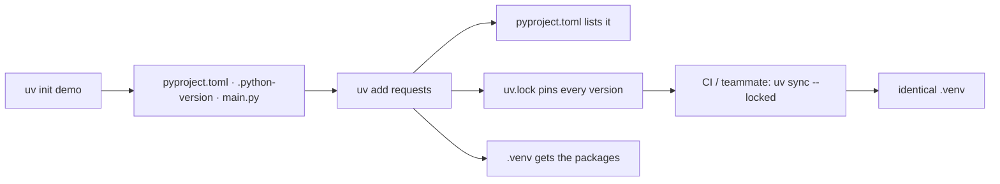
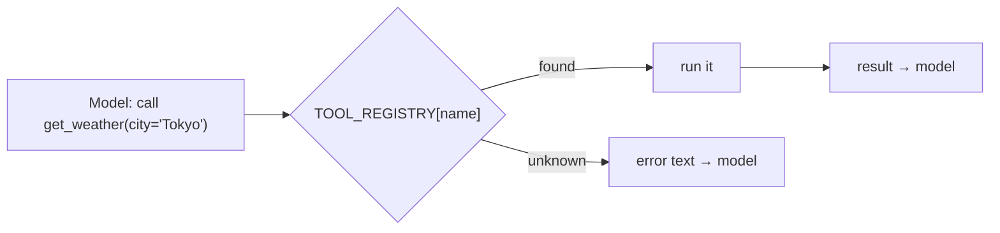

# Chapter 1: Setup and API basics

*Everything an agent is built from, before any AI: a reproducible project, a safe API call, and the idea of a tool.*

> [!NOTE]
> **📍 At a glance**
> - **You will learn:** `uv` projects, production-grade HTTP calls, and what a "tool" and a tool registry are
> - **Level:** beginner · **Time:** about 15 minutes
> - **Builds on:** [LLM Ch 1](../llm/01-course-roadmap-and-prerequisites.md) · **Leads to:** [Chapter 2](02-python-refresher.md)

---

## 1.1 `uv` projects

- One fast tool replacing `pip`, `venv`, `poetry`: **package manager + project manager**
- A **virtual environment** is a room: what you install inside stays inside; each project gets its own Python and packages



| File | Purpose | Edit? |
|---|---|---|
| `pyproject.toml` | name, dependencies, tool settings | yes |
| `.python-version` | Python version for the project | rarely |
| `uv.lock` | exact versions of everything, incl. indirect deps | no (generated) |
| `.venv/` | the environment | no |

```bash
uv sync                 # install from pyproject/lock
uv add requests         # add a dependency
uv run main.py          # run inside the env (no activate needed)
uv sync --locked        # CI/Docker: fail if the lock is stale
```

- Use VS Code + `.py` files for real projects; notebooks only for exploring
- Don't mix conda and `uv` in one project

## 1.2 A safe API call

```python
import requests

try:
    r = requests.get("https://api.frankfurter.app/latest",
                     params={"from": "USD", "to": "INR", "amount": 100}, timeout=10)
    r.raise_for_status()                    # 4xx/5xx → exception
    print(r.json()["rates"]["INR"])
except requests.exceptions.RequestException as e:
    print("Request failed:", e)
```

- `timeout` (never wait forever), `raise_for_status()`, `try/except`: every LLM SDK call has the same shape

## 1.3 Production-grade HTTP

```python
from dotenv import load_dotenv
from requests.adapters import HTTPAdapter
from urllib3.util.retry import Retry

load_dotenv()
API_KEY = os.environ["WEATHER_API_KEY"]               # fail at start-up if missing

session = requests.Session()                          # connection reuse
session.mount("https://", HTTPAdapter(max_retries=Retry(
    total=3, backoff_factor=0.5,                       # 0.5 s, 1 s, 2 s
    status_forcelist=[429, 500, 502, 503, 504], allowed_methods=["GET"])))

r = session.get(URL, params={"city": "Tokyo"},
                headers={"Authorization": f"Bearer {API_KEY}"}, timeout=(3.05, 10))
```

| Response | Retry? | Action |
|---|---|---|
| timeout, connection error | yes if idempotent | backoff, then clear message |
| `429` | yes | honour `Retry-After`, slow down |
| `5xx` | a few times | backoff, alert if persistent |
| `400`, `422` | no | fix the arguments |
| `401`, `403` | no | key missing or lacks permission |

> [!IMPORTANT]
> **🏭 In production:** only retry **idempotent** calls (a retried payment `POST` can charge twice); use `httpx.AsyncClient` + `asyncio.gather` for many calls; log status and duration, never the `Authorization` header.

## 1.4 What a "tool" is

- A tool is a plain function with **type hints, a docstring and a return value**; the docstring becomes the description the model reads
- A **registry** maps names to functions, because the model replies with a *name* and your code must find the function

```python
TOOL_REGISTRY: dict[str, Callable] = {}

def tool(func):
    @functools.wraps(func)
    def wrapper(*args, **kwargs):
        start = time.perf_counter()
        result = func(*args, **kwargs)
        log.info("tool=%s ms=%.1f", func.__name__, (time.perf_counter() - start) * 1000)
        return result
    TOOL_REGISTRY[func.__name__] = wrapper
    return wrapper

@tool
def get_weather(city: str) -> str:
    """Return the current weather for `city`."""
    ...
```



> [!CAUTION]
> **🔒 Never `eval` model-chosen text.** A character allow-list still lets `9**9**9` through and hangs the process; use a real expression parser.

- Learn the concept in plain Python first; frameworks (LangChain) automate this same pattern

## Interview corner

<details class="qa"><summary>1. What does <code>uv.lock</code> give you over <code>pyproject.toml</code>?</summary>

- Exact pinned versions of every dependency, so `uv sync --locked` rebuilds the identical env in CI and Docker

</details>

<details class="qa"><summary>2. Which HTTP failures do you retry?</summary>

- Timeouts, 429, 5xx, with backoff, and only for idempotent calls; never 4xx client errors

</details>

<details class="qa"><summary>3. Why does an agent need a tool registry?</summary>

- The model returns a tool name as text; the registry resolves it to a real function and catches unknown names

</details>

---

*Source: Live-Class-2026 class 01 (setup slides, `currency.py`, `tools.py`); production HTTP and security notes added by Claude.*

Next: [Chapter 2, Python refresher](02-python-refresher.md)
