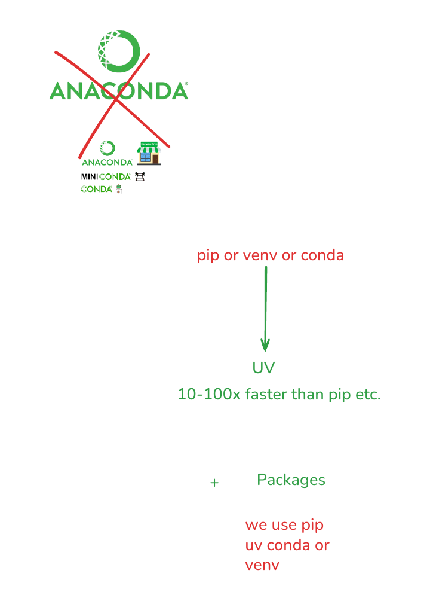
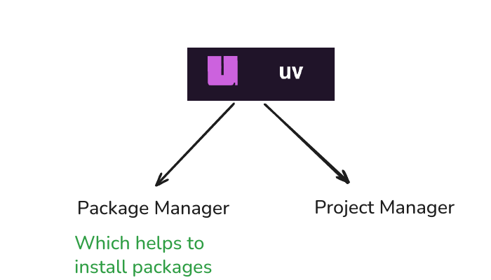
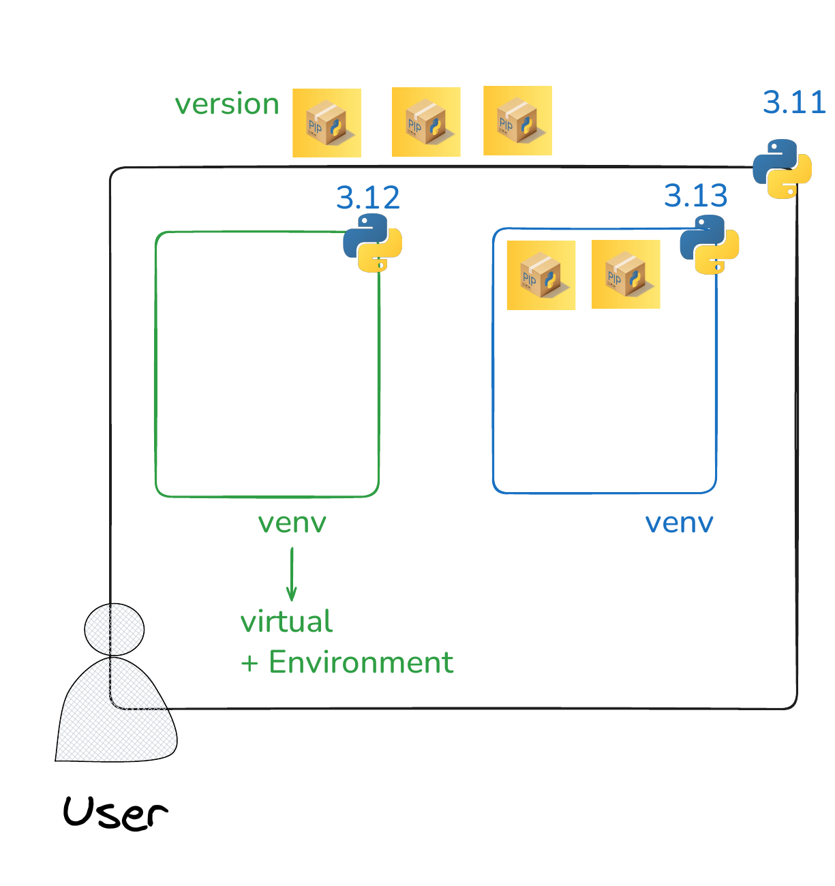
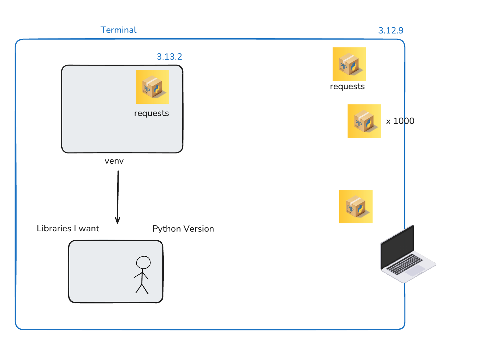
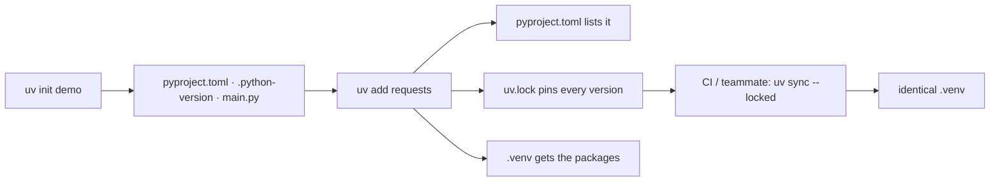
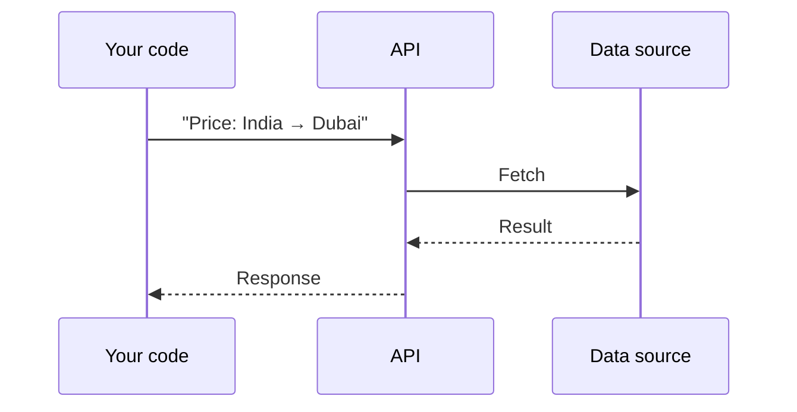
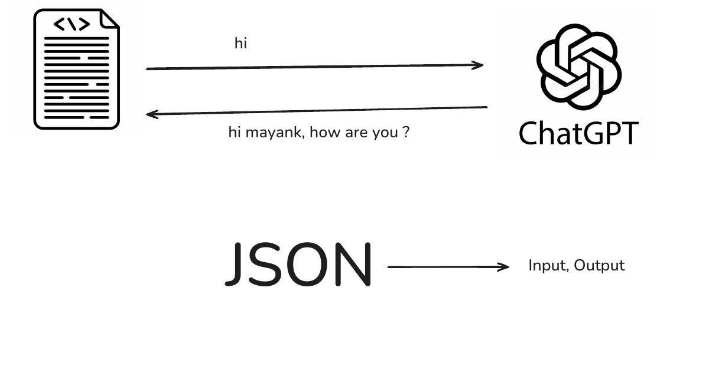
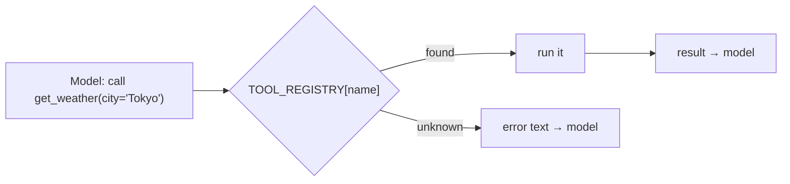

# Chapter 1: Setup and API basics

*Everything an agent is built from, before any AI: a reproducible project, a safe API call, and the idea of a tool.*

> [!NOTE]
> **📍 At a glance**
> - **You will learn:** `uv` projects, production-grade HTTP calls, and what a "tool" and a tool registry are
> - **You will build:** a `uv` project, a live currency converter, and a hand-made `@tool` registry with three tools
> - **Level:** beginner · **Time:** about 35 minutes
> - **Builds on:** [LLM Ch 1](../llm/01-course-roadmap-and-prerequisites.md) · **Leads to:** [Chapter 2](02-python-refresher.md)

**After this chapter you can:**

- Set up a terminal, Python 3.10+ and VS Code, and say why the course avoids Anaconda
- Explain virtual environments, and create, lock and reproduce a project with `uv`
- Call a web API safely: timeout, status check, error handling
- Decide which HTTP failures to retry, and retry them with backoff
- Write a tool (typed, documented function) and register it by name
- Read basic Python (types, f-strings, `if`, `for`) as the agent vocabulary it becomes

---

## 1.1 `uv` projects

### Your machine: terminal, Python, editor

- **Development happens best in the terminal.** You will later work on cloud servers, which are Linux machines with no desktop
- Mac and Linux have a terminal built in. **Windows** has only `cmd` and PowerShell; the class uses **Git Bash** or Windows Terminal
- **Python 3.10 or newer.** Check with `python3 --version`
  - Versions are like Office 2007, 2010, 2013: several can live on one machine, and each project picks one
- **VS Code + `.py` files** for real projects. This is an agentic AI course, not data science: scripts, a terminal and a debugger, with notebooks only for exploring



- One fast tool replacing `pip`, `venv`, `poetry`: **package manager + project manager**
- The class drops Anaconda (Anaconda, Miniconda, conda) for `uv`: one tool, much faster installs



### Virtual environments

- A **virtual environment** is a room: what you install inside stays inside; each project gets its own Python and packages



- Without one, every package lands in the one global Python, and a thousand projects share one pile of libraries
- With one, a project gets exactly the **libraries it wants** and the **Python version** it wants



### The `uv` workflow



| File | Purpose | Edit? |
|---|---|---|
| `pyproject.toml` | name, dependencies, tool settings | yes |
| `.python-version` | Python version for the project | rarely |
| `uv.lock` | exact versions of everything, incl. indirect deps | no (generated) |
| `.venv/` | the environment | no |

```bash
uv init my-first-project    # scaffold: pyproject.toml, .python-version, main.py, README.md, .gitignore, git repo
cd my-first-project
uv add requests             # add a dependency
uv add -r requirements.txt  # import an old requirements.txt
uv run main.py              # run inside the env (no activate needed)
uv sync                     # install from pyproject/lock
uv lock                     # refresh the lock after editing pyproject.toml by hand
uv sync --locked            # CI/Docker: fail if the lock is stale
```

- The class's starter project, `my-first-project/`, is exactly this scaffold. Its `main.py` only proves the wiring works:

```python
def main():
    print("Hello from my-first-project!")


if __name__ == "__main__":
    main()
```

- Its `pyproject.toml` says `requires-python = ">=3.13"` and lists `fastapi`, `requests`, `pydantic`, `python-dotenv`, `pandas`, `numpy`, `matplotlib`
- The class's other way in, with a classic activated environment:

```bash
uv venv && source .venv/bin/activate   # Windows: .venv\Scripts\activate
uv add requests
uv run currency.py
deactivate
```

- *Tested (`uv` 0.11.32):*
  - `uv init` also created `.gitignore` and a git repository
  - `uv add requests` wrote `requests>=2.34.2` into `pyproject.toml` and locked 6 packages (requests, its 4 dependencies and the project)
  - After a hand edit to `pyproject.toml`, `uv sync --locked` refused with "To update the lockfile, run `uv lock`"
- Don't mix conda and `uv` in one project

> [!WARNING]
> **`uv init` needs a valid project name.** In class 03, `uv init` in the class folder stopped with "Current directory is not a valid package name". *Tested (`uv` 0.11.32):* folders named like `Class 1 (Python)`, `(1)`, `#class` or `-x` fail with "is not a valid package name. Please provide a package name with `--name`", while `Class 1 Python AI` became `class-1-python-ai`. Fix: `uv init --name my-project`, or `uv init my-project` to create a subfolder.

## 1.2 A safe API call

- An API is how your code asks another program for data. The class's picture: with an old keypad phone and no internet, you call a travel agent for a flight price; they look it up and call you back



- The class demo, `currency.py`: a real, free, key-free currency API (Frankfurter)

```python
import requests

BASE = "https://api.frankfurter.app"
url = f"{BASE}/latest"
params = {"from": "USD", "to": "INR", "amount": 100}

try:
    r = requests.get(url, params=params, timeout=10)   # hang up if no answer in 10 s
    r.raise_for_status()                    # 4xx/5xx → exception
    print(f"100 USD = {r.json()['rates']['INR']:.2f} INR")
except requests.exceptions.RequestException as e:
    print("Request failed:", e)
```

- `timeout` (never wait forever), `raise_for_status()`, `try/except`: every LLM SDK call has the same shape
- An LLM is just another API: your code sends text as JSON and gets JSON back



- Class 2 (`_5_calling_a_real_api.py`) wraps the call in a function that **returns** errors instead of crashing:

```python
def convert_currency(amount: float, from_currency: str, to_currency: str) -> float | str:
    """Convert `amount` between currencies using real, live ECB rates."""
    try:
        response = requests.get(
            "https://api.frankfurter.dev/v1/latest",
            params={"base": from_currency.upper(), "symbols": to_currency.upper()},
            timeout=10,
        )
        response.raise_for_status()
        rate = response.json()["rates"][to_currency.upper()]
        return round(amount * rate, 2)
    except requests.exceptions.RequestException as exc:
        return f"Couldn't reach the currency service: {exc}"
    except KeyError:
        return f"No rate available for {from_currency} -> {to_currency}"
```

- Note the two addresses: Class 1 used `api.frankfurter.app` with `from` / `to` / `amount`; Class 2 used `api.frankfurter.dev/v1` with `base` / `symbols`
- Returning a message string is what a **tool** should do: the model can read it and react. Chapter 2.4 covers why

## 1.3 Production-grade HTTP

*Added by Claude: the class code stops at 1.2; this is what a real service adds.*

```python
import os
import requests
from dotenv import load_dotenv
from requests.adapters import HTTPAdapter
from urllib3.util.retry import Retry

load_dotenv()
API_KEY = os.environ["WEATHER_API_KEY"]               # fail at start-up if missing

session = requests.Session()                          # connection reuse
session.mount("https://", HTTPAdapter(max_retries=Retry(
    total=3, backoff_factor=0.5,                       # waits grow: 0.5 s, 1 s, 2 s
    status_forcelist=[429, 500, 502, 503, 504], allowed_methods=["GET"])))

r = session.get(URL, params={"city": "Tokyo"},
                headers={"Authorization": f"Bearer {API_KEY}"}, timeout=(3.05, 10))
```

- `timeout=(3.05, 10)`: 3 s to connect, 10 s to read
- *Tested* against a local server that failed twice with `503`, then answered: the session made 3 requests and returned `200`. A server that always failed raised `RetryError` after 4 requests (1 + 3 retries)

| Response | Retry? | Action |
|---|---|---|
| timeout, connection error | yes if idempotent | backoff, then clear message |
| `429` | yes | honour `Retry-After`, slow down |
| `5xx` | a few times | backoff, alert if persistent |
| `400`, `422` | no | fix the arguments |
| `401`, `403` | no | key missing or lacks permission |

> [!IMPORTANT]
> **🏭 In production:** only retry **idempotent** calls (a retried payment `POST` can charge twice); use `httpx.AsyncClient` + `asyncio.gather` for many calls; log status and duration, never the `Authorization` header. *Added by Claude.*

## 1.4 What a "tool" is

- A tool is a plain function with **type hints, a docstring and a return value**; the docstring becomes the description the model reads
- The class's first two tools (`functions or tools.py`), with no framework and no AI import:

```python
import time

def get_current_time() -> str:
    """Return the current time as a human-readable string."""
    return time.strftime("%Y-%m-%d %H:%M:%S")

fake_weather_data = {
    "tokyo": "22°C, partly cloudy",
    "delhi": "34°C, clear skies",
    "london": "15°C, light rain",
}

def get_weather(city: str) -> str:
    """Return the current weather for `city`. (Mock data for teaching.)"""
    return fake_weather_data.get(city.lower(), f"No weather data for {city!r}")
```

- A **registry** maps names to functions, because the model replies with a *name* and your code must find the function
- `tools.py` adds a `@tool` decorator that times every call and registers it:

```python
import functools
import time
from typing import Callable

TOOL_REGISTRY: dict[str, Callable] = {}

def tool(func):
    @functools.wraps(func)
    def wrapper(*args, **kwargs):
        start = time.perf_counter()
        result = func(*args, **kwargs)
        elapsed_ms = (time.perf_counter() - start) * 1000
        print(f"[tool call] {func.__name__}({args}, {kwargs}) -> {result!r}  ({elapsed_ms:.2f} ms)")
        return result
    TOOL_REGISTRY[func.__name__] = wrapper
    return wrapper

@tool
def calculator(expression: str) -> float:
    """Safely evaluate a simple arithmetic expression, e.g. '12 * (4 + 1)'."""
    allowed_characters = set("0123456789+-*/(). ")
    if not set(expression) <= allowed_characters:
        raise ValueError(f"Expression contains characters that aren't allowed: {expression!r}")
    return eval(expression)  # "safe" only because of the character check above
```

- *Tested:* `get_current_time`, `calculator("12 * (4 + 1)")` → `60` and `get_weather("Tokyo")` each printed a `[tool call]` line, and the registry held all three names
- The class then feeds it `"12 + ; DROP TABLE users;"`: the guard raises `ValueError`, and the caller catches it, so nothing crashes. A model, not a person, will choose these strings later



> [!CAUTION]
> **🔒 Never `eval` model-chosen text.** A character allow-list still lets `9**9**9` through and hangs the process; use a real expression parser.
> *Tested:* `calculator("9**9**9")` passed the check and was still running after 5 seconds when it was killed.

- A safe calculator walks the parsed expression and allows only numbers and four operators (*added by Claude*):

```python
import ast
import operator

OPS = {ast.Add: operator.add, ast.Sub: operator.sub, ast.Mult: operator.mul, ast.Div: operator.truediv}

def safe_calc(expression: str) -> float:
    """Evaluate +, -, *, / on numbers. Anything else raises ValueError."""
    def ev(node):
        if isinstance(node, ast.Constant) and isinstance(node.value, (int, float)):
            return node.value
        if isinstance(node, ast.BinOp) and type(node.op) in OPS:
            return OPS[type(node.op)](ev(node.left), ev(node.right))
        if isinstance(node, ast.UnaryOp) and isinstance(node.op, ast.USub):
            return -ev(node.operand)
        raise ValueError(f"Not allowed: {ast.dump(node)[:40]}")
    return ev(ast.parse(expression, mode="eval").body)
```

- *Tested:* `safe_calc("12 * (4 + 1)")` → `60`. `9**9**9` and `__import__('os')` raised `ValueError` at once; `"12 + ; DROP TABLE users;"` is not an expression at all, so `ast.parse` raised `SyntaxError`. Catch both
- Learn the concept in plain Python first; frameworks (LangChain) automate this same pattern. The class's rule: *"Agent is a concept — never learn a concept through a framework first"*

## 1.5 Python basics, read as agent vocabulary

- `Python_foundamentals.py` labels every basic type with the agent idea it becomes:

```python
city = "Tokyo"                    # str   -- what a tool ARGUMENT looks like
temperature = 22.5                # float -- what a tool RESULT often looks like
is_raining = False                # bool  -- what a DECISION inside an agent looks like
forecast = [22.5, 23.1, 21.8]     # list  -- a sequence of readings, in order

print(f"The temperature in {city} is {temperature} degrees.")
print(f"That's {temperature * 9 / 5 + 32:.1f}°F.")   # math inside { }; :.1f = 1 decimal

if is_raining:
    print("Bring an umbrella.")
else:
    print("No umbrella needed.")

for day_temp in forecast:                          # the class file uses if/else here
    print(f"{day_temp}°C — {'warm' if day_temp > 23 else 'mild'} day")
```

| Python | Agent idea later |
|---|---|
| `str` | a tool argument, a prompt, a reply |
| `float` / `int` | a tool result |
| `bool` + `if` | a decision |
| `list` + `for` | a sequence: readings, messages, steps |
| f-string | building a prompt from variables |

- *Tested:* the class file printed the four types, `72.5°F`, "No umbrella needed." and warm only for `23.1`
- The class closes the file with: *"Every one of these types and decisions reappears, unchanged, inside the agent you build later."*

## Questions from the class (class 01)

| Question | Answer |
|---|---|
| Is the course right for non-tech or semi-tech people? | Doable, but expect roughly **double the class time** in self-effort. It assumes basic developer comfort |
| GitHub Copilot or Claude Code? | The mentor personally finds Claude Code better for development (his view). GitHub Copilot is covered in the course |
| Is there a tool to understand an unfamiliar codebase? | No magic tool. Feed the repo and docs to Claude or ChatGPT (for example through a GitHub MCP) and ask for a summary |
| Help finding AI use cases at work? | A handbook mapping AI opportunities across industries is to be shared (see [LLM Ch 1](../llm/01-course-roadmap-and-prerequisites.md), 1.4) |
| Should I code along in class? | No. Watch and understand live, then practise with the recording |
| Do I need Python experience? | Helpful, not mandatory. Beginners should reinforce basics fast |
| Will Microsoft Copilot Studio be covered? | Only if the mentor can get access |

- After class: install Python 3.10+, UV and VS Code; Windows users install Git Bash or Windows Terminal; redo the commands from the recording
- Left out: ground rules and two job referrals (not teaching content)

*Source: `classes_transcription_summary/01`, Q&A and action items.*

## 1.6 Added by Claude, not from the sources

- **Pin the Python version per project** (`.python-version`), not per machine; CI and teammates then match
- **Commit `uv.lock`**, never `.venv/`. The lock makes builds repeatable; the folder is rebuilt from it
- **Keys go in `.env`, and `.env` goes in `.gitignore`.** Fail at start-up when a key is missing, not in the middle of a request
- **Every network call has a timeout.** A call without one can hang a whole agent run
- **Tools return errors as text**, so the model can recover; only programming bugs should raise

## Interview corner

**What interviewers listen for:** you can make a project reproducible, you treat every network call as able to fail, and you never let model-chosen text run as code.

### 🟢 Basic

<details class="qa"><summary>1. What does <code>uv.lock</code> give you over <code>pyproject.toml</code>?</summary>

- Exact pinned versions of every dependency, so `uv sync --locked` rebuilds the identical env in CI and Docker
- `pyproject.toml` holds ranges you choose (`requests>=2.34.2`); the lock holds the exact versions, including indirect ones
- *Stronger answer:* CI runs `uv sync --locked`, which fails if someone edited `pyproject.toml` without re-locking

</details>

### 🟡 Intermediate

<details class="qa"><summary>2. Which HTTP failures do you retry?</summary>

- Timeouts, 429, 5xx, with backoff, and only for idempotent calls; never 4xx client errors
- Honour `Retry-After` on 429
- *Stronger answer:* cap total retries and time, and log each attempt, so a dying service doesn't turn into a retry storm

</details>

<details class="qa"><summary>3. Why does an agent need a tool registry?</summary>

- The model returns a tool name as text; the registry resolves it to a real function and catches unknown names
- It is also the single place to add timing, logging and validation for every tool
- *Stronger answer:* an unknown name returns an error message to the model instead of crashing, so the model can try again

</details>

### 🔴 Senior

<details class="qa"><summary>4. A tool must evaluate maths the model writes. How do you make it safe?</summary>

- Never `eval` or `exec` model text, even behind a character filter: `9**9**9` passes and hangs the process
- Parse with `ast` and allow only numbers and chosen operators, or use a maths library
- *Stronger answer:* also cap input length and run the tool with a time limit, since even safe parsing can be fed huge inputs

</details>

<details class="qa"><summary>5. A teammate's code works on their laptop but not in CI. What do you check first?</summary>

- Python version (`.python-version`, `requires-python`)
- Whether `uv.lock` was committed and is current; run `uv sync --locked`
- Missing environment variables that exist only in their `.env`
- *Stronger answer:* make CI the source of truth: locked sync, a pinned Python, and a start-up check that fails fast on missing keys

</details>

> [!TIP]
> **🧩 Design question to practise:** *"Ship a currency-conversion tool for an agent used by 1,000 people."* Cover: the project and lock, keys, timeouts and retries, caching rates, what the tool returns on failure, and logging.

## Cheat sheet

```bash
uv init proj && cd proj        # new project
uv add requests                # add a dependency (writes pyproject.toml + uv.lock)
uv run main.py                 # run in the project env
uv sync --locked               # CI: exact rebuild, fail on a stale lock
```

```python
r = requests.get(url, params=params, timeout=10)   # always a timeout
r.raise_for_status()                               # 4xx/5xx → exception
TOOL_REGISTRY[func.__name__] = wrapper             # name → function, for the model's tool calls
```

## Recap

- Terminal, Python 3.10+, VS Code; Git Bash on Windows; no Anaconda
- A virtual environment gives each project its own Python and packages
- `uv` = package manager + project manager; `uv.lock` makes installs exact
- Safe call = timeout + `raise_for_status()` + `try/except`; an LLM call has the same shape
- Retry only timeouts, 429 and 5xx, with backoff, on idempotent calls
- A tool = typed, documented function; a registry finds it by name
- Never `eval` model text

## Practice

1. `uv init` a project, `uv add requests`, delete `.venv`, run `uv sync`, and confirm it comes back identical
2. Edit `pyproject.toml` by hand, run `uv sync --locked`, read the error, then fix it with `uv lock`
3. Run `currency.py`, then turn off Wi-Fi and run it again. Which `except` caught it?
4. Add a `convert_currency` tool to the `@tool` registry and call it by name: `TOOL_REGISTRY["convert_currency"](100, "USD", "INR")`
5. Break the class `calculator` with an input that passes its filter, then replace it with `safe_calc`

## How this chapter was checked

- **Run offline** on Python 3.13 with `requests` 2.34.2. The currency API was blocked from this environment, so `requests.get` was replaced by a stand-in returning Frankfurter-shaped JSON
- **1.1, `uv init` names:** reproduced the class 03 error in folders with brackets, `#`, a leading `-` or non-Latin letters; `uv init --name class-1-python` fixed it
- **1.1:** `uv` 0.11.32 for real: `uv init`, `uv add requests`, `uv add -r requirements.txt`, `uv run main.py` ("Hello from demo!"), and `uv sync --locked` refusing a stale lock, then passing after `uv lock`
- **1.2:** `currency.py` printed `100 USD = 8550.00 INR` (stand-in rate). `_5`'s `convert_currency` returned the converted amount, and a text message on an HTTP error
- **1.3:** the retry session against a local server that returned `503` twice then `200` (3 requests), and one that always returned `503` (`RetryError` after 4)
- **1.4:** `tools.py` as written; the SQL-shaped string was caught; `9**9**9` killed after 5 s; `safe_calc` on the cases listed
- **1.5:** `Python_foundamentals.py` as written
- **Not run:** the live Frankfurter API (blocked here)

## Sources and further reading

- Live-Class-2026, `Weekend 01 - 27-28 Jun/01 - 27 Jun - Python Setup & API Basics/`: `README.md`, `Python_foundamentals.py`, `currency.py`, `functions or tools.py`, `tools.py`, `notebook.ipynb`, `my-first-project/` (re-read in full 2026-11-15)
- Live-Class-2026, the Class 1 whiteboard `Class-1-Python-and-AI.pdf` (four figures in `images/`) and the Day 2 whiteboard `Agentic-3-0.pdf` (the code-to-LLM figure)
- Live-Class-2026, `02-03 - 28 Jun & 4 Jul .../_5_calling_a_real_api.py` (the `convert_currency` function in 1.2)
- `uv` documentation: [docs.astral.sh/uv](https://docs.astral.sh/uv/)
- Added by Claude: 1.3, `safe_calc` in 1.4, 1.6, interview questions 4–5

Next: [Chapter 2, Python refresher](02-python-refresher.md)
