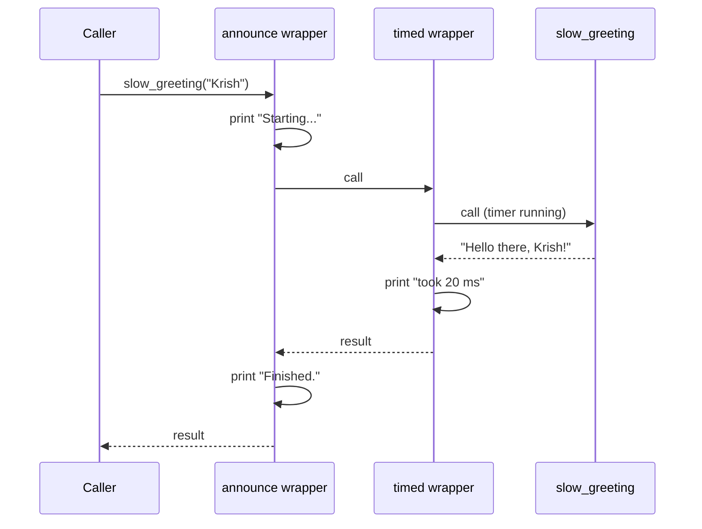

# Chapter 2: Python you need for agent code

*Only the Python that agent frameworks are built on: data shapes, classes, decorators, errors, typing, streaming, async and logging.*

> [!NOTE]
> **📍 At a glance**
> - **You will learn:** the patterns you will read in every SDK, LangChain and MCP codebase
> - **You will build:** a bank account and a book class, two stacked decorators, safe error handling, and a script that is also an importable module
> - **Level:** beginner · **Time:** about 40 minutes
> - **Builds on:** [Chapter 1](01-setup-and-api-basics.md) · **Leads to:** [Chapter 3](03-anatomy-of-an-agent.md), [Pydantic book](../pydantic/01-why-pydantic-and-basemodel.md)

**After this chapter you can:**

- Pick a list, tuple, dict or set, and handle a list of dicts (the shape of chat history)
- Write a class with state and guard clauses, and the same thing as a `@dataclass`
- Name the six OOP ideas and show each in a line of code
- Write and stack decorators, and say why `functools.wraps` matters for tools
- Catch the right exceptions, and return errors as text from a tool
- Use type hints, generators, context managers, `async` and logging the way agent code does
- Keep demo code under `if __name__ == "__main__":` so importing a file has no side effects

---

## 2.1 The data shape that matters most: a list of dicts

```python
messages = [
    {"role": "system", "content": "You are helpful."},
    {"role": "user", "content": "Weather in Tokyo?"},
]
users = [m for m in messages if m["role"] == "user"]     # comprehension
reading.get("humidity")       # None if missing (optional key)
reading["city"]               # KeyError if missing (required key)
lat, lon = (35.68, 139.69)    # tuple unpacking
```

- Chat history, tool results and JSON payloads are all lists of dicts
- The class builds up to it one structure at a time (`_1_data_structures.py`):

```python
cities = ["Tokyo", "Delhi", "London"]
cities[0], cities[-1], cities[0:2]     # 'Tokyo', 'London', ['Tokyo', 'Delhi']
cities.append("Paris")                 # lists can change

coordinates = (35.68, 139.69)          # a tuple: a fixed pair
latitude, longitude = coordinates      # unpacking

weather_reading = {"city": "Tokyo", "temperature_c": 22.5, "condition": "partly cloudy"}
weather_reading["humidity"] = 60       # add a key
for key, value in weather_reading.items():
    print(f"{key}: {value}")

readings = [
    {"city": "Tokyo", "temperature_c": 22.5},
    {"city": "Delhi", "temperature_c": 34.0},
    {"city": "London", "temperature_c": 15.0},
]
warm_cities = [r["city"] for r in readings if r["temperature_c"] > 20]   # ['Tokyo', 'Delhi']
```

- A list can hold **mixed types**: the class notebook's `["Tokyo", "Delhi", "London", 1]` is legal Python. That freedom is why model output needs checking (the Pydantic book)
- The notebook asks for a list vs array comparison. Here it is, with the other built-ins (*added by Claude*):

| Type | Ordered | Changeable | Duplicates | Use it for |
|---|---|---|---|---|
| `list` | yes | yes | yes | messages, steps, results |
| `tuple` | yes | **no** | yes | fixed pairs: `(lat, lon)`, return values |
| `dict` | insertion order | yes | keys unique | labelled data: one message, one JSON object |
| `set` | no | yes | **no** | membership: allowed currencies, seen ids |
| `array.array` / NumPy array | yes | yes | yes | many numbers of **one type**, fast maths |

- *Tested:* assigning to a tuple item raised `TypeError: 'tuple' object does not support item assignment`
- **A dict is how Python holds JSON.** For this course treat them as one thing (the class: "dict is JSON")
  - JSON text needs double quotes; a Python dict takes either. *Tested:* `json.loads("{'name': 'Alice'}")` failed with "Expecting property name enclosed in double quotes"
  - APIs reply in JSON, and `response.json()` turns the reply into a dict
- Nested JSON mixes the two containers: a list value holds items, a dict value holds named keys

```python
profile = {
    "name": "Alice",
    "skills": ["Python", "SQL", "Docker"],           # list: 3 items; append one and it's 4
    "address": {"city": "Mumbai", "pin": "400001"},  # dict: 2 named keys
}
profile["skills"][0]           # 'Python'
profile["address"]["city"]     # 'Mumbai'

fact = requests.get("https://catfact.ninja/fact", timeout=10).json()   # the free API the class used
print(fact["fact"], fact["length"])                                    # a dict with two keys; no API key needed
```

## 2.2 Classes and dataclasses

- The class teaches classes on something ordinary first, a bank account (`_2_oop_classes.py`):

```python
class BankAccount:
    """A blueprint for a bank account -- nothing to do with AI."""

    def __init__(self, owner: str, balance: float = 0.0):
        self.owner = owner       # every instance gets its OWN owner
        self.balance = balance   # and its OWN balance -- the account's STATE
        self.history = []

    def deposit(self, amount: float) -> None:
        self.balance += amount
        self.history.append(f"Deposited {amount}")

    def withdraw(self, amount: float) -> None:
        if amount > self.balance:                         # guard clause
            print(f"Insufficient funds: tried to withdraw {amount}, balance is {self.balance}")
            return
        self.balance -= amount
        self.history.append(f"Withdrew {amount}")

account_1 = BankAccount(owner="Mayank", balance=1000)
account_2 = BankAccount(owner="Krish", balance=500)
account_1.deposit(200); account_1.withdraw(50)    # 1150
account_2.withdraw(1000)                          # refused; still 500
```

- A **class** is a blueprint; an **instance** is one thing built from it, with its own state
- An object holds **state**; methods change it. Use **guard clauses** to reject bad requests before they corrupt state
- `@dataclass` writes `__init__` and `__repr__` for you from type-hinted fields:

```python
from dataclasses import dataclass, field

@dataclass
class Book:
    title: str
    author: str
    pages_read: int = 0
    tags: list = field(default_factory=list)   # mutable defaults need field(default_factory=...)

    def read(self, pages: int) -> None:
        self.pages_read += pages

b = Book(title="Atomic Habits", author="James Clear"); b.read(40)
print(b)   # Book(title='Atomic Habits', author='James Clear', pages_read=40, tags=[])
```

> [!WARNING]
> **Mutable defaults.** `tags: list = []` in a dataclass fails at once: `ValueError: mutable default <class 'list'> for field tags is not allowed: use default_factory`. In a plain class, `def __init__(self, tags=[])` does **not** fail: every instance shares one list. *Tested:* appending to one instance's `tags` showed up in another's.

- The class's agent is exactly this pattern, with a new label:

```python
@dataclass
class Agent:
    name: str
    system_prompt: str
    tools: dict = field(default_factory=dict)       # mutable default → default_factory
    messages: list = field(default_factory=list)    # the memory

    def remember(self, role: str, content: str) -> None:
        self.messages.append({"role": role, "content": content})
```

- `@dataclass` writes `__init__`/`__repr__` but **validates nothing** → Pydantic at boundaries

### The six OOP ideas

- The class's `OOPS.py` is an outline of six words. One line of meaning and one line of code each (*examples added by Claude*):

| Idea | Meaning | In one line |
|---|---|---|
| Class | a blueprint | `class BankAccount: ...` |
| Object | one thing built from it | `acc = BankAccount("Mayank")` |
| Inheritance | a child reuses a parent | `class SavingsAccount(BankAccount): ...` |
| Polymorphism | same call, different behaviour | `for t in tools: t.run(text)` |
| Abstraction | a required interface, details hidden | `class Tool(ABC): @abstractmethod def run(...)` |
| Encapsulation | state changed only through methods | `acc.withdraw(50)`, not `acc.balance -= 50` |

- **Abstraction / duck typing:** every tool exposes the same call shape, so an agent can loop over them

```python
from abc import ABC, abstractmethod

class Tool(ABC):
    @abstractmethod
    def run(self, text: str) -> str: ...

class Upper(Tool):
    def run(self, text: str) -> str:
        return text.upper()

class Reverse(Tool):
    def run(self, text: str) -> str:
        return text[::-1]

for t in [Upper(), Reverse()]:      # polymorphism: same call, different result
    print(t.run("agent"))           # AGENT, then tnega
```

- *Tested:* `Tool()` itself raised `TypeError` (can't instantiate an abstract class)

> [!TIP]
> **Watch objects being built.** [Python Tutor](https://pythontutor.com) runs pasted code one step at a time and draws every object. The class used it to show `__init__` filling in two separate `BankAccount` objects.

## 2.3 Decorators

- A decorator is a gift wrapper: the function inside doesn't change, but every call gets something extra (`_4_decorators.py`):

```python
import functools, time

def announce(func):
    @functools.wraps(func)
    def wrapper(*args, **kwargs):
        print(f"Starting {func.__name__}...")
        result = func(*args, **kwargs)
        print(f"Finished {func.__name__}.")
        return result
    return wrapper

def timed(func):
    @functools.wraps(func)                     # keeps __name__ and docstring
    def wrapper(*args, **kwargs):
        start = time.perf_counter()
        try:
            return func(*args, **kwargs)
        finally:
            print(f"{func.__name__} took {(time.perf_counter() - start) * 1000:.2f} ms")
    return wrapper

@announce
@timed
def slow_greeting(name):
    time.sleep(0.02)
    return f"Hello there, {name}!"
```

- `@d` is `func = d(func)`; stacked decorators wrap outside-in



- *Tested:* the output order was "Starting slow_greeting..." → "slow_greeting took 20.24 ms" → "Finished slow_greeting."
- **Why it matters:** `@tool` in LangChain/MCP is exactly this pattern, and `functools.wraps` keeps the docstring the model reads
- *Tested:* without `wraps`, a decorated `get_weather` reported its name as `wrapper` and its docstring as `None`, so a framework would describe the tool to the model as "wrapper", with no description

## 2.4 Errors

- The class's patterns (`_3_error_handling.py`):

```python
try:
    result = 10 / 0
except ZeroDivisionError:
    result = 0                                   # decide what happens instead

def read_setting(value):
    try:
        return int(value)
    except ValueError:
        print(f"{value!r} isn't a number, defaulting to 0.")
        return 0
    finally:
        print("(Done attempting to read this setting.)")   # runs either way

weather_reading = {"city": "Tokyo", "temperature_c": 22.5}
try:
    print(weather_reading["humidity"])
except KeyError:
    print("No humidity data available -- that's fine, we'll skip it.")
```

- `finally` runs on success **and** on failure: *tested*, it printed after both `read_setting("42")` and `read_setting("oops")`
  - Its typical job is clean-up that must happen either way, such as closing a database connection
- A **SyntaxError** is a different kind of error: code written wrongly, for example an unclosed bracket. `ZeroDivisionError` or `ValueError` happen while correct code runs, which is what `try/except` handles
  - A SyntaxError stops the whole file before it runs, so a `try/except` in that file can't catch it. *Tested:* compiling a file with an unclosed bracket raised `SyntaxError: '(' was never closed` (*added by Claude*)
- In a tool, the same idea returns a message instead of crashing:

```python
def convert(amount, src, dst) -> float | str:
    try:
        r = requests.get(URL, params={"base": src, "symbols": dst}, timeout=10)
        r.raise_for_status()
        return round(amount * r.json()["rates"][dst], 2)
    except requests.exceptions.RequestException as e:
        return f"Currency service unavailable: {e}"
    except KeyError:
        return f"No rate for {src}->{dst}"
```

- Catch **named** exceptions, never bare `except:`
- In tools, **return** errors as text so the model can react; `finally` for clean-up
- The class's `safe_divide` returns `0` on a `TypeError`. That hides a bug: `safe_divide(10, "x")` is a programming mistake, not bad luck. Return a clear message or let it raise (*added by Claude*)

## 2.5 Type hints and `TypedDict`

*Sections 2.5 to 2.8 are added by Claude: the class code uses these, but doesn't teach them.*

```python
from typing import Literal, TypedDict

class Message(TypedDict):
    role: Literal["system", "user", "assistant", "tool"]
    content: str

def get_weather(city: str, unit: Literal["c", "f"] = "c") -> dict:
    """Return current weather for `city`."""
```

- Frameworks turn hints + docstring into the **tool schema**; nothing checks them at run time (Pydantic does)
- The class files use the modern forms: `float | str` (either type), `dict[str, Callable]`, `list[dict]`
- `from __future__ import annotations` (used in the class's fake-AI file) stores every hint as a string instead of evaluating it. A hint can then name a class that is defined later
  - *Tested on Python 3.12:* with it, `f.__annotations__` gave `{'x': 'NotDefinedYet', 'return': 'int'}`; without it, the same function raised `NameError`
  - Python 3.14 evaluates hints only when needed, so new code there doesn't need the import. Python's docs call it deprecated, with removal not before Python 3.13's end of life in 2029 (What's New in Python 3.14, checked 22 Nov 2026)

## 2.6 Generators (streaming) and context managers

```python
import time
from contextlib import contextmanager

def stream_words(text):
    for w in text.split():
        yield w + " "                 # one piece at a time, like streamed tokens

@contextmanager
def timer(label):
    start = time.perf_counter()
    try:
        yield
    finally:
        log.info("%s: %.0f ms", label, (time.perf_counter() - start) * 1000)
```

- `for chunk in client.stream(...)` is a generator; `with` / `async with` guarantee clean-up of clients and connections

## 2.7 `async` for parallel tool calls

```python
import asyncio

async def call_tool(name):
    await asyncio.sleep(0.2)          # stands in for a 0.2 s network call
    return name

async def main():
    return await asyncio.gather(call_tool("weather"), call_tool("currency"), call_tool("news"))
asyncio.run(main())                  # ~0.2 s total instead of 0.6 s
```

- *Tested:* three 0.2 s calls finished in 0.20 s together
- Helps when waiting on I/O (network, disk), not CPU work
- LangChain `ainvoke`, MCP clients and FastAPI are async-first

## 2.8 Logging, not `print`

```python
import logging

logging.basicConfig(level=logging.INFO, format="%(asctime)s %(levelname)s %(name)s %(message)s")
log = logging.getLogger("agent")
log.info("tool=%s duration_ms=%.1f", "get_weather", 12.3)
```

- The class files use `print` to show what happens; production code logs, with levels and timestamps

> [!IMPORTANT]
> **🏭 In production:** log tool name, duration and outcome, never keys or personal data; type-hint every tool; use async when one agent calls several tools or serves several users. *Added by Claude.*

## 2.9 Scripts vs modules: the `__main__` guard

- Every class file ends with `if __name__ == "__main__":`. Code under it runs only when the file is **run**, not when it is **imported**

```python
def fake_ai(question: str) -> str:
    return "stand-in reply"

if __name__ == "__main__":            # demo: runs on `uv run file.py` only
    print(fake_ai("Convert 50 dollars to euros."))
```

> [!WARNING]
> **Found in the class code.** `_6_fake_ai_call.py` has a second demo at the bottom **outside** the guard. Files `_7`, `_11` to `_14` import `FakeAIClient` from it as a fallback, and every import ran that demo.
> *Tested:* running `_7` and `_11` with no API key printed "User: Convert 50 dollars to euros." and a stand-in reply that belong to `_6`, before their own output. Keep demo code under the guard.

- The class also explains its file names: Python can't `import` a module whose name starts with a digit, so the files are `_0_...`, `_1_...` (a leading underscore sorts the same way and stays importable)

## Questions from the class (class 02)

| Question | Answer |
|---|---|
| Why learn raw-Python agents before LangChain? | Frameworks are mature and convenient (like WhatsApp versus SMS), but learn the fundamentals first |
| Do frameworks cost more in tokens? | Yes. The mentor says he avoids agent frameworks in his own production work where he can, preferring simple API orchestration to control token cost and execution (his view) |
| Can Pydantic structure messy LLM output? | Yes: define the shape as a model and extract exactly that ([Pydantic Ch 5](../pydantic/05-validating-llm-output.md)) |
| Is GraphQL versus REST covered? | Not as a core topic; it may appear in a project (for example observability) |
| Node.js or TypeScript instead of Python? | LangChain and LangGraph support TypeScript. The language is an implementation detail |
| DevOps use cases for agents? | Think "mini interns": code review, infrastructure provisioning, repetitive ops tasks |
| Is "vibe coding" enough to ship an app to the Play Store? | It gets you about 80 to 90 percent of the way. Have a developer review security and data handling before publishing |
| Guardrails for sensitive data? | Covered later with dedicated guardrail tools ([Langchain Ch 8](../langchain/08-prebuilt-middleware-limits-fallback-and-pii.md)) |
| When do deployment and AgentOps come? | After fundamentals and frameworks, about 1.5 to 2 months in, on a VPS or cloud |
| How is 3.0 different from 2.0? | More project and AgentOps focus, with newer tools (Claude Code, latest LangChain) |
| Why did Copilot give two developers different answers to the same prompt? | AI output varies from run to run, and the tool also carries session memory and instruction files (such as `AGENTS.md`). Give precise instructions: "compare the two models field by field", not "compare these files" (the mentor's view) |
| How was the course's doubt-solver GPT built? | A custom GPT: written instructions plus knowledge files such as the syllabus. No code, about half a day including testing. It works from those files, not from live data |
| Open-source or frontier models in client work? | The mentor ships frontier models (OpenAI, Claude): for small clients, hosting and testing open models costs more than API calls. Companies with their own hardware may choose differently (his view) |
| RAG with or without embeddings? | Decide from the data and the domain, after experiments. In his client work, short, well-structured warranty documents got a structured approach without embeddings; large documents got embeddings |
| Are Copilot Studio or Logic Apps enough for agents? | For internal, repetitive orchestration, yes. For custom products they give too little control and don't scale (the mentor's view) |
| Is agent orchestration machine learning? | No. It is software design: which agent runs, in what order, with what data |
| `uv` picked my Anaconda Python for the class files. What now? | The class files are standalone scripts: run them directly, or make one environment for the folder and activate it. Not one environment per file. To choose the Python, see `uv venv --python` ([Ch 1](01-setup-and-api-basics.md)) |

*Source: `classes_transcription_summary/02`, Q&A. This answers the glossary term "vibe coding" ([LLM Ch 4](../llm/04-glossary.md)).*

*Rows from "Why did Copilot give two developers" on: the class 02 recording subtitles (28 Jun 2026).*

## 2.10 Added by Claude, not from the sources

- **Type-hint every public function.** Agent frameworks read the hints to build tool schemas
- **Prefer `dict.get` for optional keys and `[]` for required ones**, so a missing required key fails loudly
- **Don't swallow errors to a default.** Returning `0` for a bad input hides bugs; return a clear message or raise
- **Keep modules import-safe.** No network calls, prints or file writes at import time

## Interview corner

**What interviewers listen for:** you know which data shape to use, you write decorators that keep metadata, you handle errors on purpose, and your modules are safe to import.

### 🟢 Basic

<details class="qa"><summary>1. Why <code>functools.wraps</code> in a tool decorator?</summary>

- Keeps the original name and docstring, which frameworks use to build the tool schema
- Without it the tool is named `wrapper` with no docstring (tested)
- *Stronger answer:* it also copies `__wrapped__`, so tools like `inspect.signature` still see the real parameters

</details>

### 🟡 Intermediate

<details class="qa"><summary>2. When does <code>async</code> help an agent?</summary>

- When it waits on several network calls (tools, model APIs); `gather` runs them concurrently. Not for CPU-heavy work
- *Stronger answer:* add a timeout per call and a limit on how many run at once, so one slow tool doesn't block the rest

</details>

<details class="qa"><summary>3. Dataclass vs Pydantic model?</summary>

- Dataclass: internal structures, no validation; Pydantic: anything from outside (API, config, LLM output)
- *Stronger answer:* a dataclass happily stores `amount="five hundred"`; Pydantic rejects it or converts `"100"` to `100.0`

</details>

<details class="qa"><summary>4. What goes wrong with <code>def __init__(self, tags=[])</code>?</summary>

- The default list is created once and shared by every instance, so one object's change shows up in another
- Dataclasses refuse it; use `field(default_factory=list)`, or `None` and create the list inside
- *Stronger answer:* the same bug appears in agents as memory shared between users when a list is a default argument

</details>

### 🔴 Senior

<details class="qa"><summary>5. Importing a helper module prints output and makes a network call. What is wrong, and how do you prevent it?</summary>

- Code runs at import time, outside `if __name__ == "__main__":`
- Move demos under the guard; keep imports free of side effects
- *Stronger answer:* add a test that imports every module with the network blocked, so a side effect fails CI

</details>

> [!TIP]
> **🧩 Design question to practise:** *"Design the base class for a tool in your own agent framework."* Cover: the interface (`name`, `description`, `run`), how arguments are typed and checked, how errors come back, timing and logging via a decorator, and async support.

## Cheat sheet

```python
readings = [{"city": "Tokyo", "t": 22.5}]                 # list of dicts = chat history shape
warm = [r["city"] for r in readings if r["t"] > 20]       # comprehension
@dataclass
class Agent:
    messages: list = field(default_factory=list)          # never `= []`
def deco(func):
    @functools.wraps(func)                                # keep name + docstring
    def wrapper(*a, **k): return func(*a, **k)
    return wrapper
try: ...
except (KeyError, ValueError) as e: return f"error: {e}"  # named exceptions; return text from tools
if __name__ == "__main__": main()                          # demo code only here
```

## Recap

- List of dicts is the shape of messages, tool results and JSON
- Tuples don't change; sets hold unique items; dicts hold labelled data
- A class holds state; guard clauses protect it; `@dataclass` saves boilerplate but validates nothing
- Never use a mutable default; use `default_factory`
- Decorators wrap outside-in; `functools.wraps` keeps the name and docstring a tool needs
- Catch named exceptions; tools return errors as text; `finally` always runs
- Type hints feed tool schemas; generators stream; `async` overlaps waiting; log instead of print
- Demo code goes under `if __name__ == "__main__":`

## Practice

1. Build `readings` for five cities and print the coldest city with one line of `min(...)`
2. Add `SavingsAccount(BankAccount)` with an `add_interest(rate)` method. Which OOP ideas did you use?
3. Write a `@retry(times=3)` decorator (a decorator that takes an argument) and use `functools.wraps`
4. Remove `functools.wraps` from `timed` and print `slow_greeting.__name__`
5. Import `_6_fake_ai_call` from another file and watch the side effect. Fix it with the guard
6. Run three fake tool calls with `asyncio.gather` and time them

## How this chapter was checked

- **Run offline** on Python 3.13: `_0` to `_4` as written, `_6`, `_7` and `_11` with no API key, and every code block in this chapter
- **2.1:** list indexing and slicing, tuple unpacking, `.get` returning `None`, the comprehension giving `['Tokyo', 'Delhi']`; assigning to a tuple raised `TypeError`; the mixed list held `str` and `int`
- **2.2:** the bank account ended at 1150 and 500 with the refusal printed; `Book` printed its generated `repr`; `tags: list = []` in a dataclass raised `ValueError`; a plain-class `tags=[]` default was shared; `Tool()` raised `TypeError`
- **2.3:** the stacked output order shown; without `wraps` the name was `wrapper` and the docstring `None`
- **2.4:** `finally` printed for both calls
- **2.7:** `gather` of three 0.2 s calls took 0.20 s
- **2.9:** running `_7` and `_11` printed `_6`'s module-level demo first
- **Class 02 subtitle additions (22 Nov 2026), on Python 3.12:** the `profile` lookups; `json.loads` rejecting single quotes; the unclosed-bracket `SyntaxError`; the `__future__` annotations with and without the import. The Cat Facts call was made with `urllib` (same URL, same reply shape: a dict with `fact` and `length`), because `requests` isn't installed on this machine
- **Not run:** live API calls (the currency host and model providers are blocked here)

## Sources and further reading

- Live-Class-2026, `Weekend 01 - 27-28 Jun/02-03 - 28 Jun & 4 Jul - Python Refresher & Pydantic Deep Dive/`: `README.md`, `_0_basics_refresher.py` to `_4_decorators.py`, `_6_fake_ai_call.py`, `Python_run.ipynb` (re-read in full 2026-11-15)
- Live-Class-2026, `01 - 27 Jun - Python Setup & API Basics/OOPS.py` (the six OOP ideas)
- Python docs: [dataclasses](https://docs.python.org/3/library/dataclasses.html), [functools.wraps](https://docs.python.org/3/library/functools.html#functools.wraps), [asyncio](https://docs.python.org/3/library/asyncio.html), [What's New in Python 3.14: annotations](https://docs.python.org/3/whatsnew/3.14.html#from-future-import-annotations)
- Class 02 recording subtitles, 28 Jun 2026 (JSON and dicts, Python Tutor, error kinds, `__future__` annotations, the after-class Q&A)
- [Python Tutor](https://pythontutor.com) and the [Cat Facts API](https://catfact.ninja/fact), both used in class
- Added by Claude: the type table in 2.1, the OOP examples, sections 2.5 to 2.8 and 2.10, interview questions 4–5, and the uncatchable-SyntaxError point in 2.4

Previous: [Chapter 1](01-setup-and-api-basics.md) · Next: [Chapter 3, Anatomy of an agent](03-anatomy-of-an-agent.md)
