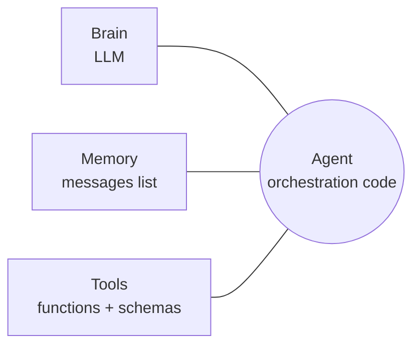
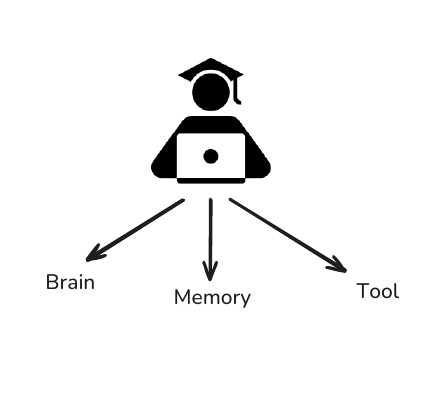
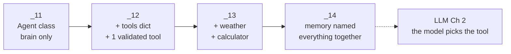

# Chapter 3: Anatomy of an agent

*An agent is plumbing between a brain, a memory and some tools. Build each part by hand and you will recognise it in every framework.*

> [!NOTE]
> **📍 At a glance**
> - **You will learn:** statelessness, model vs chatbot vs agent, calling providers through one interface, and what turns a toy agent into a product
> - **You will build:** a fake LLM client, a provider wrapper, and the class's Trip Planner agent with three validated tools and a memory
> - **Level:** beginner to intermediate · **Time:** about 35 minutes
> - **Builds on:** [Chapter 2](02-python-refresher.md), [LLM Ch 3](../llm/03-inside-the-model.md) · **Leads to:** [LLM Ch 2](../llm/02-the-agentic-loop-in-pure-python.md)

**After this chapter you can:**

- Tell a model, a chatbot and an agent apart, and explain why "memory" is a list you resend
- Call Groq, OpenRouter and OpenAI with one SDK, and fall back to a fake client without a key
- Build an agent class with a brain, validated tools and a memory, as the class does in files `_11` to `_14`
- List what the class agent still lacks, and fix the first gaps: system prompt, tool results in memory, caught errors, bounded memory

---

## 3.1 Model, chatbot, agent

| Level | Adds | Remembers? | Acts? |
|---|---|---|---|
| **Model** | one stateless prediction | no | no |
| **Chatbot** | message history resent each call | yes (via your list) | no |
| **Agent** | tools the **model chooses** + a loop | yes | yes |





- The class's picture: a model on its own is **only a brain**. An agent is like an intern, a "digital human": **brain + memory + tools**
- **LLM calls are stateless.** "Memory" is the whole history resent each time, so long chats get slow, costly and eventually forget the start
- The orchestration code is not intelligent; it routes between the three parts

## 3.2 One interface, many providers

- The class starts with a **fake** client shaped exactly like the real one, so the real thing feels familiar (`_6_fake_ai_call.py`):

```python
class _Message:
    def __init__(self, content: str):
        self.content = content

class _Choice:
    def __init__(self, content: str):
        self.message = _Message(content)

class _FakeResponse:
    def __init__(self, content: str):
        self.choices = [_Choice(content)]

class _Completions:
    def create(self, *, model: str, max_tokens: int, messages: list[dict]) -> _FakeResponse:
        last = messages[-1]["content"].lower()
        if "currency" in last or "convert" in last:
            reply = "I'd reach for a currency conversion tool rather than guess an exchange rate."
        elif "weather" in last:
            reply = "I'd reach for a weather tool for that -- I don't have real eyes on the sky."
        else:
            reply = "I'm a stand-in today, running on simple rules, not a real model."
        return _FakeResponse(reply)

class _Chat:
    def __init__(self):
        self.completions = _Completions()

class FakeAIClient:
    """A drop-in stand-in for a real LLM client, in the OpenAI-compatible shape."""
    def __init__(self):
        self.chat = _Chat()

client = FakeAIClient()
r = client.chat.completions.create(model="fake-model", max_tokens=200,
                                   messages=[{"role": "user", "content": "Convert 50 dollars to euros."}])
print(r.choices[0].message.content)
```

- The shape to remember: `client.chat.completions.create(...)` → `.choices[0].message.content`
- The same file shows a dict version, `fake_ai(...)` → `response["choices"][0]["message"]["content"]`: the JSON the real API sends, before an SDK wraps it in objects
- `_7_ai_call_free_and_paid.py` makes the real call. Only the client setup changes:

| Provider | Cost | `base_url` | Model in class | Key |
|---|---|---|---|---|
| Groq | free, email signup, no card | `https://api.groq.com/openai/v1` | `llama-3.3-70b-versatile` | `GROQ_API_KEY` |
| OpenRouter | free tier | `https://openrouter.ai/api/v1` | `openrouter/free` (routes to whatever is free now) | `OPENROUTER_API_KEY` |
| OpenAI | paid, shown not run | none (the default) | `gpt-4o-mini` | `OPENAI_API_KEY` |

```python
import os
from dotenv import load_dotenv
from openai import OpenAI

load_dotenv()                     # reads .env: GROQ_API_KEY=... (copy .env.example)

def call_groq(question: str) -> str:
    client = OpenAI(api_key=os.environ["GROQ_API_KEY"], base_url="https://api.groq.com/openai/v1")
    response = client.chat.completions.create(
        model="llama-3.3-70b-versatile", max_tokens=200,
        messages=[{"role": "user", "content": question}],
    )
    return response.choices[0].message.content
```

- Every class file **falls back** to the fake client when no key is set, so the code always runs
- Wrapped behind one function, a provider is just configuration (*added by Claude*):

```python
from openai import OpenAI

PROVIDERS = {
    "openai":     dict(base_url=None,                             key="OPENAI_API_KEY"),
    "groq":       dict(base_url="https://api.groq.com/openai/v1", key="GROQ_API_KEY"),
    "openrouter": dict(base_url="https://openrouter.ai/api/v1",   key="OPENROUTER_API_KEY"),
}

def ask(messages, provider="groq", model="llama-3.3-70b-versatile") -> str:
    p = PROVIDERS[provider]
    client = OpenAI(api_key=os.environ[p["key"]], base_url=p["base_url"])
    r = client.chat.completions.create(model=model, max_tokens=300, messages=messages)
    log.info("tokens in=%s out=%s", r.usage.prompt_tokens, r.usage.completion_tokens)
    return r.choices[0].message.content
```

- *Tested* against a local server that speaks the OpenAI API: `ask(...)` returned the reply and logged `tokens in=1 out=1` from `usage`
- Groq, OpenRouter, many local servers: **OpenAI-compatible** (same SDK, different `base_url`)
- **Anthropic differs:** `client.messages.create(...)`, system prompt as a separate `system=` argument, text at `response.content[0].text`, usage as `input_tokens`/`output_tokens` (*not tested here*)
- Wrap providers behind one function so switching model is config, not a rewrite (LangChain's `init_chat_model` does this for you)
- For tests, a **fake client with the same shape** keeps code runnable without keys

> [!CAUTION]
> **🔒 Keys:** `.env.example` lists the three keys with placeholder values; copy it to `.env`, paste real keys there, and keep `.env` out of git. The OpenAI call is paid: the class shows it but never runs it. *Added by Claude: also set a spending limit on any paid key.*

## 3.3 From toy agent to production agent

### The class build, file by file



- **`_11`:** File 2's dataclass pattern, now called `Agent`: `name`, `system_prompt`, `messages`, and `ask_brain()`. A chatbot: all brain, no hands
- **`_12`:** adds `tools: dict` and the currency tool. Arguments pass through a **Pydantic model** before the tool runs:

```python
KNOWN_CURRENCIES = {"USD", "INR", "EUR", "GBP", "JPY"}

class ConvertCurrencyArgs(BaseModel):
    amount: float = Field(gt=0)
    from_currency: str
    to_currency: str

    @field_validator("from_currency", "to_currency")
    @classmethod
    def must_be_known_currency(cls, value: str) -> str:
        value = value.upper().strip()
        if value not in KNOWN_CURRENCIES:
            raise ValueError(f"{value!r} isn't recognized: {KNOWN_CURRENCIES}")
        return value

def call_tool_safely(name: str, raw_arguments: dict):
    if name == "convert_currency":
        try:
            validated = ConvertCurrencyArgs(**raw_arguments)
        except ValidationError as exc:
            return f"Rejected before the tool ran: {exc}"
        return convert_currency(**validated.model_dump())
    if name == "get_weather":
        return get_weather(**raw_arguments)
    if name == "calculator":
        return calculator(**raw_arguments)
    return f"No tool named {name!r}"
```

- **`_13`:** three tools: currency (real API), weather (sample data), calculator (Chapter 1's filtered `eval`)
- **`_14`:** names the memory out loud: *"Memory, in every agent you'll ever build, is a Python list"* of `{"role", "content"}` dicts
- The agent still doesn't **decide** which tool to use; `use_tool(...)` is called by your code. The model choosing is the agentic loop ([LLM Ch 2](../llm/02-the-agentic-loop-in-pure-python.md))
- *Tested:* `use_tool("convert_currency", amount=100, from_currency="usd", to_currency="inr")` normalised the codes to `USD`/`INR` and converted; `amount=-5` with `"xyz"` was rejected with 2 validation errors before the tool ran; an unknown tool name returned `No tool named 'send_email'`

### What the class agent still lacks

The class `Agent` teaches the parts but has gaps that real agents must close. The **tested** rows were observed by running `_11` to `_14` with no API key:

| Part | Toy agent | Production |
|---|---|---|
| System prompt | stored, never sent (tested: no `system` message in `messages`) | always first message; versioned, tested |
| Memory | grows forever | per user/thread; trimmed or summarised; persisted |
| Tool choice | your code decides | the **model** decides via schemas ([LLM Ch 2](../llm/02-the-agentic-loop-in-pure-python.md)) |
| Tool results | not in memory (tested: the `_14` transcript held only the user and assistant turns) | saved as `tool` messages |
| Tool errors | raise, stop the run (tested: a bad calculator expression raised `ValueError` out of `use_tool`) | caught, returned as text |
| Provider failure | silent fallback, which also drops the history (tested: the fake sees only the last question) | timeouts, retries on 429/5xx, clear error |
| Cost | unknown | `usage` logged per call, budgets |
| Visibility | `print` | structured logs, traces (LangSmith, OpenTelemetry) |
| Security | `eval` behind a filter | sandboxed tools, allow-lists, least privilege, human approval |

```python
MAX_MESSAGES = 20

def build_request(system_prompt, messages, question):
    return [{"role": "system", "content": system_prompt},
            *messages[-MAX_MESSAGES:],                      # bounded memory
            {"role": "user", "content": question}]
```

- Fixed-window trimming is the simplest policy; summarising older turns keeps more meaning ([Langchain Ch 7](../langchain/07-middleware.md))
- The first four gaps, closed in one class (*added by Claude*):

```python
@dataclass
class Agent:
    name: str
    system_prompt: str
    client: object                                   # any OpenAI-shaped client, real or fake
    tools: dict = field(default_factory=dict)
    messages: list = field(default_factory=list)
    max_messages: int = 20

    def ask(self, question: str) -> str:
        request = build_request(self.system_prompt, self.messages[-self.max_messages:], question)
        r = self.client.chat.completions.create(model="llama-3.3-70b-versatile",
                                                max_tokens=300, messages=request)
        answer = r.choices[0].message.content
        self.messages += [{"role": "user", "content": question},
                          {"role": "assistant", "content": answer}]
        return answer

    def use_tool(self, name: str, **arguments) -> str:
        try:
            result = str(call_tool_safely(name, arguments))
        except Exception as exc:                      # a tool bug must not end the run
            result = f"Tool {name} failed: {exc}"
        self.messages.append({"role": "user", "content": f"[{name} result] {result}"})
        return result
```

- *Tested* with a fake client that records each request: the system prompt was always first, history was capped at 20 messages, a crashing calculator came back as text, and the tool result was in the next request
- Real tool messages (`role: "tool"` with a `tool_call_id`) need the model to have asked for the tool first. That is the agentic loop, next

> [!IMPORTANT]
> **🏭 In production:** cost grows with history (trim, summarise, prompt caching); one provider wrapper; trace every turn (prompt, tools, tokens, latency). *Added by Claude.*

## 3.4 Added by Claude, not from the sources

- **Write the fake client first.** Tests, demos and CI then never need a key, as every class file shows
- **Never fall back silently.** Log which provider answered; a fake reply shown to a user as real is a bug
- **Validate tool arguments at the boundary**, as `call_tool_safely` does, then extend it to every tool, not just currency
- **One memory per user or thread**, never a module-level list shared by everyone

## Interview corner

**What interviewers listen for:** you know an LLM call is stateless, you can swap providers without rewriting code, and you can list what a demo agent lacks before production.

### 🟢 Basic

<details class="qa"><summary>1. Chatbot vs agent?</summary>

- A chatbot keeps history; an agent also has tools the model chooses, run in a loop until it can answer
- *Stronger answer:* both are stateless underneath; the "memory" is the history you resend each call

</details>

### 🟡 Intermediate

<details class="qa"><summary>2. How do you switch between OpenAI, Groq and Anthropic cleanly?</summary>

- One `ask(messages)` wrapper; OpenAI-compatible providers differ only by `base_url`/key; Anthropic needs an adapter for its message and response shape
- *Stronger answer:* keep provider and model in config, log `usage` per call, and add a fallback model for outages

</details>

<details class="qa"><summary>3. Why build a fake LLM client?</summary>

- Code runs and can be tested with no key, no cost and no network
- It must have the same shape as the real client, so swapping is one line
- *Stronger answer:* scripted fakes make tests deterministic; the LangChain book uses the same idea with `GenericFakeChatModel`

</details>

### 🔴 Senior

<details class="qa"><summary>4. What breaks first when a demo agent goes to production?</summary>

- Unbounded memory (cost, context overflow), uncaught tool errors, no retries, no cost/trace visibility, unsafe tools
- In the class agent: the system prompt is never sent and tool results never reach memory
- *Stronger answer:* fix the order: bounded per-user memory and caught tool errors first, then retries and tracing, then tool security and approvals

</details>

> [!TIP]
> **🧩 Design question:** a support agent for 10,000 users. Cover: per-user memory in a DB with trimming/summaries, provider wrapper with retries and fallback model, tool error handling, cost budgets, tracing, approval for refunds.

## Cheat sheet

```python
client = OpenAI(api_key=os.environ["GROQ_API_KEY"], base_url="https://api.groq.com/openai/v1")
r = client.chat.completions.create(model="llama-3.3-70b-versatile", max_tokens=200, messages=messages)
text = r.choices[0].message.content                 # same path for the fake client
messages.append({"role": "assistant", "content": text})   # memory = the list you resend
request = [{"role": "system", "content": sp}, *messages[-20:], {"role": "user", "content": q}]
```

## Recap

- Model = brain; chatbot = brain + resent history; agent = brain + memory + tools + a loop
- LLM calls are stateless; memory is a list of dicts resent each call
- OpenAI-compatible providers differ by `base_url` and key; a fake client keeps code runnable
- The class agent validates currency arguments with Pydantic before the tool runs
- It still lacks: system prompt sent, tool results in memory, caught tool errors, bounded memory, and the model choosing tools

## Practice

1. Run `_6_fake_ai_call.py`, then add a rule for "time" questions
2. Get a free Groq key, put it in `.env`, and run `_7`. Then break the key and watch the fallback
3. Extend `call_tool_safely` with a Pydantic model for `calculator` arguments
4. Fix the class `Agent` so `ask_brain` sends the system prompt first. Print the request to prove it
5. Make `use_tool` store each result in `messages`, then print the transcript

## How this chapter was checked

- **Run offline**, no API keys, Python 3.13, `pydantic` 2.14.3, `openai` 3.51.0; the currency API replaced by a stand-in returning Frankfurter-shaped JSON
- **3.2:** the `FakeAIClient` block printed the currency reply. `_7` with no key printed the stand-in for Groq and OpenRouter. The `ask()` wrapper ran against a local fake OpenAI server (`base_url` pointed at it) and logged token usage
- **3.3:** `_11` to `_14` as written. Observed: no system message in `messages`; tool calls absent from the transcript; `use_tool("calculator", expression="__import__('os')")` raised `ValueError`; the fallback received only the last question; bad currency arguments rejected with 2 validation errors; an unknown tool returned a message
- **3.3, the improved `Agent`:** run with a recording fake client over 25 turns: every request started with the system prompt, held at most 20 history messages plus the new question, and included the previous tool result
- **Not run:** real Groq, OpenRouter, OpenAI or Anthropic calls

## Sources and further reading

- Live-Class-2026, `Weekend 01 - 27-28 Jun/02-03 - 28 Jun & 4 Jul - Python Refresher & Pydantic Deep Dive/`: `_6_fake_ai_call.py`, `_7_ai_call_free_and_paid.py`, `_11_agent_class_ai_only.py` to `_14_agent_with_memory.py`, `.env.example`, `README.md` (re-read in full 2026-11-15)
- Live-Class-2026, the Class 3–4 whiteboard `Class-3-4.pdf` (the brain, memory and tool figure in `images/`)
- [Groq OpenAI compatibility](https://console.groq.com/docs/openai) and [OpenRouter quickstart](https://openrouter.ai/docs/quickstart) for the `base_url` values
- Added by Claude: the `ask()` wrapper, the improved `Agent`, the production column, 3.4, interview questions 3–4

Previous: [Chapter 2](02-python-refresher.md)
