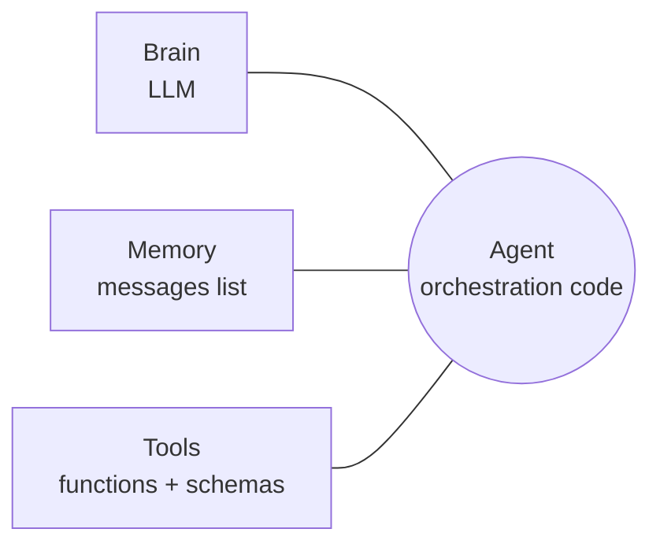

# Chapter 3: Anatomy of an agent

*An agent is plumbing between a brain, a memory and some tools. Build each part by hand and you will recognise it in every framework.*

> [!NOTE]
> **📍 At a glance**
> - **You will learn:** statelessness, model vs chatbot vs agent, calling providers through one interface, and what turns a toy agent into a product
> - **Level:** beginner to intermediate · **Time:** about 20 minutes
> - **Builds on:** [Chapter 2](02-python-refresher.md), [LLM Ch 3](../llm/03-inside-the-model.md) · **Leads to:** [LLM Ch 2](../llm/02-the-agentic-loop-in-pure-python.md)

---

## 3.1 Model, chatbot, agent

| Level | Adds | Remembers? | Acts? |
|---|---|---|---|
| **Model** | one stateless prediction | no | no |
| **Chatbot** | message history resent each call | yes (via your list) | no |
| **Agent** | tools the **model chooses** + a loop | yes | yes |



- **LLM calls are stateless.** "Memory" is the whole history resent each time, so long chats get slow, costly and eventually forget the start
- The orchestration code is not intelligent; it routes between the three parts

## 3.2 One interface, many providers

```python
from openai import OpenAI

PROVIDERS = {
    "openai":     dict(base_url=None,                             key="OPENAI_API_KEY"),
    "groq":       dict(base_url="https://api.groq.com/openai/v1", key="GROQ_API_KEY"),
    "openrouter": dict(base_url="https://openrouter.ai/api/v1",   key="OPENROUTER_API_KEY"),
}

def ask(messages, provider="groq", model="llama-3.3-70b-versatile") -> str:
    p = PROVIDERS[provider]
    client = OpenAI(api_key=os.environ[p["key"]], base_url=p["base_url"])
    r = client.chat.completions.create(model=model, max_tokens=300, messages=messages)
    log.info("tokens in=%s out=%s", r.usage.prompt_tokens, r.usage.completion_tokens)
    return r.choices[0].message.content
```

- Groq, OpenRouter, many local servers: **OpenAI-compatible** (same SDK, different `base_url`)
- **Anthropic differs:** `client.messages.create(...)`, system prompt as a separate `system=` argument, text at `response.content[0].text`, usage as `input_tokens`/`output_tokens`
- Wrap providers behind one function so switching model is config, not a rewrite (LangChain's `init_chat_model` does this for you)
- For tests, a **fake client with the same shape** keeps code runnable without keys

## 3.3 From toy agent to production agent

The class `Agent` (a dataclass with `name`, `system_prompt`, `tools`, `messages`) teaches the parts but has gaps that real agents must close:

| Part | Toy agent | Production |
|---|---|---|
| System prompt | stored, never sent | always first message; versioned, tested |
| Memory | grows forever | per user/thread; trimmed or summarised; persisted |
| Tool choice | your code decides | the **model** decides via schemas ([LLM Ch 2](../llm/02-the-agentic-loop-in-pure-python.md)) |
| Tool results | not in memory | saved as `tool` messages |
| Tool errors | raise, stop the run | caught, returned as text |
| Provider failure | silent fallback | timeouts, retries on 429/5xx, clear error |
| Cost | unknown | `usage` logged per call, budgets |
| Visibility | `print` | structured logs, traces (LangSmith, OpenTelemetry) |
| Security | `eval` behind a filter | sandboxed tools, allow-lists, least privilege, human approval |

```python
MAX_MESSAGES = 20

def build_request(system_prompt, messages, question):
    return [{"role": "system", "content": system_prompt},
            *messages[-MAX_MESSAGES:],                      # bounded memory
            {"role": "user", "content": question}]
```

- Fixed-window trimming is the simplest policy; summarising older turns keeps more meaning ([Langchain Ch 7](../langchain/07-middleware.md))

> [!IMPORTANT]
> **🏭 In production:** cost grows with history (trim, summarise, prompt caching); one provider wrapper; trace every turn (prompt, tools, tokens, latency).

## Interview corner

<details class="qa"><summary>1. Chatbot vs agent?</summary>

- A chatbot keeps history; an agent also has tools the model chooses, run in a loop until it can answer

</details>

<details class="qa"><summary>2. How do you switch between OpenAI, Groq and Anthropic cleanly?</summary>

- One `ask(messages)` wrapper; OpenAI-compatible providers differ only by `base_url`/key; Anthropic needs an adapter for its message and response shape

</details>

<details class="qa"><summary>3. What breaks first when a demo agent goes to production?</summary>

- Unbounded memory (cost, context overflow), uncaught tool errors, no retries, no cost/trace visibility, unsafe tools

</details>

> [!TIP]
> **🧩 Design question:** a support agent for 10,000 users. Cover: per-user memory in a DB with trimming/summaries, provider wrapper with retries and fallback model, tool error handling, cost budgets, tracing, approval for refunds.

---

*Source: Live-Class-2026 classes 02–04 (`_01`, `_02`, `_6`, `_7`, `_11`–`_14`); production table and provider wrapper added by Claude.*

Previous: [Chapter 2](02-python-refresher.md)
