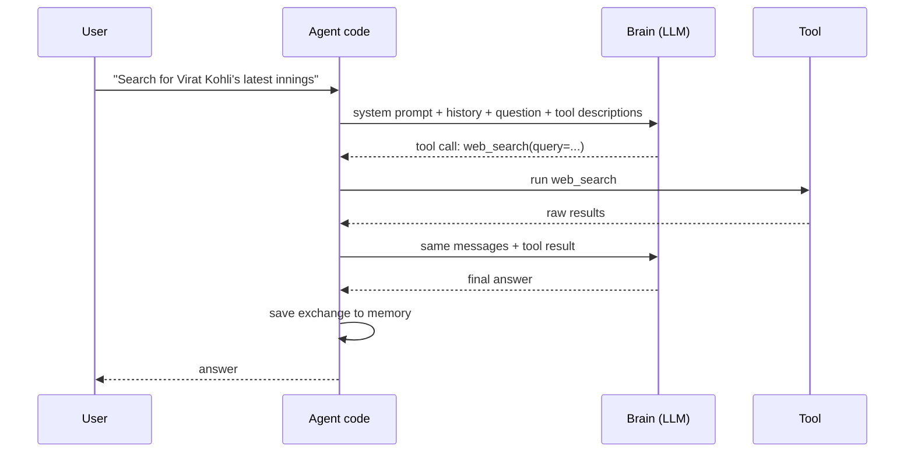

# Chapter 3: Anatomy of an agent

*An agent is plumbing between a brain, a memory and some tools. Build each part by hand and you will recognise it in every framework.*

> [!NOTE]
> **📍 At a glance**
> - **You will learn:** why LLM calls are stateless, how a model, a chatbot and an agent differ, how to call four providers, and what separates a toy agent from a production one
> - **You will build:** read and fix the class `Agent` (files `_11` to `_14`) so it sends its system prompt, keeps tool results and trims its memory
> - **Level:** beginner to intermediate · **Time:** about 60 minutes
> - **Builds on:** [Chapter 2](02-python-refresher.md), [Pydantic Ch 5](../pydantic/05-validating-llm-output.md), [LLM Ch 3](../llm/03-inside-the-model.md). **Leads to:** [LLM Ch 2](../llm/02-the-agentic-loop-in-pure-python.md) (the loop)

**After this chapter you can:**

- Explain why LLM calls are stateless
- Tell a model, a chatbot and an agent apart in real code
- Name the parts of an agent: brain, memory, tools
- Call four providers and read each response shape
- Read the class's `Agent` class (files `_11` to `_14`) and spot what it does not do yet
- List what a production agent adds: bounded memory, caught errors, retries, cost tracking, tracing

## 3.1 The big idea: LLM calls are stateless

- Every call takes an input and gives an output. The model remembers nothing
- What looks like memory is the **entire history resent** with every message
- Message 2 really sends message 1, reply 1 and message 2
- A new Google search does not remember your last one. A new LLM call is the same
- The class proved it live: a single "hi" in one chat tool used tens of thousands of tokens (hidden system prompts and tool context), and the count rose as the chat grew
- Consequence: long chats get slow, costly and forgetful. A new chat resets the resent history
- How the context window fills up: [LLM Ch 3](../llm/03-inside-the-model.md)

*Source: `classes_summary/04`, `classes_transcription_summary/04`.*

## 3.2 Model, chatbot, agent: three levels in real code

`_01_ai_model_vs_chatbot_vs_agent.py` draws all three with no API calls:

```python
def ai_model(question: str) -> str:
    """A single one-shot prediction. Remembers NOTHING between calls."""
    return f"[Mock prediction for]: {question}"

class Chatbot:
    """Wraps ai_model() with conversation history."""
    def __init__(self) -> None:
        self.history: list[dict] = []

    def ask(self, question: str) -> str:
        self.history.append({"role": "user", "content": question})
        answer = ai_model(question)
        self.history.append({"role": "assistant", "content": answer})
        return answer

class Agent:
    """Wraps ai_model() with history AND a set of tools it can choose to use."""
    def __init__(self, tools: dict[str, callable]) -> None:
        self.history: list[dict] = []
        self.tools = tools

    def decide_tool(self, question: str) -> str | None:
        for name in self.tools:
            if name in question.lower():   # a KEYWORD match -- deliberately naive
                return name
        return None

    def ask(self, question: str) -> str:
        self.history.append({"role": "user", "content": question})
        tool_name = self.decide_tool(question)
        if tool_name is not None:
            answer = f"[used tool: {tool_name}] {self.tools[tool_name]()}"
        else:
            answer = ai_model(question)
        self.history.append({"role": "assistant", "content": answer})
        return answer
```

- `decide_tool` is a placeholder. String matching is not how real decisions work. The next class has the model choose by meaning
- ✅ *Verified:* the chatbot's history grew by 2 per question (2, then 4). The agent used the tool for "what is the weather?" and answered normally for "tell me about Tokyo"
- *Checked, the weakness:* "WEATHER?" matched (it lower-cases); "whether it rains" did not

*Source: `classes_summary/04`, `Project 0/_01_ai_model_vs_chatbot_vs_agent.py`.*

## 3.3 Brain, memory, tools

- **Brain:** the LLM. The only part that decides anything
- **Memory:** the chat history, in a database or in memory
- **Tools:** web search, a calculator, a calendar
- The agent itself is only plumbing between these three. LangChain, LangGraph and CrewAI all do this
- Analogy: hiring an intern
  - A laptop with no skills (a weak brain) can do little
  - A brilliant brain with no tools cannot act in the world
  - The brain sets a hard ceiling. A cheap, weak model fails on complex tasks however good the orchestration



### The three-step build-up shown in class

1. **Brain only.** Say "Hi, I am Mayank", then ask "Who am I?" The agent cannot answer: no history attached
2. **Add memory.** Before each call, fetch the earlier messages, send them with the new one, then save the exchange. One brain call per turn
   - Short-term memory only: a fresh chat starts blank. Long-term memory is a later topic
3. **Add tools.** A tool's description tells the brain it exists
   - Casual greeting: the brain replies directly
   - Factual question: the brain picks a tool, the tool returns raw results, the brain is called a **second time** to write the answer
   - Flow: brain, decide, maybe tool, brain again, respond

The class 03-04 whiteboard draws the same:

- Instructions: "You are a helpful assistant, you have 3 tools" (web search, calculator, weather), next to the memory
- For "Search for Virat Kohli latest innings": the brain answers with a tool call, the tool returns results, the brain is called again for the reply
- The slide calls the agent an intern or digital human made of brain, memory and tools. A student's definition: an agent works out the steps of a task and does them, instead of only answering

*Source: `classes_transcription_summary/04`, `Class-3-4.pdf`. The class demos used a visual workflow tool as illustration; they are not code here.*

## 3.4 Calling a real model: four providers, one shape

`_02_calling_the_ai_paid_and_free.py` puts the providers side by side. OpenAI and Groq share an SDK and response shape. Groq is free and needs only a different `base_url`. Anthropic's SDK is the exception:

```python
def ask_openai(question: str) -> str:
    from openai import OpenAI
    client = OpenAI(api_key=os.environ["OPENAI_API_KEY"])
    response = client.chat.completions.create(model="gpt-4o-mini", max_tokens=200,
                                              messages=[{"role": "user", "content": question}])
    return response.choices[0].message.content

def ask_anthropic(question: str) -> str:
    """The ONE exception: .messages.create(), and .content[0].text"""
    from anthropic import Anthropic
    client = Anthropic(api_key=os.environ["ANTHROPIC_API_KEY"])
    response = client.messages.create(model="claude-3-5-haiku-20241022", max_tokens=200,
                                      messages=[{"role": "user", "content": question}])
    return response.content[0].text

def ask_groq(question: str) -> str:
    """Free. The OpenAI SDK, pointed at Groq's own base_url."""
    from openai import OpenAI
    client = OpenAI(api_key=os.environ["GROQ_API_KEY"], base_url="https://api.groq.com/openai/v1")
    response = client.chat.completions.create(model="llama-3.3-70b-versatile", max_tokens=200,
                                              messages=[{"role": "user", "content": question}])
    return response.choices[0].message.content
```

- ✅ *verified* against local stand-in servers with the real SDKs: `ask_openai` and `ask_anthropic` both returned their text, through the two different response shapes. The Anthropic request carried only `model`, `max_tokens` and `messages`
- `ask_openai` also **prints the whole response object** (a debug line left in the file)

### A fake client with the same shape (`_6_fake_ai_call.py`)

- A no-dependency stand-in with exactly the shape of the real client
- `FakeAIClient` has `chat.completions.create(model, max_tokens, messages)` returning `choices[0].message.content`
- It answers by rule on the last user message: "currency" or "convert" says it would use a currency tool, "weather" a weather tool, anything else says it is a stand-in

```python
client = FakeAIClient()
response = client.chat.completions.create(
    model="fake-model", max_tokens=200,
    messages=[{"role": "user", "content": "Convert 50 dollars to euros."}],
)
print(response.choices[0].message.content)
```

- That shape is what Groq, OpenRouter and OpenAI use. Anthropic is the exception
- The file has a second, plain-dict fake: `fake_ai(model, max_tokens, messages)` returns `{"choices": [{"message": {"content": reply}}]}`
- **Pitfall:** the file runs that second version at module level, outside `if __name__ == "__main__":`. Importing `_6_fake_ai_call` (as `_7`, `_11` to `_14` do) prints its extra lines. ✅ *verified* when running `_11` to `_14`

*Source: `_6_fake_ai_call.py`. Run offline.*

### Free and paid providers in one file (`_7_ai_call_free_and_paid.py`)

| Provider | Cost | Set-up |
|---|---|---|
| Groq | Free, email sign-up, no card | OpenAI SDK, `base_url="https://api.groq.com/openai/v1"` |
| OpenRouter | Free tier | OpenAI SDK, `base_url="https://openrouter.ai/api/v1"`, `model="openrouter/free"` (routes to a free model so the code does not go stale) |
| OpenAI | Paid, shown for completeness, not run automatically | OpenAI SDK, no `base_url` |

- `uv add openai python-dotenv`, then `GROQ_API_KEY` and/or `OPENROUTER_API_KEY` in `.env`. The file calls `load_dotenv()` and reads `os.environ`
- Functions: `call_groq`, `call_openrouter`, `call_openai_paid`
- **Fall-back:** a missing key or an error uses the fake client from `_6`, so the file always runs:

```python
def call_fallback(question: str) -> str:
    from _6_fake_ai_call import FakeAIClient
    client = FakeAIClient()
    response = client.chat.completions.create(
        model="fallback", max_tokens=200, messages=[{"role": "user", "content": question}]
    )
    return response.choices[0].message.content
```

- ✅ *verified* with no keys: "No GROQ_API_KEY set. Stand-in: ..." and "No OPENROUTER_API_KEY set. Stand-in: ...", plus a note that the paid call is not made
- The OpenRouter walk-through (key, free model, token counts) is in [LLM Ch 3](../llm/03-inside-the-model.md)
- In the agent class, `ask_ai()` picks whichever key is set in `.env`, free first. Reused for the rest of the course
> [!CAUTION]
> **🔒 Security: API keys**
> - Keys live in `.env`, which must be in `.gitignore`; the class code reads them with `load_dotenv()` and `os.environ`
> - A key pushed to a public repo is found by scanners within minutes: revoke it at once, do not just delete the commit
>
> *Added by Claude.*

- **Check model names before you copy.** `claude-3-5-haiku-20241022` and `gpt-4o-mini` were current when the class ran (July 2026) and may be retired

*Source: `_7_ai_call_free_and_paid.py`, `classes_summary/04`, `Project 0/_02_calling_the_ai_paid_and_free.py`.*

## 3.5 Structuring the reply with Pydantic

- Ask the model for **only** a JSON object and validate it with a Pydantic model (`WeatherQuestion`: `city`, `wants_fahrenheit`) before trusting any field
- Code and the failure table: [Pydantic Ch 5](../pydantic/05-validating-llm-output.md), 5.4

## 3.6 Giving it a tool, by hand

`_04_giving_it_a_tool.py` connects the extraction to a real tool, but **you** decide to call it:

```python
def answer_weather_question(user_message: str) -> str:
    extracted = extract_weather_question(user_message)
    if not isinstance(extracted, WeatherQuestion):
        return f"Could not extract a city: {extracted}"
    return get_weather(extracted.city)      # <- "we decided"
```

- The model decides nothing beyond extraction. The next class lets it decide when to use the tool: [LLM Ch 2](../llm/02-the-agentic-loop-in-pure-python.md)

*Source: `classes_summary/04`, `Project 0/_04_giving_it_a_tool.py`.*

## 3.7 The `Agent` class: files `_11` to `_14`

The class 02-03 folder ends with an `Agent` class that grows one idea per file. Each file reuses the `BankAccount` and `Book` pattern from [Chapter 2](02-python-refresher.md).

| File | What it adds |
|---|---|
| `_11_agent_class_ai_only.py` | `Agent` as a dataclass: `name`, `system_prompt`, `messages`, with `remember`, `show_transcript`, `ask_brain`. "All brain, no hands" |
| `_12_agent_with_one_tool.py` | A `tools` dict and the validated currency tool; `use_tool(name, **args)` |
| `_13_agent_with_more_tools.py` | Three tools: currency, weather (sample data), calculator |
| `_14_agent_with_memory.py` | Names memory: a list of `{"role", "content"}` dicts |

```python
@dataclass
class Agent:
    name: str
    system_prompt: str
    tools: dict = field(default_factory=dict)
    messages: list = field(default_factory=list)   # this IS the memory

    def ask_brain(self, question):
        self.remember("user", question)
        # real call to Groq if GROQ_API_KEY is set, else the _6 stand-in
        self.remember("assistant", answer)
        return answer

    def use_tool(self, name, **arguments):
        return call_tool_safely(name, arguments)    # WE decide, not the brain
```

- `ask_brain` uses Groq (`llama-3.3-70b-versatile`) if `GROQ_API_KEY` is set and the call works. Otherwise `_fallback` uses the `_6` stand-in
- `call_tool_safely` validates currency arguments with Pydantic, then calls the tool by name; an unknown name returns "No tool named ..."
- The tool code (`TOOL_REGISTRY`, `@tool`, `ConvertCurrencyArgs`) is **copied** into `_12`, `_13` and `_14`
- `_14` runs its "memory" demo **at import**, not inside `__main__`, so importing it prints text
- The file ends by saying the missing piece is the brain choosing a tool itself, "the actual agent loop"

*✅ *verified** (no keys; the live currency call fails in the sandbox but is caught):

- `_11`: the transcript held two lines (user, assistant: the stand-in's reply)
- `_12`: the currency tool logged `[tool call] convert_currency({'amount': 100.0, 'from_currency': 'USD', 'to_currency': 'INR'}) -> ...` and returned the "Couldn't reach" message
- `_13`: weather gave `22°C, partly cloudy`; the calculator gave `71.6` for `22 * 9 / 5 + 32`
- `_14`: after the three tool calls the transcript still held **only** the brain's two lines

**What the class files do not do** (all *checked* with a recording stand-in for the Groq client):

1. **`system_prompt` is never sent.** The second request carried roles `user, assistant, user`, and the text "Always answer in French" appeared in none. The field is stored and unused
2. **Tool results are not in memory.** After `use_tool("get_weather")` and a follow-up question, no message held the weather text. So the transcript in `_14` is not "the agent's memory, end to end" as its heading says
3. **The fallback ignores history.** `_fallback` sends only the last question
4. **Tool errors escape.** `use_tool("calculator", expression="__import__('os')")` raised `ValueError`; `"1/0"` raised `ZeroDivisionError`; `use_tool("get_weather", town="x")` raised `TypeError`. Only currency arguments are validated; an unknown name and a bad currency return messages
5. **The weather and calculator tools have no schema or description for a model.** Nothing tells a model they exist ([LLM Ch 2](../llm/02-the-agentic-loop-in-pure-python.md) adds schemas)

*Source: code files `_11` to `_14` in `Weekend 01 - 27-28 Jun/02-03 - .../`.*

## 3.8 Questions from the class

| Question | Answer |
|---|---|
| Does Copilot or Claude send a company's private code to a shared database? | No. Providers do not pool your code across companies |
| Why are input tokens charged? | Every token has to be processed, including an uploaded PDF |
| Are the LLM and the embedding model the same? | No, they are separate specialised models |
| Do parameters change as users chat? | No. They are fixed after training |

## 3.9 From toy agent to production agent

The class `Agent` teaches the parts. A production agent keeps the same parts and hardens each one.

| Part | Class `Agent` (`_11` to `_14`) | Production |
|---|---|---|
| System prompt | stored, never sent | always sent first; versioned and tested |
| Memory | a list that grows forever | per user or thread; trimmed or summarised; stored in a database |
| Tool results | not in memory | saved as `tool` messages so the next turn can see them |
| Tool errors | raise and stop the run | caught and returned as text the model can read |
| Provider failures | silent fallback to a stand-in | timeouts, retries with backoff on 429 and 5xx, then a clear error |
| Cost | unknown | `usage` tokens logged per call; budget limits |
| Visibility | `print` | structured logs and traces (LangSmith, OpenTelemetry) |
| Security | `eval` behind a character check | sandboxed tools, allow-lists, least-privilege keys, human approval for risky actions |

A minimal fixed `ask`:

```python
MAX_TURNS = 20                                      # keep the last 20 messages

def build_request(system_prompt, messages, question):
    recent = messages[-MAX_TURNS:]                  # bounded memory
    return [{"role": "system", "content": system_prompt}, *recent,
            {"role": "user", "content": question}]

def ask(client, model, system_prompt, messages, question):
    request = build_request(system_prompt, messages, question)
    response = client.chat.completions.create(model=model, max_tokens=300, messages=request)
    answer = response.choices[0].message.content
    messages += [{"role": "user", "content": question}, {"role": "assistant", "content": answer}]
    return answer
```

- ✅ *Verified with a recording stand-in client: the first message sent was the system prompt, and after 15 turns the request held 1 + 20 + 1 messages, not 31.*
- Cutting a fixed number of messages is the simplest policy; summarising older turns keeps more meaning ([Langchain Ch 7](../langchain/07-middleware.md) does this with middleware)
- Read the cost from the response: `response.usage.prompt_tokens` and `completion_tokens` on OpenAI-style APIs, `usage.input_tokens` and `output_tokens` on Anthropic

> [!IMPORTANT]
> **🏭 In production**
> - **Cost grows with history.** Every turn resends everything, so a long chat costs more per message. Trim, summarise, or use the provider's prompt caching
> - **Wrap providers behind one function** (`ask(messages) -> text`) so switching models is a configuration change, not a rewrite
> - **Trace every turn:** which prompt, which tools, how many tokens, how long. You cannot fix what you cannot see
>
> *Added by Claude.*

## 3.10 Added by Claude, not from the sources

- **Fix the class `Agent` in four lines.** Prepend `{"role": "system", "content": self.system_prompt}` when building the request. Append tool results as `tool` messages. Send `self.messages` in the fallback. Wrap `use_tool` in `try/except` and return the error text
- **Anthropic takes the system prompt separately** (a `system` parameter), not as a message in the list. The OpenAI-style `system` role used above applies to OpenAI, Groq and OpenRouter
- **Names change fast.** Treat every model id in these files as an example
- **Put copied tool code in one module.** `_12` to `_14` repeat about 50 lines. A shared module avoids three versions drifting apart

## 3.11 Interview corner

**What interviewers listen for:** statelessness and what it costs, the brain–tool–brain loop, and how you would harden a toy agent.

### 🟢 Basic

<details class="qa"><summary>1. What are the three parts of an agent?</summary>

- Brain (the model), memory (the history), tools; the agent is the code that joins them
- *Stronger answer:* the brain sets the ceiling: weak model, weak agent, however good the code

</details>

<details class="qa"><summary>2. Model, chatbot, agent: what separates them?</summary>

- A model is one stateless call; a chatbot adds history; an agent adds tools it chooses itself

</details>

<details class="qa"><summary>3. Why is the brain called twice when a tool is used?</summary>

- Once to choose the tool, again to turn the tool's result into an answer

</details>

### 🟡 Intermediate

<details class="qa"><summary>4. How do you swap providers without rewriting code?</summary>

- OpenAI, Groq and OpenRouter share an SDK and shape: change `base_url`, key and model
- *Stronger answer:* Anthropic differs (`messages.create`, `content[0].text`, system prompt as a separate parameter), so hide providers behind one adapter function

</details>

<details class="qa"><summary>5. Where does an agent's memory live?</summary>

- In a list of messages resent each call; long-term memory needs a store
- *Stronger answer:* scope it per user or thread, and bound it (trim or summarise)

</details>

<details class="qa"><summary>6. What bugs does the class <code>Agent</code> have?</summary>

- System prompt never sent; tool results not stored; fallback ignores history; tool errors escape
- *Stronger answer:* each is a one-to-four-line fix (3.10), and each is a classic production incident

</details>

### 🔴 Senior

<details class="qa"><summary>7. The agent's cost per conversation doubled after launch. Why, and what do you do?</summary>

- Calls are stateless, so every turn resends the whole growing history
- *Stronger answer:* measure `usage` per call, trim or summarise old turns, cache the stable prefix (system prompt, tool schemas), and use a cheaper model for simple steps

</details>

<details class="qa"><summary>8. A tool raises an exception mid-conversation. What should happen?</summary>

- Catch it and return the error as a tool message
- *Stronger answer:* the model can retry with better arguments or explain the failure; log it with the trace id, and never leak internal details or secrets in the message

</details>

> [!TIP]
> **🧩 Design question**
> - *"Design memory for a support agent used by 10,000 customers."*
> - Talk about: a thread id per conversation, messages in a database, a bounded window plus a running summary, long-term facts per customer stored separately, privacy and deletion, and cost per conversation

## Cheat sheet

```python
messages = [{"role": "system", "content": "You are concise."},
            {"role": "user", "content": "Hi"}]                       # resend all of it every call
r = client.chat.completions.create(model=MODEL, max_tokens=200, messages=messages)
text, used = r.choices[0].message.content, r.usage                  # OpenAI, Groq, OpenRouter
a = anthropic.messages.create(model=MODEL, max_tokens=200, system="You are concise.",
                              messages=[{"role": "user", "content": "Hi"}])
text = a.content[0].text                                            # Anthropic shape
```

## Recap

- LLM calls are stateless; memory is the history resent
- Model, chatbot, agent = one call, plus history, plus tools
- Brain, memory, tools. The brain is called again after a tool runs
- OpenAI, Groq and OpenRouter share a shape; Anthropic differs
- The class `Agent` (`_11` to `_14`) holds brain, tools and a list, but does not send its system prompt, store tool results or catch tool errors
- Production adds: system prompt always sent, bounded memory, caught tool errors, retries, cost and trace logging
- Next: the model chooses the tool ([LLM Ch 2](../llm/02-the-agentic-loop-in-pure-python.md))

## Practice

1. Explain "LLM calls are stateless" in your own words, with an example
2. Run `_02` and compare Anthropic's response shape with the others
3. Trace `_03` ([Pydantic Ch 5](../pydantic/05-validating-llm-output.md)) and say why the code-fence markers are stripped
4. Run `_04` and point to the one line that means "we decided"
5. Make `_14`'s agent send its system prompt, and prove it with a recording stand-in
6. Make `use_tool` return an error message instead of raising
7. Add a 20-message window to the class `Agent` and log the token usage of each call

## How this chapter was checked

- **Run:** `_01` (chatbot history, agent keyword match); `_02`'s `ask_openai` and `ask_anthropic` against local stand-in servers; `_6` and `_7` with no keys; `_11` to `_14` with no keys; the recording stand-in tests for `system_prompt`, tool results and tool errors
- **Not run:** `_02` with real keys, Groq, OpenRouter, `_04` end to end, the live currency API
- **Run in the 2026 review:** the 3.9 `build_request`/`ask` code with a recording stand-in client (system prompt first, window of 20 messages); the cheat sheet against stand-in OpenAI-shape and Anthropic-shape clients
- 3.9, the sequence diagram, the security and production boxes and the graded interview were added in the 2026 review (Added by Claude: standard practice)
- The body was written earlier; the class summaries and whiteboard were not re-opened in this pass. Section 3.7 came from reading and running `_11` to `_14`

## Sources and further reading

- Live-Class-2026, `classes_summary/04 - 5 Jul - Anatomy of an Agent.md`
- Live-Class-2026, `classes_transcription_summary/04 - 5 Jul - Anatomy of an Agent.md`
- Live-Class-2026, code folder `Weekend 02 - 4-5 Jul/04-05 - 5 Jul & 11 Jul - .../Project 0/`
- Live-Class-2026, code files `_6`, `_7`, `_11`, `_12`, `_13`, `_14` in the class 02-03 folder `Weekend 01 - 27-28 Jun/02-03 - .../`

Previous: [Chapter 2](02-python-refresher.md)
