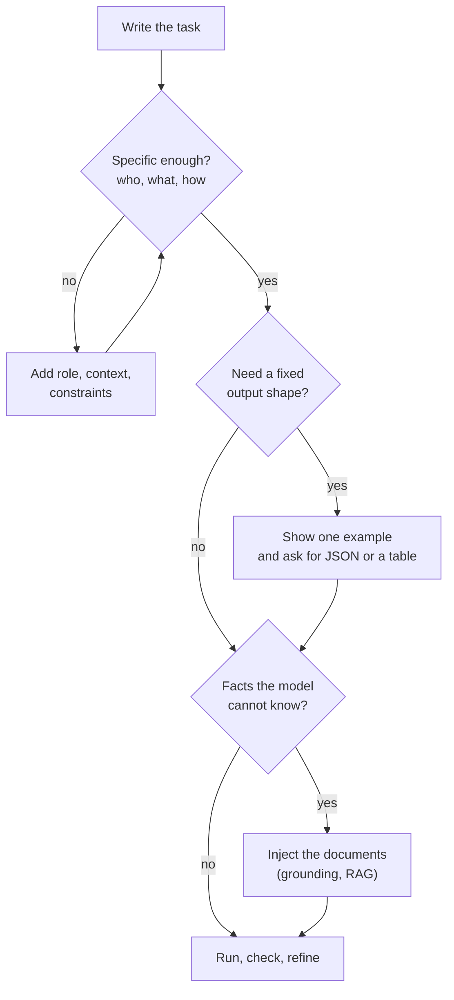
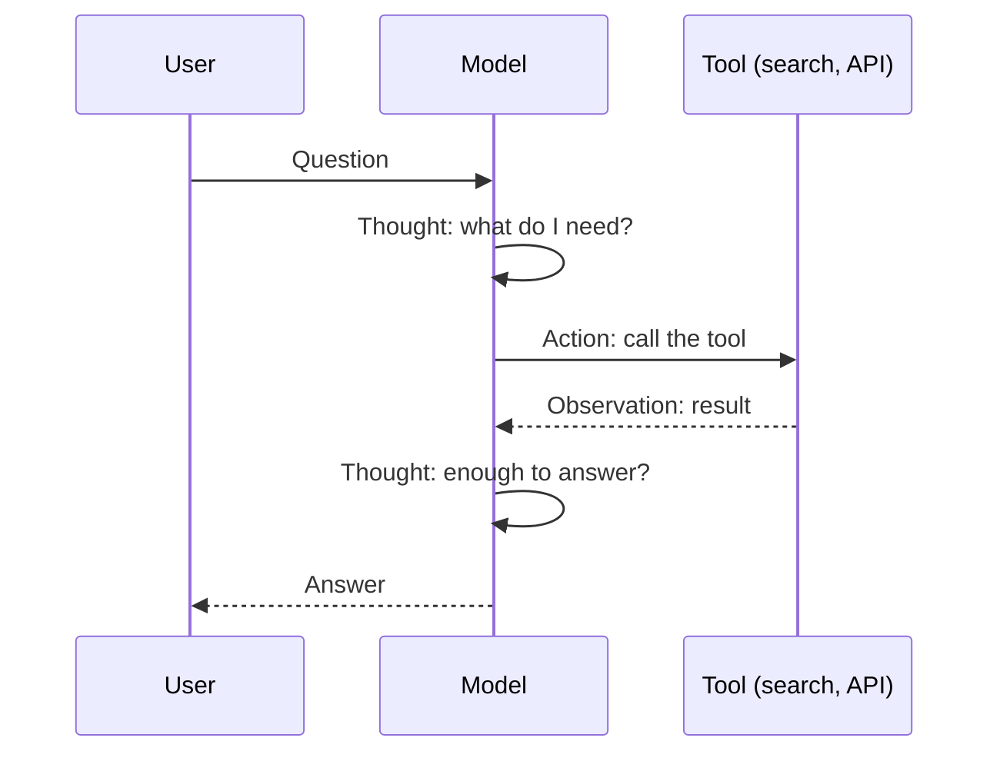

# Prompt engineering: from zero-shot to grounded prompts

*Modern models are smart enough that most "prompt tricks" no longer matter. The few techniques that still do are about being specific, showing an example, and giving the model the facts it lacks.*

> [!NOTE]
> **📍 At a glance**
> - **You will learn:**
>   - what a prompt is, and why prompting is "Software 3.0"
>   - zero-shot and few-shot prompting
>   - chain-of-thought and reasoning models, role and system prompts, and ReAct
>   - structured output and context injection
>   - how to prompt a grounded assistant such as Joule for Consultants
> - **You will build:** a one-shot prompt with a system message, and a parser that rejects any reply that is not the JSON you asked for
> - **Level:** beginner · **Time:** about 35 minutes
> - **Builds on:** [Inside a large language model](llm-prompt-to-answer.md)
> - **Last checked:** 20 Nov 2026

**After this chapter you can:**

- Explain why prompting replaced much of the coding and training work for language tasks
- Turn a vague prompt into a specific one, with role, context, format and an example
- Decide when chain-of-thought instructions still help, and when they are wasted
- Ask for structured output and validate it in code
- Write prompts that get better answers from a retrieval-based assistant

## 5.1 What a prompt is, and Software 3.0

- A **prompt** is everything you send the model: the instruction, the question, any context and any examples.
- With AI you once wrote code; with machine learning you trained a model.
  - With generative AI, someone else has trained the model and serves it through an API, or lets you run it locally.
  - Your job is to tell it what you want, in natural language: **prompting**.
- Andrej Karpathy, a leading AI researcher, calls this **Software 3.0**:

| Era | You write | Example |
|---|---|---|
| **Software 1.0** | Explicit code | ABAP, Python, Java |
| **Software 2.0** | Neural-network weights, learned from data | An image classifier |
| **Software 3.0** | Prompts in natural language; the LLM is the programmable part | "Summarise this contract in five bullets" |

| Traditional code | Prompting |
|---|---|
| Explicit step-by-step logic | You state the intent; the model finds the path |
| Deterministic: same input, same output | Probabilistic: outputs vary |
| You handle every edge case | The model handles many unseen cases |
| The machine follows syntax | The model follows context, tone and nuance |

- **Prompt engineering is lighter than it was.** A few years ago long, elaborate prompts were sold as digital products.
  - Today's models give much the same result for "summarise this book in one line" as for a page-long template.
  - Spend learning time on AI fundamentals rather than on prompt tricks.



## 5.2 Zero-shot and few-shot

- **Zero-shot:** only the instruction, no example. "Do a sentiment analysis of this review."
  - The model decides the output itself: it may return a heading, a rating and a long breakdown.
- **One-shot:** one worked example of input and the output you want. **Few-shot:** two to five examples.
  - The model copies the pattern for every new input.
  - From one example, review after review comes back as just "sentiment" and "course".
- The terms come from the GPT-3 paper (2020): examples are given in the prompt at run time, with no change to the model's weights.
- **Why it still matters:** it is often hard to say exactly what you want, but easy to show it. You train a new colleague the same way.

> [!TIP]
> Few-shot is the highest-impact technique for tasks without much reasoning: classification, extraction and fixed formats. Pick examples that cover the tricky cases, not three easy ones.

## 5.3 Chain-of-thought and reasoning models

- **Chain-of-thought (CoT):** asking the model to "think step by step" before answering.
  - It helped older models a lot on maths, logic and multi-step problems.
- **Reasoning models think by themselves.** OpenAI released o1-preview, the first of its reasoning series, on 12 Sep 2024.
  - Today's flagship models reason internally: they plan, search, check and re-plan before answering, and many apps let you open that thinking.
  - Telling them to think step by step adds little.
- **When CoT still helps:**
  - Small, non-reasoning models, chosen to save cost on simple tasks.
  - When you want to audit the logic: "explain how you reached this, step by step".

## 5.4 Role and system prompts

- **Role prompt:** give the model a persona. The same question gets a different focus.
  - "Explain the SAP Business AI Platform" gives a general overview.
  - "You are a senior SAP security consultant. Explain the SAP Business AI Platform" frames it as an attack surface and governance boundary. It covers identity and access, data security and AI governance, without being asked.
  - One role word stands in for a whole list of instructions.
- **System prompt:** standing instructions that apply to every turn of a conversation, or every chat in an app.
  - Use it for who you are and what your terms mean, so you do not repeat it. For example: "SAC means SAP Analytics Cloud".
  - Chat apps call this custom instructions, memory or projects.

| | Role prompt | System prompt |
|---|---|---|
| Scope | One request | The whole conversation or app |
| Typical content | "You are a finance architect…" | Tone, format, glossary, rules, refusals |
| Example | "As a BTP security architect, review this role assignment" | "Answer in bullets. Say 'unknown' if unsure." |

- **The system prompt outranks the user.** A rule typed by the user in the chat ("always answer in Pig Latin") is soon forgotten; the same rule as a system instruction holds for every turn. (Lecture 13 demo.)
- **Scope is a guardrail.** "You are a tour guide" still answers tax questions. "Answer only travel questions; for anything else say it is outside your scope" refuses them. A support bot that answers off-topic questions (the class example was the Joule on api.sap.com) is missing this.
- **Who outranks whom:**

| Level | Set by | Can the user override it? |
|---|---|---|
| Vendor safety rules | The model maker, built into the model | No; attempts to break them are called **jailbreaking** |
| System prompt | The app or agent builder | Should not; harden it against "ignore your instructions" |
| User prompt | The end user | — |

- **In Joule Studio** the agent's instructions play the role of the system prompt; put guardrails such as "read-only, never delete data" in the first instruction blocks, not in additional context.
- **Messages in a stored template:** system (rules), user (question), assistant (a sample answer, which makes it one-shot or few-shot) and variables. How to build and version one in SAP AI Launchpad: [chapter 7.7](sap-ai-core-launchpad.md).

## 5.5 ReAct: reason, then act

- **ReAct** (Yao et al., 2022) interleaves **thoughts** with **actions**, such as a search or a tool call, and **observations** of the results.
  - Thought: "I need today's price." → Action: search → Observation: the price → Thought: "Now I can answer."
- It is the loop behind every AI agent. The ReAct paper reports it makes answers more factual and easier to follow.
- **You rarely write it by hand now.** Current models and agent frameworks run the loop themselves; they decide when to search or call a tool.



## 5.6 Structured output and output constraints

- Say exactly what shape you want: JSON, XML, a Markdown table, bullets, a word limit, or even an interactive HTML page.
- Essential when code reads the answer. Name the keys and allowed values, and validate before using it.
- Constraints can be added later in the same chat: "now give me this as an interactive HTML page" reformats the answer you already have.

```python
import json

SYSTEM = ("You classify course reviews. Reply with JSON only, with the keys "
          "sentiment (positive, negative or neutral) and course.")

EXAMPLES = [  # one-shot: a single worked example of input and output
    ("Clear explanations, I cleared my SAP BTP Administration and Security exam.",
     {"sentiment": "positive", "course": "SAP BTP Administration and Security"}),
]


def build_messages(review):
    messages = [{"role": "system", "content": SYSTEM}]
    for text, answer in EXAMPLES:
        messages.append({"role": "user", "content": text})
        messages.append({"role": "assistant", "content": json.dumps(answer)})
    messages.append({"role": "user", "content": review})
    return messages


def parse_reply(reply):
    data = json.loads(reply)                       # fails loudly on prose
    if set(data) != {"sentiment", "course"}:
        raise ValueError(f"unexpected keys: {sorted(data)}")
    if data["sentiment"] not in {"positive", "negative", "neutral"}:
        raise ValueError(f"bad sentiment: {data['sentiment']}")
    return data


messages = build_messages("The SAP AI Training hands-on labs were excellent.")
print(len(messages), "messages, roles:", [m["role"] for m in messages])

# Stand-in for the model's reply (no API call needed to test the parsing)
print(parse_reply('{"sentiment": "positive", "course": "SAP AI Training"}'))
try:
    parse_reply("Sure! The sentiment is positive.")
except json.JSONDecodeError:
    print("rejected: reply was not JSON")
```

- Output: four messages (system, example question, example answer, new question). The JSON reply parses; the chatty reply is rejected.

✅ *Verified: run with Python 3 (details at the end).*

## 5.7 Context injection and examples of good and bad

- Models are trained on public data. They know nothing about your leave policy, contracts or insurance terms.
- **Context injection:** put the relevant document into the prompt, then ask. "Based on the attached policy, am I covered for…?"
- **Retrieval-augmented generation (RAG)** automates this: it searches your documents for the passages closest to the question and adds them to the prompt. It is the core of context engineering.
- **Positive and negative examples:** show an answer you want and one you do not. The model learns the boundary more precisely than from a description.

## 5.8 The rules that cover most cases

| Rule | Weak | Strong |
|---|---|---|
| **Be specific** | "Write a test case" | "Write a Playwright test for the SAC login flow that checks the redirect on an expired session" |
| **Say the format** | "Tell me about Joule" | "List Joule's admin settings as a table with columns setting, default, effect" |
| **Give the role and context** | "Is this role safe?" | "As a BTP security architect, review this role collection for a payroll clerk" |
| **Separate instructions from data** | Instructions mixed into a pasted document | Instructions first, then the document clearly marked (for example in `<context>` tags) |
| **Iterate** | Start a new chat each time | Follow up in the same chat: "shorter", "as a table", "now as HTML" |

- XML-style tags were once essential for structure. Current models also follow plain explanations, but tags still help in long prompts.

## 5.9 Prompting a grounded assistant such as Joule for Consultants

- A retrieval-based assistant first searches its document store, then answers from what it found. Prompts work best when they help the **search**, not just the model.
- SAP's guidance for Joule for Consultants:

| Strategy | OK | Better | Why |
|---|---|---|---|
| Be clear and specific | "How does SAP help suppliers?" | "How does SAP ISBN optimise supplier collaboration in global manufacturing?" | Specific keywords help both keyword and vector search |
| Use domain terms | "Explain Q2C." | "Key differences between SAP BRIM and traditional contract billing?" | SAP terms match how the content is chunked |
| Add context or constraints | "How does SAP handle asset tracking?" | "How does SAP Asset Performance Management integrate with IoT for real-time monitoring?" | Context filters out irrelevant chunks |
| Ask for steps or structure | "How do I use SAP BTP APIs?" | "List the steps to integrate third-party apps with SAP Integration Suite using REST APIs." | Structure guides the format |
| Refine if too generic | "How does SAP Sustainability work?" | "Compare SAP Sustainability Control Tower and SAP Environment Management for carbon tracking." | Pulls several relevant chunks |
| Avoid ambiguity | "How does SAP help governments manage finances?" | "How does SAP S/4HANA Public Sector Management support fund accounting?" | Precision in retrieval |

- **Advanced strategies** (also SAP's):
  - ask for a summary across several sources
  - ask for a comparison, which forces retrieval from different angles
  - ask for documented examples as evidence
  - ask for step-by-step explanations of processes
  - ask for a set number of recommendations ("three best practices for…")
- **Who, what, how:** name the role (who), describe the requirement (what), and ask for the solution: steps, tools or configuration (how). SAP Joule chapter 1 shows full examples.

> [!IMPORTANT]
> **🏭 In production**
> - Version prompts like code: keep them in the repository, review changes, and re-run a fixed test set of inputs before each release.
> - Never trust free-form output in a workflow. Validate structured output against a schema, and retry or escalate on failure.
> - Keep secrets, personal data and customer identifiers out of prompts unless the model provider's contract covers that data.
>
> *Added by Claude*

> [!CAUTION]
> **🔒 Prompt injection**
> - Text inside a document or web page can contain instructions ("ignore previous instructions and…").
> - When you inject documents, tell the model that they are data, never instructions.
> - Never let model output trigger an action, such as a payment, without a check.

## 5.10 Added by Claude, not from the sources

- **Put the stable part first.** A long fixed system prompt followed by a short changing question benefits from vendors' prompt-caching discounts and gives more consistent answers.
- **Ask for "I don't know".** Add an explicit way out ("if the documents do not answer it, say so"); it cuts invented answers in grounded assistants.
- **Native structured-output modes beat prompt-only JSON.** Most model APIs can enforce a JSON schema; use that when available, and keep the parser as a safety net.

## 5.11 Interview corner

**What interviewers listen for:** knowing which techniques still matter with reasoning models, a habit of validating output, and awareness of injection risks.

### 🟢 Basic

<details class="qa"><summary>1. What is the difference between zero-shot and few-shot prompting?</summary>

- Zero-shot: only an instruction; few-shot: a few worked input–output examples in the prompt
- Examples fix the output format and style without retraining the model
- *Stronger answer:* say that one well-chosen example (one-shot) is often enough for formatting tasks

</details>

<details class="qa"><summary>2. What is a system prompt?</summary>

- Standing instructions that apply to the whole conversation or app: role, tone, format, rules
- Saves repeating context, such as your company's terms, in every message
- *Stronger answer:* add that it is not a security boundary; users and injected text can still try to override it

</details>

### 🟡 Intermediate

<details class="qa"><summary>3. Is chain-of-thought prompting still useful?</summary>

- Much less with reasoning models (since OpenAI's o1 in September 2024), which reason internally
- Still useful for small non-reasoning models and when you need the logic written out for review
- *Stronger answer:* mention the cost: asking for reasoning adds output tokens, which are the expensive ones

</details>

<details class="qa"><summary>4. How do you make an LLM's output safe to use in code?</summary>

- Ask for a fixed structure (JSON with named keys and allowed values) and show an example
- Parse and validate; reject or retry anything that does not match
- *Stronger answer:* use the API's schema-enforced output mode, plus a validator such as Pydantic

</details>

<details class="qa"><summary>5. What is ReAct?</summary>

- A loop of thought, action (tool call) and observation, repeated until the model can answer
- It is how agents use search and APIs; modern models and frameworks run it for you
- *Stronger answer:* tie it to grounding: actions fetch facts the model cannot know

</details>

### 🔴 Senior

<details class="qa"><summary>6. Users say the company's internal policy bot gives vague answers. How do you improve it?</summary>

- Check retrieval first: are the right passages found? Improve chunking and metadata before touching the prompt
- Teach users to ask specifically, with domain terms and context, as SAP advises for Joule for Consultants
- Tell the model to answer only from the passages, cite them, and say when the answer is missing
- *Stronger answer:* build a test set of real questions with expected answers, and measure before and after

</details>

<details class="qa"><summary>7. How do you defend a document-grounded assistant against prompt injection?</summary>

- Mark injected documents as data, and keep instructions separate in the system prompt
- Limit what the assistant can do: read-only tools, no action without confirmation
- *Stronger answer:* filter or flag documents that contain instruction-like text, and log the sources used for every answer

</details>

> [!TIP]
> **🧩 Design question:** design a prompt for classifying incoming supplier emails into "invoice", "dispute", "delivery" and "other", whose output a workflow will route automatically.
> - System prompt: the role, the four labels with one-line definitions, and "reply with JSON only".
> - One example per label, including a tricky "other".
> - Validate the JSON; send low-confidence or invalid replies to a person.
> - Keep a monthly sample of results to check accuracy.

## Cheat sheet

```text
Specific      who (role) · what (task + context) · how (format, steps, length)
Zero-shot     instruction only             Few-shot   2–5 worked examples (one-shot = 1)
CoT           only for small non-reasoning models or to audit logic
Role          "You are a senior SAP security consultant…"   System = standing rules
ReAct         thought → action (tool) → observation → … → answer
Structure     "Reply with JSON only: {sentiment, course}" → parse and validate
Grounding     put the documents in; tell the model they are data, not instructions
Grounded Q&A  specific SAP terms · context · compare · ask for evidence · iterate
```

## Recap

- Prompting is Software 3.0: you describe intent; the pre-trained model does the work
- Show one or a few examples to fix the format; zero-shot leaves the format to the model
- Reasoning models made chain-of-thought and hand-written ReAct largely unnecessary
- Roles shift perspective; system prompts carry standing rules
- Ask for structured output and validate it; inject documents for private knowledge
- For grounded assistants such as Joule for Consultants, write prompts that help the search: specific, in domain terms, with context

## 🧪 Try it hands-on

*Added by Claude: SAP's own tutorials in this book that let you try what this chapter teaches.*

- **Write and test prompts:** [Prompt LLMs in the generative AI hub in SAP AI Core & Launchpad](tutorial-ai-core-generative-ai.md)
- **Save prompts as reusable templates:** [Leveraging Prompt Registry for Seamless Orchestration](tutorial-ai-core-genaihub-prompt-registry.md)
- **Measure whether a prompt got better:** [Generative AI Custom Evaluation - Quickstart](tutorial-ai-core-genaihub-evaluation.md)
- **Let SAP refine a prompt for you:** [Prompt optimization](tutorial-ai-core-genaihub-prompt-optimization.md), then [Prompt Optimization with Tool Calling](tutorial-prompt-optimization-tool-calling.md)

## Practice

1. Ask a chat model "Do a sentiment analysis" on a course review (zero-shot). Then give one example and ask again (one-shot). Compare the outputs.
2. Ask the same model to explain the SAP Business AI Platform with no role, then as a security consultant, then as a finance manager. Note what changes.
3. Add a third allowed key, `rating` (1 to 5), to the snippet's parser, and test a reply where `rating` is 7.
4. Rewrite "How does SAP do procurement?" into a strong prompt for Joule for Consultants using who, what and how.

## How this chapter was checked

- **Lecture 7 recording:** captions 1:07 to 1:31 (prompting techniques with live demos) and 1:36 to 1:39 (prompt engineering resources) read in full.
- **Course Drive (read in full):**
  - the deck *The Art & Science of Prompt Engineering* (10 slides)
  - *Joule for Consultant.pptx* (prompting strategies for a RAG system, slides 9 and 10)
  - the *J4C Hands On* document
- **Read in full on 20 Nov 2026:**
  - OpenAI's o1-preview announcement (12 Sep 2024)
- **Read in full by a reading helper:**
  - the AI Native Foundation article on Karpathy's Software 3.0 (20 Jun 2025)
  - promptingguide.ai and its ReAct page
- **Read in part by a reading helper:** the GPT-3 paper, Section 2 (zero-, one- and few-shot).
- **Run with Python 3.12, standard library only:** the snippet prints 4 messages with roles system, user, assistant, user. It parses the JSON reply and rejects the prose reply.

## Sources and further reading

- Mentors Pool course, Lecture 7 recording (BT018); course Drive: *Prompt Engineering* deck (BT051), *Joule for Consultant.pptx* (BT055), *J4C Hands On* (BT069)
- AI Native Foundation, *Andrej Karpathy's "Software 3.0" vision* (20 Jun 2025): https://ainativefoundation.org/andrej-karpathys-software-3-0-vision-the-definitive-blueprint-for-ai-native-application-modernization/
- DAIR.AI, *Prompt Engineering Guide*: https://www.promptingguide.ai
- DAIR.AI, *ReAct Prompting*: https://www.promptingguide.ai/techniques/react
- OpenAI, *Introducing OpenAI o1-preview* (12 Sep 2024): https://openai.com/index/introducing-openai-o1-preview/
- Brown et al., *Language Models are Few-Shot Learners* (2020): https://arxiv.org/abs/2005.14165
- Yao et al., *ReAct: Synergizing Reasoning and Acting in Language Models* (2022): https://arxiv.org/abs/2210.03629

Previous: [Inside a large language model: from prompt to answer](llm-prompt-to-answer.md) · Next: [Responsible AI: SAP's ethics policy, the EU AI Act and the AI Terms](responsible-ai-ethics-governance.md)
