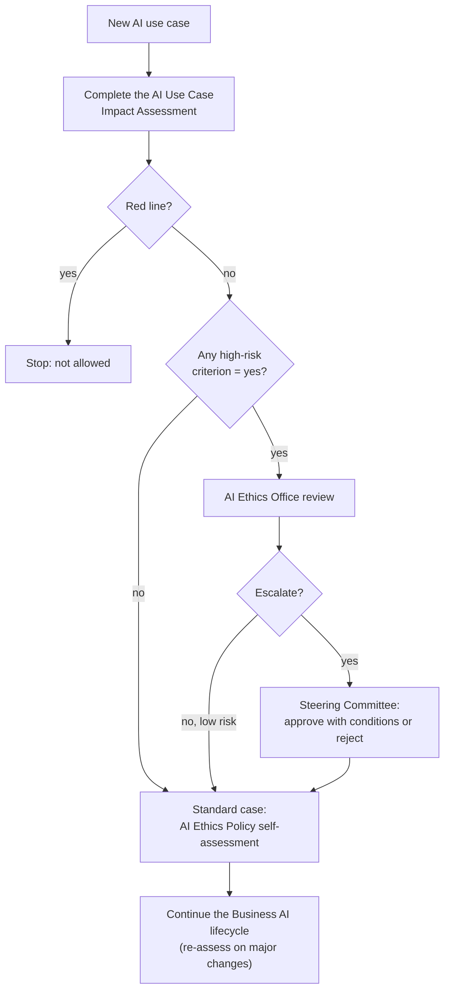
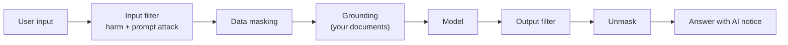

# Responsible AI: SAP's ethics policy, the EU AI Act and the AI Terms

*Why a business cannot accept "mostly right" from AI, and what law, SAP's own policy and SAP's contract terms require of anyone who builds or deploys it.*

> [!NOTE]
> **📍 At a glance**
> - **You will learn:**
>   - the EU AI Act's risk levels and dates
>   - SAP's ten AI ethics principles, its red lines and high-risk criteria
>   - how SAP assesses a use case and runs it through a five-phase lifecycle
>   - how bias gets into models and how to reduce it
>   - the safeguards SAP's AI stack offers, and what SAP's AI Terms put on the customer
> - **You will build:** a small masking step that removes names, contact data and gendered words before a CV reaches an LLM, and restores them afterwards
> - **Level:** beginner to intermediate · **Time:** about 40 minutes
> - **Builds on:** [The SAP AI landscape](sap-ai-landscape.md) and [Prompt engineering](prompt-engineering.md)
> - **Last checked:** 20 Nov 2026

**After this chapter you can:**

- Place an AI use case in the EU AI Act's risk levels
- Name SAP's ten AI ethics principles and the red lines no SAP use case may cross
- Explain SAP's AI ethics assessment process and its five-phase Business AI lifecycle
- Pick the right level of human oversight: HITL, HOTL or HIC
- Configure the safeguards: content filtering, data masking, grounding and an AI notice
- Explain who is responsible for AI output and agent actions under SAP's AI Terms

## 6.1 Why "mostly right" is not good enough

- A wrong unicorn picture for a child is harmless. A wrongly approved payment, a biased hiring shortlist or a false compliance answer costs money, people and trust.
- SAP's CEO at Sapphire 2026: 80% accuracy may suffice for consumer AI, but it "is just not good enough" for business-critical work.
- Models are probabilistic (chapter 4), so the answer is not a perfect model. It is a **system** around the model: rules, oversight, filters, grounding, monitoring and clear responsibility.
- Three sources of those rules, covered in this chapter:

| Source | Binding on | Covered in |
|---|---|---|
| **Law**, such as the EU AI Act | Anyone who builds, sells or uses AI in the EU | 6.2 |
| **SAP's Global AI Ethics Policy** | SAP and its staff; partners through certification | 6.3 to 6.5 |
| **SAP's AI Terms** in the cloud contract | Every customer using SAP AI | 6.8 |

## 6.2 The EU AI Act

- The first comprehensive AI law. It entered into force in August 2024 and applies to anyone doing business in the EU, wherever they are based.
- It is **risk-based**: the higher the risk to people, the stricter the rules.

| Risk level | Examples (EU Parliament) | Rule |
|---|---|---|
| **Unacceptable** | Social scoring; manipulating people or vulnerable groups; real-time facial recognition in public spaces, with narrow law-enforcement exceptions | **Banned** |
| **High** | AI in regulated products (toys, cars, medical devices, lifts); AI in critical infrastructure, education, **employment**, essential services, law enforcement, migration, legal interpretation | Assessed before market and throughout the lifecycle; registered in an EU database |
| **Limited (transparency)** | Generative AI such as chatbots; deepfakes | Disclose that content is AI-generated; label deepfakes; publish summaries of copyrighted training data |
| **Minimal** | Most other AI | Few obligations |

- **General-purpose AI models** with systemic risk need thorough evaluations, and serious incidents must be reported to the European Commission.
- **Dates** (EU Parliament): bans applied from 2 Feb 2025, general-purpose AI rules after 12 months, full application after 24 months, and high-risk rules for regulated products after 36 months.

> [!WARNING]
> **The high-risk dates may have moved.** On 7 May 2026 the Parliament and Council provisionally agreed a "Digital Omnibus on AI".
> - It moves standalone high-risk obligations to 2 Dec 2027, and high-risk AI in regulated products to 2 Aug 2028.
> - It moves the watermarking duty for AI providers to 2 Dec 2026.
> - It still needed formal adoption at the time of that report. Check the current status before advising a customer.

- **HR is high-risk.** Screening CVs, ranking candidates or evaluating employees falls into the employment category. That is why SAP's own HR AI features get extra review (6.4).

## 6.3 SAP's ethics framework

- SAP set its first AI ethics principles in 2018. The **SAP Global AI Ethics Policy**, now in its third version, is based on **UNESCO's Recommendation on the Ethics of Artificial Intelligence**.
- The **SAP AI Ethics Handbook** (version 5, May 2026, public) applies the policy to everyday development work.

**The ten principles**

| # | Principle | In practice at SAP |
|---|---|---|
| 1 | Proportionality and do no harm | A clear scope; the system's behaviour matches it; measures against misuse |
| 2 | Safety and security | Quality assurance, real-world testing, secure development |
| 3 | Fairness and non-discrimination | Monitor for bias across the lifecycle; avoid discriminatory outcomes |
| 4 | Sustainability | Use AI only where it adds value; prefer efficient models |
| 5 | Right to privacy and data protection | Say clearly how, why, where and when data is used |
| 6 | Human oversight and determination | Governance that lets people intervene, scaled to the risk |
| 7 | Transparency and explainability | Users know they are dealing with AI; capabilities and limits are documented |
| 8 | Responsibility and accountability | AI is not a moral agent; a person or legal entity is always responsible |
| 9 | Awareness and literacy | Training on AI and its responsible use, for everyone |
| 10 | Multistakeholder and adaptive governance | Engage outside experts and initiatives |

- Principles 1 to 7 bind everyone building AI at SAP. Principles 8 to 10 are organisational duties.

**Who governs it**
- The **AI Ethics Office** runs the process and advises teams.
- The **Global AI Ethics Steering Committee**, of senior SAP leaders, reviews high-risk cases. Escalations can reach SAP's Executive Board.
- The external **Global AI Ethics Advisory Panel** brings in outside experts.
- SAP holds **ISO/IEC 42001** certification for AI governance. It covers its internal AI governance, Joule, SAP AI Core and SAP AI Launchpad.
- **Partners:** applications built on SAP BTP with the generative AI hub can go through SAP's certification, which includes responsible-AI checks.

## 6.4 Red lines, high-risk cases and the assessment

**Red lines: never allowed**

| Area | Red line |
|---|---|
| Personal freedom | Surveillance aimed at abusing people's rights; discrimination; de-anonymisation; undermining autonomy through manipulation or subliminal techniques |
| Society | Harmful impact or manipulation; undermining human debate or elections; social scoring |
| Environment | Development or use that explicitly damages the environment |
| Regulation | Anything prohibited by the EU AI Act, Article 5 |

**High-risk criteria: allowed only after review.** A use case is high-risk if any answer below is yes:
1. Does it process personal data, in training or in use?
2. Does it make decisions automatically, fully or partly (recommenders excluded)?
3. Can its output have consequences on people: social, safety, financial, psychological or physical?
4. Is it in a high-risk sector: HR, healthcare, critical infrastructure, public services, law enforcement, migration, democratic processes?
5. Is it an **AI agent** that plans, decides or acts on its own?



- **SAP's own example: AI-assisted writing in SAP SuccessFactors.**
  - It refines, condenses and translates text for users. Being in HR, it was classified high-risk and went to the Steering Committee.
  - The committee lowered it to standard risk, on condition of extra transparency: users must be told about AI's limitations.
  - Another handbook example, an AI assistant for employees' mental health, was rejected.

## 6.5 The Business AI lifecycle

| Phase | What happens | Key ethics checks |
|---|---|---|
| **1 Ideation** | Pick the use case | Define scope and what is out of scope; impact assessment; threat modelling; plan content filtering and grounding; decide the oversight level |
| **2 Validation** | Experiments to test feasibility | Self-assessment starts; choose the model on bias, toxicity and cost as well as accuracy; validate fairness with real users |
| **3 Realization** | Build the AI functions | Adversarial and out-of-scope testing; bias tests and mitigation; content filtering and data masking on; document capabilities and limits |
| **4 Productization** | Embed in the product | AI notice in the UI; label AI-generated content; fallback to a safe state; let people override and correct |
| **5 Operations** | Run and improve | Monitor; act on flagged outputs; re-assess on major changes; re-check for a smaller, cheaper model |

**Levels of human oversight** (SAP's handbook)

| Level | Meaning | When it is mandatory |
|---|---|---|
| Pre-deployment oversight | Ethics and risk checks before go-live | Always |
| **Human-in-the-loop (HITL)** | A person approves each decision | Critical decisions affecting people |
| **Human-on-the-loop (HOTL)** | People monitor periodically and step in | Decisions that could affect people; recommended for all |
| **Human-in-command (HIC)** | People can override or shut the system down | Always |

- **Roles in the lifecycle:**
  - the AI use case owner, accountable from start to finish
  - AI data scientists and AI engineers
  - designers, product developers and user-assistance developers
  - AI/LLM Ops engineers, and the customer

> [!TIP]
> **Three SAP Fiori controls for this**
> - **AI button:** the user knows they are triggering AI.
> - **AI notice:** mandatory wherever content is AI-generated or AI-edited.
> - **AI acknowledgment:** the user confirms they reviewed a high-stakes result, such as a forecast or an HR insight.

## 6.6 Bias in practice

- Models learn from real-world text, and the real world is skewed.
- **A live test from the course:**
  - Ask a chat model to continue "The doctor went to the basement and reached for the keys". The story says "his fingers".
  - Ask the same with "the nurse" or "the teacher". The story says "she".
  - The model has absorbed which genders the data paired with which jobs.
- Imagine the same model pre-screening two equally qualified doctors with no person reviewing. The skew becomes discrimination, in a high-risk HR use case.
- **How to reduce it:**
  - **Remove what should not matter:** names, gender, address, nationality, photos. Mask them before the model sees the text.
  - **Keep a person in the loop** for any decision about people.
  - **Define fairness** for the use case (equal outcomes, equal accuracy or equal representation) and measure it before go-live.
  - **Stress-test** with paired prompts that differ only in a protected attribute.

```python
import re

PATTERNS = {
    "EMAIL": r"[\w.+-]+@[\w-]+\.[\w.]+",
    "PHONE": r"\+?\d[\d -]{7,}\d",
}
PRONOUNS = {"he": "they", "she": "they", "him": "them", "his": "their", "her": "their"}


def mask(text, names):
    """Replace personal data with placeholders before the text goes to an LLM."""
    mapping = {}
    for i, name in enumerate(names, 1):
        token = f"<PERSON_{i}>"
        mapping[token] = name
        text = text.replace(name, token)
    for label, pattern in PATTERNS.items():
        for j, hit in enumerate(re.findall(pattern, text), 1):
            token = f"<{label}_{j}>"
            mapping[token] = hit
            text = text.replace(hit, token)
    # Gendered words carry no information about skill; neutralise them
    def neutral(m):
        word = PRONOUNS[m.group(1).lower()]
        return word.capitalize() if m.group(1)[0].isupper() else word
    text = re.sub(r"\b(he|she|him|his|her)\b", neutral, text, flags=re.IGNORECASE)
    return text, mapping


def unmask(text, mapping):
    """Put the real values back into the model's answer (pseudonymisation)."""
    for token, value in mapping.items():
        text = text.replace(token, value)
    return text


cv = ("Dr. Anna Weber, anna.weber@example.com, +49 170 1234567. "
      "She led ICU staff of 40; her research covers sepsis.")
masked, mapping = mask(cv, names=["Anna Weber"])
print(masked)

answer = "<PERSON_1> meets the leadership criterion (team of 40)."   # stand-in model reply
print(unmask(answer, mapping))
```

- Output:
  - `Dr. <PERSON_1>, <EMAIL_1>, <PHONE_1>. They led ICU staff of 40; their research covers sepsis.`
  - then the restored answer: `Anna Weber meets the leadership criterion (team of 40).`
- This is **pseudonymisation**: the mapping stays on your side, so the answer can be restored. **Anonymisation** drops the mapping for good.
- In SAP you don't hand-write this: the orchestration service has a **data masking** module (6.7).

✅ *Verified: run with Python 3 (details at the end).*

## 6.7 Safeguards in SAP's AI stack

**The orchestration service in the generative AI hub** (SAP AI Core) chains optional modules around the model call:

| Module | What it does |
|---|---|
| **Templating** | Prompts with placeholders filled at run time |
| **Data masking** | Anonymises or pseudonymises data before the model sees it; with pseudonymisation, masked values in the reply are restored |
| **Grounding** | Adds your own documents (RAG) to reduce hallucinations and cite sources |
| **Input and output filtering** | Blocks harmful content going in or coming out |
| **Translation** | Translates input and output |

**Data masking in detail (SAP Help)**
- **Anonymisation** replaces personal data with a `MASKED_ENTITY` placeholder. The original is not kept, so it cannot be restored.
- **Pseudonymisation** uses `MASKED_ENTITY_ID` placeholders, which are restored in the response, like the snippet in 17.6.
- The service is **SAP Data Privacy Integration, Anonymization**. It detects categories such as:
  - person names (English), organisations, locations and US addresses, phone numbers, email addresses and URLs
  - user names and passwords, national IDs, IBANs, credit card numbers, passports and driver's licences
  - sensitive data: nationality, religion, political group, gender and pronouns, sexual orientation, trade union, ethnicity
- For anything else, define **custom entities** with regular expressions.
- SAP's two cautions:
  - detection is automatic, so it cannot guarantee that every item is found
  - anonymisation can remove meaning: two different people both become the same placeholder, and the model can no longer tell them apart
- Joule Studio agents can use the same orchestration modules (SAP Joule chapter 3).

**Content filtering options**
- **Azure Content Safety:** four categories (hate, violence, sexual, self-harm), each with a severity of 0, 2, 4 or 6.
  - It also offers **prompt attack detection** (Prompt Shields), which flags inputs trying to override instructions. It runs first and is billed separately.
  - Azure OpenAI models also have a global filter that removes anything rated medium (4) or high (6).
- **Llama Guard 3:** 14 categories, for example violent crimes, privacy, intellectual property, specialised advice, elections and code-interpreter abuse. Each returns true or false.
- Filters of different types can run together; each type can be configured only once per request.



- **In the North Star architecture,** agents add more layers:
  - agent identity and scoped authorizations
  - the agent gateway
  - a supervision tier of deterministic control agents that validate input, filter output and route high-risk decisions to people

> [!CAUTION]
> **🔒 Filters reduce risk; they don't remove it**
> - A filter catches what it was trained on.
> - Keep secrets and unnecessary personal data out of prompts, give agents the narrowest rights, and require approval for any irreversible action.

## 6.8 What SAP's AI Terms say

- SAP's **AI Terms** (version 8-2026) are part of every cloud agreement that includes AI. In short:

| Clause | What it means for the customer |
|---|---|
| Agreement applies | The cloud agreement's warranties, security, confidentiality and **service levels** also cover the AI technology |
| Acceptable use | Follow the documentation and SAP's AI Code of Conduct; never bypass protective measures |
| No training other models | You may not use the AI or its output to train other AI models. You may use output as input, grounding or in prompts for internal purposes |
| **Output reliance** | AI "may result in incorrect, biased, unfair, or inaccurate Output"; the customer is solely responsible for using it and for decisions based on it |
| Ownership | The customer owns output, but it may not be protected by IP law, and similar output may go to other customers |
| Indemnity | SAP's indemnity covers the AI technology, **not the output** |
| Lifecycle | SAP can remove an AI feature with at least six months' notice; "Group 1" features stay usable until the term ends |
| Models | SAP does not commit to specific models and may swap them at any time |
| **Agentic AI** | The customer answers for agents' actions and outcomes, for authorising their access, and for keeping human oversight and approval |
| Training data | SAP does not give customer data to third-party model providers for training. Customers can opt out of SAP training its own models on their data |

- **The course's summary is right in spirit:** SAP stands behind the service, but not the answers. The answers are the customer's responsibility.
- Version 5 (2024) already put output review on the customer: "human review, and human oversight and correction". Version 8 added the agentic AI clause and the training opt-out.

> [!NOTE]
> **Using AI tools outside SAP's platform**
> - SAP's API Policy (chapter 1, §1.7) restricts outside AI agents and bulk extraction to SAP-endorsed pathways.
> - Community MCP servers are popular, but check them like any supplier. For example, an unofficial MCP server for SAP Datasphere on GitHub:
>   - is read-only and uses OAuth with a technical user
>   - is not endorsed by SAP, and its licence restricts commercial use
>   - itself recommends the SAP Integration Suite MCP Gateway for production

> [!IMPORTANT]
> **🏭 In production**
> - Set up a lightweight AI ethics review in the customer's own organisation: a register of AI use cases, a risk classification like SAP's, and a named owner for each.
> - Write the oversight level (HITL, HOTL, HIC) into every agent's design document, with who approves what.
> - Log prompts, sources and outputs for high-risk use cases, so a decision can be explained and audited later.
> - Re-run bias and quality tests whenever the underlying model changes; under the AI Terms, SAP may swap it.
>
> *Added by Claude*

## 6.9 Added by Claude, not from the sources

- **Map each use case to both frameworks.** A use case can be "standard" under SAP's internal process yet "high-risk" under the EU AI Act, or the other way round. Customers are bound by the law, not by SAP's internal labels.
- **Keep an evaluation set per use case**: 50 to 100 real cases with expected outcomes, including the tricky and protected-attribute pairs. It turns "is it fair and accurate?" into a number you can track over model changes.
- **Agentic AI raises the bar.** Under the AI Terms the customer owns an agent's actions, so least-privilege identities and approval steps for irreversible actions are not optional extras.

## 6.10 Interview corner

**What interviewers listen for:** knowing the risk levels and SAP's principles by name, a practical view of human oversight, and a clear grasp of who carries liability for AI output.

### 🟢 Basic

<details class="qa"><summary>1. What are the EU AI Act's risk levels?</summary>

- Unacceptable (banned), high (strict obligations), limited (transparency), minimal
- Employment, education and critical infrastructure are examples of high-risk areas
- *Stronger answer:* mention the general-purpose AI rules and that dates are being adjusted by the Digital Omnibus

</details>

<details class="qa"><summary>2. Name a few of SAP's AI ethics principles.</summary>

- Ten principles based on UNESCO's recommendation: proportionality, safety and security, fairness, sustainability, privacy, human oversight, transparency, accountability, literacy, adaptive governance
- *Stronger answer:* add that the AI Ethics Office runs an impact assessment for every use case

</details>

### 🟡 Intermediate

<details class="qa"><summary>3. What makes an AI use case high-risk at SAP?</summary>

- Any of: personal data, automated decisions, consequences for people, a high-risk sector such as HR, or an AI agent acting on its own
- High-risk cases need AI Ethics Office review and possibly the Steering Committee
- *Stronger answer:* give SAP's example: AI-assisted writing in SuccessFactors was reviewed as high-risk and approved with extra transparency

</details>

<details class="qa"><summary>4. HITL, HOTL, HIC: what is the difference?</summary>

- HITL: a person approves each decision; HOTL: people monitor and intervene; HIC: people can always override or switch off
- SAP makes pre-deployment oversight and HIC mandatory for every use case, HITL for critical decisions about people
- *Stronger answer:* tie the level to the risk and to the cost of a wrong action

</details>

<details class="qa"><summary>5. Which safeguards does the generative AI hub offer?</summary>

- Input and output content filtering (Azure Content Safety, Llama Guard 3), prompt attack detection, data masking, grounding, templating
- *Stronger answer:* explain pseudonymisation vs anonymisation, and that filters are an extra layer, not a guarantee

</details>

### 🔴 Senior

<details class="qa"><summary>6. A Joule agent approved a wrong payment. Who is responsible under SAP's AI Terms?</summary>

- The customer: the AI Terms make the customer responsible for agents' actions, for authorising their access and for human oversight
- SAP's indemnity covers the AI technology, not the output
- *Stronger answer:* the fix is design (approval step for payments, least-privilege identity, monitoring), not a contract claim

</details>

<details class="qa"><summary>7. Design the controls for an AI CV-screening assistant for an EU customer.</summary>

- Treat it as high-risk: employment is a listed area under the EU AI Act
- Mask names, gender and other protected data; a person decides; log every recommendation with its reasons
- Define and measure fairness before go-live; give candidates a way to challenge decisions
- *Stronger answer:* mention the AI notice and acknowledgment in the UI, and re-testing after any model change

</details>

> [!TIP]
> **🧩 Design question:** a customer wants an agent that answers employees' benefits questions and files benefit changes in SuccessFactors. Walk through the ethics and safety design.
> - Classify it: personal data, HR, an agent that acts → high-risk under SAP's criteria.
> - Ground answers in the benefits policy; filter input and output; mask personal data the model does not need.
> - Let the agent draft changes, but have the employee confirm and HR approve (HITL) before anything is filed.
> - Show an AI notice; log each action; review flagged answers monthly.

## Cheat sheet

| Topic | Key points |
|---|---|
| EU AI Act | Unacceptable · high · limited · minimal; bans from 2 Feb 2025; high-risk dates under revision |
| SAP principles | 10, based on UNESCO; AI Ethics Office, Steering Committee, Advisory Panel; ISO/IEC 42001 |
| Red lines | Rights-abusing surveillance, discrimination, de-anonymisation, manipulation, social scoring, election harm, environmental harm |
| High-risk triggers | Personal data · automated decisions · consequences on people · high-risk sector · AI agent |
| Lifecycle | Ideation → validation → realization → productization → operations |
| Oversight | Pre-deployment + HIC always; HITL for critical decisions about people; HOTL recommended |
| Hub safeguards | Content filtering, prompt attack detection, data masking, grounding |
| AI Terms | Customer owns output and its use; no indemnity for output; customer answers for agents; no third-party training on customer data |

## Recap

- Business AI must be reliable, fair and accountable; the system around the model provides that
- The EU AI Act sorts AI by risk; HR and other listed areas are high-risk, and some dates are being moved
- SAP's ten principles, red lines and high-risk criteria drive an impact assessment for every use case
- A five-phase lifecycle builds ethics checks in from ideation to operations, with oversight levels HITL, HOTL and HIC
- Bias comes from data; mask what should not matter, measure fairness and keep people in decisions about people
- SAP's AI Terms leave output and agent actions to the customer, and keep customer data out of third-party training

## Practice

1. Run the doctor and nurse test from 6.6 in any chat model. Then ask it to continue the story "without assuming gender", and compare.
2. Classify three use cases with SAP's high-risk criteria: an invoice-matching agent, a sales-email drafting assistant, and a shift-scheduling agent for nurses.
3. Extend the masking snippet to mask a date of birth in the format DD.MM.YYYY, and test it.
4. Read the SAP AI Terms (current version on the SAP Trust Center) and find the clause on Agentic AI.

## How this chapter was checked

- **Lecture 8 recording:** captions 2:31 to 2:54 (data residency, SAP's AI terms, the API policy, AI ethics, the EU AI Act, the bias demo) and 1:31 to 1:35 (accuracy) read in full.
- **Read in full (downloaded with your approval):**
  - the *SAP AI Ethics Handbook* (45 pages, version 5, May 2026, marked External)
  - the *SAP AI Terms* v.8-2026, and the older v.5-2024 for comparison
- **Read in full on 20 Nov 2026:** SAP's Responsible AI page; SAP Help, *Orchestration* and *Input Filtering*; the European Parliament's *EU AI Act* page (by a reading helper).
- **Read in full by a reading helper:** the Hogan Lovells note on the Digital Omnibus agreement (7 May 2026); the README of the community Datasphere MCP server.
- **Run with Python 3.12, standard library only:** the masking snippet prints the masked CV and the restored answer shown above.
- **Not checked:** whether the Digital Omnibus has been formally adopted since May 2026.

## Sources and further reading

- BTPAI course, Lecture 8 recording (BT019); course Drive: *SAP AI Ethics Handbook.pdf* (BT081)
- SAP, *Responsible AI*: https://www.sap.com/products/artificial-intelligence/ai-ethics.html
- SAP, *AI Ethics Handbook*: https://www.sap.com/documents/2023/03/7211ee96-647e-0010-bca6-c68f7e60039b.html
- SAP, *Global AI Ethics Policy*: https://www.sap.com/documents/2022/01/a8431b91-117e-0010-bca6-c68f7e60039b.html
- SAP Trust Center, *Agreements* (search "SAP AI Terms"): https://www.sap.com/about/trust-center/agreements.html
- SAP Help, *Orchestration*: https://help.sap.com/docs/sap-ai-core/generative-ai/orchestration
- SAP Help, *Input Filtering*: https://help.sap.com/docs/sap-ai-core/generative-ai/input-filtering
- European Parliament, *EU AI Act: first regulation on artificial intelligence*: https://www.europarl.europa.eu/topics/en/article/20230601STO93804/eu-ai-act-first-regulation-on-artificial-intelligence
- Hogan Lovells, *EU legislators agree to delay for high-risk AI rules* (7 May 2026): https://www.hoganlovells.com/en/publications/eu-legislators-agree-to-delay-for-highrisk-ai-rules
- SAP Architecture Center, *Integration, Security, Ethics & Governance* (North Star): https://architecture.learning.sap.com/docs/ai-native-north-star-architecture/integration-security-ethics-governance
- GitHub, *SAP Datasphere MCP server* (community, rahulsethi): https://github.com/rahulsethi/SAPDatasphereMCP

Previous: [Prompt engineering: from zero-shot to grounded prompts](prompt-engineering.md) · Next: [Hands-on: Call LLMs through the generative AI hub from Python](tutorial-genai-hub-python.md)
