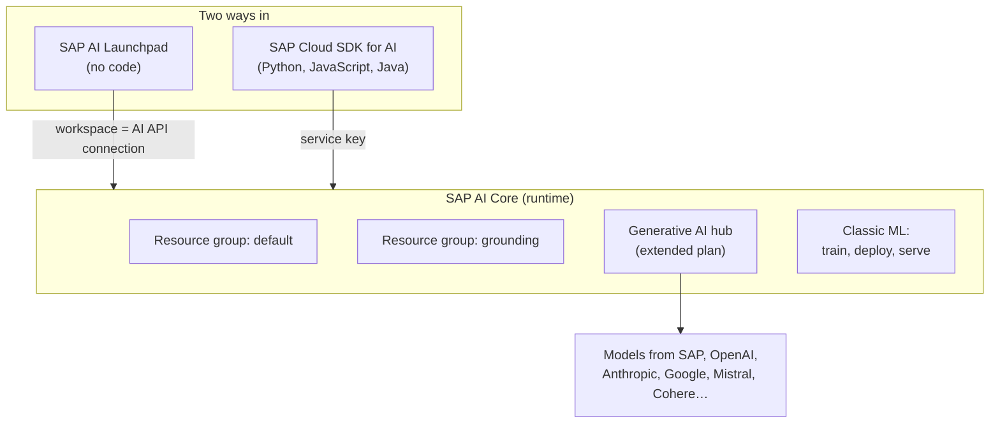

# SAP AI Core, the generative AI hub and SAP AI Launchpad

*Where SAP's AI models run, how you reach them without code, and how a company keeps prompts, models and quotas under control.*

> [!NOTE]
> **📍 At a glance**
> - **You will learn:** what AI Core, the generative AI hub, AI Launchpad and the SAP Cloud SDK for AI each do; workspaces and resource groups; the model library; chat, prompt editor, prompt management and optimisation; rate limits; what it costs
> - **You will build:** an AI Launchpad connection to AI Core, a reusable prompt template with variables, and a versioned copy of it
> - **Level:** beginner to intermediate · **Time:** about 60 minutes
> - **Builds on:** [Prompt engineering](prompt-engineering.md) (chapter 5), [Global account, subaccount and your first subscription](../sap-btp/btp-account-model-first-subscription.md) (SAP BTP chapter 4)
> - **Last checked:** 22 Nov 2026

**After this chapter you can:**

- Explain AI Core, the generative AI hub, AI Launchpad and the SDK in one minute each
- Connect AI Launchpad to an AI Core instance and pick the right resource group
- Choose a model by what it can do, and know what reasoning models cost you
- Build, save and version a prompt template with system, user and assistant parts and variables
- Cap a team's model usage with rate limits, and explain the bill

## 7.1 Three pieces, two ways in

- **Why it matters:** every "SAP AI" project, from a chat app to a RAG service, sits on these pieces. Mixing them up is the most common beginner mistake.
- **SAP AI Core** is the **runtime**: the place in BTP where AI models run, with the CPU, GPU and memory they need.
  - It existed before generative AI, for **classic machine learning**: you bring data and code, train a model, deploy and use it. (SAP's earlier AI brand was SAP Leonardo.)
- **The generative AI hub** is an **extension inside AI Core** that gives you ready-made LLMs from SAP and its partners. You don't train them; you call them.
  - Only on AI Core's **extended** plan, not on standard (see [chapter 8.1](tutorial-genai-hub-python.md)).
- **Two ways to use what runs there:**
  - **SAP AI Launchpad:** the no-code web UI (chat, prompt tools, model library, administration).
  - **SAP Cloud SDK for AI:** the pro-code route, with SDKs for Python, JavaScript and Java ([chapter 8](tutorial-genai-hub-python.md)). Anything you click in AI Launchpad you can also do through the API, CLI or SDK.

| Piece | What it is | In your subaccount it is… | Billed |
|---|---|---|---|
| SAP AI Core | Runtime for AI models (classic ML and LLMs) | A **service instance** (plan *extended* for generative AI) | By consumption |
| Generative AI hub | LLM access inside AI Core | Part of the AI Core extended plan | By tokens used |
| SAP AI Launchpad | No-code UI for AI Core | An **application subscription** | Fixed monthly fee per subaccount |
| SAP Cloud SDK for AI | Code libraries | A package you install | Free; you pay for the calls |



- **AI Core is not Joule Studio.** Joule Studio agents pick their models from SAP's own list; your AI Core instance is not connected to them. (SAP may use AI Core behind the scenes, but as a customer you don't link the two.)
- **The idea in one line:** AI Core with the generative AI hub is SAP's **model aggregator**, like OpenRouter outside SAP: one account, many vendors' models, under SAP's enterprise terms.

> [!TIP]
> **Subscription or instance?**
> - An **application subscription** is finished software with a UI (AI Launchpad, SAP Analytics Cloud, the BTP cockpit).
> - A **service instance** is a building block you use from your own apps (AI Core). You reach it with a **service key**.

## 7.2 Connect AI Launchpad to AI Core: the workspace

- **What you need first:**
  - an AI Core instance on the **extended** plan, and a **service key** for it (downloaded as JSON)
  - an AI Launchpad subscription, and a role collection that includes the AI Launchpad roles (adding a connection needs `connections_editor`)
- **Steps:**
  1. Open AI Launchpad → **Workspaces** → **Add**.
  2. Give the connection a name: lowercase letters, digits, hyphens or periods, starting and ending with a letter or digit.
  3. **Upload the service key file.** It fills in the AI API URL, auth URL, client ID and secret. (You can type them instead.)
  4. **Create.** The generative AI hub, ML Operations and administration apps now appear.
- **A workspace is one connection to one AI Core instance.**
  - One AI Launchpad can connect to several AI Core instances; each becomes its own workspace.
  - It is not per user: everyone uses the same workspace and key.

> [!CAUTION]
> **🔒 The service key is a secret**
> - It holds a client ID and secret for the whole AI Core instance. Keep it out of chats, screenshots and Git, and rotate it if it leaks.
> - Give users AI Launchpad roles; don't hand out the key.

## 7.3 Resource groups: sub-areas inside AI Core

- **After you pick a workspace, pick a resource group.** Until you do, the generative AI hub and ML Operations stay greyed out.
- **A resource group** isolates deployments and settings inside one AI Core instance. Think of it as a sub-folder with its own models, features and limits.
  - Example from class: group `grounding` has **document grounding** switched on; group `default` doesn't. The tooltip says so when a feature is off.
  - An AI Core tenant can have up to **50** resource groups.
- **SAP's advice:** keep all your generative AI work in one resource group. A model deployed in one group isn't available in another without repeating the steps.
- **Typical layouts:**

| Pattern | When |
|---|---|
| One AI Launchpad, one AI Core, groups such as `sandbox` and `finance` | Most companies: separate by group, set tighter limits on the sandbox |
| A separate sandbox AI Launchpad and AI Core | Companies that want training and trial-and-error fully away from production |

- **One AI Launchpad is enough** for a landscape. AI work doesn't need the dev/test/prod chain of an ERP, though many SAP shops keep at least a sandbox anyway.

## 7.4 Who uses AI Launchpad, and with which tools

| Persona | What they do | Tool group in AI Launchpad |
|---|---|---|
| AI Core administrator | Connections, resource groups, quotas, access | **SAP AI Core Administration** |
| Prompt engineer | Tries models, writes and stores prompts | **Generative AI Hub** |
| Business analyst | Uses what others built | (consumer; no own tool group) |
| MLOps engineer | Trains, deploys and monitors classic ML models | **ML Operations** |

- All of them work through the same **workspace**, which is why the connection comes first.

## 7.5 The model library: picking a model

- **Where:** Generative AI Hub → **Model Library**. In class it listed **68 models**, or **77** with deprecated ones shown. New models arrive and old ones retire all the time, so check the library, not a slide.
- **SAP's own models:**
  - **SAP-ABAP-1:** generates ABAP. ABAP is SAP's closed language, so public LLMs saw little of it in training; SAP trained on its own code.
  - **SAP-RPT-1 family** (relational pretrained transformer): predicts missing values in **tables**, such as forecasts, without training your own model. Several versions and sizes, including 1.5 and 1.6. SAP also bought Prior Labs, maker of the TabPFN tabular models (see [chapter 1](sap-ai-landscape.md)). SAP's public demo is at rptcloud.sap.com.
- **Partner models:** OpenAI, Anthropic and Google, plus **Mistral** (France) and **Cohere** (Canada).
  - The European and Canadian vendors give **sovereign AI** options: models built and governed outside the US, in case regulation or politics cut off a region.
- **Filter by capability.** As shown in class:

| Capability | What it means | Models in class |
|---|---|---|
| Text generation | Writes text from a prompt | 49 |
| Image recognition | Reads an image you give it (for example an invoice) | 43 |
| Speech-to-text | Transcribes speech | 7 |
| Speech-to-speech | Listens and answers in a synthetic voice | 1 (gpt-realtime) |
| Image generation | Draws an image from text | 3 (Google Gemini image models) |
| Reasoning | Plans and checks internally before answering | (filter) |
| Embedding | Turns text into vectors for search and RAG | (filter) |

- **Multimodal** models handle more than text: images, audio, sometimes video. Most current LLMs are multimodal.
- **Reasoning models** think in steps before answering (you can watch this in some chat apps). They solve hard multi-step problems better but **use more tokens**, so they cost more.
  - Use them for complex or high-stakes tasks. For a canned reply to a store review, a small non-reasoning model is enough.
- **Embedding models** don't return text: they return vectors. They power RAG and document grounding ([chapter 11](tutorial-rag-grounding-genai-hub.md)).
- **Leaderboard tab:** SAP scores models on its own benchmarks, for example how often a model refuses biased or discriminatory requests. Useful when, say, an HR app must never discriminate. For general rankings, see public sites such as llm-stats.com ([chapter 4.11](llm-prompt-to-answer.md)).
- **Each model card** shows your **rate limits** for that model, with an **Increase Quota** button (see 7.10). Rates, limits and retirement dates per model are in SAP Note 3437766.

## 7.6 Chat: a playground your company approves

- **Generative AI Hub → Chat:** pick a model and talk to it, like ChatGPT, but inside your company's SAP contract.
- **Why companies want this:** public chat apps may keep or train on what you type. Enterprise terms don't. Many companies ban public tools and give staff an approved chat instead.
- **Switch models** with the model selector to compare answers. Ask a model to identify itself to confirm the switch.
- **It doesn't know your company.** Ask "how many sick days do I get?" and it can't answer, until you ground it in your documents ([chapter 11.5](tutorial-rag-grounding-genai-hub.md)).

## 7.7 Prompt editor: system, user and assistant

- **Three kinds of message:**

| Part | Who writes it | Use it for |
|---|---|---|
| **System** | The app builder | Role, tone, format, scope, what to refuse. Weighs more than the user's words and lasts the whole conversation |
| **User** | The end user | The actual question |
| **Assistant** | You, as an example | A sample answer: one example is **one-shot**, several are **few-shot** ([chapter 5.2](prompt-engineering.md)) |

- **Scope is a guardrail.** In class, "You are a tour guide" still answered a tax question. Adding "answer only tourism and travel questions; for anything else, say it's outside your scope" made it refuse.
  - **Counter-example:** the Joule on api.sap.com happily listed tourist spots in India. That is a chatbot without enough guardrails.
- **Variables** let users change the parts that should change without touching the prompt.
  - Replace "5 days" and "Delhi" with two input variables, `days` and `destination` (added with the editor's variable button; SAP's orchestration templates write such placeholders as `{{?name}}`). Give default values, and anyone can run the same tuned prompt for "3 days, Goa".
  - Variables work in system, user and assistant parts.

**The same idea in code** (Python, standard library; it shows how a template fills its variables before the call):

```python
import string

template = [
    {"role": "system", "content": "You are a tour guide. Answer only travel questions; "
                                  "for anything else say it is outside your scope. Use short bullets."},
    {"role": "user", "content": "Plan a ${days}-day itinerary for ${destination}."},
]

def fill(messages, **values):
    """Return a copy of the messages with ${name} variables replaced."""
    return [{"role": m["role"], "content": string.Template(m["content"]).substitute(values)}
            for m in messages]

for days, place in [(5, "Delhi"), (3, "Goa")]:
    print(fill(template, days=days, destination=place)[1]["content"])
```

- **Output:** `Plan a 5-day itinerary for Delhi.` then `Plan a 3-day itinerary for Goa.` The system part never changes, which is the point of a template.

## 7.8 Prompt management: save, reuse, version

- **Save** a prompt from the editor as a template: choose a **scenario** (collection), a **name** and a **version**. Then find it under **Prompt Management**, open it, and **Open in Prompt Editor** to try it.
- **Experts write, everyone reuses.** Not everyone writes good prompts. Store the good ones for common tasks: answering complaint mails, triaging tickets, drafting replies.
- **Version, never overwrite.** When you improve a working prompt, save it as a new version:

| Version part | Bump it when | Example |
|---|---|---|
| Major (`2.0.0`) | The prompt changes shape, for example you add variables | 1.0.0 → 2.0.0 |
| Minor (`1.1.0`) | A meaningful improvement | 1.0.0 → 1.1.0 |
| Patch (`1.0.1`) | A small fix | 1.0.0 → 1.0.1 |

- Old and new versions sit side by side, so apps using 1.0.0 keep working while you test 1.1.0.
- ⚠️ **Prompt storage is switched off in some data centres.** If you can't save a prompt there, SAP says to save a prompt template instead.

> [!WARNING]
> **⚠️ Pitfall: fixing one complaint breaks ten other answers**
> - In class, widening the tour guide to answer crime-rate questions still didn't work after one edit.
> - Test the new version on many old questions before switching apps to it. That's why versions exist.

## 7.9 Prompt optimisation

- **What it does:** takes a template from the prompt registry and rewrites it to score better on a metric, for example when you move it to a different model.
- **What you must give it:**
  - the template (baseline) and one or more target models
  - a **dataset**: a JSON file in your object store with example variable values and the **desired answer** for each, registered as an artifact (scenario `genai-optimizations`)
  - **at least 25 and at most 200 examples**
- **Good to know:** a run takes from minutes to hours; Mistral and DeepSeek models aren't supported; variable mapping (since Aug 2026) handles datasets whose column names differ from the prompt's variables.
- **The trainer's view:** building 25+ expected answers is tedious, so this is rarely used. His shortcut: give a chat model the old prompt, one example of the answer you want, and the new model's answer, and ask it to adapt the prompt.

## 7.10 Administration: rate limits so one team can't starve another

- **Why:** each model has a vendor rate limit (requests per minute or hour). One enthusiastic user can use it up and block the whole company.
- **Set limits per resource group and model:**
  1. **Administration → Quota Management → Create** (or **Increase Quota** on the model card).
  2. Choose the **scope** (for example a resource group), the **model**, the **limit** and a **reason**.
  3. The request waits for approval; once approved, the limit is enforced for that group.
- **Pattern:** a low limit for `sandbox`, the full limit for `finance`. You then need only one AI Core instance.
- There are also quota-management API endpoints for doing this in code.
- **No load balancing to set up:** the models are vendor APIs; rate limits are what you manage.

## 7.11 Orchestration: the next step

- So far there's a model and a prompt. **Orchestration** builds a pipeline around them: input filtering, data masking, grounding, the templated prompt, tool calling, output filtering.
- **Why a prompt alone isn't enough:** a prompt can say "don't repeat personal data", but by then the data has already reached the model. An input filter or masking step removes it **before** the call.
- The modules and the no-code setup are in [chapter 11.6](tutorial-rag-grounding-genai-hub.md); the course covers them in detail next.

## 7.12 What it costs and who pays

| Item | How it's billed |
|---|---|
| AI Core instance | Nothing just for existing; you pay for use |
| Generative AI hub | Per token in and out, converted to SAP's billing units; rates per model in SAP Note 3437766 |
| Classic ML in AI Core | By the compute (CPU, GPU, memory) your workloads use |
| AI Launchpad (standard plan) | A fixed monthly price per subaccount, however much you use it. The free plan ended on 22 May 2026; a 30-day trial is available |

- **Practising on a free trial:** AI Core's trial may not include the generative AI hub (extended plan), so you may not be able to repeat every step here.

> [!IMPORTANT]
> **🏭 In production**
> - **One AI Launchpad, few AI Core instances, many resource groups.** Each extra instance adds keys and connections to manage, not capability.
> - **Quota before launch:** set rate limits per resource group before you open the chat to everyone, not after the first outage.
> - **Store prompts, don't paste them:** apps should read a named, versioned template, so a prompt fix doesn't need a redeploy.
> - **Choose models by task and price:** non-reasoning for high volume, reasoning for the few hard cases.
>
> *Added by Claude*

## 7.13 Added by Claude, not from the sources

- **Check model retirement dates before you build.** SAP Note 3437766 lists them per model. Pin a model and plan the move before it retires, the same way you plan an SAP upgrade.
- **Treat the service key like a password with a blast radius.** Anyone with it can call any model in the instance and run up the bill. Use separate instances or keys only where you need separate billing or ownership, and rotate keys when people leave.
- **Name resource groups by purpose** (`sandbox`, `finance-prod`) rather than by person. Limits, grounding and deployments then follow the business, not an individual.

## 7.14 Interview corner

**What interviewers listen for:** that you can separate runtime, UI and SDK; that you know workspaces and resource groups; and that you treat prompts and quotas as things to govern.

🟢 **Basic**

<details class="qa"><summary>1. What's the difference between SAP AI Core, the generative AI hub and SAP AI Launchpad?</summary>

- AI Core is the runtime where models run, for classic ML and LLMs
- The generative AI hub is the part of AI Core (extended plan) that gives access to SAP and partner LLMs
- AI Launchpad is the no-code UI on top; the SAP Cloud SDK for AI is the pro-code route
- *Stronger answer:* add the BTP types: AI Core is a service instance reached with a service key; AI Launchpad is a subscription with a monthly fee

</details>

<details class="qa"><summary>2. What is a workspace in AI Launchpad?</summary>

- A connection from AI Launchpad to one AI Core instance, created by uploading that instance's service key
- Several AI Core instances means several workspaces
- *Stronger answer:* say it is shared, not per user, and that adding one needs the `connections_editor` role

</details>

🟡 **Intermediate**

<details class="qa"><summary>3. Why are the generative AI hub menus greyed out after you connect?</summary>

- No resource group is selected yet; the hub and ML Operations need one
- Features like document grounding are switched on per resource group
- *Stronger answer:* mention SAP's advice to keep all generative AI work in one group, and the limit of 50 groups per tenant

</details>

<details class="qa"><summary>4. When would you choose a reasoning model, and when not?</summary>

- Reasoning models plan internally and handle hard multi-step tasks better
- They use more tokens, so they cost more and answer more slowly
- Use a small non-reasoning model for high-volume, simple replies
- *Stronger answer:* route by task: cheap model first, escalate the hard cases

</details>

<details class="qa"><summary>5. Why version prompts instead of editing them?</summary>

- Apps depend on a prompt that works; an edit that fixes one case can break others
- Save the change as a new version (major, minor or patch), test it, then switch apps over
- *Stronger answer:* add variables so users change inputs without touching the tuned prompt

</details>

🔴 **Senior**

<details class="qa"><summary>6. One team's experiments keep hitting the model's rate limit and block finance. What do you do?</summary>

- Put the teams in separate resource groups
- Set a low quota for the sandbox group and the full quota for finance (Administration → Quota Management, with approval)
- *Stronger answer:* add monitoring on usage per group and agree the quota policy with the budget owner, so limits follow business priority

</details>

<details class="qa"><summary>7. A customer asks why they should pay SAP per token when OpenAI's API is cheaper. Your answer?</summary>

- One contract and account for many vendors' models, including sovereign options
- Enterprise data terms, SAP's guardrails and orchestration (masking, filtering, grounding) and BTP identity
- *Stronger answer:* compare the full cost: security reviews, contracts per vendor and building the guardrails yourself

</details>

> [!TIP]
> **🧩 Design question:** Your company wants an internal HR policy chat for 20,000 staff, a sandbox for 50 AI enthusiasts, and a finance assistant that must never be blocked. Sketch the AI Launchpad, AI Core and resource group setup, the prompts you'd store, and the quotas you'd set.

## Cheat sheet

```text
AI Core            = runtime (service instance, key)    → classic ML + generative AI hub (extended plan)
AI Launchpad       = no-code UI (subscription, monthly) → Workspaces · Generative AI Hub · ML Operations · Administration
Workspace          = connection to ONE AI Core instance (upload service key)
Resource group     = sub-area inside AI Core: deployments, features (grounding), quotas; select one first
Model library      = filter: text · image in/out · speech · reasoning · embedding; SAP Note 3437766
Prompt editor      = system (rules, scope) + user (question) + assistant (examples) + {{?variables}}
Prompt management  = save as scenario/name/version; never overwrite; semver
Optimisation       = template + target model + 25–200 examples (JSON artifact)
Quota Management   = rate limit per scope + model, approved, enforced
```

## Recap

- AI Core runs models; the generative AI hub adds LLMs (extended plan); AI Launchpad and the SDK are the two ways in.
- A workspace connects AI Launchpad to one AI Core instance; a resource group decides which features, deployments and limits apply.
- Pick models by capability and cost; reasoning models cost more.
- Store prompts as versioned templates with variables; use the system part for scope and guardrails.
- Rate limits per resource group stop one team from starving another; AI Launchpad costs a fixed monthly fee, AI Core costs what you use.

## Practice

1. **Map your landscape:** draw one AI Launchpad, one AI Core and three resource groups (`sandbox`, `hr`, `finance`). Write which features and quotas each gets.
2. **Build a template:** in the prompt editor (or with the code in 7.7), write a system part that limits scope, one assistant example, and two variables. Save it as 1.0.0.
3. **Version it:** change the scope rule, save it as 1.1.0, and test both versions on the same five questions.
4. **Choose models:** for (a) store-review replies, (b) contract clause analysis and (c) invoice image reading, filter the model library and justify your pick by capability and cost.

## How this chapter was checked

- **Course:** Lecture 13 recording read in full from its captions (3 h 22 min), including the Q&A. The trainer's live demos of AI Launchpad are described in my words; model counts are as shown in class.
- **Web-checked on 22 Nov 2026 against SAP Help:**
  - adding a connection (name rules, service key, `connections_editor`)
  - resource groups (selection required, one group for generative AI, maximum 50)
  - rate limits (model card, Quota Management)
  - prompt optimisation (25–200 samples, JSON artifact, unsupported models, variable mapping)
  - prompt storage limits
  - AI Launchpad service plans (fixed monthly fee per subaccount, free plan ended 22 May 2026, 30-day trial)
- ✅ *Verified: the Python template snippet in 7.7 was run (details below).*
  - Ran on 22 Nov 2026 with Python 3.12, standard library only. It printed the two filled user messages shown under the code.
- **Not run:** no AI Launchpad or AI Core tenant in this workspace; the UI steps follow the class demo and SAP Help.

## Sources and further reading

- Mentors Pool course, Lecture 13 recording (AI Core, generative AI hub, AI Launchpad), master row BT185
- SAP Help, Add Connection to SAP AI Core: https://help.sap.com/docs/ai-launchpad/sap-ai-launchpad/add-connection-to-sap-ai-core
- SAP Help, Set Resource Group: https://help.sap.com/docs/ai-launchpad/sap-ai-launchpad-user-guide/set-resource-group
- SAP Help, Model Library: https://help.sap.com/docs/ai-launchpad/sap-ai-launchpad/model-library
- SAP Help, What's New for SAP AI Launchpad (prompt optimisation, prompt storage, service plans): https://help.sap.com/docs/ai-launchpad/sap-ai-launchpad/whats-new-for-sap-ai-launchpad
- SAP Help, SAP AI Core Service Plans: https://help.sap.com/docs/sap-ai-core/sap-ai-core-service-guide/service-plans
- SAP Help, Metering and Pricing for Generative AI: https://help.sap.com/docs/sap-ai-core/sap-ai-core-service-guide/metering-and-pricing-for-generative-ai
- SAP Note 3437766 (models, token rates, rate limits, retirement dates)

Previous: [Responsible AI: SAP's ethics policy, the EU AI Act and the AI Terms](responsible-ai-ethics-governance.md) · Next: [Hands-on: Call LLMs through the generative AI hub from Python](tutorial-genai-hub-python.md)
