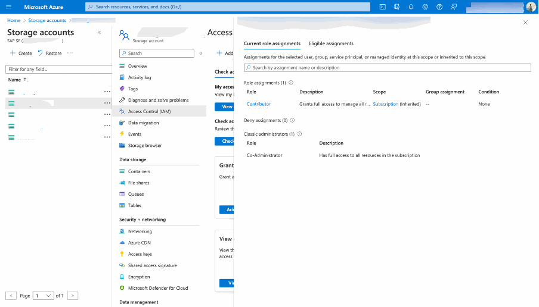
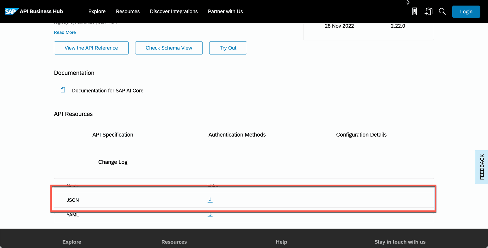
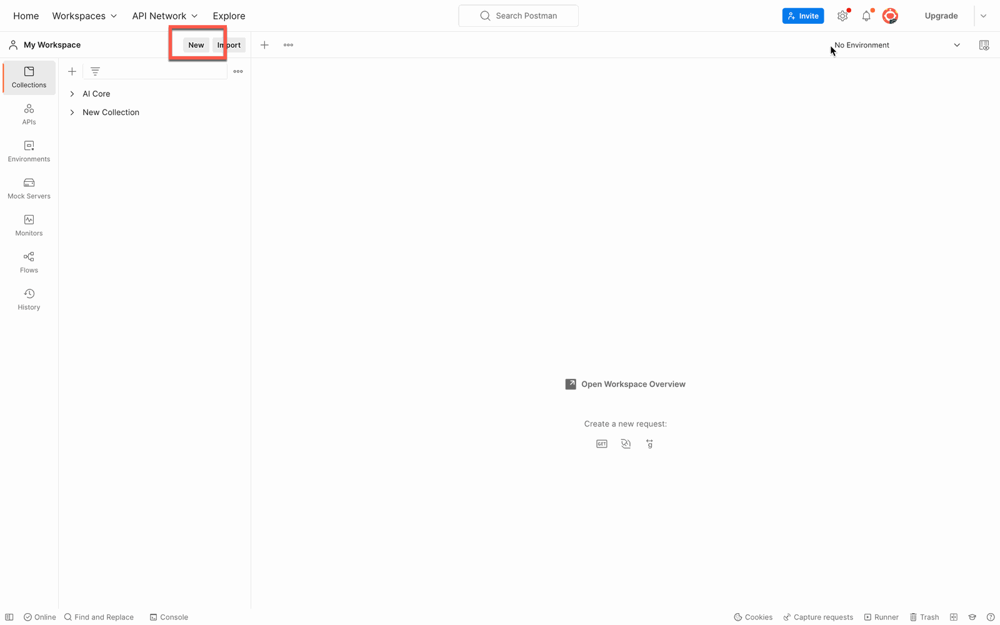
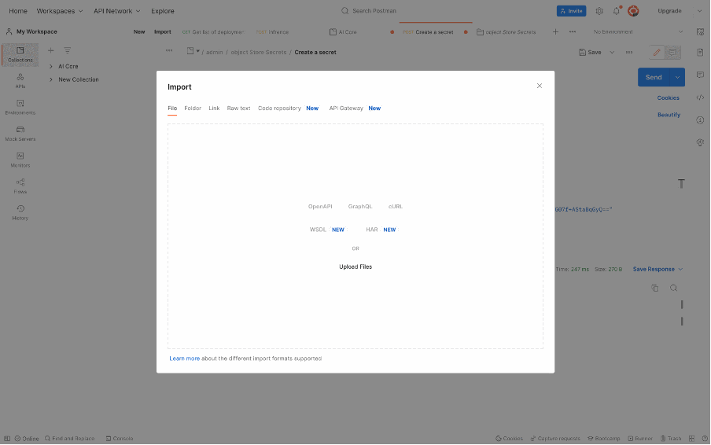
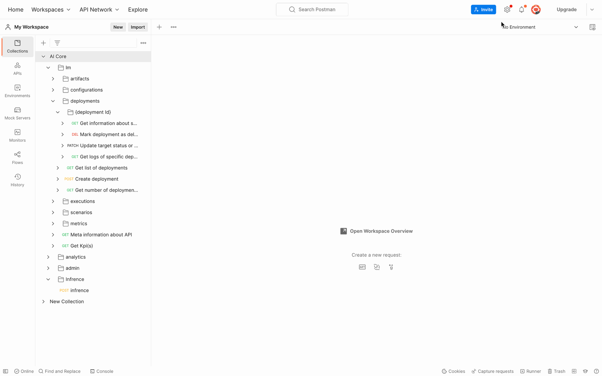
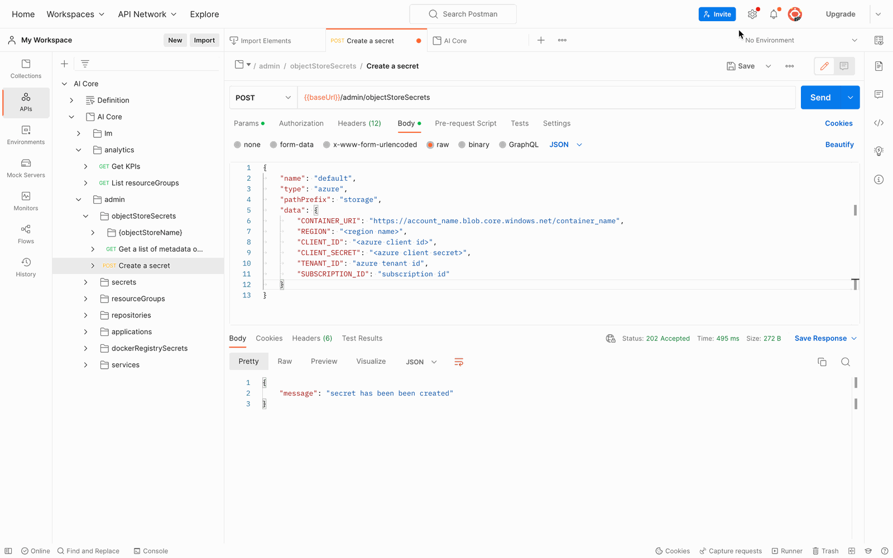

# Tutorial: Setup Azure Data Bucket with AI Core

*Set up azure bucket (Azure Blob Storage) with SAP AI Core.*

> [!NOTE]
> **📍 At a glance**
> - **Source:** SAP Developer Center tutorial [Setup Azure Data Bucket with AI Core](https://developers.sap.com/tutorials/ai-core-azure) by Dhrubajyoti Paul · about 10 min
> - **Licence:** © 2026 SAP SE or an SAP affiliate company, [CC BY 4.0](https://creativecommons.org/licenses/by/4.0/). The text and screenshots are SAP's; source on GitHub: [sap-tutorials/Tutorials](https://github.com/sap-tutorials/Tutorials/blob/master/tutorials/ai-core-azure/)
> - **Changes for this book:** page layout; steps numbered 49.1 to 49.2; SAP's language tabs shown as folding blocks; screenshots wider than 1600 px shrunk and all recompressed; image and file paths changed
> - **Last checked:** 21 Nov 2026

## Prerequisites
- A BTP global account
If you are an SAP Developer or SAP employee, please refer to the following links ( **for internal SAP stakeholders only** ) - 
[How to create a BTP Account (internal)](https://me.sap.com/notes/3493139)
[SAP AI Core](https://help.sap.com/docs/sap-ai-core?version=INTERNAL&locale=en-US&state=PRODUCTION)
If you are an external developer or a customer or a partner kindly refer to this [tutorial](https://developers.sap.com/tutorials/btp-cockpit-entitlements.html)
- An existing Azure account with Admin access to create and use Azure Data store.
- TODO establish the setup prerequisites for SAP AI Core 


>**IMPORTANT** Before you start this tutorial with SAP AI Launchpad, it is recommended that you should set up at least one other tool, either Postman or Python (SAP AI Core SDK) because some steps of this tutorial cannot be performed with SAP AI Launchpad.

## You will learn
- About Azure data store
- To setup Azure for use with AI core
- Setup Azure data buckets for use with AI Core.

 ## Intro
**What is Azure Data Store?**

Azure Data Store refers to a collection of data storage solutions offered by Microsoft Azure, including Azure Blob Storage, Azure Data Lake Storage, Azure Queue Storage, and Azure Table Storage. These solutions provide scalable, highly available, and secure data storage options for a variety of use cases, such as big data analytics, `NoSQL` databases, content delivery, and message queuing.

## 49.1 System Setup
For Detailed docs refer : [AI Core Setup](https://developers.sap.com/tutorials/ai-core-setup.html)

- Downloading `config` for Postman

Go to [AI core API](https://api.sap.com/api/AI_CORE_API/overview) and download the JSON File.



- Open Postman and in the Top right corner click on Import.



- Under file click on Choose file and Select the Json that you just downloaded.



- Once the Import is done you will be able to see the Postman `config`.



## 49.2 Creating Object store Secret

At Postman at AI core API Go to admin > Object store secret > create object store secret.
And set the following json as body
```Python
{
	"name": "default",
	"type": "azure",
	"pathPrefix": "<path prefix to be appended>",
	"data": {
		"CONTAINER_URI": "https://account_name.blob.core.windows.net/container_name",  
		"REGION": "<region-name>",                  
		"CLIENT_ID": "<azure-client-id>",         
		"CLIENT_SECRET": "<azure-client-secret>",  
		"STORAGE_ACCESS_KEY": "sas_token",          
		"TENANT_ID": "azure tenant id",             
		"SUBSCRIPTION_ID": "subscription id",      
	}
}
```

Once Its done click on Send



Hence Your Object Store secret for Azure Data buckets is created.

Previous: [Tutorial: Set Up the Metaflow Library for SAP AI Core](tutorial-ai-core-metaflow-setup.md) · Next: [Tutorial: Configure Your SAP S/4HANA System for ISLM](tutorial-abap-islm-setup-prepare.md)
