# Tutorial: Set Up Tools to Connect With and Operate SAP AI Core

*Use SAP AI Launchpad, Postman or python to connect with SAP AI Core.*

> [!NOTE]
> **📍 At a glance**
> - **Source:** SAP Developer Center tutorial [Set Up Tools to Connect With and Operate SAP AI Core](https://developers.sap.com/tutorials/ai-core-setup) by Dhrubajyoti Paul · about 20 min
> - **Licence:** © 2026 SAP SE or an SAP affiliate company, [CC BY 4.0](https://creativecommons.org/licenses/by/4.0/). The text and screenshots are SAP's; source on GitHub: [sap-tutorials/Tutorials](https://github.com/sap-tutorials/Tutorials/blob/master/tutorials/ai-core-setup/)
> - **Changes for this book:** page layout; steps numbered 12.1 to 12.7; SAP's language tabs shown as folding blocks; screenshots wider than 1600 px shrunk and all recompressed; image and file paths changed
> - **Last checked:** 21 Nov 2026

## Prerequisites
- A BTP global account
If you are an SAP Developer or SAP employee, please refer to the following links ( **for internal SAP stakeholders only** ) - 
[How to create a BTP Account (internal)](https://me.sap.com/notes/3493139)
[SAP AI Core](https://help.sap.com/docs/sap-ai-core?version=INTERNAL&locale=en-US&state=PRODUCTION)
If you are an external developer or a customer or a partner kindly refer to this [tutorial](https://developers.sap.com/tutorials/btp-cockpit-entitlements.html)
- You have created an SAP AI Core instance.

## You will learn
- How to create a connection between SAP AI Core and your tool of choice (SAP AI Launchpad, Postman, python)
- How to look explore the tools for SAP AI Core

## Intro
If you want to use SAP AI Core with python, select the tab for **SAP AI Core SDK** or **AI API client SDK**.

Please find downloadable sample notebooks for the tutorials : . Note that these tutorials are for demonstration purposes only and should not be used in production environments. To execute them properly, you'll need to set up your own S3 bucket or provision services from BTP, including an AI Core with a standard plan for narrow AI and an extended plan for GenAI HUB. Ensure you input the service keys of these services into the relevant cells of the notebook.
[Link to notebook](https://github.com/SAP-samples/ai-core-samples/blob/main/02_ai_core/tutorials/01_create_your_first_machine_learning_project_using_sap_ai_core/01_01_set_up_tools_to_connect_with_and_operate_sap_ai_core/setup_create_connection.ipynb)
  
---

## 12.1 Get your SAP AI Core keys

Using your SAP Business Technology Platform (BTP), to generate keys for the SAP AI Core instance, using [Provision SAP AI Core](https://help.sap.com/docs/AI_CORE/2d6c5984063c40a59eda62f4a9135bee/38c4599432d74c1d94e70f7c955a717d.html)

The following is a set of keys for **example reference only**. Please generate keys for your own SAP AI Core instance.

```JSON
{
  "clientid": "ss-2222-aaa-4444-888-8555!bbb|aicore!bbb",
  "appname": "2222-aaa-4444-888-8555!bbb|aicore!bbb",
  "identityzone": "tutorial",
  "identityzoneid": "11111-dddd-444-888-888888",
  "clientsecret": "qwertyuiop",
  "serviceurls": {
  "AI_API_URL": "https://api.ai.prod.us-east-1.aws.ml.hana.ondemand.com"
  },
  "url": "https://tutorial.authentication.us10.hana.ondemand.com"
}
```

## 12.2 Get tools to connect to SAP AI Core

<details class="qa"><summary>SAP AI Launchpad</summary>

Subscribe to SAP AI Launchpad on your SAP BTP Cockpit, and add **SAP AI Launchpad** to the **Entitlements** of your subaccount.

Access the app through your SAP BTP Cockpit.

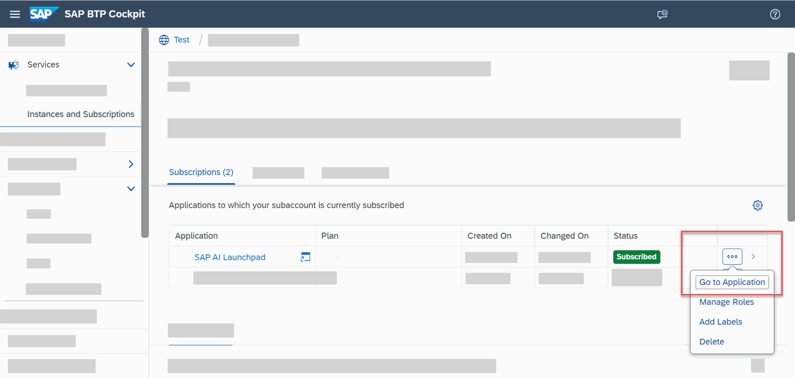

</details>

<details class="qa"><summary>Postman</summary>

[Download](https://www.postman.com/downloads/) and install Postman.

</details>

<details class="qa"><summary>SAP AI Core SDK</summary>

[Download](https://www.python.org/downloads/) python 3.

Start the installer with the following settings.

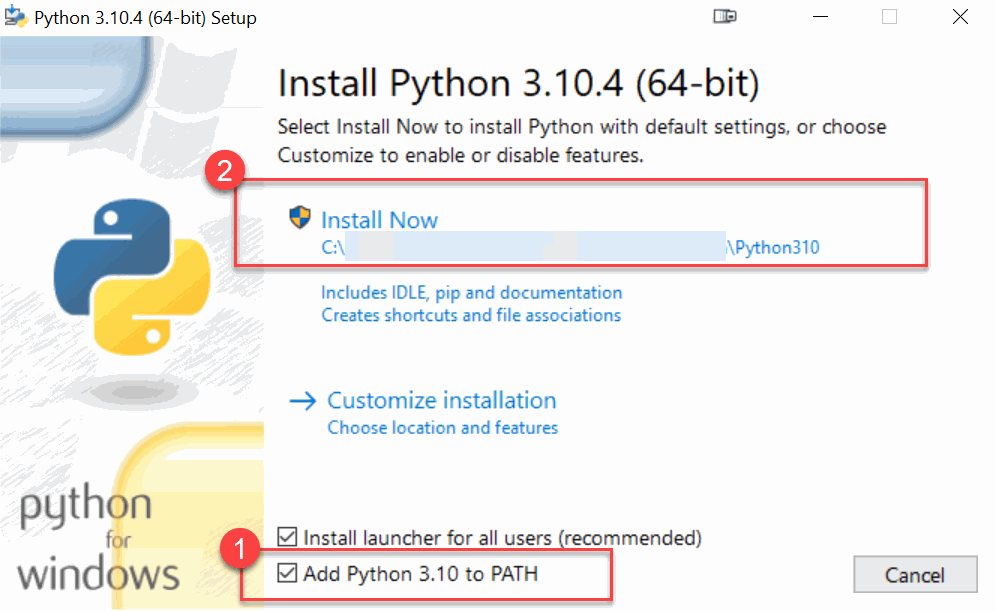

The command line tool `pip` is the python package installer, it will be installed automatically with python.

Use `pip` to install the SAP AI Core SDK.

```BASH
pip install ai-core-sdk
```

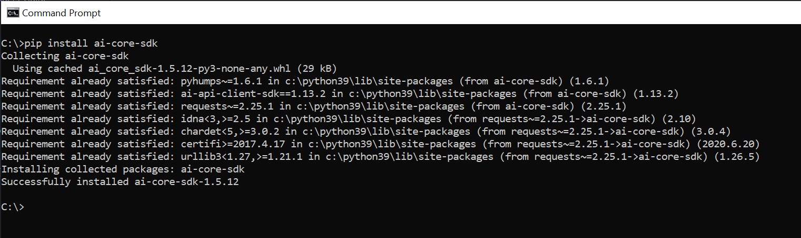

Use `pip` to install Jupyter Notebook. Jupyter is used to execute python code pieces in the form of reusable cells.

```BASH
pip install notebook
```

</details>

<details class="qa"><summary>AI API client SDK</summary>

The command line tool `pip` is the python package installer, it will be installed automatically with python.

Use `pip` to install the AI API client SDK.

```BASH
pip install ai-api-client-sdk
```

Use `pip` to install Jupyter Notebook. Jupyter is used to execute python code pieces in the form of reusable cells.

```BASH
pip install notebook
```

</details>

## 12.3 Set up tools for usage with SAP AI Core

<details class="qa"><summary>SAP AI Launchpad</summary>

Click on the **Workspaces** app. Click **Add** to create connection to your SAP AI Core instance.

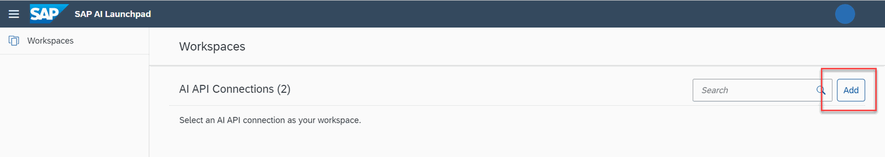

Enter the name `my-ai-core` for the connection . Fill other details from your SAP AI Core service key as marked in the image.

> **INFORMATION** If you find that a connection already exists in your SAP AI Launchpad then you may add your connection under a different name. You may add any number of connections to SAP AI Core instances in your SAP AI Launchpad (this may not be case if you are using Free Tier).

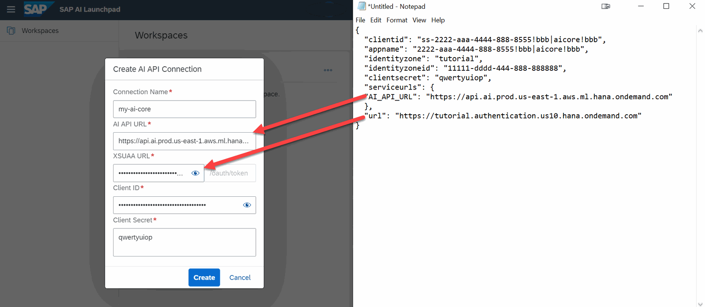

</details>

<details class="qa"><summary>Postman</summary>

Visit [SAP API Business Hub](https://api.sap.com/api/AI_CORE_API/overview) and search for "SAP AI Core". In this site you can find the latest collections and endpoints available for use with SAP AI Core.

Click on the **Download** icon next to the JSON. This downloads a file `AI_CORE_API.json` which has the available API endpoint of SAP AI Core.

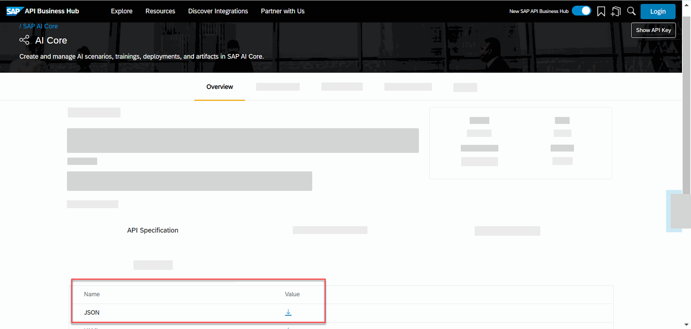

On the Postman app, click **Import** and open the downloaded JSON file.

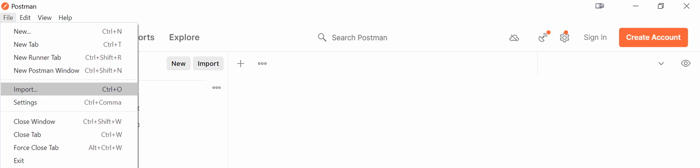

Click **Upload files** and open `AI_CORE_API.json` file. Next, click **Show advanced settings**. Set the following settings:

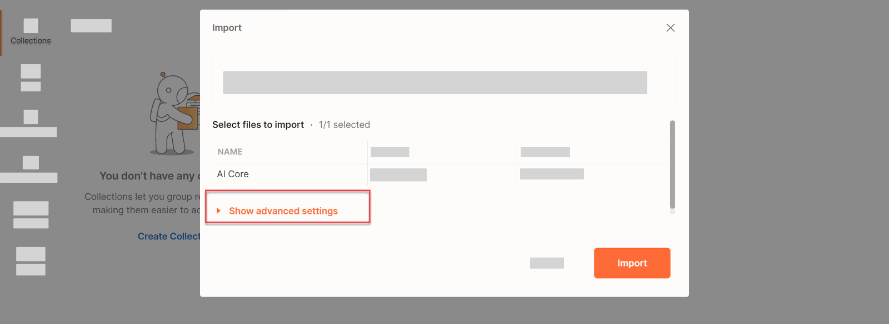

| Setting | Value
| --- | --- |
|Request parameter generation | Schema
|Response parameter generation | Schema
|Disable optional parameters | ON

Leave other settings unchanged and click **Import**.

You now have your copy of the official API collections of SAP AI Core named `AI Core`.

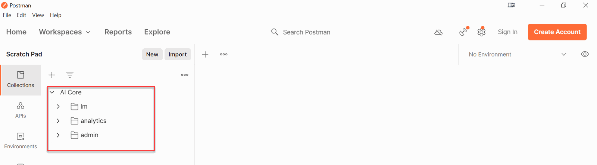

Click on the collection `AI Core`, this shows you the settings page for the whole collections.

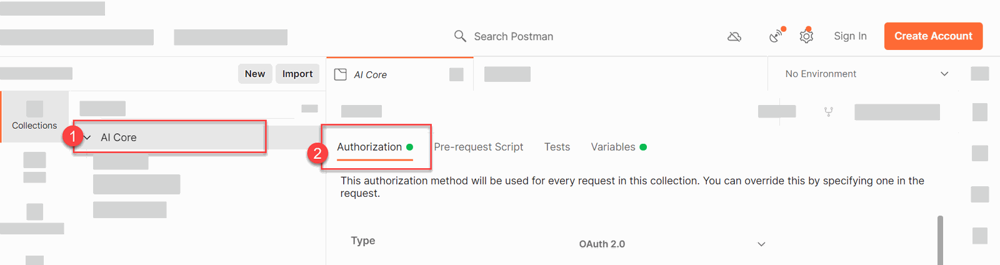

Under the **Authorization** tab, scroll to **Configure New Token**. Edit the settings, using the example and instructions below as a guide.

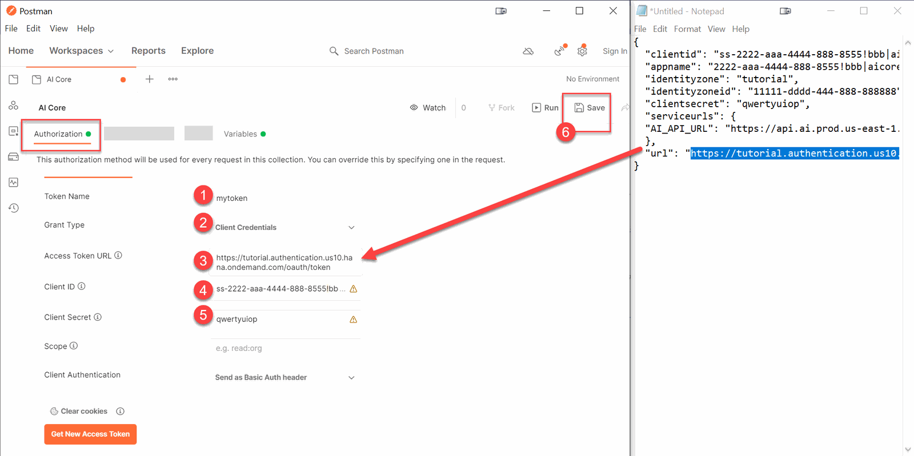

1. Type any descriptive name for **Token Name**.
2. Set **Grant Type** to `Client Credentials`.
3. Paste your `url` (from your SAP AI Core keys) for **Access Token URL**. Also notice the suffix `/oauth/token`, which you need to add.
4. Set value from your keys.
5. Set value from your keys.
6. Click **Save**.

This process saves your credentials to make the repetitive task of token generation (covered later) easier.

Click on the **Variables** tab. Fill the settings as mentioned below.

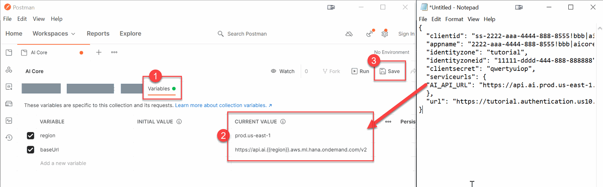

1. Remove the values from the **Initial Value** column to avoid confusion. Set the value from your `AI_API_URL` for the variable `baseUrl`.

>Note that you have to set part of your `AI_API_URL` (from SAP AI Core Keys) for the value `region` (in Postman), for this you can put any part, there are no specific constraint. **But please ensure you add the suffix `/v2` at the end of you `baseUrl`** as shown in the screenshot.

2. Click **Save**.

</details>

<details class="qa"><summary>SAP AI Core SDK</summary>

Start your Jupyter notebook. This will start a Jupyter session in the browser.

```BASH
jupyter notebook
```

Create a python notebook.

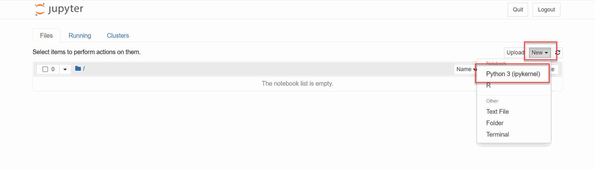

Create a new cell.

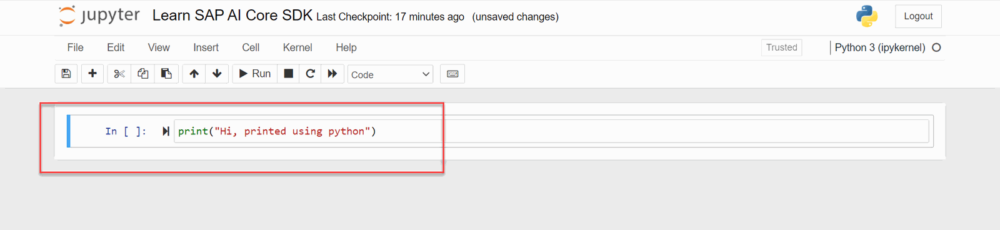

Run the cell.

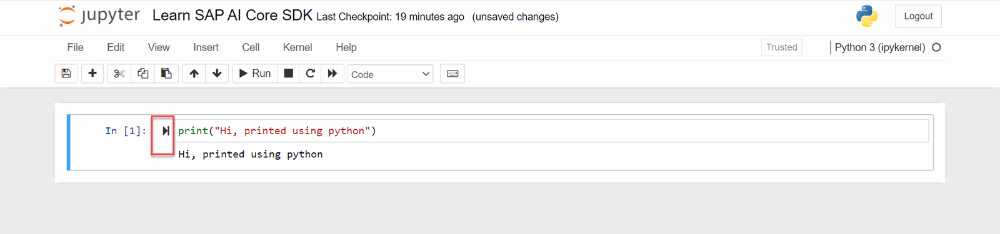

Use this notebook in the tutorial to try out python commands for yourself. Please explore how to save, rename and create new cells in the notebook.

</details>

<details class="qa"><summary>AI API client SDK</summary>

Start your Jupyter notebook. This will start a Jupyter session in the browser.

```BASH
jupyter notebook
```

Create a python notebook.


Create a new cell.


Run the cell.


Use this notebook in the tutorial to try out python commands for yourself. Please explore how to save, rename and create new cells in the notebook.

</details>

## 12.4 Connect with SAP AI Core

<details class="qa"><summary>SAP AI Launchpad</summary>

Click on `my-ai-core` under the **Workspaces** app. You will observe the connection name on the header. You can find new apps on the side navigation bar, like **SAP AI Core Administration** and **ML Operations**.

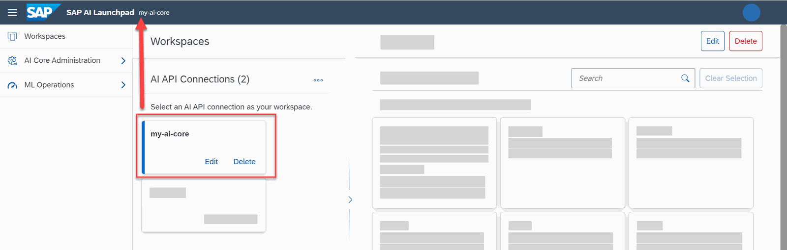

Select `default` from the **Resource Groups** Pane. Again this selection is updated in the header.

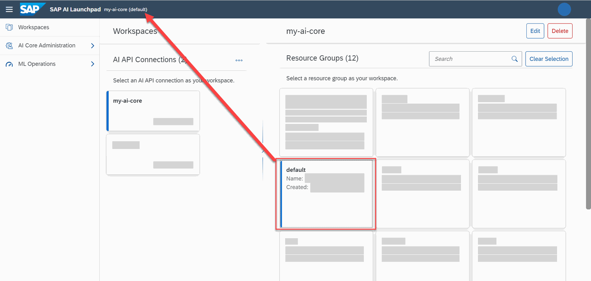

</details>

<details class="qa"><summary>Postman</summary>

Click on the collection **AI Core**. Navigate to the **Authorization** tab and scroll below. Click **Get New Access Token**.

> **IMPORTANT**: If you face error in this step, please check previous steps and ensure you added the suffix `/oauth/token` to the **Access Token URL**.

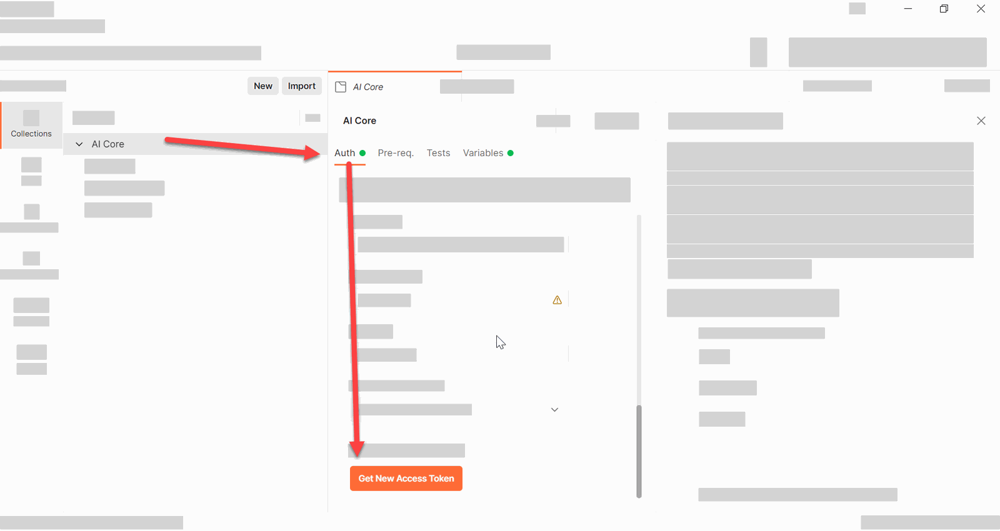

Follow the guided steps in  the dialog box that appears.

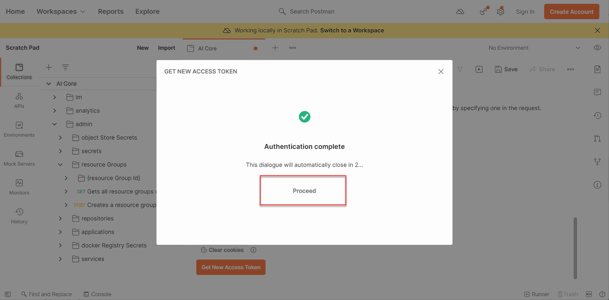

Click **Use Token**.

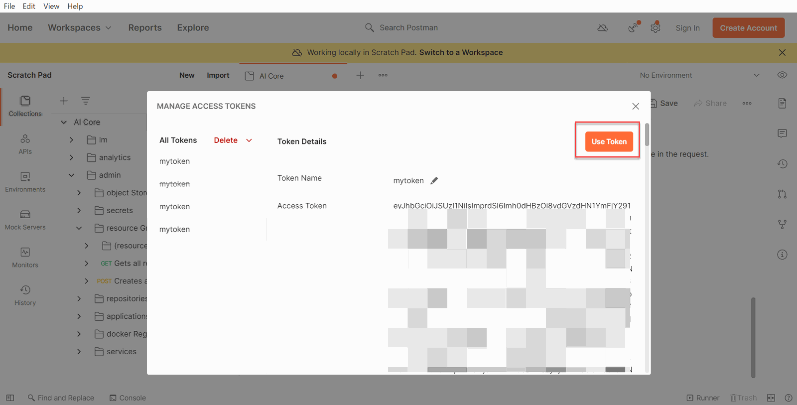

</details>

<details class="qa"><summary>SAP AI Core SDK</summary>

Edit the command with your SAP AI Core credentials. Please add the suffixes to the values of `base_url` and `auth_url` as shown in the code snippet below. Execute the command.

```PYTHON
# Load Library
from ai_core_sdk.ai_core_v2_client import AICoreV2Client

# Create Connection
ai_core_client = AICoreV2Client(
    base_url = "<YOUR_AI_API_URL>" + "/v2", # The present SAP AI Core API version is 2
    auth_url=  "<YOUR_url>" + "/oauth/token", # Suffix to add
    client_id = "<YOUR_clientid>",
    client_secret = "<YOUR_clientsecret>"
)
```

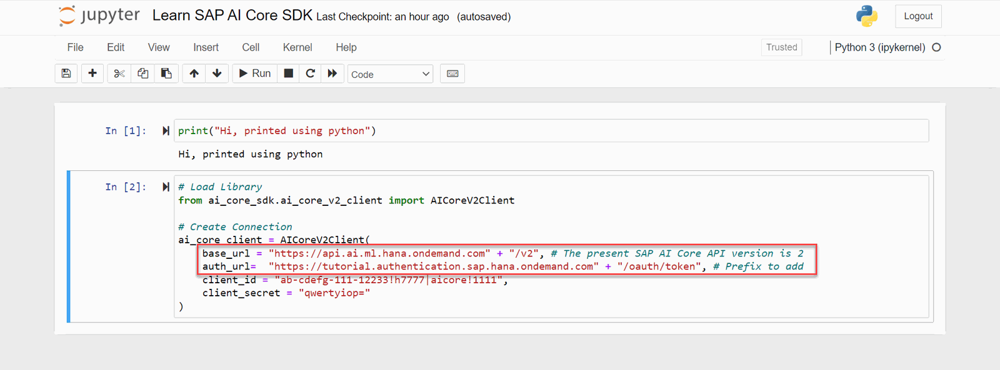

</details>

<details class="qa"><summary>AI API client SDK</summary>

Edit the command with your SAP AI Core credentials. Please add the suffixes to the values of `base_url` and `auth_url` as shown in the code snippet below. Execute the command.

```PYTHON
# Load library
from ai_api_client_sdk.ai_api_v2_client import AIAPIV2Client

# Create connection
ai_api_client = AIAPIV2Client(
    base_url = "https://api.ai.ml.hana.ondemand.com" + "/v2", # The present SAP AI Core API version is 2
    auth_url=  "https://tutorial.authentication.sap.hana.ondemand.com" + "/oauth/token", # Suffix to add
    client_id = "ab-cdefg-111-12233!h7777|aicore!1111",
    client_secret = "qwertyiop="
)
```

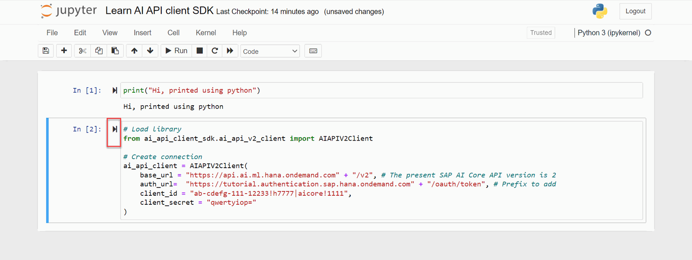

</details>

## 12.5 Perform an action in SAP AI Core

<details class="qa"><summary>SAP AI Launchpad</summary>

Click on **Scenarios** in the **ML Operations** app. The term Scenario refers to a use case. You may not have any scenario listed. You will learn how to add workflows (AI pipelines) to SAP AI Core in future tutorials, which can then be used to create scenarios.

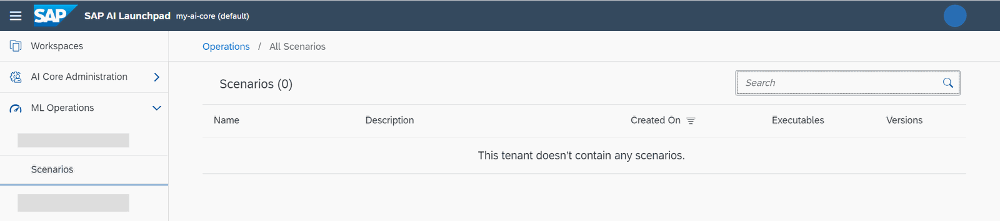

</details>

<details class="qa"><summary>Postman</summary>

List all the resource groups. Check that there is a resource group named **default** in the response.

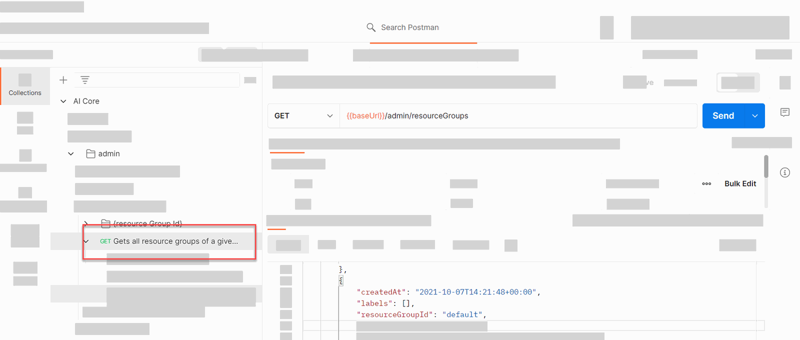

>**Troubleshooting (Optional)**

>If you receive the error: `RBAC: Access Denied`:

>1. Click on the collection named **AI Core**, click the **Authorization** tab, and check whether a token is being used or not. It might be that you generated a token but forgot to click **Use Token** in the process.

>2. Click the **Variables** tab and check if the value for `baseUrl` matches the value of `AI_API_URL` and you have the suffix `/v2` at the end.

</details>

<details class="qa"><summary>SAP AI Core SDK</summary>

Execute the command below to list the GitHub repositories connected to your SAP AI Core. If the response prints `error stack trace`, verify that you used the correct set of keys and added the suffixes mentioned the previous step, when setting the connection.

```PYTHON
response = ai_core_client.repositories.query()
print(response.count)
```

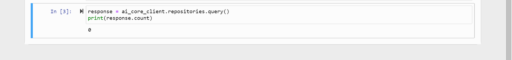

</details>

<details class="qa"><summary>AI API client SDK</summary>

Execute the command below to list the GitHub repositories connected to your SAP AI Core. If the response prints `error stack trace`, verify that you used the correct set of keys and added the suffixes mentioned the previous step, when setting the connection.

```PYTHON
ai_api_client.rest_client.get(
    path="/admin/repositories"
)
```

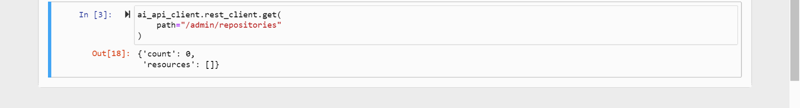

</details>

## 12.6 Discover tool specific nuances

<details class="qa"><summary>SAP AI Launchpad</summary>

If you are don't have apps (like **SAP AI Core Administration** and **ML Operations**) on the navigations pane, please check that you are assigned the required role collections in the SAP BTP Cockpit for SAP AI Launchpad.

If you have assigned the roles and the sections are still not visible then please clear your browser cache and relaunch.

> **INFORMATION**: **New role collections** introduced in new releases of SAP AI Launchpad are not auto-assigned to existing users. The administrator of your SAP BTP Cockpit must ensure that the  correct users are assigned new roles. New role collections and other feature releases can be found in [Release Notes for SAP AI Launchpad](https://help.sap.com/doc/43b304f99a8145809c78f292bfc0bc58/Cloud/en-US/98bf747111574187a7c76f8ced51cfeb.html?sel1=SAP%20AI%20Launchpad).

</details>

<details class="qa"><summary>Postman</summary>

You added the suffix `/v2` in your `baseUrl`, because the current SAP AI Core endpoint version is `v2`. You will find all the related information in the SAP API Business Hub.

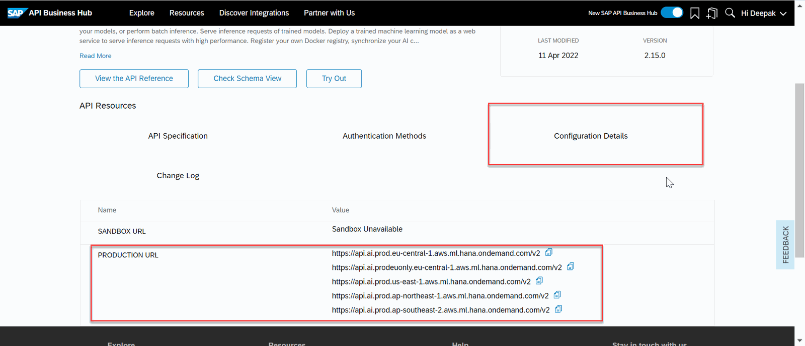

</details>

<details class="qa"><summary>SAP AI Core SDK</summary>

Compare the previous step between SAP AI Core SDK and AI API client SDK. Whilst both are python packages offered to control SAP AI Core, the AI API client SDK can also control other AI runtimes which implement the AI API. Therefore the AI API client SDK lacks native function support for operations specific to SAP AI Core, like GitHub repository connection control.

</details>

<details class="qa"><summary>AI API client SDK</summary>

When creating a connection to SAP AI Core using the AI API client SDK you must use one of the following:

- Type 1: Required when performing Admin operations, where `base_url` has suffix `/v2`

   ```PYTHON
   # Load library
   from ai_api_client_sdk.ai_api_v2_client import AIAPIV2Client

   # Create connection
   ai_api_client = AIAPIV2Client(
       base_url = "https://api.ai.ml.hana.ondemand.com" + "/v2", # The present SAP AI Core API version is 2
       auth_url=  "https://tutorial.authentication.sap.hana.ondemand.com" + "/oauth/token", # Suffix to add
       client_id = "ab-cdefg-111-12233!h7777|aicore!1111",
       client_secret = "qwertyiop="
   )
   ```

- Type 2: Required when performing lifecycle management operations, where `base_url` has suffix `/v2/lm`

   ```PYTHON
   # Load library
   from ai_api_client_sdk.ai_api_v2_client import AIAPIV2Client

   # Create connection
   ai_api_client = AIAPIV2Client(
       base_url = "https://api.ai.ml.hana.ondemand.com" + "/v2/lm", # The present SAP AI Core API version is 2
       auth_url=  "https://tutorial.authentication.sap.hana.ondemand.com" + "/oauth/token", # Suffix to add
       client_id = "ab-cdefg-111-12233!h7777|aicore!1111",
       client_secret = "qwertyiop="
   )
   ```

Visit [SAP API Business Hub](https://api.sap.com/api/AI_CORE_API/resource) to find out which operation endpoints start with `/v2/admin` (Admin operations) and which ones start with `/v2/lm` (lifecycle management).

</details>

## 12.7 Find help provisions for your interface, and the SAP AI Core help page

<details class="qa"><summary>Postman</summary>

If Postman is unable to decipher the schema of the JSON file that you downloaded, you will require the following information, which is stored, for your reference, at [API Business Hub of SAP AI Core](https://api.sap.com/api/AI_CORE_API/resource).

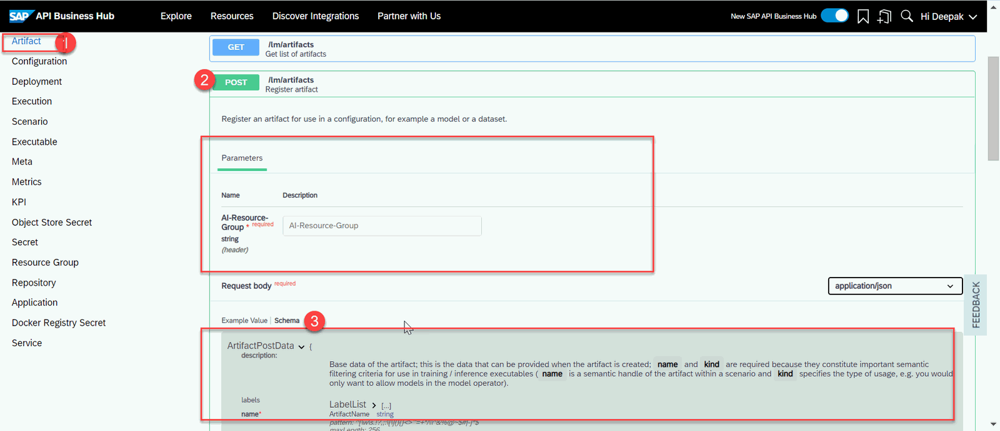

1. Click on any of the endpoints you would like to know information on, for example, click on **Artifact**.

2. Click on **POST** endpoint.

3. Click the **Schema** tab. Here, you will find the detailed description of the values supported by this endpoint.

</details>

<details class="qa"><summary>SAP AI Core SDK</summary>

1. Use python's `dir` function to list contained modules and functions.

```PYTHON
print(dir(ai_core_client))
```

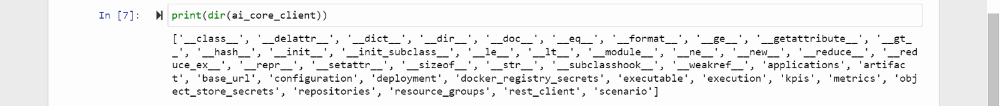

2. Use python's `help` function on a listed module or function to get a `docstring`, which documents what the function does and what parameters it requires.

```PYTHON
help(ai_core_client.scenario.query)
```

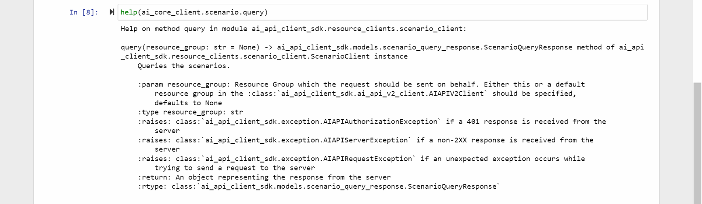

</details>

<details class="qa"><summary>AI API client SDK</summary>

1. Use python's `dir` function to list contained modules and functions.

```PYTHON
print(dir(ai_api_client))
```

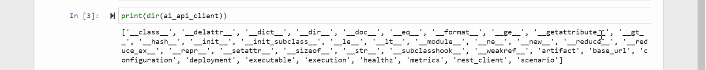

2. Use python's `help` function on a listed module or function to get a `docstring`, which documents what the function does and what parameters it requires.

```PYTHON
help(ai_api_client.scenario.query)
```

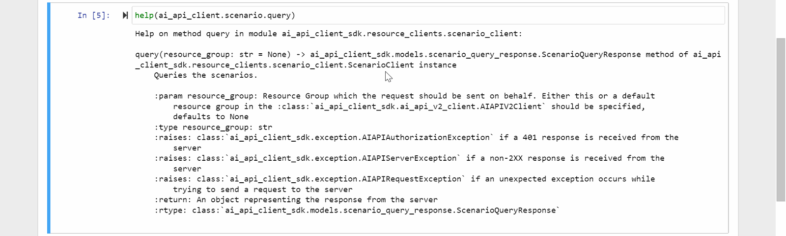

</details>

For support, look at the [Troubleshooting Guide for SAP AI Core](https://help.sap.com/docs/AI_CORE/2d6c5984063c40a59eda62f4a9135bee/3da90ba77bcb401496028d8bd6e819dd.html?locale=en-US). If this does not help resolve your issue, please raise a ticket.

Previous: [Hands-on: RAG and document grounding with the generative AI hub](tutorial-rag-grounding-genai-hub.md) · Next: [Tutorial: Use Boosters for Use of SAP AI Core and SAP AI Launchpad](tutorial-ai-core-launchpad-provisioning.md)
