# Tutorial: Deploy a Movie Recommendation System to AI Core Using Template Generator

*Build a portable AI code with Vs code template generator and deploy the same on SAP AI Core.*

> [!NOTE]
> **📍 At a glance**
> - **Source:** SAP Developer Center tutorial [Deploy a Movie Recommendation System to AI Core Using Template Generator](https://developers.sap.com/tutorials/ai-core-template-wizard) by Dhrubajyoti Paul · about 45 min
> - **Licence:** © 2026 SAP SE or an SAP affiliate company, [CC BY 4.0](https://creativecommons.org/licenses/by/4.0/). The text and screenshots are SAP's; source on GitHub: [sap-tutorials/Tutorials](https://github.com/sap-tutorials/Tutorials/blob/master/tutorials/ai-core-template-wizard/)
> - **Changes for this book:** page layout; steps numbered 46.1 to 46.3; SAP's language tabs shown as folding blocks; screenshots wider than 1600 px shrunk and all recompressed; image and file paths changed
> - **Last checked:** 21 Nov 2026

## Prerequisites
- Understanding Of SAP AI Core
- [Installing SAP AI Core toolkit VS Code extension](https://help.sap.com/docs/sap-ai-core/sap-ai-core-toolkit/sap-ai-core-toolkit)

## You will learn
- How to setup a VS Code template generator
- How to deploy generated code to AI Core

## Intro
In this tutorial we would be Creating a movie recommendation Template and deploying the same using AI core.

## 46.1 Installing Application wizard in Visual Studio Code

In your Visual Studio Code Application, go to extensions and search for application wizard. Go to the Applictation wizard by SAP OS and install it.

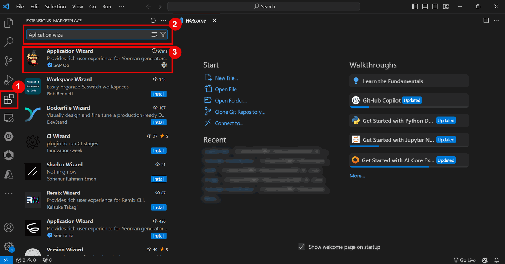

Press Command + shift + p for *mac* and Control + shift + p for *Windows* to open control center and choose open template wizard.

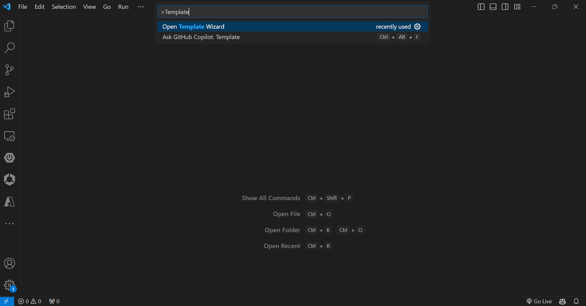

When the template wizard is open, click on **Explore and Install generators**.

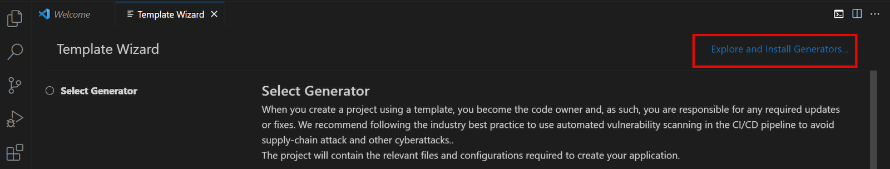

Search for *ai core* and install the **@sap/ai-core** generator.

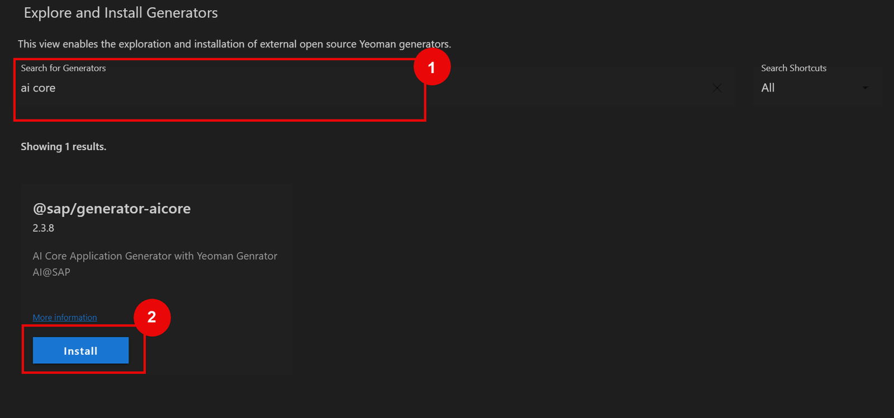

## 46.2 Generate a template for movie recommendaiton

-  press Command + shift + p for *mac* and Control + shift + p for *Windows* to open control center and choose open template wizard.

- Once the Template generator opens choose AI core and press start.

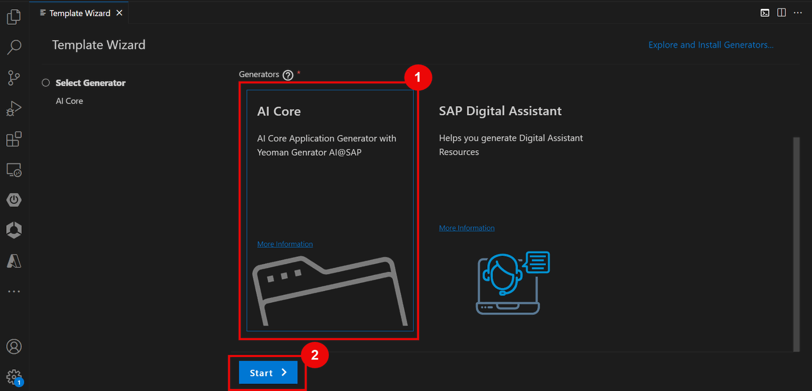

- If you have your custom code choose Basic Project or if you wanted to use the pre-generated training and serving code use AI core sample project for this demo we are going to use.

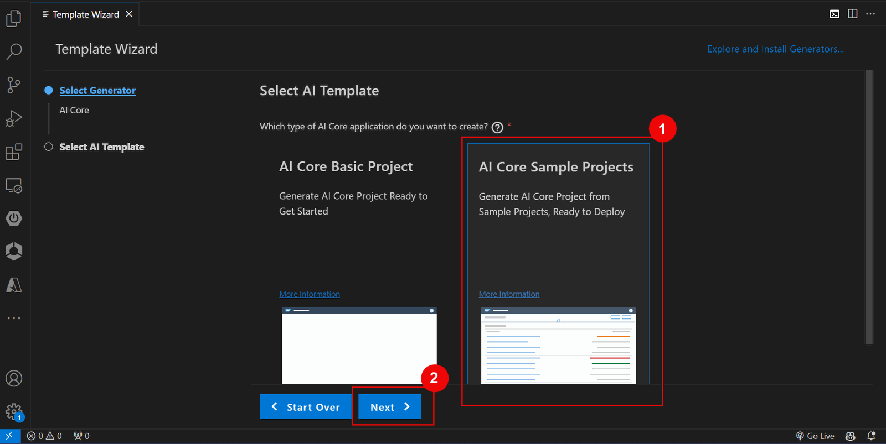

- enter the project name and version and press enter

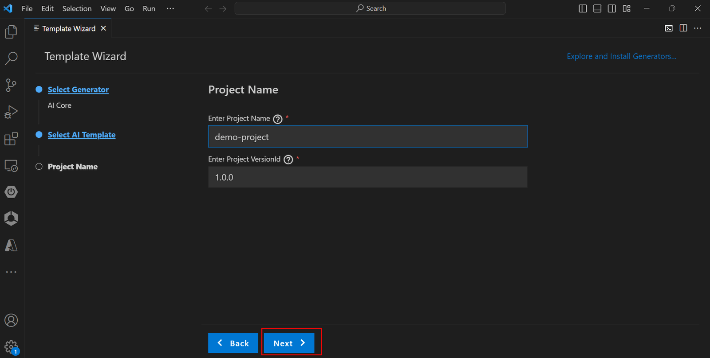

- fill up the details like scenario ID and Resource plan.

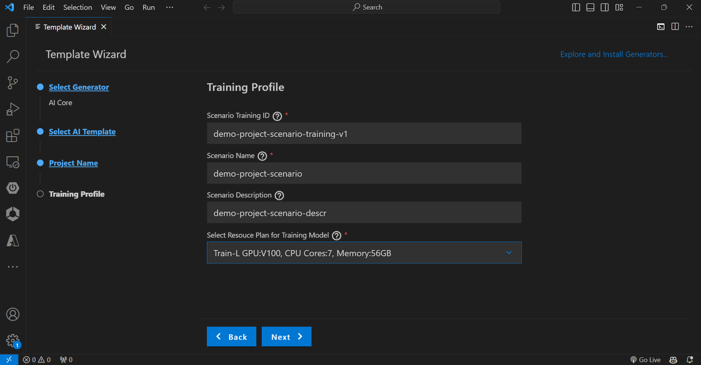

- Similarly fill the details for Serving Plan.

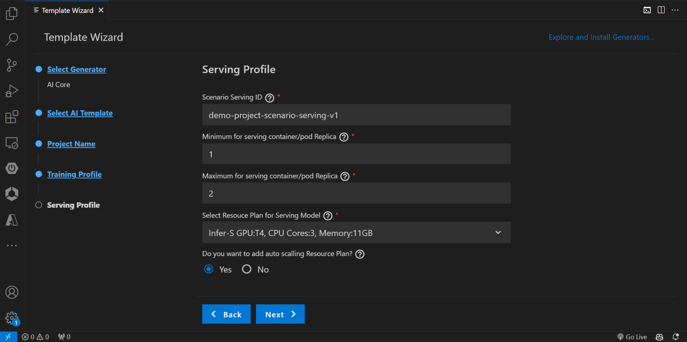

- Choose the demo sample project as Movie Recommendation and click on next.

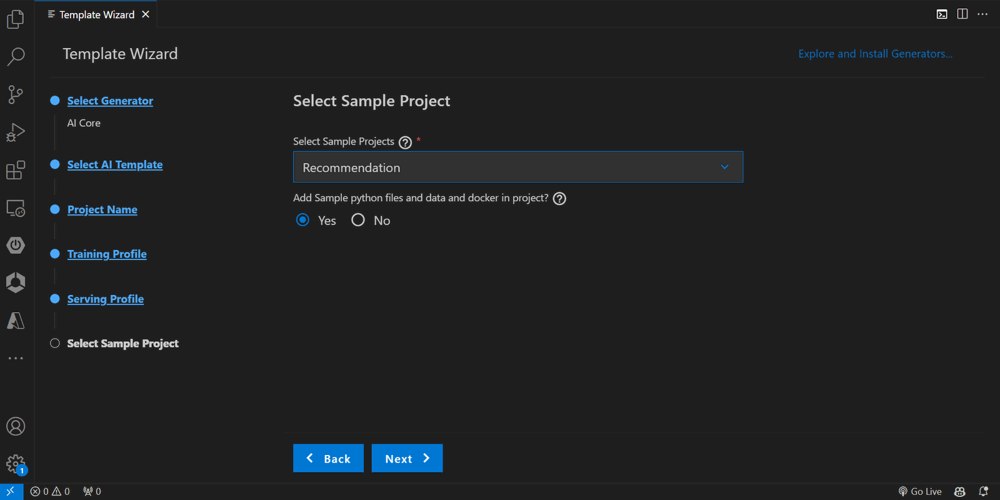

- As a last step add the Docker Details like Docker registry URL and username and click next to create the project.

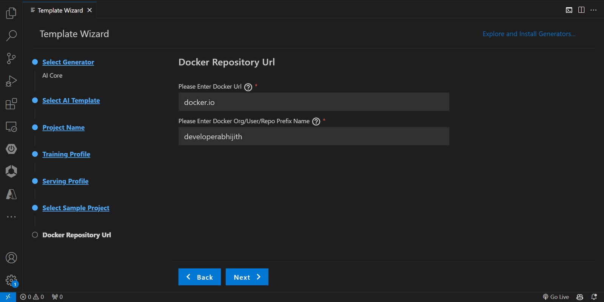

- It will create all the required folders in the current directory.

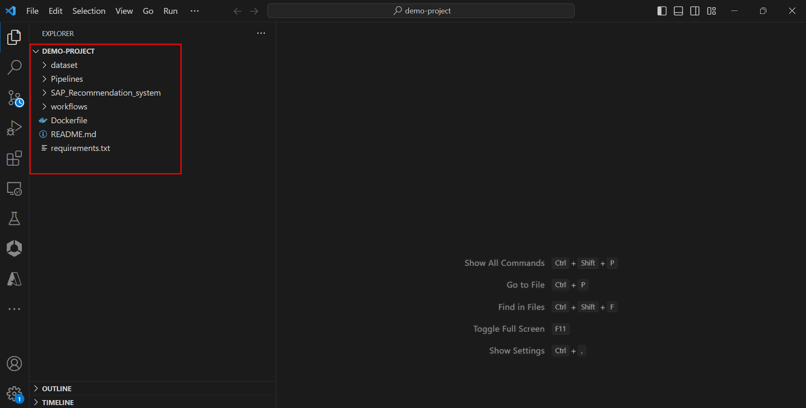

## 46.3 Deploying Template to AI Core

In the generated template visit Template folder > Pipelines and replace `ai-core_creds.json` and `S3_creds.json` with your actual AI core credentials.

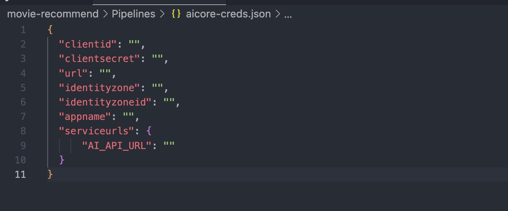

Once done Under the same pipelines folder open AI-core-skd-notebook and replace the Configure variables with your own Variables and click on run all.

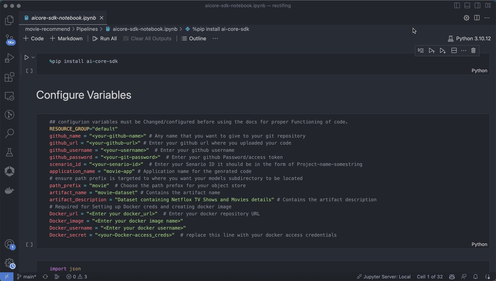

Previous: [Tutorial: Build a House Price Predictor with SAP AI Core using VS Code Toolkit](tutorial-ai-core-vs-code-toolkit.md) · Next: [Tutorial: Use Pre-Trained Tensorflow Models with a GPU in SAP AI Core](tutorial-ai-core-tensorflow-byod.md)
