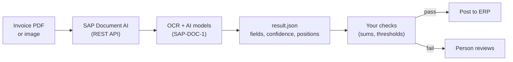

# Hands-on: Extract invoice data with SAP Document AI from Python

*Send an invoice PDF to SAP Document AI, get its header fields and line items back as JSON, then check the result in code before anyone pays.*

> [!NOTE]
> **📍 At a glance**
> - **Sources:**
>   - the course's `document-ai` folder: README, `document_ai.py`, `utils.py`, and a real `result.json`
>   - SAP's *SAP Document AI* product page (read 21 Nov 2026)
>   - the `sap-business-document-processing` Python library, version 0.4.1
> - **You will build:** a script that lists what Document AI can extract, extracts an invoice, saves `result.json`, and flags low-confidence fields and totals that don't add up
> - **You need:** an SAP Document AI service instance and its service key, Python 3.12, and a sample invoice PDF
> - **Level:** beginner to intermediate
> - **Concepts:** [Inside a subaccount](../sap-btp/btp-subaccount-walkthrough.md) (service keys), [Responsible AI](responsible-ai-ethics-governance.md) (personal data)
> - **Last checked:** 21 Nov 2026

**After this tutorial you can:**

- Connect to Document AI with a service key kept in a `.env` file
- Choose the header fields and line items to extract from an invoice
- Read a result: values, raw text, confidence, page and position
- Check totals and confidence in code, and know why that step is not optional

## 8.1 What Document AI does



- **SAP Document AI** reads business documents (invoices, purchase orders, quality certificates and more) and returns structured data.
- Its REST API was called *Document Information Extraction*. The Python library still uses that path: `document-information-extraction/v1/`.
- SAP's product page lists **35+ file formats** and **100+ languages**, a foundation model trained on business documents (**SAP-DOC-1**), and *instant learning* from user corrections.
- It's also built into SAP products: Ariba Central Invoice Management, sales-order automation in S/4HANA Cloud, quality certificates and SAP Concur receipts.
- **Pricing (SAP, 21 Nov 2026):** the premium edition is sold in blocks of 100 documents, through Pay-As-You-Go or a BTP Enterprise Agreement. Plans are listed in Discovery Center.

> [!NOTE]
> **Free tier: check before you plan a lab**
> - SAP's two free-tier setup tutorials for Document AI (*Use Free Tier to Set Up Account for SAP Document AI…*) returned "page not found" on 21 Nov 2026.
> - Look up the current plans in SAP Discovery Center before you plan any free practice.

## 8.2 Set up

1. Create a Document AI instance and a **service key** in your subaccount.
2. Install the library and helpers:

```bash
pip install sap-business-document-processing python-dotenv
```

3. Put the key's values in a `.env` file next to the script:

```bash
# .env — the field each value comes from in the service key
URL=<url>
CLIENT_ID=<uaa.clientid>
CLIENT_SECRET=<uaa.clientsecret>
UAADOMAIN=<uaa.url>
```

> [!CAUTION]
> **🔒 Two kinds of secret here**
> - `.env` holds the client secret. Add `.env` to `.gitignore`, and share a `.env.example` with placeholders instead.
> - **The results are personal data too.** An invoice result contains names, addresses and tax IDs: the course's `result.json` did. Store results like the documents themselves, and never commit them.

## 8.3 Extract an invoice

```python
import json, os
from dotenv import load_dotenv
from sap_business_document_processing import DoxApiClient
from sap_business_document_processing.document_information_extraction_client.constants import CONTENT_TYPE_PDF

load_dotenv()
api = DoxApiClient(os.getenv("URL"), os.getenv("CLIENT_ID"),
                   os.getenv("CLIENT_SECRET"), os.getenv("UAADOMAIN"))

# What can this tenant extract? Document types and their fields.
capabilities = api.get_capabilities()
print(capabilities["documentTypes"])

result = api.extract_information_from_document(
    document_path="bills/invoice.pdf",
    client_id="default",                 # a Document AI "client": a namespace for documents, not your OAuth client
    document_type="invoice",
    mime_type=CONTENT_TYPE_PDF,
    header_fields=["documentNumber", "documentDate", "taxId", "purchaseOrderNumber",
                   "senderName", "receiverName", "currencyCode",
                   "netAmount", "taxAmount", "taxRate", "grossAmount"],
    line_item_fields=["description", "quantity", "unitPrice", "netAmount"],
)
with open("result.json", "w", encoding="utf-8") as f:
    json.dump(result, f, indent=2)
```

- `extract_information_from_document` uploads the file, then **polls** until the job is done. By default it checks every 5 seconds, up to 60 times.
- `client_id="default"` is a Document AI client, which groups documents. The course uses the one called `default`; the commented-out lines in its script show `get_clients()` and `create_client()` for more.
- Ask only for the fields you need: fewer fields, a smaller result, less to check.

## 8.4 Read the result

A trimmed result, with made-up values but the same structure as the course run:

```json
{
  "status": "DONE", "documentType": "invoice", "pageCount": 2, "country": "IN",
  "dataForRetrainingStatus": "notUsedForTraining",
  "extraction": {
    "headerFields": [
      { "name": "taxAmount", "value": 270.0, "rawValue": "270.00", "type": "number",
        "confidence": 0.77, "page": 2, "group": 1,
        "coordinates": { "x": 0.41, "y": 0.48, "w": 0.04, "h": 0.01 }, "model": "ai" }
    ],
    "lineItems": [
      [ { "name": "description", "value": "Intemet Access Services", "confidence": 0.90, "page": 2 },
        { "name": "netAmount", "value": 3540.0, "rawValue": "3.540.00", "confidence": 0.90, "page": 2 } ]
    ]
  }
}
```

| Key | Meaning |
|---|---|
| `value` / `rawValue` | The cleaned value, and the text exactly as read. A date `23/12/2024` becomes `2024-12-23` |
| `confidence` | 0 to 1. In the course run, header fields ranged from **0.58 to 0.93** |
| `page`, `coordinates` | Where the value was found. `x`, `y`, `w`, `h` are **fractions of the page**, not pixels |
| `group` | Repeated fields belong together, for example each tax line's rate and amount |
| `lineItems` | A list of rows; each row is a list of fields |
| `dataForRetrainingStatus` | Whether the document may be used to train SAP's models |

**What the course's real result shows** (values not copied):

- **OCR slips:** "Internet" came back as *Intemet*, and `3,540.00` as the raw text `3.540.00`. The number was still parsed correctly.
- **Totals that don't add up:** the gross amount was read from page 1 with low confidence, and didn't equal net plus the tax lines from page 2.
- So a result is a **proposal**, not a fact. The next section checks it.

## 8.5 Check before you trust *(added by Claude)*

```python
def header(result, name):
    """All values of one header field (tax lines repeat, one per group)."""
    return [f for f in result["extraction"]["headerFields"] if f["name"] == name]

def check_extraction(result, min_confidence=0.8, tolerance=0.01):
    problems = []
    for f in result["extraction"]["headerFields"]:
        if f["confidence"] < min_confidence:
            problems.append(f"low confidence {f['confidence']:.2f}: {f['name']} = {f['value']!r}")
    net = sum(f["value"] for f in header(result, "netAmount"))
    tax = sum(f["value"] for f in header(result, "taxAmount"))
    gross = sum(f["value"] for f in header(result, "grossAmount"))
    if abs(net + tax - gross) > tolerance:
        problems.append(f"sum check failed: net {net} + tax {tax} != gross {gross}")
    return problems

for p in check_extraction(result):
    print("-", p)
```

✅ *Verified: run on a made-up result shaped like the course's; it flagged four low-confidence fields and the failed sum (details at the end).*

- Anything flagged goes to a person; clean results can flow on. This is the same rule as SAP's own *instant learning*: corrections come from people.
- Tune `min_confidence` per field. A wrong amount costs more than a wrong address line.

## 8.6 See what was extracted, on the page

The course's `utils.py` draws a box around each value on a copy of the PDF, so a reviewer can see it in place. The key step converts Document AI's fractions into PDF points:

```python
def to_points(box, page_width, page_height):
    """Document AI gives x, y, w, h as fractions of the page; PDF tools need points."""
    return (box["x"] * page_width, box["y"] * page_height,
            box["w"] * page_width, box["h"] * page_height)

print(to_points({"x": 0.64, "y": 0.12, "w": 0.12, "h": 0.01}, 595, 842))   # A4 page
```

- `display_capabilities(capabilities)` in the same file prints each document type with its header and line-item fields. It's a quick way to see what your tenant supports.

> [!WARNING]
> **⚠️ Pitfall: the overlay code uses old PyPDF2 calls**
> - `utils.py` calls `getPage()` and `mergePage()`. The PyPDF2 project is no longer maintained, and its successor **pypdf** spells these `pages[n]` and `merge_page()`.
> - If the overlay fails on a fresh install, switch to pypdf with those names.
>
> *Added by Claude; not run here*

## 8.7 Things to watch

- **Throughput:** one call per document, each polling until done. For volume, run documents in parallel and respect the service's limits.
- **Language and country:** the result reports both (`languageCodes`, `country`). Tax fields differ by country, for example the GST lines in the course invoice.
- **Containers:** the course folder also has a Dockerfile, which wasn't readable in Drive's preview.

> [!IMPORTANT]
> **🏭 In production**
> - Keep the original file, the result and the person's corrections together, so every posted value can be traced to the page it came from.
> - Delete results on a schedule. They contain personal data, and they also show what was billed to whom.
> - Watch the share of documents that need review. A rising share means a new supplier layout, not a bad day.
>
> *Added by Claude*

## Check yourself

<details class="qa"><summary>Why check an extraction in code when the service already gives confidence scores?</summary>

- Confidence is per field; it can't see that the fields contradict each other.
- A sum check (net + tax = gross) catches a confident but wrong amount.
- **Stronger answer:** route anything that fails either check to a person, and post only clean results automatically.

</details>

<details class="qa"><summary>What is the "client" in client_id="default"?</summary>

- A Document AI client: a namespace that groups documents and settings inside your tenant.
- It is not the OAuth client ID from your service key.
- **Stronger answer:** list clients with `get_clients()` and create one per business unit or test set with `create_client()`, so documents and settings stay apart.

</details>

## How this page was checked

- **Course files read in full on 21 Nov 2026:** `README.md`, `document_ai.py`, `utils.py`, `result.json`.
  - `result.json` comes from a real bill and contains a person's name, address and tax IDs. Only its structure is used here; all values shown are made up.
- **Not read:** `Dockerfile` and `pyproject.toml` (Drive shows no preview). **Never opened:** `.env`.
- **Library checked on 21 Nov 2026:** `sap-business-document-processing` 0.4.1 installed in a throwaway folder.
  - Checked: the `DoxApiClient` parameters, the default path `document-information-extraction/v1/`, `get_capabilities`, and `CONTENT_TYPE_PDF`.
  - Nothing called SAP.
- **Run:** `check_extraction` and `to_points`, on a made-up result.
- **Not run:** the extraction itself (needs a Document AI instance) and the PDF overlay.
- **SAP's product page read on 21 Nov 2026** (main sections). The two free-tier tutorial addresses returned 404.

## Sources

- BTPAI course Drive: `document-ai` (README, `document_ai.py`, `utils.py`, `result.json`) (BT054)
- SAP, *SAP Document AI*: https://www.sap.com/products/artificial-intelligence/document-ai.html
- `sap-business-document-processing` 0.4.1, the installed Python library (inspected, not its website); project home: https://github.com/SAP/business-document-processing

Previous: [Hands-on: Call LLMs through the generative AI hub from Python](tutorial-genai-hub-python.md) · Next: [Hands-on: Translate text and documents with SAP Translation Hub from Python](tutorial-translation-hub-python.md)
