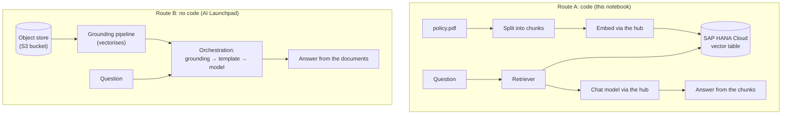

# Hands-on: RAG and document grounding with the generative AI hub

*Make a model answer from your own documents in two ways: in Python with LangChain and the SAP HANA Cloud vector engine, or without code in SAP AI Launchpad's grounding management.*

> [!NOTE]
> **📍 At a glance**
> - **Sources:**
>   - the course's notebook `rag_genaihub.ipynb` and its sample `policy.pdf`
>   - the course's sheet *Document Grounding in SAP AI Launchpad*
>   - the course Drive's *SAP AI Core, Generative AI Hub & AI Launchpad How-To Guide*, a third-party summary (claims checked against SAP)
>   - SAP Help: *Service Plans*, *Roles and Authorizations*, *Grounding Management*, *Build Your Orchestration Workflow*; SAP's AI Core trial page (all read 21 Nov 2026)
> - **You will build:** a question-answering chain over a 27-page insurance policy, with chunks stored in SAP HANA Cloud; then the same idea with no code in AI Launchpad
> - **You need:**
>   - SAP AI Core on the extended plan (or SAP's 30-day trial) and its service key ([chapter 8](tutorial-genai-hub-python.md))
>   - Code route: an SAP HANA Cloud instance with the vector engine
>   - No-code route: SAP AI Launchpad, and an object store on BTP
> - **Level:** intermediate
> - **Concepts:** [Prompt engineering](prompt-engineering.md) (RAG), [Hands-on: generative AI hub](tutorial-genai-hub-python.md)
> - **Last checked:** 21 Nov 2026

**After this tutorial you can:**

- Split a PDF into chunks, embed them through the hub and store them in SAP HANA Cloud
- Build a retrieval chain that answers only from those chunks
- Set up document grounding in AI Launchpad and use it in an orchestration flow
- Choose between the code route and the no-code route

## 11.1 Where the pieces sit

| Piece | What it does | You use it to |
|---|---|---|
| **SAP AI Core** | Runs and serves AI models on BTP | Hold the models and the orchestration deployment |
| **Generative AI hub** | Governed access to LLMs from several providers (extended plan) | Call chat and embedding models |
| **SAP AI Launchpad** | The web UI for AI Core | Chat, edit prompts, manage grounding and orchestration without code |
| **SAP Cloud SDK for AI** | The code route into the hub | Call models from Python, with LangChain |
| **SAP HANA Cloud vector engine** | Stores embeddings and finds the nearest ones | Keep your document chunks for retrieval |



- **Plans (SAP Help, 21 Nov 2026):** the hub needs AI Core's **extended** plan.
  - A **30-day basic trial** covers AI Launchpad, prompt design and RAG with vectors.
  - After it, you buy AI Core through Pay-As-You-Go or an Enterprise Agreement (SAP's trial page).
- The course's guide says the extended plan needs a BTPEA or CPEA contract, "not plain Pay-As-You-Go". SAP's trial page names Pay-As-You-Go too, so this book follows SAP.
- **Not the same as Joule's document grounding** ([SAP Joule 16.5](../sap-joule/joule-integration-other-sap-solutions.md)). That one lets Joule answer from your documents. This chapter builds grounding into your own app.

## 11.2 Route A: set up

```bash
pip install "sap-ai-sdk-gen[all]" langchain-hana hdbcli pypdf python-dotenv
```

- **Use `[all]`.** Any import from `gen_ai_hub.proxy.langchain` also loads the SDK's Amazon module, so without the Amazon parts it fails with *No module named 'botocore'* (SDK 7.4.1, seen in testing).
- `langchain-hana` and `hdbcli` are SAP's packages: the LangChain vector store for HANA Cloud and the database client.

Keep every credential outside the notebook. The `.env` file:

```bash
# .env — never commit this file
HANA_HOST=<your-instance>.hana.prod-<region>.hanacloud.ondemand.com
HANA_USER=<database user with rights on the vector table>
HANA_PASSWORD=<password>
```

```python
import os
from dotenv import load_dotenv
from hdbcli import dbapi

load_dotenv()
load_aicore_key()                      # from chapter 33: AI Core settings from key.json

connection = dbapi.connect(
    address=os.environ["HANA_HOST"], port=443,
    user=os.environ["HANA_USER"], password=os.environ["HANA_PASSWORD"],
    encrypt=True, autocommit=True,
)
```

> [!CAUTION]
> **🔒 Never type a database password into a notebook**
> - The course notebook writes the HANA user, password and host straight into a cell. Anyone who gets the file can log in to that database.
> - Saved notebooks travel: Drive folders, Git, email. Keep secrets in `.env` or a secret store, and use a user with rights only on the vector table, not an admin user.
> - If a password ever appeared in a shared file, change it.

## 11.3 Load, split, embed, store

```python
from langchain_community.document_loaders import PyPDFLoader
from langchain_text_splitters import TokenTextSplitter
from langchain_hana import HanaDB
from gen_ai_hub.proxy.langchain.openai import OpenAIEmbeddings

pages = PyPDFLoader("policy.pdf").load()                 # one Document per page
splitter = TokenTextSplitter(chunk_size=500, chunk_overlap=25)
chunks = splitter.split_documents(pages)

embeddings = OpenAIEmbeddings(proxy_model_name="text-embedding-ada-002")
db = HanaDB(embedding=embeddings, connection=connection, table_name="INSURANCE")
db.add_documents(chunks)
```

- **Chunks:** 500 tokens with a 25-token overlap, so a sentence cut at a border appears in both chunks. (The notebook's comment says 200; its code uses 500.)
- **Each chunk keeps its metadata**, such as the source file and page, so an answer can cite where it came from.
- **The table:** HanaDB creates one row per chunk with three columns: the text (`VEC_TEXT`), the metadata as JSON (`VEC_META`) and the vector (`VEC_VECTOR`). The course looks at them with SQL:

```python
cur = connection.cursor()
cur.execute('SELECT TOP 3 "VEC_TEXT", "VEC_META" FROM "INSURANCE"')
for text, meta in cur.fetchall():
    print(meta, text[:80])
```

> [!WARNING]
> **⚠️ Pitfall: `delete(filter={})` empties the table**
> - The course runs `db.delete(filter={})` before loading, so a re-run doesn't add duplicates. An empty filter matches **every** row.
> - Fine for a lab table. In a shared table, delete by your own metadata instead, for example `db.delete(filter={"source": "policy.pdf"})`.

## 11.4 Ask questions

```python
from langchain_core.prompts import ChatPromptTemplate
from langchain_classic.chains import create_retrieval_chain
from langchain_classic.chains.combine_documents import create_stuff_documents_chain
from gen_ai_hub.proxy.core.proxy_clients import get_proxy_client
from gen_ai_hub.proxy.langchain.openai import ChatOpenAI

llm = ChatOpenAI(proxy_model_name="gpt-5.4",        # the course's model; pick one from your deployments
                 proxy_client=get_proxy_client("gen-ai-hub"), temperature=0.0)
prompt = ChatPromptTemplate.from_template(
    "Answer only from the context. If the answer is not there, say you don't know.\n\n"
    "<context>\n{context}\n</context>\n\nQuestion: {input}")

rag = create_retrieval_chain(db.as_retriever(), create_stuff_documents_chain(llm, prompt))
out = rag.invoke({"input": "What is the maximum allowed expense for ambulance?"})
print(out["answer"])        # course run: road ambulance up to ₹1,000 per hospitalisation
print(len(out["context"]), "chunks used")
```

✅ *Verified: the same chain ran with in-memory stand-ins for HANA, the embeddings and the model (details at the end).*

- **What happens:** the retriever embeds the question and takes the nearest chunks from HANA. `create_stuff_documents_chain` puts them into `{context}`, and the model answers.
- `out["context"]` holds the chunks used. Show them next to the answer, so a person can check it.
- **Ask a question that isn't in the PDF.** Without the policy, the course's model said it had no access to the company's documents. With the chain, it answered from the policy, down to a 14-item list of claim documents.
- **Older code uses `RetrievalQA`.** It's deprecated. In LangChain 1.x, `create_retrieval_chain` lives in the `langchain_classic` package.
- **Shortcut:** `init_llm("gpt-4o", max_tokens=300)` from `gen_ai_hub.proxy.langchain.init_models` builds the chat model for you. Its default `max_tokens` is 256, too short for long answers.

## 11.5 Route B: grounding without code (AI Launchpad)

**What you need first (SAP Help, *Grounding Management*):**

- A **resource group** with the **document grounding label** switched on.
- A **generic secret** for AI data management with the grounding label, pointing at your document store.
- A role that allows it:

| Role | Can |
|---|---|
| `genai_manager` | Create prompts, manage orchestration, create and delete grounding repositories |
| `grounding_manager` | Create and delete grounding repositories |
| `genai_experimenter`, `grounding_viewer` | Use and search, not create |

**Steps (course sheet, matched to SAP Help):**

1. In the subaccount, create an **Object Store** service instance, with two service keys: one with **write**, one with **read** rights.
2. Upload the documents with the AWS CLI, using the write key:

```bash
aws configure --profile btp-write          # paste the write key's access key ID and secret
aws s3 cp policy.pdf s3://<bucket-from-the-key> --profile btp-write
aws s3 ls s3://<bucket-from-the-key> --profile btp-read
```

3. In AI Launchpad, create a **generic secret** with the **read** key, the grounding label on.
4. *Generative AI Hub → Grounding Management → Create*: a data repository over the bucket, using that secret.
5. Wait until the documents are vectorised. Check the chunks in the document view, then choose **Run Search** with a test question.
6. Choose **Use in Orchestration**, or build an orchestration flow with the grounding module on.
7. Put both grounding variables into the template:

```text
User query: {{?grounding_input_variable_1}}
Context from document grounding: {{?grounding_output_variable}}
```

8. Ask questions. Answers now come from the grounded documents.

- **Limits (SAP Help, *Service Plans*):** a tenant can have at most **5 tenant-wide generic secrets** and **50 resource groups**.

## 11.6 Orchestration: the pipeline around the model

SAP Help lists these orchestration modules. Each module's output is the next one's input, and SAP sets the order:

| Module | Does |
|---|---|
| Grounding | Fetches context from your repositories |
| Templating *(required)* | Builds the prompt from variables |
| Tool calling, Response format | Lets the model call tools; forces a JSON shape |
| Input and output translation | Translates before and after the model |
| Data masking | Hides personal data before the model sees it |
| Input and output filtering | Content safety checks |
| Model configuration *(required)* | Picks the model and its parameters |

- One API call runs the whole chain. You switch modules on and off in AI Launchpad, or send the configuration as JSON.
- You need a running **orchestration deployment**, and `orchestration_executor`, `genai_experimenter` or `genai_manager`.

## 11.7 Which route?

| | Code (LangChain + HANA) | No code (Launchpad grounding) |
|---|---|---|
| Best for | Your own app, full control of chunking and prompts | Trying RAG fast; business users testing prompts |
| You manage | Splitting, vector table, retrieval, prompt | Bucket, secret, repository; SAP does chunking and vectors |
| Masking and filters | Build them yourself | Orchestration modules, switched on |
| Extra service | SAP HANA Cloud | Object store |

## 11.8 Things to watch

- **Chunk size is a trade-off.** Small chunks match precisely but lose context; large ones carry more noise and cost more tokens. Try a few sizes on real questions.
- **Re-index when documents change.** The code route re-runs `add_documents`. In the Launchpad, each repository shows its sync history, and you can trigger a sync by hand.
- **Same embedding model for storing and asking.** Vectors from different models can't be compared.

> [!IMPORTANT]
> **🏭 In production**
> - Keep a small set of questions with known answers, and run it after every change to chunking, prompt or model.
> - Log which chunks were used for each answer, so a wrong answer can be traced to a bad chunk or a missing document.
> - Respect document permissions: a retriever returns any chunk in the table, so split tables or filter by metadata per user group.
>
> *Added by Claude*

## Check yourself

<details class="qa"><summary>Why does the RAG answer differ from the plain chat answer to the same question?</summary>

- Plain chat answers from training data, which doesn't contain the company's policy.
- The chain puts the policy's matching chunks into the prompt and tells the model to answer only from them.
- **Stronger answer:** show the chunks used with the answer, and say "I don't know" when none match.

</details>

<details class="qa"><summary>What do you need before you can create a grounding repository in AI Launchpad?</summary>

- A resource group with the document grounding label on, and a generic secret with the grounding label for the document store.
- The `grounding_manager` or `genai_manager` role.
- **Stronger answer:** use separate read and write keys for the bucket. The pipeline only needs read.

</details>

## How this page was checked

- **Course files read in full on 21 Nov 2026:**
  - `rag_genaihub.ipynb` (34 cells, with outputs)
  - the *Document Grounding in SAP AI Launchpad* sheet
  - the 14-page *How-To Guide*. It says it was compiled from SAP's documentation and doesn't replace it, so its claims were checked against SAP. Its cost table, third-party estimates, is not used.
- **Read partly:** `policy.pdf` (page 1: a public 27-page health-insurance policy wording, used only as input) and the AeroSense X1 product spec (page 1: a fictional 2-page sample).
- **Not read:** `pyproject.toml` (Drive shows no preview). `invoice.png` is a sample invoice image; no course file uses it.
- **Not copied:** the HANA login written into the course notebook, and the course's bucket name.
- **Installed and checked on 21 Nov 2026**, in a throwaway folder:
  - `langchain-hana` 1.2.0, `hdbcli` 2.30.32, and `sap-ai-sdk-gen` 7.4.1 with `[all]`
  - the LangChain imports fail without the Amazon parts (`botocore`) and work with `[all]`
  - `HanaDB` has `add_documents`, `as_retriever` and `delete(ids, filter)`; `init_llm` defaults to 256 tokens
- **Run:** the split, store and retrieval chain, with in-memory stand-ins for HANA, the embeddings and the model. It returned an answer and the chunks used.
- **Not run:** anything against HANA Cloud, AI Core or AI Launchpad.

## Sources

- Mentors Pool course Drive:
  - `rag_genaihub.ipynb` (BT078) and its input `policy.pdf` (BT076)
  - *Document Grounding in SAP AI Launchpad* (BT065)
  - *SAP AI Core, Generative AI Hub & AI Launchpad How-To Guide* (BT087)
  - `docs/AeroSense_X1_Office_Chair_Product_Spec.pdf` (BT053)
- SAP Help, *Service Plans* (SAP AI Core): https://help.sap.com/docs/sap-ai-core/sap-ai-core-service-guide/service-plans
- SAP, *SAP AI Core trial*: https://www.sap.com/products/artificial-intelligence/core-ai-trial.html
- SAP Help, *Roles and Authorizations* (SAP AI Launchpad): https://help.sap.com/docs/ai-launchpad/sap-ai-launchpad/roles-and-authorizations
- SAP Help, *Grounding Management*: https://help.sap.com/docs/ai-launchpad/sap-ai-launchpad/grounding-management
- SAP Help, *Build Your Orchestration Workflow*: https://help.sap.com/docs/ai-launchpad/sap-ai-launchpad/build-your-orchestration-workflow

Previous: [Hands-on: Translate text and documents with SAP Translation Hub from Python](tutorial-translation-hub-python.md) · Next: [Tutorial: Set Up Tools to Connect With and Operate SAP AI Core](tutorial-ai-core-setup.md)
