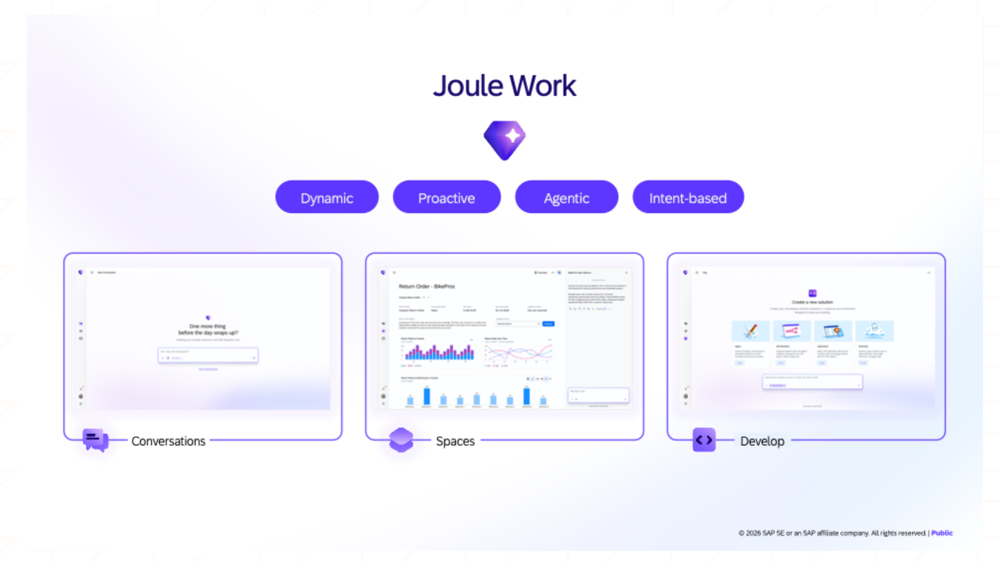
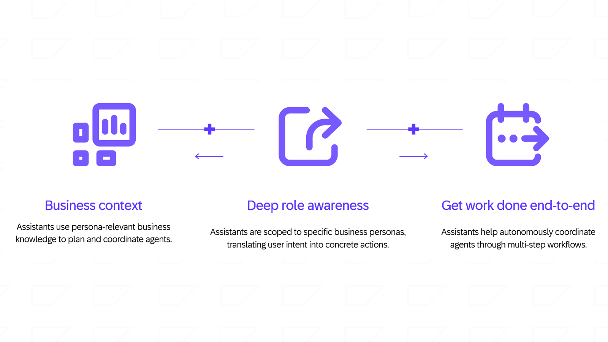
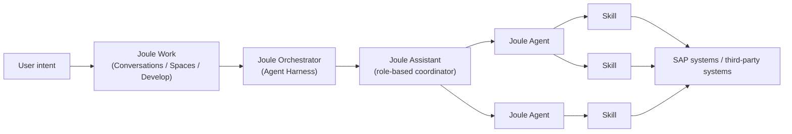
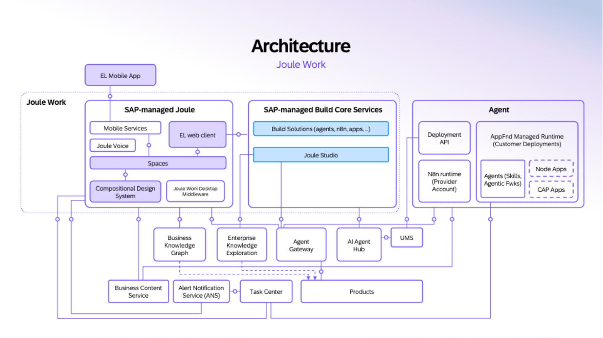
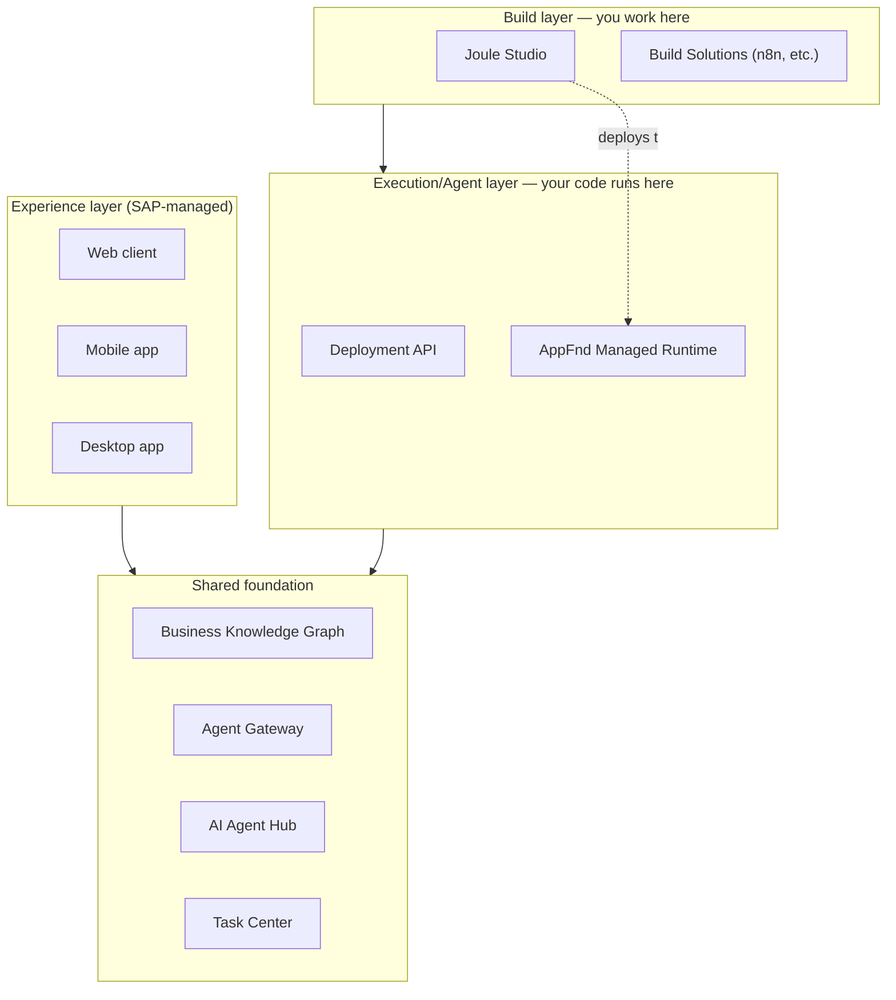

# Chapter 1: What Joule actually is

*Not a chatbot bolted onto SAP. A four-layer system — Work, Assistants, Agents, Skills — with a build layer where you write code.*

> [!NOTE]
> **📍 At a glance**
> - **You will learn:** the Work → Assistants → Agents → Skills taxonomy, Joule's three architectural zones, how a request actually gets routed, the three ways an agent gets triggered, and where a developer touches any of this
> - **You will build:** nothing yet — the mental model the rest of the book hangs code on
> - **Level:** beginner · **Time:** about 20 minutes
> - **Builds on:** nothing (first chapter). **Leads to:** Chapter 2 (Joule Studio and building your first agent)

**After this chapter you can:**

- Explain the difference between a Joule Skill, Agent, Assistant and Joule Work without hand-waving
- Say which of Joule's three zones you actually write code in, and which SAP manages for you
- Name the three ways a Joule Agent gets triggered, and pick the right one for a given scenario
- Describe how the Joule Orchestrator (Agent Harness) routes a request
- List the shared platform pieces (Knowledge Graph, Agent Gateway, AI Agent Hub, Task Center) and what each does
- Spot the one place this course source contradicts itself on a hard number

## 1.1 The taxonomy: Work, Assistants, Agents, Skills

Four terms get used loosely in SAP material. They are not interchangeable.

- **Joule Skill** — an atomic, deterministic action: fetch a record, trigger a transaction, run a predefined query. No reasoning. Same input, same output.
- **Joule Agent** — an autonomous system that plans a multi-step task and orchestrates one or more Skills in sequence to complete it. This is where reasoning happens.
- **Joule Assistant** — a role-aligned coordinator. You talk to *one* assistant; it decides which Agents to invoke, in what order, and surfaces the result. Assistants are the "teammate" layer, included with your SAP subscription — the Agents they coordinate are what's metered.
- **Joule Work** — the workspace you (or your Assistant) actually operate in, with three interfaces: **Conversations** (natural language), **Spaces** (AI-generated, outcome-focused work areas), **Develop** (the door into Joule Studio).

An Assistant's job in one picture — business context in, role-scoped intent, work done end to end:

- A Skill is a function call with no judgment. An Agent is the thing that decides *which* Skills to call and *in what order*. An Assistant is the thing you address, which picks the Agent(s).
- This maps almost directly onto an agentic framework's own vocabulary: Skill ≈ a tool/function; Agent ≈ an agent with a planning loop; Assistant ≈ a router/supervisor agent in front of several worker agents.

> [!WARNING]
> **⚠️ Pitfall: the skill-count number does not agree with itself**
> One lesson in this same course states "over 1,300 Joule Skills covering approximately 80% of the most-used SAP transactions." A different lesson in the same course states "over 1,800 skills." Both are from SAP, in the same course, published the same week. Treat any specific skill/agent count from SAP material as directional, not a number to quote in a design doc without checking the current AI Feature Catalog yourself.

## 1.2 The three zones: where you can actually write code

Joule Work is not one application — it's three zones plus a shared foundation underneath.

| Zone | What's in it | Who manages it |
|---|---|---|
| **Experience layer** | Web client, mobile app, Spaces, Joule Voice, desktop app middleware | SAP-managed — you don't touch this |
| **Build layer** | Joule Studio (intent-to-deployment), Build Solutions (n8n and other frameworks), Agent Runtime for custom agents | SAP-managed tooling, but **this is where you build** |
| **Execution (Agent) layer** | Deployment API, AppFnd Managed Runtime, the frameworks hosting Skills and agentic workflows alongside Node and CAP apps | SAP runs it; your deployed agent code lives and executes here |

- As a developer, your actual surface area is the **Build layer** (you design and write the agent in Joule Studio or export it) and the **Execution layer** (your code runs there, under your org's authorization boundaries — every action traces back to the user/role that triggered it).
- Underneath all three sits a **shared foundation** you consume but don't operate:
  - **Business Knowledge Graph** — SAP's model of business data, processes and relationships. This is what grounds a response in your actual landscape instead of a generic LLM answer.
  - **Enterprise Knowledge Exploration** — extends that grounding to unstructured content (documents, policies) via document grounding.
  - **Agent Gateway** — the secure routing layer every request passes through: authentication, principal propagation, tool discovery. Functionally this is doing the job an API gateway + auth proxy does in front of your own tool servers.
  - **AI Agent Hub** — governance command center (see 1.6).
  - **Task Center** — aggregates human-approval work items from across SAP apps into one inbox, for wherever your agent needs a human in the loop.

SAP's own architecture diagram for this (note it also shows a few pieces the lesson text never explains in prose — UMS, N8n runtime under a provider account, Business Content Service, Alert Notification Service — so treat those as "exists, not yet documented here" rather than skip them silently):

The same structure, simplified to just what's covered above:

## 1.3 Three ways an Agent gets triggered

An Agent never runs "just because." It is always triggered in one of three modes:

| Mode | Trigger | Example |
|---|---|---|
| **Conversational** | A user asks directly in Joule | "Approve this expense report" |
| **Embedded** | The agent surfaces inside an app the user is already in, no context switch | A cost-saving suggestion appears while working in Ariba |
| **System-triggered** | A business event, schedule, or signal — no user involved | An agent watches for trade-policy changes and proposes reclassifications automatically |

- Across all three modes, every agent action carries the triggering user's identity and permissions — an agent can't act on anything that user couldn't act on themselves. Worth remembering when you're designing a system-triggered agent: it still needs *someone's* authorization context, usually a service identity you configure explicitly.

## 1.4 Where a developer actually touches this

Two developer-facing surfaces came up in this course, both of which are presumably the subject of later chapters:

- **Joule Studio** — intent-to-deployment. You describe the problem in plain language; it asks clarifying questions, enriches your intent using SAP LeanIX/Signavio/Domain Models/Knowledge Graph context, then generates a PRD and technical spec, and AI coding agents turn that into production code. You can stay in Joule Studio's browser environment, or export and keep working in **VS Code, Cursor, or Claude Code**. It explicitly supports building with **LangChain, LangGraph, Pydantic AI, and LlamaIndex** — you're not locked into one framework. Output runs on SAP's managed runtime (no infra config).
- **SAP Joule for Developers** — embedded AI for SAP Build and ABAP: generates CAP/RAP components, accelerates low-code artifacts, and does code-quality work (search, refactoring, explanation) for ABAP/Java/JavaScript, including generating unit tests.

> [!IMPORTANT]
> **🏭 In production: agent actions cost money, even if the agent itself is free to build**
> Design-time use of Joule Studio is free (within fair-use limits). Once an agent you built runs in production, every agent *action* it takes is metered. If you're designing a loop (an agent that re-checks something repeatedly, or chains several agent calls per request), that loop has a real per-action cost at scale — architect for the minimum number of agent-level actions, and push deterministic work down into plain Skills rather than agent reasoning where you can.
>
> *Added by Claude; this course covers the pricing mechanics in far more detail than a developer needs — we're keeping only the design implication.*

## 1.5 Grounding your own agent with your own data

The course describes this in the context of a consulting feature (Custom Knowledge Grounding), but the pattern underneath is a standard RAG pipeline and is worth lifting out:

- Your documents are uploaded to a data repository.
- They're indexed by **SAP AI Core**.
- At query time, relevant chunks are retrieved and combined with SAP's own curated knowledge in a single response.

This is the same retrieve-then-generate shape you'd build by hand with any vector store — SAP is just running the indexing and retrieval for you against SAP AI Core specifically.

## 1.6 Governance: the AI Agent Hub

- **AI Agent Hub** is SAP's single inventory and control plane for *every* agent in the landscape — SAP-built, your own custom agents from Joule Studio, and third-party agents (the course names Microsoft, Google, AWS and ServiceNow explicitly).
- Its lifecycle has five stages: **Discover & Provision → Plan & Build → Observe & Analyze → Secure & Govern → Optimize & Decommission.**
- Relevant if you're building a custom agent: it's where identity/access controls get applied to your agent, where its MCP servers get verified, and where its execution telemetry and audit trail live — not something your agent code needs to implement itself.

## 1.7 Interoperability: the parts that aren't SAP-only

- The **desktop app** variant of Joule Work connects to enterprise systems via **MCP (Model Context Protocol)** — the same protocol from the [MCP book](../mcp/01-why-mcp-exists.md). If you already know MCP, this is not a new concept, just a new host.
- Joule supports bidirectional integration with **Microsoft 365**.
- The **Joule Action Bar** extends Joule into any web-based tool or browser environment.
- Agents are described as built on "open protocols" so they can interoperate with third-party agents — the course doesn't name a specific agent-to-agent standard (no explicit mention of A2A), so treat this as a direction, not a documented interface, until a later source confirms it.

## 1.8 Added by Claude, not from the sources

- The Skill/Agent/Assistant/Work vocabulary is SAP's own, but the mapping onto generic agentic-framework terms (tool, agent, supervisor) in 1.1 is added here to connect it to concepts you already have from the LangChain and LLM books.
- The cost-awareness framing in the 🏭 box (1.4) is a design implication drawn from the commercial-model lesson in this course, deliberately stripped of SKU numbers and pricing-tier detail, which this book is explicitly skipping.
- Not run: nothing in this chapter is code yet, so there's nothing to verify. Chapter 2 (Joule Studio, first agent) will carry the first "not run" / "verified" markers.

## 1.9 Interview corner

**What interviewers listen for:** you don't call Joule "a chatbot," you know which of the four terms (Work/Assistant/Agent/Skill) does the reasoning, and you can say where your own code would actually live.

### 🟢 Basic

1. What's the difference between a Joule Skill and a Joule Agent?

- A Skill is atomic and deterministic — same input, same output, no reasoning
- An Agent plans a multi-step task and orchestrates one or more Skills to complete it
- *Stronger answer:* this maps to "tool" vs "agent" in any other agentic framework — SAP just gives it product names

2. Name the three ways a Joule Agent can be triggered.

- Conversational (user asks directly), embedded (surfaces inside an app in flow), system-triggered (a business event or schedule, no user involved)

### 🟡 Intermediate

3. Which of Joule's three architectural zones does a developer actually write code in?

- The Build layer (Joule Studio / Build Solutions) to design and build; the Execution/Agent layer is where it then runs. The Experience layer is entirely SAP-managed and not something you touch
- *Stronger answer:* this split matters for a design conversation — you're never asked to manage infrastructure, only to design the agent's logic and its skill orchestration

4. What does the Agent Gateway do?

- It's the secure routing layer every Joule request passes through: authentication, principal propagation, tool discovery
- *Stronger answer:* functionally equivalent to an API gateway sitting in front of your tool/agent backends, except SAP operates it for you

### 🔴 Senior

5. You're designing a custom agent that needs to check an external regulatory feed every hour and act without a user present. Walk through which Joule building blocks you'd use.

- Trigger mode: system-triggered (scheduled/event-based, no user initiating)
- Build it in Joule Studio against the Agent Runtime; it executes in the Agent/Execution layer under a service identity's authorization boundary, not an interactive user's
- Register it in AI Agent Hub for visibility/governance; route any human-approval step through Task Center
- *Stronger answer:* flag the per-action cost of a polling agent up front — an hourly check that fans out into several agent actions per run adds up, so push the "did anything change" check down into a plain deterministic Skill and only invoke agent-level reasoning when the check actually fires

> [!TIP]
> **🧩 Design question**
> *"A finance team wants an agent that watches cash positions and proposes reclassifications, but legal insists a human signs off on anything over $50k."* Talk about: system-triggered mode for the watch loop, a deterministic Skill for the threshold check (not agent reasoning), routing the sign-off through Task Center, and registering the agent in AI Agent Hub so the audit trail exists before legal asks for it.

## Cheat sheet

| Term | One-line definition |
|---|---|
| Joule Skill | Atomic, deterministic action — no reasoning |
| Joule Agent | Plans + orchestrates Skills across multiple steps |
| Joule Assistant | Role-based coordinator you talk to; picks the Agent(s) |
| Joule Work | The workspace: Conversations / Spaces / Develop |
| Joule Orchestrator | Routes intent to the right Assistant/Agent/Skill combo |
| Build layer | Joule Studio — where you design/write agents |
| Execution layer | Where your built agent actually runs |
| AI Agent Hub | Governance across SAP, custom, and third-party agents |
| Agent trigger modes | Conversational / embedded / system-triggered |

## Recap

- Four layers, not one product: **Work** (the workspace) → **Assistants** (role-based routers) → **Agents** (planners that orchestrate) → **Skills** (atomic deterministic actions)
- Three zones: **Experience** (SAP-managed, you don't touch it), **Build** (you design agents here, in Joule Studio), **Execution** (your agent runs here, under the triggering identity's permissions)
- A shared foundation underneath all three does grounding (Knowledge Graph), routing/auth (Agent Gateway), governance (AI Agent Hub) and human-in-the-loop (Task Center)
- Agents trigger three ways: conversational, embedded, system-triggered — always within the triggering identity's authorization
- Joule Studio exports to VS Code/Cursor/Claude Code and explicitly supports LangChain, LangGraph, Pydantic AI, LlamaIndex
- The course's own skill-count numbers disagree with each other (1,300 vs 1,800) — don't trust a specific figure without checking the current catalog

## Practice

1. Without looking back, draw the Work → Assistant → Agent → Skill chain and label which layer does reasoning
2. Pick a business process you know and sketch which of the three trigger modes fits an agent for it, and why
3. Explain out loud: "where does your custom agent's code actually run, and who manages that?"

## How this chapter was checked

- All 11 lessons and all 5 unit quizzes of "Introducing Joule" (learning.sap.com/courses/introducing-joule) were read in full, 9 Nov 2026. Linked videos, the external architecture-center link, and "Related resources" live sessions were not opened.
- All 7 images across the course's lessons were viewed. 3 are used in this chapter (saved to `images/`, never hotlinked): the Joule Work interfaces screenshot, the assistant-value illustration, and SAP's official architecture diagram. The other 4 (the Autonomous Enterprise vision graphic, the value-pillars graphic, the "Joule Delivers Value" graphic, and the Reimagine Finance stats slide) illustrate the marketing/ROI content this chapter deliberately left out, so they weren't saved.
- Nothing in this chapter is code yet, so nothing was run.
- Sections on activation (SAP for Me), licensing (Joule Base vs Premium AI, SKUs, AI Unit pricing tiers), the "staying current" resource list, and consultant-only features (Expert Workspaces, Landscape Awareness, SAP Joule for Consultants pricing) were deliberately left out of this chapter as licensing/change-management/end-user material, per the book's developer-only scope.

## Sources and further reading

- SAP Learning, *Introducing Joule* — https://learning.sap.com/courses/introducing-joule (all 11 lessons + 5 quizzes, read in full 9 Nov 2026)

Previous: [SAP Joule book introduction](README.md) · Next: Chapter 2 (TBD)
