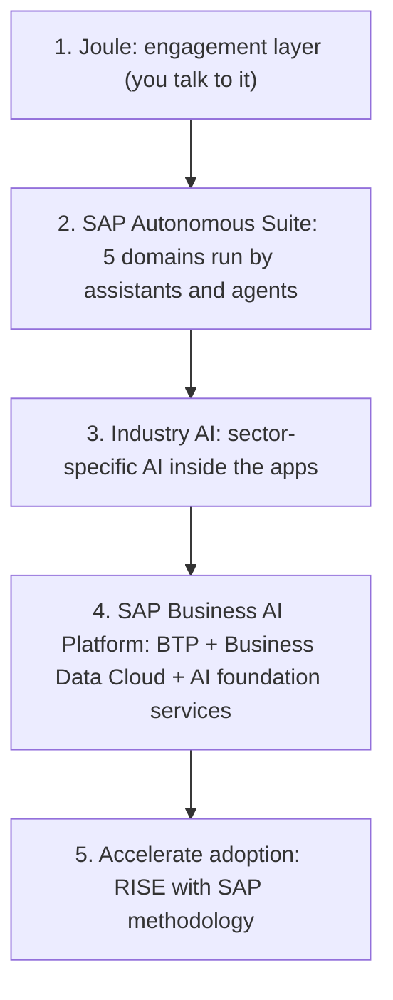
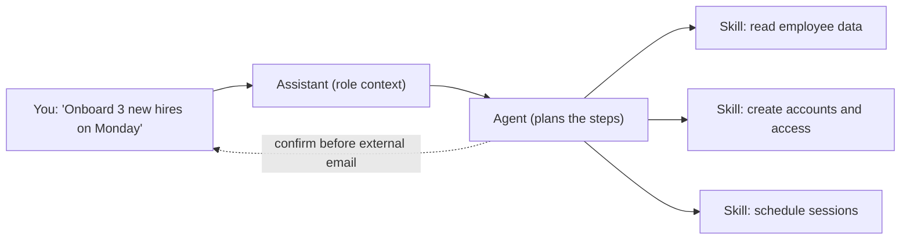
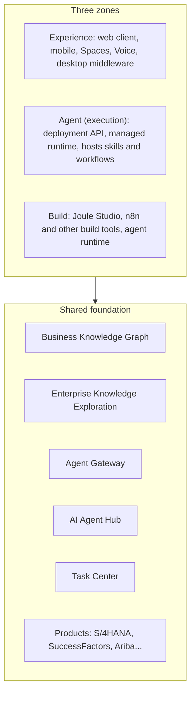

# Chapter 1: What is SAP Joule?

*Joule is SAP's AI layer for the enterprise: you state a goal, an assistant picks agents, and agents run skills inside SAP's governance.*

> [!NOTE]
> **📍 At a glance**
> - **You will learn:** what Joule is, its parts (Joule Work, assistants, agents, skills), how it is built, how it is switched on and paid for
> - **You will build:** nothing yet; a clear mental model you can explain in 2 minutes
> - **Level:** beginner · **Time:** about 40 minutes
> - **Source:** SAP Learning course *Introducing Joule* (free, 11 lessons), read 8 November 2026
> - **Leads to:** Joule Studio (next chapter, not written yet)

**After this chapter you can:**

- Explain Joule without calling it "a chatbot" or "a copilot"
- Name the four layers of the vocabulary: Joule Work, assistant, agent, skill
- Describe the three zones of Joule Work and the shared platform parts under them
- Say what Joule Base and Premium AI mean, and which is free
- Tell a customer what SAP-Managed Joule changes for setup
- List where to track new features, because Joule changes every two weeks

> [!WARNING]
> **Dates matter in this chapter**
> - The course describes several items as "planned for H2 2026" or "from Q3 2026" (SAP-Managed Joule, the new Premium AI pricing).
> - Today is later than that. Treat those lines as **what SAP said**, and check SAP Help or the AI Feature Catalog before you tell a customer.

## 1.1 What Joule is

- Joule is SAP's flagship AI solution, built **into** SAP applications, not beside them
- Not just a copilot: a copilot helps one person with one task; Joule turns tasks into connected workflows
- You say a goal; Joule brings the data, workflows and agents together to reach it
- It works across SAP apps and chosen third-party systems, inside SAP's security and compliance rules
- It can be extended: you build your own agents and skills in **Joule Studio**

**Why SAP says it is reliable (three foundations):**

| Foundation | Meaning |
|---|---|
| Process and industry knowledge | Agents know the order and rules of business processes, not only the data |
| Semantically rich data | Records carry business meaning (what stock is for, where it sits), so answers are operationally right |
| Governance | Actions are governed, auditable, reversible; your data is not used to train third-party models |

## 1.2 The five-layer picture

- SAP places Joule in the **Autonomous Enterprise**: people set direction, agents do the repeatable work
- The course lists five layers, top to bottom:

- **Five domains:** Autonomous Finance, Spend, Supply Chain Management, HCM, Customer Experience
- **Scale quoted:** more than 50 assistants and about 200 agents "being made available" across the domains
- Some features are early access or rolling out through 2026; the course marks what is available now

## 1.3 Joule Work: the workspace

- **Joule Work** is the central workspace where you state a goal and agents get it done
- It has three parts:

| Part | What it is |
|---|---|
| Conversations | Plain-language chat that can act, with sources shown |
| Spaces | AI-generated work areas built around one business outcome |
| Develop | Entry point into Joule Studio to build custom agents and workflows |

- The engine underneath is the **Joule Orchestrator**, also called the **Agent Harness**
- It decides which assistants and agents are needed, loads tools and skills, handles grounding, returns the result
- **Three surfaces**, all generally available per the course: web, mobile, desktop
- The desktop app is separate: local files and on-device work, connected to systems through **MCP**

✅ *Verified against the lesson text; nothing run (see "How this chapter was checked").*

## 1.4 Assistants, agents and skills

- **Assistant:** role-based "teammate". Reads your intent and role, picks the agents. You talk to one assistant
- **Agent:** autonomous worker for one business process. Plans steps, calls skills, adapts. It acts, it does not just answer
- **Skill:** small, atomic, **deterministic** action such as fetch data or trigger a transaction
- Agents combine skills; humans approve only at key decision points

**The four skill types** (the same four appear as "capability types" for business users):

| Type | Does | Example |
|---|---|---|
| Transactional | Runs a business process | Create a purchase order |
| Navigational | Takes you to the right app or object | "Where do I approve invoices?" |
| Informational | Answers from docs and policies | "What is our vacation policy?" |
| Analytical | Queries data, returns charts | Sales numbers via SAP Analytics Cloud |

**How an agent runs (three modes):**

- **Conversational:** you ask in Joule
- **Embedded:** inside the app you are already in
- **System-triggered:** a business event or a schedule starts it, no user request
- Every action carries **your identity and permissions**, so an agent only does what you may do

> [!WARNING]
> **Two skill counts in one course**
> - One lesson says "over 1,300 skills covering about 80% of the most-used transactions"; another says "over 1,800 skills".
> - Likely different dates. Quote neither as exact: say "well over a thousand" and check the AI Feature Catalog.

## 1.5 Who uses it, and how

- **Business users:** Joule is already in the shell bar of S/4HANA, SuccessFactors, Ariba, Concur, IBP and others
- **Consultants:** *SAP Joule for Consultants* answers from SAP Notes, KBAs and best practices, with sources in a panel
- Consultants also get **Custom Knowledge Grounding** (your firm's documents, indexed by SAP AI Core) and **Expert Workspaces**
- **Developers:** Joule Studio goes from a plain-language problem to a requirements document, a spec, then code
- Studio works in the browser or by export to VS Code, Cursor or Claude Code, on SAP's managed runtime
- It supports LangChain, LangGraph, Pydantic AI and LlamaIndex, so you are not forced into one framework
- **SAP Joule for Developers:** coding help inside SAP Build and ABAP, trained on SAP models (CAP, RAP)

## 1.6 How Joule Work is built

- Three SAP-managed zones sit on a shared foundation:

| Foundation part | Job |
|---|---|
| Business Knowledge Graph | Grounds answers in your SAP data and processes |
| Enterprise Knowledge Exploration | Grounds answers in documents and policies |
| **Agent Gateway** | Secure routing: authentication, **principal propagation**, tool discovery |
| **AI Agent Hub** | Governance for every agent: SAP-built, custom, third-party |
| Task Center | One inbox for approvals and tasks that agents need from humans |

- You do not run any of this; SAP provisions and maintains the experience and build zones

> [!IMPORTANT]
> **🏭 In production**
> - The two parts that matter most for a developer are the **Agent Gateway** (identity travels with every call) and the **AI Agent Hub** (you can see and stop agents).
> - *Added by Claude:* when you design a custom agent, ask first "which user identity does it run as?" and "will it appear in the Hub?".

## 1.7 Governing agents: the AI Agent Hub

- One view of **all** agents: SAP-built, custom from Joule Studio, and third-party (Microsoft, Google, AWS, ServiceNow named)
- Included as a base capability for SAP Business AI Platform customers; a premium tier needs Joule Studio or AI Units
- The course gives five lifecycle stages:

- **Observe:** every agent decision is logged and traceable, with exception rates and telemetry
- **Secure:** identity controls, verify agents **and MCP servers**, enforce policy, keep audit trails

## 1.8 Switching it on, and paying for it

**Two access tiers:**

| Tier | What you get | Cost |
|---|---|---|
| **Joule Base** | Conversational help, skills for everyday tasks, guidance in your SAP apps | Included with a qualifying SAP cloud subscription |
| **Premium AI (AI Units)** | Agents, assistants, enterprise AI features | Bought separately, activated in SAP for Me |

- Before Base can be provisioned, add SKU **8019544** (0 EUR) once; it accepts SAP's AI terms
- If you already own AI Units (SKU **8019164**), Joule Base is included and you skip that step
- **SAP-Managed Joule** is the new standard path: you request it in **SAP for Me**; SAP does BTP setup, integrations, identity and updates
- It was announced at Sapphire 2026 with general availability planned for H2 2026; "months of setup become hours"
- **Customer-managed Joule** stays for existing instances; migration help is offered
- Assistants are part of the experience layer; the **agents** they coordinate carry the cost, under Premium AI
- For **RISE with SAP** customers, assistants are activated at no extra cost, including selected hybrid and on-premise cases

**The pricing change SAP described (phased from Q3 2026):**

- Agents become the core of Premium AI, priced by **AI Units used**; in 2026 each agent action costs **0.02 AI Units**
- Many generative features now in per-user-per-month (PUPM) packages move to Base AI; PUPM packages are phased out
- **Exception:** Joule for Consultants stays at 35 AI Units per user per month
- **Custom agents:** design time in Joule Studio is free (fair use); runtime is billed on compute, storage, transactions and tokens via BTPEA, CPEA or PAYG
- A promotion keeps custom-agent runtime free until the end of 2026

> [!WARNING]
> **Check before you quote**
> - Prices, SKUs and promotions are time-limited statements from one course. Confirm in SAP for Me or with the account executive.
> - The **SAP Business AI Feature Catalog** (SAP Discovery Center) is SAP's pointer for what is Base and what is Premium.

## 1.9 Value claims: read them as marketing

- SAP quotes up to 80% less time on accruals, up to 70% faster RFP creation, up to 98% less ESG reporting time, and more
- The course itself says the numbers are **indicative** and depend on landscape and depth of integration
- **Bosch Power Tools example:** 1.5 million service tickets a year; up to 40% were mis-routed; one generative agent replaced hundreds of static rules
- Reported results: ticket classification accuracy up 35%, 80 IT man-days saved a year, 2,500+ hours saved per contact centre
- The McKinsey figures (74% of organisations stuck in pilot) come from SAP's slides, not from this book's own check

> [!CAUTION]
> **🔒 Security**
> - SAP states data is not used to train third-party models, AI is certified to ISO/IEC 42001, and frameworks align to the EU AI Act, GDPR and NIST AI RMF.
> - These are SAP claims. A customer should still check their own contract and the **Joule Admin Center** settings, such as web search on or off.

## 1.10 Staying current

- Joule releases new features **every other week** (per the course)
- **Track:** AI Feature Catalog, SAP Roadmap Explorer, Sapphire 2026 Innovation News Guide
- **Subscribe:** "What's new" on SAP Help (SAP login), the SAP Business AI newsletter
- **Ask and learn:** SAP Community, SAP Developer Center, SAP Learning live sessions ("Beyond Hype")

## 1.11 Added by Claude, not from the sources

*Everything in this section is my own mapping, not SAP's wording.*

**If you know LangChain and MCP, map the vocabulary like this:**

| Joule term | Closest idea you already know |
|---|---|
| Skill | A **tool** with a fixed contract |
| Agent | An agent loop that plans and calls tools |
| Assistant | A role-aware router or supervisor over several agents |
| Joule Orchestrator | The runtime that runs the loop and loads tools |
| Agent Gateway | A gateway in front of tools and agents, with auth |
| AI Agent Hub | An agent registry plus observability and policy |

- The mapping is for orientation only; SAP products have their own rules, limits and licensing
- **Questions to ask on any Joule project:**
  - Base or Premium: which capability do we actually have rights to?
  - Whose identity does the agent run as, and can it see data that user cannot?
  - Who approves what, and where does the audit trail live?
  - SAP-managed or customer-managed setup?

## 1.12 Interview corner

**What interviewers listen for:** you separate **assistant, agent and skill** correctly, you know Joule Base from Premium AI, and you raise identity, governance and cost before you raise features.

🟢 1. What is Joule, in two sentences?

- SAP's AI solution embedded across its applications: you state a goal and it coordinates data, workflows and agents
- Not only a copilot: it executes work inside SAP's security and governance rules

*Stronger answer:* add that it can be extended with Joule Studio and works with non-SAP systems.

🟢 2. What is the difference between an assistant, an agent and a skill?

- **Skill:** one atomic, deterministic action
- **Agent:** plans and runs several skills for one process
- **Assistant:** role-aware teammate that chooses and coordinates agents

*Stronger answer:* an agent can run on a schedule or event, not only from a chat.

🟢 3. Name the four skill types.

- Transactional, navigational, informational, analytical
- One example each: create a PO, open the right app, answer a policy question, return a chart

*Stronger answer:* say which of the four needs write access, and how that changes the review.

🟡 4. What is Joule Work?

- The central workspace: Conversations, Spaces, Develop
- Run by the Joule Orchestrator; available on web, mobile and desktop
- Desktop connects to other systems through MCP

*Stronger answer:* it overlays your SAP apps and does not replace them.

🟡 5. Joule Base versus Premium AI?

- Base: included with a qualifying cloud subscription; conversation, everyday skills
- Premium: agents and advanced features, bought with AI Units
- Joule for Consultants is priced separately per user

*Stronger answer:* say that SAP described a move from per-user packages to agent-action pricing, and that you would confirm current terms before quoting.

🟡 6. What does SAP-Managed Joule change?

- You request it in SAP for Me; SAP does BTP setup, integrations, identity and updates
- Faster start and automatic new features
- Customer-managed instances stay and can migrate

*Stronger answer:* name what you still own: entitlements, role design, testing.

🔴 7. How does Joule stop an agent from doing more than the user is allowed to do?

- Every agent action carries the user's identity and permissions
- The Agent Gateway handles authentication and principal propagation
- The AI Agent Hub logs, audits and can retire agents

*Stronger answer:* test with a low-privilege user, because "runs as the user" is only as safe as the roles.

🔴 8. A customer says "the vendor's ROI numbers say 80% savings, so we will cut the team." Your reply?

- The numbers are indicative and depend on integration depth
- Pilot on one process, measure before and after, then decide
- Count AI Unit cost and review effort in the result

*Stronger answer:* ask for the baseline: current time, error rate and volume.

> [!TIP]
> **🧩 Design question**
> A finance team wants an agent that proposes accrual postings, but a human must approve every posting over a limit.
> - **Sketch:** which skills it needs, which identity it runs as, where the approval appears (Task Center), and what the AI Agent Hub should show.
> - **Say out loud:** one failure case, for example a wrong cost centre, and how you would catch it before posting.

## 1.13 Cheat sheet

| Question | Short answer |
|---|---|
| What is Joule? | SAP's embedded AI layer: goal in, coordinated work out |
| Who does what? | Assistant chooses, agent plans, skill acts |
| Where do I work? | Joule Work: Conversations, Spaces, Develop |
| Who governs agents? | AI Agent Hub (lifecycle), Agent Gateway (routing and identity) |
| What is free? | Joule Base; Studio design time (fair use) |
| What costs? | Premium AI by AI Units; custom-agent runtime by consumption |
| How is it started? | SAP for Me, SAP-Managed Joule (customer-managed for old setups) |

## 1.14 Course quiz review (19 questions)

- The course has a short quiz at the end of each of its 5 units; SAP does not show an answer key
- **Answers below are worked out from the lesson text (mine, not SAP's key).** Wording is shortened; try each before you open it

**Unit 1: Getting to Know Joule (pass mark 6 of 7)**

1. HR queries now take 40% less time. Which value pillar is that?

- **Answer:** Employee experience and productivity (the "new human advantage" pillar).
- The other options (TCO, integration, governance) are not what that figure shows.

2. What most clearly separates Joule from a generic AI assistant?

- **Answer:** It understands your processes, roles and data context.
- It is not a separate login, not trained only on public data, and not only for developers.

3. Where is Joule available?

- **Answer:** Across multiple SAP cloud applications.
- It is not limited to one product.

4. Best description of Joule?

- **Answer:** An AI assistant embedded across SAP applications that understands business context.
- It does not replace Fiori and is not only a customer-service bot.

5. How should the productivity benchmarks be read?

- **Answer:** As indicative figures that vary by role, industry and deployment.
- They are not guarantees, SLAs or minimums.

6. Who gains most from retrieving and summarising information across apps without switching screens?

- **Answer:** The business user.
- This is the day-to-day user embedded in SAP apps.

7. Which is one of the three value pillars?

- **Answer:** Improving employee productivity through AI-assisted task execution.
- Server consolidation, user provisioning and replacing ERP modules are not pillars.

**Unit 2: Meeting the Joule Ecosystem (pass mark 5 of 6)**

8. Which is NOT a Joule Work surface?

- **Answer:** The SAP Fiori tile launcher.
- The surfaces are web client, mobile app and desktop.

9. An agent inside Ariba suggests savings and updates a supplier without the user leaving the app. Which mode?

- **Answer:** Embedded mode.
- Conversational needs a chat request; system-triggered needs an event or schedule.

10. Skill vs agent?

- **Answer:** A skill runs a predefined task deterministically; an agent reasons across steps and orchestrates several skills.
- Skills are not only for business users, and agents are not the only ones that reach third parties.

11. A trade-compliance agent watches rule changes and proposes reclassifications with nobody asking. Which mode?

- **Answer:** System-triggered mode (event or system signal).
- "Manual" and "proactive" are not the course's modes.

12. "What is our travel reimbursement policy?" Which skill type?

- **Answer:** Informational.
- It looks up documents; it does not run a process, navigate or chart.

13. What are Spaces for?

- **Answer:** A dynamic, AI-generated work area around one business outcome.
- Not archiving, not a Fiori launchpad replacement, not a notification list.

**Unit 3: Connecting Joule to Your Enterprise (pass mark 1 of 1)**

14. How is Joule Work structured and run?

- **Answer:** A layered system of three zones (experience, build, execution) on a shared platform; SAP manages the experience and build layers; agents run inside the customer's authorization boundaries.
- It is not one monolith run by customer IT, and routing and governance are central, not left to each agent.

**Unit 4: Understanding Joule's Prerequisites (pass mark 3 of 4)**

15. What does SAP manage under SAP-Managed Joule?

- **Answer:** Infrastructure, runtime, application integration and lifecycle updates.
- Business process configuration, training and data migration stay with you.

16. Which tool starts Joule provisioning?

- **Answer:** SAP for Me.
- Not BTP Cockpit, Joule Studio or Cloud ALM.

17. Who gets Joule Assistants at no extra cost?

- **Answer:** RISE with SAP customers.
- Not all cloud customers, and not only Premium add-on buyers.

18. What are AI Units?

- **Answer:** A consumption-based metric for using Premium AI capabilities.
- Not a user limit, an agent limit or a flat unlimited tier.

**Unit 5: Identifying Your Sources for the Latest Updates (pass mark 1 of 1)**

19. Why stay current with Joule and SAP Business AI?

- **Answer:** To get new features and integrations and stay competitive.
- Not to avoid shutdowns, meet quarterly upgrades or get discounts.

## Recap

- Joule is the engagement layer of SAP's Autonomous Enterprise; Joule Work is where you use it
- Assistants coordinate agents; agents run skills; skills are deterministic actions
- Three SAP-managed zones sit on a shared foundation with a gateway and an agent hub
- Base is included; Premium AI is paid by AI Units; SAP-Managed Joule is the standard way to start
- Treat dates, prices and ROI figures as SAP's statements to verify

## Practice

1. Draw, from memory, the flow from "goal" to "skill" with assistant and agent in between.
2. For three tasks (change a supplier date, ask a policy question, find an app), name the skill type.
3. List four things you would ask a customer before promising an agent project.
4. In the AI Feature Catalog, find one capability and decide if it is Base or Premium.

## How this chapter was checked

- **Read fully (11 lessons, SAP Learning, 8 Nov 2026, no login needed):** Discovering Joule; Understanding the Value Provided by Joule; Identifying Roles and Personas; Getting to Know Joule Work; AI Assistants in Joule; Joule Agents; Joule Skills; Understanding Joule's Architecture; Activating Joule; Understanding the Commercial Model; Staying Up to Date with SAP Business AI
- **Quizzes read fully:** all 5 unit quizzes (19 questions), in 1.14. SAP shows no answer key, so the answers are my reading of the lessons
- **Not read:** every link the lessons point to (Feature Catalog, Roadmap Explorer, videos, the Joule for Consultants course)
- **Gap:** the architecture lesson's zone diagram did not come through as text, so the zone list is from the descriptions below it
- **Not run:** this chapter has no code; no SAP system was used
- **Numbers and prices** are SAP's statements in the course, unverified elsewhere
- The two different skill counts (1,300 and 1,800) are kept as found

## Sources and further reading

- SAP Learning, *Introducing Joule* (course): https://learning.sap.com/courses/introducing-joule
- Quizzes: the five unit quiz pages under the same course path
- Lessons read, under the same course path: Discovering Joule; Understanding the Value Provided by Joule; Identifying Roles and Personas; Getting to Know Joule Work; Getting to Know AI Assistants in Joule; Getting to Know Joule Agents; Getting to Know Joule Skills; Understanding Joule's Architecture; Activating Joule; Understanding the Commercial Model; Staying Up to Date with SAP Business AI

*Next in this book: Joule Studio (SJ008), not written yet.*
