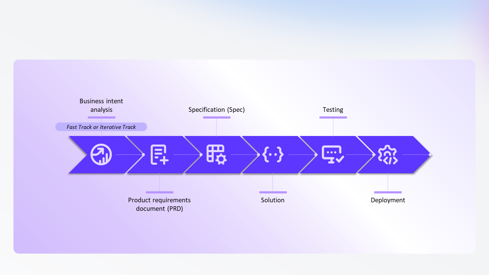
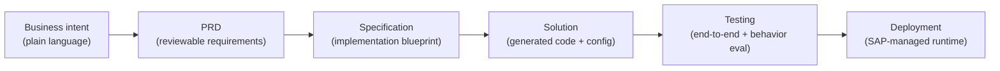
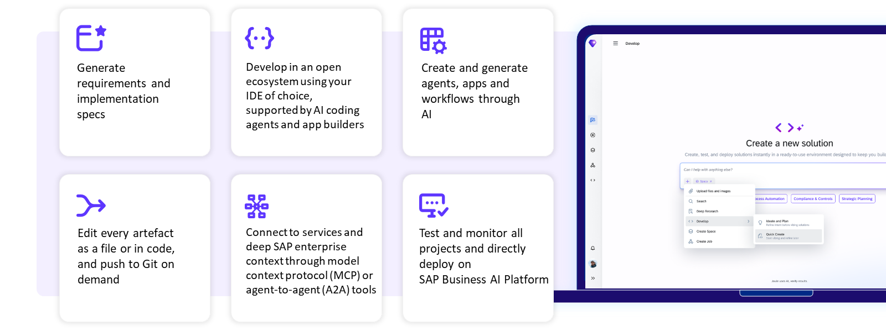

# Chapter 2: Joule Studio and the agent development lifecycle

*Intent in, agent out — but every stage in between is a reviewable artifact, not a black box.*

> [!NOTE]
> **📍 At a glance**
> - **You will learn:** where Joule Studio sits in the SAP Business AI Platform, the three principles SAP designs "trusted" agents around, and the six-stage lifecycle every agent goes through from business intent to a deployed, monitored agent
> - **You will build:** nothing yet — Chapter 3 extends a real SAP-delivered agent end to end; this chapter is the map you'll use while doing it
> - **Level:** beginner · **Time:** about 15 minutes
> - **Builds on:** [Chapter 1](01-what-is-joule.md) (Skill/Agent/Assistant/Work, the three zones). **Leads to:** Chapter 3 (extending a standard agent, worked example)

**After this chapter you can:**

- Place Joule Studio correctly inside the SAP Business AI Platform's three pillars
- Name the six stages an agent moves through in Joule Studio, in order
- Explain the difference between Quick Create and the Iterative Track, and when you'd pick each
- Say which three surfaces you can actually build in, and what ties them together
- Describe what Joule Studio tests before letting you deploy

## 2.1 Where Joule Studio sits

The SAP Business AI Platform has three pillars, and Joule Studio is only one piece of the first:

| Pillar | What it does | Key pieces |
|---|---|---|
| **Creation** | Build and extend AI-powered applications | **Joule Studio**, SAP Integration Suite |
| **Context and Analysis** | Give AI access to unified, high-quality business data | Business Data Fabric (SAP Datasphere) |
| **Governance** | Manage the AI lifecycle at scale | SAP AI Core, SAP AI Launchpad |

- If you've read the [SAP AI book](../sap-ai/README.md), AI Core and AI Launchpad will already be familiar — they're the governance pillar underneath both Joule and your own custom AI Core workloads.
- Inside Joule specifically: **Joule Work** is where business users consume AI capability through natural language; **Joule Studio** is where you build and extend it. Same platform, different door.

## 2.2 Three principles, because "it compiles" isn't enough

An agent that reasons well isn't automatically safe to run against a live business process. SAP frames this as a **trust gap**, and designs Joule Studio around three principles to close it:

- **Context** — the agent needs business objectives, domain knowledge, enterprise data and process awareness, not just a system prompt.
- **Open and enterprise grade** — the solution has to integrate with what you already run, follow standards, and be tested against exceptions and edge cases, not just the golden path.
- **Governance** — identity and access controls, secure execution, and a traceable record of what the agent decided and why, plus visibility into cost and value delivered.

None of these three is unique to SAP — they're the same questions you'd ask of any production agent. What's specific to Joule Studio is that each one maps to a concrete capability in the next two sections, instead of staying a slide-ware principle.

## 2.3 The six-stage lifecycle

Every agent — new or extended — moves through the same six stages:

1. **Business intent** — you describe the *outcome*, not the implementation. "Review supplier information, flag risk, recommend action to procurement" is a business intent; it is not a spec.
2. **PRD** — Joule Studio turns the intent into a Product Requirements Document: problem, target users, functional requirements, success criteria. This is a review checkpoint for business stakeholders *before* anything technical gets generated.
3. **Specification** — the PRD becomes a technical blueprint: architecture, integration points, expected behavior, constraints. This is where API specs and asset directories get prepared automatically.
4. **Solution** (the course's own UI labels it "Solution"; its text occasionally says "Code" — same stage) — implementation artifacts are generated: agent config, system prompt, tool bindings. You review this in the File Explorer; nothing here is a black box.
5. **Testing** — covered in 2.5.
6. **Deployment** — to the SAP-managed runtime from [Chapter 1](01-what-is-joule.md), 1.2.

> [!TIP]
> **💡 Quick Create vs Iterative Track**
> When your intent is already well-specified, enable **Quick Create** and Joule Studio skips straight to generation. When it isn't, the **Iterative Track** asks targeted clarification questions first. Both produce the same downstream artifacts — the difference is only how much Joule Studio has to ask before it starts generating. Default to Iterative Track unless you've genuinely already thought through the edge cases yourself.

## 2.4 How you actually build

Joule Studio deliberately doesn't lock you into its own web UI:

- **Three surfaces**: the Joule Studio web interface, your own **IDE**, or a **CLI**. Pick whichever fits your team.
- **Git is the shared foundation.** Every generated artifact can be pushed to Git — version control, code review, and team collaboration work the way they already do for the rest of your code, not some Joule-specific workflow.
- **Enterprise integration runs through MCP and A2A.** This confirms the "open protocols" I flagged as unresolved in Chapter 1, 1.7 — Joule Studio names both explicitly: **MCP** for connecting tools and services, **A2A (agent-to-agent)** for agent interoperability. If you know the [MCP book](../mcp/01-why-mcp-exists.md), this is not new ground, just a new place it's wired in.
- Business context during generation is pulled from **SAP LeanIX** (landscape/architecture), **SAP Signavio** (process intelligence), and the **SAP Knowledge Graph / domain models** (application semantics) — the same three sources named in Chapter 1, 1.4, now with their actual jobs attached.

## 2.5 Testing, before you're allowed to deploy

Joule Studio's testing stage checks more than "does the generated code run":

- **End-to-end validation** — does the agent's complete execution flow work, including its calls to tools and other components, not just its code in isolation?
- **Behavior evaluation** — does the agent's output match what the PRD said it should do? This is evaluation against requirements, not just a pass/fail unit test.
- **Component-level results** — when something fails, Joule Studio's evaluation output is granular enough to say *where*, not just *that* it failed.
- **Observability after deployment** continues the same thread: tracing, metrics and logging, surfaced through the AI Agent Hub from Chapter 1, 1.6.

> [!WARNING]
> **⚠️ Pitfall: "testing" here means behavioral evaluation, not just execution**
> A generated agent can execute successfully and still fail its actual job — e.g. return a technically valid but business-wrong recommendation. Treat Joule Studio's testing stage as closer to an LLM eval suite than a traditional CI test run, and budget review time accordingly before you deploy, especially the first time you extend a given agent.

## 2.6 Added by Claude, not from the sources

- The "Solution vs Code" naming inconsistency in 2.3 is pointed out here because it would otherwise look like an error in these notes rather than in the source material.
- The framing of MCP/A2A as "resolving" Chapter 1's open question is this book's own continuity, not something the course states.
- Not run: nothing here is code yet. Chapter 3's worked example carries the first "not run" markers, since it follows a real UI walkthrough from the source rather than written prose.

## 2.7 Interview corner

**What interviewers listen for:** you can name the six lifecycle stages in order, you know Quick Create is a shortcut through clarification (not through testing or review), and you don't conflate "code executes" with "agent behaves correctly."

### 🟢 Basic

1. What are the six stages of the Joule Studio agent lifecycle?

- Business intent → PRD → Specification → Solution → Testing → Deployment

2. What's the difference between Quick Create and the Iterative Track?

- Quick Create skips the clarification questions and generates directly from the stated intent; the Iterative Track asks clarifying questions first to refine requirements before generating anything

### 🟡 Intermediate

3. Which two open protocols does Joule Studio use for enterprise integration, and what does each do?

- MCP connects an agent to tools and services; A2A lets agents interoperate with other agents
- *Stronger answer:* this is the same split as the rest of the agentic-AI ecosystem — MCP is model↔tools, A2A is agent↔agent — Joule Studio didn't invent a third mechanism

4. What does the Testing stage actually check?

- End-to-end execution across the full flow, behavior evaluation against the PRD's requirements, and component-level failure localization
- *Stronger answer:* this is closer to an agent eval suite than a conventional test runner — "the code ran" and "the agent did the right thing" are different questions, and only the testing stage answers the second one

### 🔴 Senior

5. A business user hands you a one-line intent and wants an agent by end of day. Walk through your approach.

- Resist Quick Create by default — a one-line intent is exactly the under-specified case the Iterative Track exists for
- Use the clarification questions to surface edge cases and constraints before anything is generated, since fixing a wrong PRD is cheaper than fixing a wrong deployed agent
- *Stronger answer:* push back on the deadline if the PRD review step gets skipped — that's the one human checkpoint standing between a plausible-sounding intent and a production agent making real business decisions

> [!TIP]
> **🧩 Design question**
> *"Your team ships an agent through Quick Create, it passes Testing, and three weeks later it's recommending something your PRD never asked for."* Talk about: PRD drift (did the generated solution actually match the reviewed PRD, or did it generate something the business never confirmed), whether behavior evaluation covered this exact scenario, and what AI Agent Hub's trace/logging would show you about when the behavior changed.

## Cheat sheet

| Stage | Produces | Who reviews it |
|---|---|---|
| Business intent | A plain-language problem statement | Business user |
| PRD | Structured requirements, success criteria | Business user + developer |
| Specification | Technical blueprint, integration points | Developer |
| Solution | Generated code/config (File Explorer) | Developer |
| Testing | End-to-end + behavior evaluation results | Developer |
| Deployment | A running agent on the SAP-managed runtime | Developer + AI Agent Hub |

## Recap

- Joule Studio is the **Creation** pillar of the SAP Business AI Platform; Context/Analysis (Datasphere) and Governance (AI Core, AI Launchpad) are the other two
- Three principles — **Context, Open and Enterprise Grade, Governance** — exist to close the trust gap between "the model works" and "safe to run against a real business process"
- Six lifecycle stages, always in order: **Business intent → PRD → Specification → Solution → Testing → Deployment**
- **Quick Create** skips clarification questions; it does not skip review or testing
- Build in the **web UI, an IDE, or a CLI** — Git ties them together
- Enterprise integration is **MCP** (tools) and **A2A** (agents) — not a proprietary mechanism
- Testing means **behavioral evaluation against the PRD**, not just successful execution

## Practice

1. Without looking back, list the six lifecycle stages and say in one sentence who reviews each one
2. Explain out loud when you'd choose Quick Create over the Iterative Track, with a concrete example of each
3. Draw where MCP and A2A each fit in a Joule Studio solution

## How this chapter was checked

- All 7 lessons and all 4 unit quizzes of "Introducing Joule Studio" (learning.sap.com/courses/introducing-joule-studio) were read in full, 9 Nov 2026. The "End-to-End Demo" video was not watched.
- 43 images appeared across the course's lessons (mostly concept-diagram slides, not product screenshots). 2 are used in this chapter: the six-stage lifecycle diagram and the MCP/A2A integration diagram, both saved to `images/`, never hotlinked. The remaining images from this course are either decorative restatements of the text already covered here, or belong to the two worked examples (agent extension, n8n workflow) that Chapters 3 and 4 will cover with their own screenshots.
- Nothing in this chapter is code yet, so nothing was run.

## Sources and further reading

- SAP Learning, *Introducing Joule Studio* — https://learning.sap.com/courses/introducing-joule-studio (all 7 lessons + 4 quizzes, read in full 9 Nov 2026)

Previous: [Chapter 1, What Joule actually is](01-what-is-joule.md) · Next: [Chapter 3, Extending an SAP-delivered agent](03-extending-a-standard-agent.md)
