# Chapter 2: Joule Studio and the agent development lifecycle

*Intent in, agent out — but every stage in between is a reviewable artifact, not a black box.*

> [!NOTE]
> **📍 At a glance**
> - **You will learn:** where Joule Studio sits in the SAP Business AI Platform, the three principles SAP designs "trusted" agents around, and the six-stage lifecycle every agent goes through — illustrated with a real worked example's actual generated files
> - **You will build:** nothing yet — but you'll see a complete generated agent's file tree, its `asset.yaml`, and its real test coverage breakdown
> - **Level:** beginner · **Time:** about 18 minutes
> - **Builds on:** [Chapter 1](01-what-is-joule.md) (Skill/Agent/Assistant/Work, the three zones). **Leads to:** Chapter 3 (extending a standard agent, worked example)

**After this chapter you can:**

- Place Joule Studio correctly inside the SAP Business AI Platform's three pillars, and name its actual tool ecosystem
- Name the six stages an agent moves through in Joule Studio, in order, and what each one produces
- Explain the difference between Quick Create and the Iterative Track, and when you'd pick each
- Read a real generated agent's file tree and `asset.yaml`, and know what `kind: a2a` means there
- Say what Joule Studio tests before letting you deploy, and what "framework modules" means for coverage targets

## 2.1 Where Joule Studio sits

The SAP Business AI Platform has three pillars, and Joule Studio is only one piece of the first:

| Pillar | What it does | Key pieces |
|---|---|---|
| **Creation** | Build and extend AI-powered applications | **Joule Studio**, SAP Integration Suite |
| **Context and Analysis** | Give AI access to unified, high-quality business data | Business Data Fabric (SAP Datasphere) |
| **Governance** | Manage the AI lifecycle at scale | SAP AI Core, SAP AI Launchpad |

- If you've read the [SAP AI book](../sap-ai/README.md), AI Core and AI Launchpad will already be familiar — they're the governance pillar underneath both Joule and your own custom AI Core workloads.
- Inside Joule specifically: **Joule Work** is where business users consume AI capability through natural language; **Joule Studio** is where you build and extend it. Same platform, different door.

SAP's own ecosystem diagram names real, specific tools at every layer — this is worth more than the pillar table above, because it's concrete:

![SAP Business AI Platform ecosystem: Joule on top of SAP Autonomous Domains, Partner Agents (KPMG, Accenture, Deloitte, IBM, PwC, EY, Capgemini, NTT) and Third-party AI Agents (NVIDIA NemoClaw); below, Build (Joule Studio, n8n, Vercel, Claude Code, Cursor, SAP Integration Suite), Contextualize & Reason (SAP Knowledge Graph, SAP & Non-SAP Models including OpenAI, Mistral AI, Cohere, Perplexity, PRIOR), and Govern (SAP AI Agent Hub, Value Realization, Joule Studio Runtime, Identity/Access/Security), all on SAP Business Data Cloud (SAP, Databricks, Microsoft, Google Cloud, Snowflake)](images/02-platform-ecosystem.png)

- **You are not locked into SAP's own models or tools.** The diagram names OpenAI, Mistral AI, Cohere, Perplexity and "PRIOR" as usable models alongside SAP's own, and Databricks, Microsoft, Google Cloud and Snowflake as Business Data Cloud partners.
- **Partner and third-party agents are first-class, not an afterthought.** KPMG, Accenture, Deloitte, IBM, PwC, EY, Capgemini and NTT appear as named "Partner Agents"; NVIDIA NemoClaw appears as a named "Third-party AI Agent" — all governed through the same AI Agent Hub as your own agents (Chapter 1, 1.6).
- The **Agent Gateway** (Chapter 1, 1.2) sits literally in the middle of this diagram, between the SAP Autonomous Suite above and the Business AI Platform below — it's the thing every one of these integrations actually routes through.

## 2.2 Three principles, because "it compiles" isn't enough

An agent that reasons well isn't automatically safe to run against a live business process. SAP frames this as a **trust gap**, and designs Joule Studio around three principles to close it:

- **Context** — the agent needs business objectives, domain knowledge, enterprise data and process awareness, not just a system prompt.
- **Open and enterprise grade** — the solution has to integrate with what you already run, follow standards, and be tested against exceptions and edge cases, not just the golden path.
- **Governance** — identity and access controls, secure execution, and a traceable record of what the agent decided and why, plus visibility into cost and value delivered.

None of these three is unique to SAP — they're the same questions you'd ask of any production agent. What's specific to Joule Studio is that each one maps to a concrete capability in the sections below, instead of staying a slide-ware principle.

## 2.3 The six-stage lifecycle, on a real agent

Every agent — new or extended — moves through the same six stages:


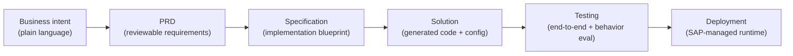

SAP's own course material walks a second full worked example through all six stages — a manufacturing agent called the **Cable Roll Optimizer**. It's reproduced here because every screen is a real generated artifact, not a mockup.

**Stage 1 — Business intent.** You describe the outcome, not the implementation, in the Create Agent dialog:

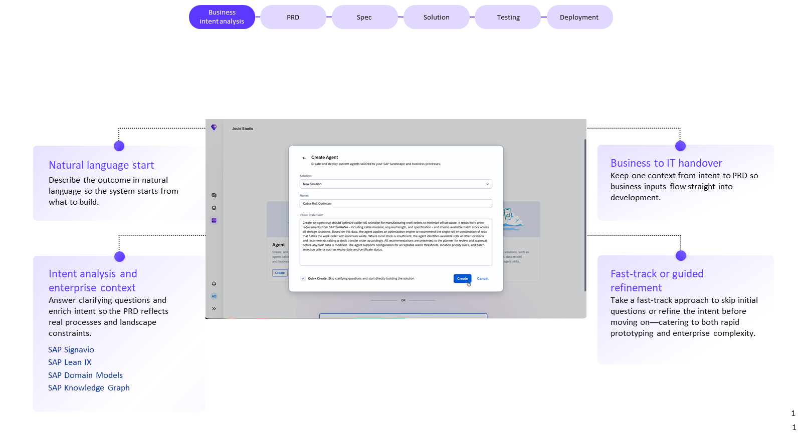

> **Intent statement (in full):** "Create an agent that should optimize cable roll selection for manufacturing work orders to minimize offcut waste. It reads work order requirements from SAP S/4HANA — including cable material, required length, and specification — and checks available batch stock across all storage locations. Based on this data, the agent applies an optimization engine to recommend the single roll or combination of rolls that fulfills the work order with minimum waste. Where local stock is insufficient, the agent identifies available rolls at other locations and recommends raising a stock transfer order accordingly. All recommendations are presented to the planner for review and approval before any SAP data is modified. The agent supports configuration for acceptable waste thresholds, location priority rules, and batch selection criteria such as expiry date and certificate status."

- Notice **"All recommendations are presented to the planner for review and approval before any SAP data is modified"** — same pattern as Chapter 3's "preserve the agent's standard functionality" clause: state your human-in-the-loop boundary in the intent itself, don't leave it implicit.
- **Quick Create: Skip clarifying questions and start directly building the solution** is a checkbox right in this dialog — confirming it's a one-step opt-in, not a separate mode.

**Stage 2 — PRD.**

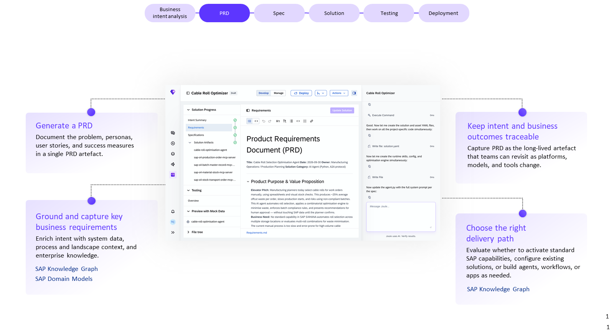

- The PRD's own title line states the architecture before a single file is generated: **Solution Category: AI Agent (Python, A2A protocol)**. Every PRD in this course — this one and the n8n example in Chapter 4 — names the implementation language and protocol up front, not as an implementation detail discovered later.

**Stage 3 — Specification.**

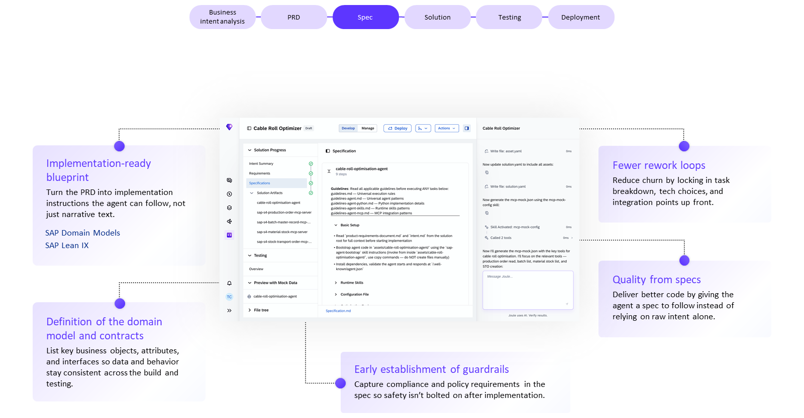

- The Specification stage generates its own **guideline files** before any implementation code: `guidelines.md` (universal execution rules), `guidelines-agent.md` (universal agent patterns), `guidelines-agent-python.md` (Python implementation details), `guidelines-agent-skills.md` (runtime skills patterns), `guidelines-agent-mcp.md` (MCP integration patterns). These are instructions the *generator* reads before writing code — a form of guardrail that exists before Stage 4, not bolted on after.
- It also generates an `mcp-mock.json` — a mocked MCP configuration used so the agent can be tested without live SAP connections (see Stage 5).

**Stage 4 — Solution** (this is the UI's own name for the stage — confirmed consistently across every screenshot in this chapter, not "Code"):

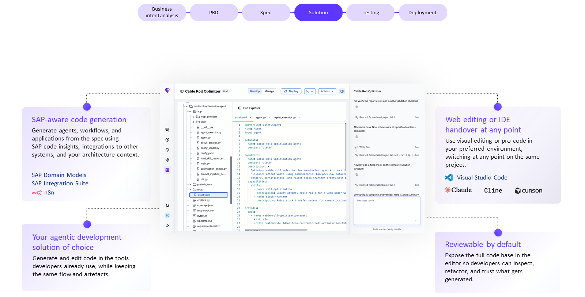

The real generated file tree:

```text
app/
  mcp_providers/
  skills/
  __init__.py
  agent_executor.py
  agent.py
  circuit_breaker.py
  config_loader.py
  config.yaml
  load_skill_resources...
  main.py
  optimisation_engine.py
  prompt_injection_detector.py
  util.py
prebuilt_tests/
tests/
asset.yaml
conftest.py
coverage.json
mcp-mock.json
pytest.ini
README.md
requirements-test.txt
```

And the real `asset.yaml`:

```yaml
apiVersion: asset.sap/v1
kind: Asset

metadata:
  name: cable-roll-optimisation-agent
  version: "1.0.0"

agentCard:
  name: Cable Roll Optimisation Agent
  version: "1.0.0"
  description: Optimises cable roll selection for manufacturing work orders by
    minimising offcut waste using combinatorial bin-packing, enforcing
    expiry/certificates, and raising stock transfer orders with priority
  capabilities:
    skills:
      - name: roll-optimisation
        description: Select optimal cable rolls for a work order with...
      - name: stock-transfer
        description: Raise stock transfer orders for cross-location

provides:
  apis:
    - name: cable-roll-optimisation-agent
      kind: a2a
      ordId: customer.build.apiResource:cable-roll-optimisation-8b8...
```

> [!IMPORTANT]
> **🏭 In production: the generated scaffold ships its own resilience and security modules by default**
> `circuit_breaker.py` and `prompt_injection_detector.py` are not something you add later — Joule Studio generates them as part of the standard agent scaffold. A circuit breaker for calls to external systems, and a prompt-injection detector as framework-level infrastructure, come for free with every generated agent. This matters for Testing in Stage 5: these are counted as *framework* modules, not business logic, so don't expect (or chase) business-logic-level test coverage on them.
>
> *Added by Claude; the course's screenshots show this but don't name the pattern explicitly.*

- `kind: a2a` on the `provides.apis` entry confirms what the PRD already said: this agent's API is exposed as an **A2A** endpoint, the same protocol from Chapter 1, 1.7 and the post-hook in Chapter 3.
- Skills are declared in the `agentCard` as a list with `name` + `description` — this is the Joule Skill concept from Chapter 1, 1.1, now visible as literal YAML.
- The IDE handover options shown here are more complete than a short list: **Claude Code, Cursor, Cline, Open Code, Codex, "and more"** — see 2.4.

**Stage 5 — Testing.**

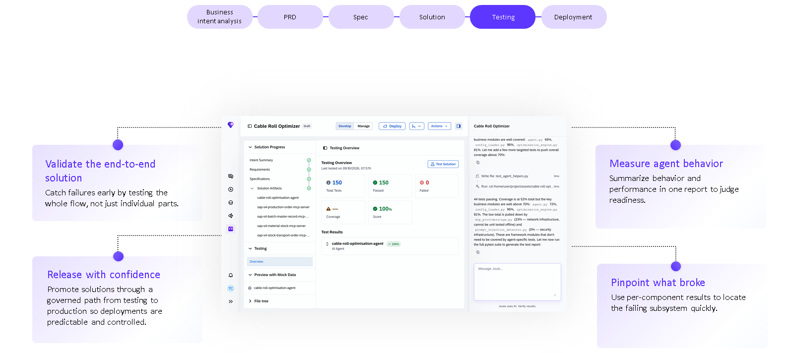

- Per-module coverage, read from the actual chat trace: **`agent.py` 69%, `config_loader.py` 96%, `optimisation_engine.py` 81%** — the genuine business logic. Against that: **`mcp_providers/agw.py` 23%** (flagged as "network infrastructure, cannot be unit tested offline") and **`prompt_injection_detector.py` 0%** (flagged as "security infrastructure... framework modules that don't need to be covered by agent-specific tests"). This is the live version of the pitfall above: don't read a low number on a framework module as a quality problem.
- This example also deploys with **4 SAP-connected MCP servers** alongside the agent — `sap-s4-production-order-mcp-server`, `sap-s4-batch-master-record-mcp-...`, `sap-s4-material-stock-mcp-server`, `sap-s4-stock-transport-order-mcp-...` — the same "one MCP server per integration point" pattern from Chapter 4's n8n example, now confirmed on an agent too.

**Stage 6 — Deployment.**

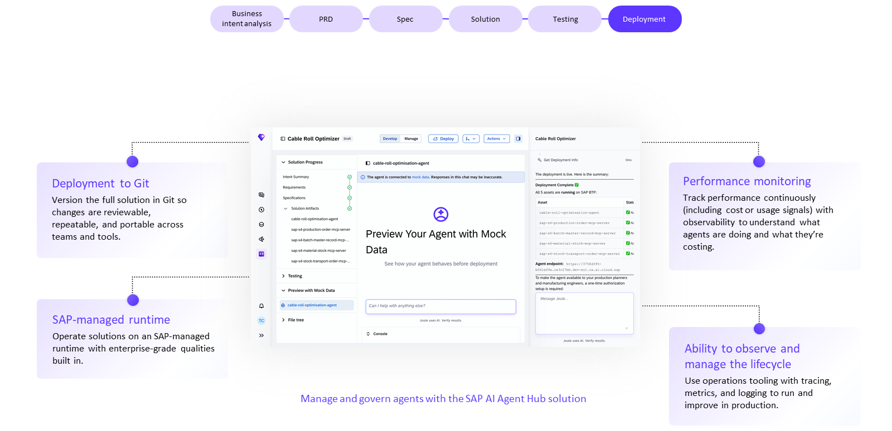

- **"Deployment Complete — All 5 assets are running on SAP BTP"** (the agent plus its 4 MCP servers), with a real endpoint format: `https://<id>.dev-eu1.ca.ai.cloud.sap`.
- **"To make the agent available to your production planners and manufacturing engineers, a one-time authorization setup is required."** — deployment and user-facing availability are two separate steps; don't assume one implies the other.
- **Preview Your Agent with Mock Data** is a distinct pre-deployment step, letting you converse with the agent before it touches real SAP data — using the `mcp-mock.json` generated back in Stage 3.

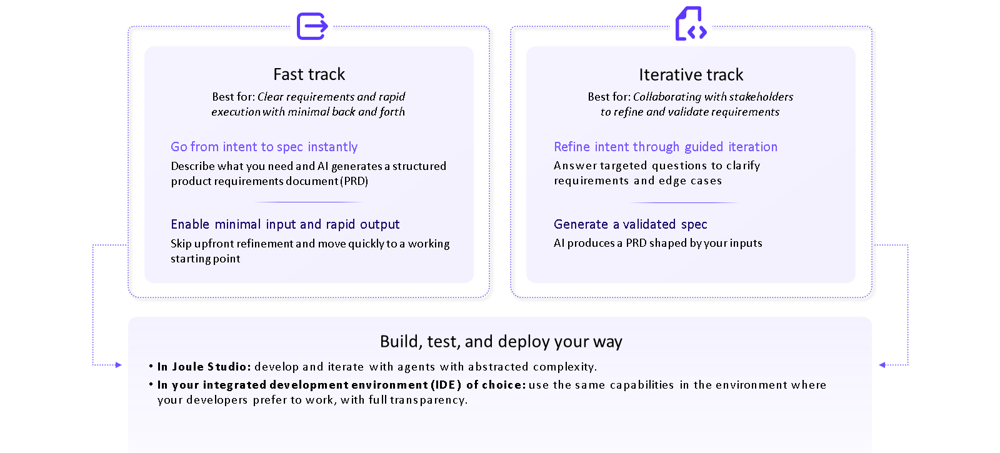

> [!TIP]
> **💡 Quick Create vs Iterative Track**
> When your intent is already well-specified, enable **Quick Create** and Joule Studio skips straight to generation. When it isn't, the **Iterative Track** asks targeted clarification questions first. Both produce the same downstream artifacts — the difference is only how much Joule Studio has to ask before it starts generating. Default to Iterative Track unless you've genuinely already thought through the edge cases yourself.

## 2.4 How you actually build

Joule Studio deliberately doesn't lock you into its own web UI:


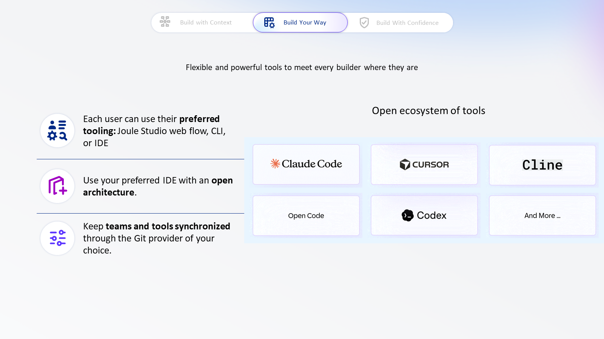

- **Three surfaces**: the Joule Studio web interface, your own **IDE**, or a **CLI**. The real tool list is wider than a token example suggests: **Claude Code, Cursor, Cline, Open Code, Codex** — "and more."

Who does what, at each stage, through which entry point — stated explicitly rather than left implicit:

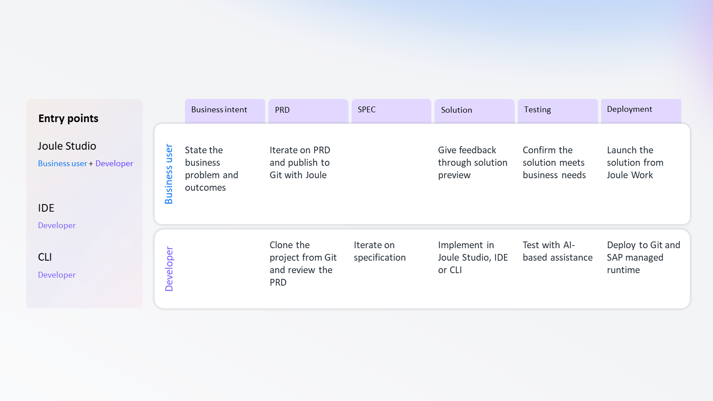

- Notice **Specification has no business-user row at all** — it's the one stage that's entirely a developer activity. Business users re-enter at Solution ("give feedback through solution preview") and Testing ("confirm the solution meets business needs"), but don't touch the technical spec itself.
- **Git is the shared foundation.** Every generated artifact can be pushed to Git, through the Git provider of your choice — version control, code review, and team collaboration work the way they already do for the rest of your code, not some Joule-specific workflow.
- **Enterprise integration runs through MCP and A2A.** This confirms the "open protocols" flagged as unresolved in Chapter 1, 1.7 — Joule Studio names both explicitly: **MCP** for connecting tools and services, **A2A** for agent interoperability, and the worked example above shows both as literal file content (`mcp-mock.json`, `kind: a2a`), not just slideware. If you know the [MCP book](../mcp/01-why-mcp-exists.md), this is not new ground, just a new place it's wired in.
- Business context during generation is pulled from **SAP LeanIX** (landscape/architecture), **SAP Signavio** (process intelligence), the **SAP Knowledge Graph / domain models** (application semantics) — and one more named here for the first time: **SAP RPT-1**, described as a predictive-AI source ("Anticipate... Predictions"). SAP Business Data Cloud fills out the picture as the facts source.

## 2.5 Testing and governance, beyond one agent

The per-agent testing in 2.3 is only half the picture — once deployed, agents are governed centrally:


- This is the **AI Agent Hub** from Chapter 1, 1.6, shown as a real screen rather than a description: a searchable **Discovery Inbox** of every agent in the landscape (here: 52 total results), each tagged by classification (SAP AI Agent, etc.) and status (**Action Needed** / **Linked**), with an **Approval gate** ("Reject" / "Add to Inventory") before anything goes into inventory.
- The detail panel for one agent shows real **usage analytics**: Total Sessions, First/Last Active dates, and a Sessions Over Time chart — this is the "visibility into cost and value delivered" principle from 2.2, made concrete.

The runtime underneath all of this:

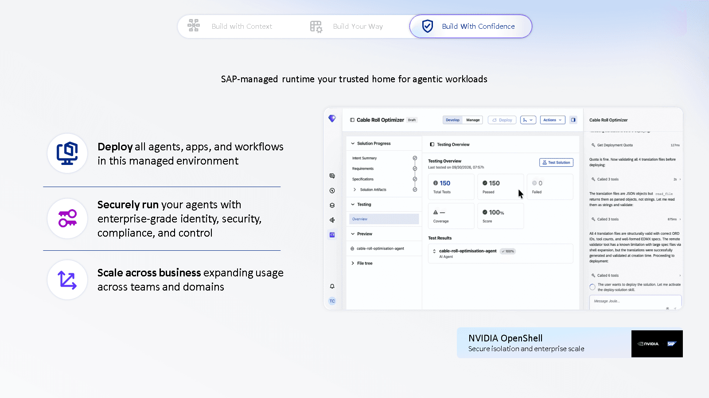

- **NVIDIA OpenShell** is named explicitly as the isolation technology behind the SAP-managed runtime's "secure isolation and enterprise scale" claim — this is the specific product name behind what Chapter 1 described only generically as "the SAP-managed runtime."
- The testing panel shown alongside it (a different example, "Cable Roll Optimizer" again, 150/150/0 at a **different point in development**) reflects a live tool trace: "Called 3 tools," "Called 6 tools," including a **deployment quota check** and **file validation** before the agent actually ships — the generation process itself uses tools, the same way the agent it's generating will.

> [!WARNING]
> **⚠️ Pitfall: "testing" here means behavioral evaluation, not just execution**
> A generated agent can execute successfully and still fail its actual job — e.g. return a technically valid but business-wrong recommendation. Treat Joule Studio's testing stage as closer to an LLM eval suite than a traditional CI test run, and budget review time accordingly before you deploy, especially the first time you extend a given agent.

## 2.6 Added by Claude, not from the sources

- The explicit confirmation that "Solution" (not "Code") is the UI's own stage name was reached by cross-checking every screenshot in this chapter — the course's own prose is looser than its own UI, but the UI is consistent everywhere it appears.
- The framing of MCP/A2A as "resolving" Chapter 1's open question is this book's own continuity, not something the course states.
- The 🏭 box on `circuit_breaker.py` / `prompt_injection_detector.py` as default scaffold modules is a pattern this book names; the course's screenshots show it but don't call it out as a design principle.
- Not run: this chapter's worked example is reproduced from the course's own screenshots; nothing here was independently executed, since it requires a Joule Studio tenant this book doesn't have access to.

## 2.7 Interview corner

**What interviewers listen for:** you can name the six lifecycle stages in order, you know Quick Create is a shortcut through clarification (not through testing or review), you don't conflate "code executes" with "agent behaves correctly," and you can read a real `asset.yaml` without flinching.

### 🟢 Basic

<details class="qa"><summary>1. What are the six stages of the Joule Studio agent lifecycle?</summary>

- Business intent → PRD → Specification → Solution → Testing → Deployment

</details>

<details class="qa"><summary>2. What's the difference between Quick Create and the Iterative Track?</summary>

- Quick Create skips the clarification questions and generates directly from the stated intent; the Iterative Track asks clarifying questions first to refine requirements before generating anything

</details>

### 🟡 Intermediate

<details class="qa"><summary>3. Which two open protocols does Joule Studio use for enterprise integration, and what does each do?</summary>

- MCP connects an agent to tools and services; A2A lets agents interoperate with other agents
- *Stronger answer:* this is the same split as the rest of the agentic-AI ecosystem — MCP is model↔tools, A2A is agent↔agent — Joule Studio didn't invent a third mechanism, and the generated `asset.yaml`'s `kind: a2a` is literal proof of it

</details>

<details class="qa"><summary>4. In the Cable Roll Optimizer example, `prompt_injection_detector.py` shows 0% test coverage. Is that a problem?</summary>

- No — it's flagged as a framework/security-infrastructure module, not business logic, and isn't expected to carry agent-specific test coverage
- *Stronger answer:* the real signal to check is whether your *business logic* modules (here, `agent.py`, `config_loader.py`, `optimisation_engine.py`) are well covered — a low number on infrastructure doesn't mean the same thing as a low number on your own code

</details>

### 🔴 Senior

<details class="qa"><summary>5. A business user hands you a one-line intent and wants an agent by end of day. Walk through your approach.</summary>

- Resist Quick Create by default — a one-line intent is exactly the under-specified case the Iterative Track exists for
- Use the clarification questions to surface edge cases and constraints before anything is generated, since fixing a wrong PRD is cheaper than fixing a wrong deployed agent
- *Stronger answer:* push back on the deadline if the PRD review step gets skipped — that's the one human checkpoint standing between a plausible-sounding intent and a production agent making real business decisions

</details>

> [!TIP]
> **🧩 Design question**
> *"Your team ships an agent through Quick Create, it passes Testing, and three weeks later it's recommending something your PRD never asked for."* Talk about: PRD drift (did the generated solution actually match the reviewed PRD, or did it generate something the business never confirmed), whether behavior evaluation covered this exact scenario, and what AI Agent Hub's session/usage trace would show you about when the behavior changed.

## Cheat sheet

| Stage | Produces | Who reviews it |
|---|---|---|
| Business intent | A plain-language problem statement | Business user |
| PRD | Structured requirements + named architecture (e.g. "AI Agent, Python, A2A") | Business user + developer |
| Specification | Technical blueprint + generated guideline files | Developer |
| Solution | Generated code/config (`asset.yaml`, skills, `kind: a2a` APIs) | Developer |
| Testing | End-to-end + per-module coverage (business logic vs. framework modules) | Developer |
| Deployment | Agent + MCP servers running on SAP BTP, one-time auth to go live | Developer + AI Agent Hub |

## Recap

- Joule Studio is the **Creation** pillar of the SAP Business AI Platform; Context/Analysis (Datasphere) and Governance (AI Core, AI Launchpad) are the other two — and the real ecosystem includes named non-SAP tools (OpenAI, Mistral AI, Cohere, Databricks, Microsoft, Google Cloud, Snowflake) and named partner/third-party agents
- Six lifecycle stages, always in order: **Business intent → PRD → Specification → Solution → Testing → Deployment** — confirmed as the UI's own naming across every screenshot
- A real generated agent is a Python/A2A solution with a standard scaffold that includes `circuit_breaker.py` and `prompt_injection_detector.py` by default, and one MCP server per SAP integration point
- **Quick Create** skips clarification questions; it does not skip review or testing
- Build in the **web UI, an IDE** (Claude Code, Cursor, Cline, Open Code, Codex), **or a CLI** — Git ties them together
- Testing means **behavioral evaluation against the PRD**, not just successful execution — and low coverage on a framework module (like the prompt-injection detector) isn't the same signal as low coverage on your own business logic
- AI Agent Hub's Discovery Inbox is a real approval gate with per-agent usage analytics, not just a concept

## Practice

1. Without looking back, list the six lifecycle stages and say in one sentence who reviews each one
2. Sketch an `asset.yaml` for an agent you're familiar with: name, version, one or two skills, and whether its API would be `kind: a2a`
3. Explain out loud why 0% coverage on `prompt_injection_detector.py` isn't a red flag, but 0% coverage on your own business logic module would be

## How this chapter was checked

- All 7 lessons and all 4 unit quizzes of "Introducing Joule Studio" (learning.sap.com/courses/introducing-joule-studio) were read in full, 9 Nov 2026. The "End-to-End Demo" video was not watched.
- 43 images appeared across the course's lessons. 14 are used in this chapter (saved to `images/`, never hotlinked): the platform ecosystem diagram, the six-stage lifecycle diagram, the Fast track/Iterative track diagram, the MCP/A2A integration diagram, the IDE ecosystem diagram, the AI Agent Hub screenshot, the runtime/NVIDIA OpenShell screenshot, and all 6 stages of the Cable Roll Optimizer worked example (intent, PRD, specification, solution/file-explorer, testing, deployment). The remaining images were reviewed and left out as pure marketing/stat graphics with no diagram or product content.
- Nothing in this chapter is code yet, so nothing was run — the file tree, `asset.yaml` and coverage numbers are transcribed directly from the course's own screenshots, not independently executed.

## Sources and further reading

- SAP Learning, *Introducing Joule Studio* — https://learning.sap.com/courses/introducing-joule-studio (all 7 lessons + 4 quizzes, read in full 9 Nov 2026)

Previous: [Chapter 1, What Joule actually is](01-what-is-joule.md) · Next: [Chapter 3, Extending an SAP-delivered agent](03-extending-a-standard-agent.md)
