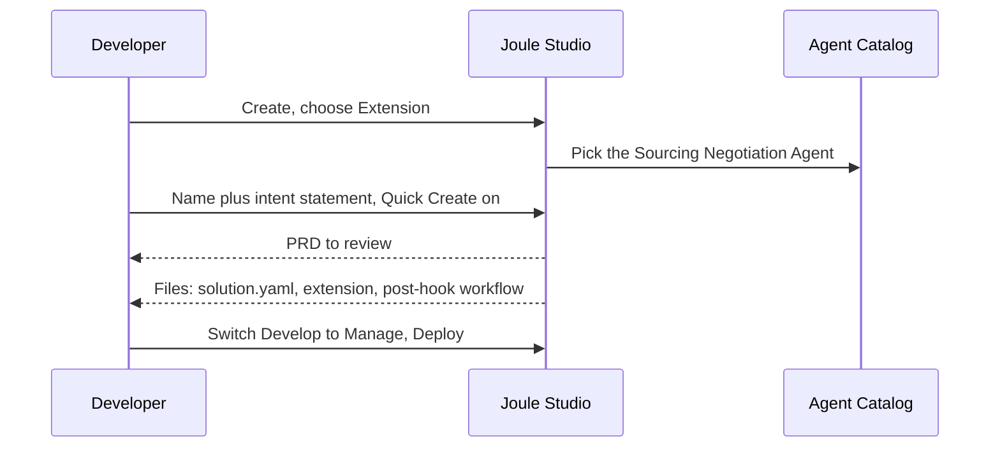

# Chapter 2: Joule Studio

*Joule Studio is where you build and extend Joule: you describe the business goal, it drafts the requirements, spec and solution, and you review, test and deploy.*

> [!NOTE]
> **📍 At a glance**
> - **You will learn:** what Joule Studio is, the intent-to-deployment lifecycle, Quick Create, extending SAP-delivered agents, and n8n workflows
> - **You will build:** nothing yet; you will be able to walk a customer through building one agent and one extension
> - **Level:** beginner to intermediate · **Time:** about 45 minutes
> - **Source:** SAP Learning course *Introducing Joule Studio* (free, 7 lessons and 4 quizzes), read 8 November 2026
> - **Builds on:** [Chapter 1: What is SAP Joule?](01-what-is-joule.md)

**After this chapter you can:**

- Say where Joule Studio sits next to Joule Work, assistants and agents
- Walk the lifecycle: intent, PRD, technical spec, generated code, test, deploy, monitor
- Choose between Quick Create and the clarifying (iterative) track
- Name the three extension points for an SAP-delivered agent: instructions, tools (MCP), hooks
- Describe an n8n workflow built through the Idea Board
- State the three principles of a trusted agentic solution

> [!WARNING]
> **This chapter is a concept chapter, not a hands-on one**
> - The course is lessons and screenshots. I have not used a Joule Studio tenant, and no step here was run.
> - Screens and names change quickly. The lessons mix older and newer wording; differences are noted where I found them.

## 2.1 Where Joule Studio fits

- **Joule Work** is where business users use AI; **Joule Studio** is where developers and business experts build and extend it
- Studio is SAP's AI-first environment for **agents, applications and workflows**
- It combines AI-assisted development, SAP business context, flexible tools and enterprise governance

| Piece | Role |
|---|---|
| Joule | SAP's overall AI brand across the portfolio |
| Joule Work | The user workspace (Conversations, Spaces, Develop) |
| Joule Assistants | Role-aware coordinators of agents |
| Joule Agents | Specialised workers inside business workflows |
| **Joule Studio** | The place to create custom agents and extend SAP-delivered ones |

**Where Studio sits in the SAP Business AI Platform** (the platform lesson names three pillars):

| Pillar | What it holds |
|---|---|
| Creation | Joule Studio, SAP Integration Suite |
| Context and analysis | A "Business Data Fabric" on SAP Datasphere, joining SAP and third-party data |
| Governance | SAP AI Core and SAP AI Launchpad manage the AI lifecycle |

> [!NOTE]
> **Wording differs between the two courses**
> - Chapter 1 (the Joule course) names **Business Data Cloud** as part of the platform; this lesson says **Datasphere** and **Business Data Fabric**.
> - Likely a rename or a different level of detail. Use the current names from SAP Help when you speak to a customer.

## 2.2 Three principles of a trusted agentic solution

- A strong model alone does not guarantee a correct business decision, so there is a **trust gap**
- Enterprise agents need context, openness and governance:

| Principle | Means |
|---|---|
| **Context** | The agent understands the problem: objectives, domain knowledge, enterprise data, processes |
| **Open and enterprise grade** | Fits existing architecture, follows standards, validated for edge cases and exceptions, not only the happy path |
| **Governance** | Identity and access control, secure execution, traceable decisions, visibility of cost and value |

## 2.3 Intent-based development (the lifecycle)

- You start from a **business intent** (what, not how) in plain language
- A good intent names the problem, the users and the expected value
- Studio asks clarifying questions, then produces a **Product Requirements Document (PRD)**, then a **technical specification**, then the implementation

| Approach | Use when | What happens |
|---|---|---|
| **Quick Create** | The outcome and constraints are already clear | Skips clarification questions, goes straight to generating a starting point |
| **Iterative track** | The scope is fuzzy or complex | Studio asks targeted questions to sharpen the intent first |

- Reviewing the PRD is a required human step: check that it matches what you meant before building
- The PRD stays as a reference when requirements change
- Developers can read the generated source, so the output is not a black box

✅ *Verified against the lesson text; nothing run.*

## 2.4 Where the business context comes from

| Source | Gives Studio |
|---|---|
| SAP LeanIX | Landscape: applications, dependencies, technology map |
| SAP Signavio | Process insight: performance, bottlenecks |
| SAP Knowledge Graph and domain models | Business objects, data structures, relationships |
| SAP best practices | Development guidelines, patterns, security and compliance norms |

- This is what separates it from a generic code generator: generated solutions are checked against business facts, architecture and policy

## 2.5 Build your way

- **Web interface, IDE or CLI:** you pick; Studio is an open architecture
- **Git** holds the artifacts: version control, code review and collaboration
- **Low-code and pro-code:** review and change what was generated either way
- **Open standards:** MCP for tools and context, **A2A** for agent-to-agent communication
- **Home screen options:** Agent, n8n Workflow, Application, Agent Extension (the extension lesson also lists data products)
- **Business users** describe the problem, review the PRD, give feedback on previews; **developers** refine the spec and code
- Finished capabilities show up for users in Joule Work

> [!NOTE]
> **From Chapter 1:** the Joule course adds that Studio supports LangChain, LangGraph, Pydantic AI and LlamaIndex and can export to VS Code, Cursor or Claude Code. This course does not repeat that list.

## 2.6 Test and evaluate

- Passing code is not enough for an agent: you must judge whether its **behaviour** matches the requirements
- **End to end:** run the whole flow, including tools and services, to catch issues invisible per component
- **Behaviour evaluation:** validation results and behavioural checks compared with the PRD
- **Component-level results** help locate where a failure happened; fix and test again before deploying

> [!WARNING]
> **Pitfall**
> - Testing only that the generated code runs is the trap the lesson warns about.
> - *Added by Claude:* write 10 to 20 realistic cases first, including bad input and a refusal case, and keep them for the next change.

## 2.7 Run and govern

- Deployment goes to an **SAP-managed runtime** for agents, apps and workflows, with enterprise identity, security and scale
- The runtime diagram in the lesson names **NVIDIA OpenShell** for secure isolation; the text says nothing more, so treat it as a detail to check
- **Governance covers** agents, LLMs **and MCP servers**, at design time and at runtime
- **Risk-based production approval:** each agent gets a **responsible owner**
- **Observability:** tracing, metrics, logging; review usage and operations data
- **Lifecycle:** updates as requirements and systems change, run through the **SAP AI Agent Hub** (see [Chapter 1, 1.7](01-what-is-joule.md))

> [!IMPORTANT]
> **🏭 In production**
> - Three things to settle before go-live: who owns the agent, which approval level its risk needs, and where its traces are read.
> - *Added by Claude:* an agent that is "deployed but nobody owns it" is the common failure in any platform; insist on the owner field.

## 2.8 Extending an SAP-delivered agent

- SAP ships ready agents for finance, supply chain, HR, procurement and customer experience
- When you need more, you **extend** instead of building anew, and you follow **clean-core** principles
- An extension is a **separate artifact**; the original agent's code is unchanged and not exposed to you
- Once deployed, the extension applies when the standard agent runs in Joule Work

**Three extension points:**

| Point | What it adds | Example from the lesson |
|---|---|---|
| **Instructions** | Scenario context, business rules, guardrails | Give a sourcing agent your negotiation guidelines |
| **Tools** (via MCP) | Access to more systems and services | Connect an extra data source |
| **Hooks** | Logic before or after the agent runs | Notify a team when an AP invoice is flagged |

- Not every agent supports every point; the **Agent Catalog** shows each agent's supported extension points
- Check them before you write requirements

**The worked example (Sourcing Negotiation Agent):**

- **Intent statement used:** add an executive summary (compliance and audit, competitive position, risks) while keeping standard behaviour
- **Generated:** an extension for the agent plus a post-hook workflow named `executive-summary-post-hook`
- **`solution.yaml`:** the file that defines the solution and references its assets
- **Manage area:** overview, deployment status, version management, monitoring; deployment history and undeploy are available

> [!WARNING]
> **Pitfall**
> - When SAP updates a standard agent, your extension may need review for compatibility.
> - An extension changes the agent's behaviour, so apply the same access control and change approval as for the agent itself.

## 2.9 n8n workflows and the Idea Board

- Studio uses **n8n**, a low-code workflow tool, to orchestrate SAP and third-party agents and automations
- Every solution goes through the **Idea Board**, which keeps the work tied to a clear intent

| Stage | What you get |
|---|---|
| Intent | A formal intent document: problem, goals, context |
| Requirement | A PRD: value, needs, objectives (the example automates purchase order intake over an OData API) |
| Specification | Technical details, asset directories, implementation steps; API specs are fetched |
| Solution | System prompt (the agent's role), LLM choice and settings such as temperature |
| n8n canvas | Nodes for webhook trigger, AI classification, data transformation, SAP calls; branching and error handling |
| Testing | Automated checks on structure, server availability and agent logic, with coverage scores |
| Deployment | Pick a target environment (for example Development) and deploy |

- The creation dialog asks for **Solution** (a group of assets), **Name** and **Intent Statement**
- Example intent: pull new purchase orders from S/4HANA Private Cloud and route them to **SAP Task Center** for approval
- Quick Create works here too, for simple automations

### 2.9a What the product page adds (SJ010)

- **Three build targets:** agents, n8n workflows, and **apps** (custom interfaces and business logic; marked **"Coming soon"**)
- **FAQ "what can I build":** AI agents and skills (task execution, decision support); workflows and integrations for SAP and non-SAP systems
- **Who it is for:** business users (guided low-code), pro-code developers (IDEs, Git, CI/CD), IT teams and architects (security, governance, runtime, scale)
- **One prompt to start:** create agents and n8n workflows from a single prompt
- **Business context Studio uses (FAQ):**
  - *Landscape:* existing architecture, central agent repository, compliance policies, identity controls
  - *Application:* data models, object relationships, content, functionality, KPIs
  - *Process:* operational gaps, bottlenecks, improvement recommendations
  - *Best practices:* process templates, development guidelines, process and industry benchmarks
- **Governance (FAQ):** identity and access (incl. SAP Cloud Identity Services); pre-launch testing; continuous evaluation; visibility into agent behaviour, decisions and failures; managed runtime, lifecycle, security, compliance
- **Users reach agents** through conversations in Joule Work ([Chapter 1](01-what-is-joule.md))
- **Certification:** a limited-time free exam voucher for *Agentic Development using Joule Studio* was advertised; offers change

> [!WARNING]
> **Marketing claims, not tested**
> - The page quotes: Accenture "cut app development time by 25%", Constellation Research "5.5x faster", Florida Crystals "eliminated manual data retrieval".
> - These are SAP's own pages and linked reports; I did not open the reports. Treat them as vendor claims, not benchmarks.
> - The page also promotes a 17 November TechEd recap webcast (not attended).

### 2.9b Community blog: example use cases (SJ011)

*Source: an SAP Community blog by a self-described newcomer to SAP. It is one person's view, not SAP documentation.*

- **Claim:** Studio is low-code/no-code; agents answer questions from SAP data, send reminders or alerts, trigger workflows, and guide users
- **Use cases the blog lists:**

| Use case | What the agent does |
|---|---|
| HR self-service | Answers "how many vacation days left?", bank-detail update process, probation end date |
| Onboarding assistant | Guides a new joiner through week one: paperwork, introductions, daily checklists |
| Procurement alerts | Watches key suppliers; notifies managers when a PO is stuck or overdue |
| Project summary | Daily briefing on overdue tasks, timesheet gaps, resource bottlenecks |
| Compliance checker | Finds staff with missing mandatory training or unsigned policies; sends reminders |
| IT helpdesk | Answers "how do I reset my SAP password?" and where to raise a ticket |

- **Client benefits listed:** self-service for users, less IT dependency for small tasks, reminders and guidance, faster onboarding, consistency across regions
- **Getting started, as the blog gives it:** run on SAP BTP, open SAP Build and Joule Studio, build one small agent, train it with real process examples and test in Preview, roll out with the right permissions
- **Screenshots (my reading of them):**
  - SAP Build "Create Project" dialog with four choices: Application, Automated Process, **AI Agent and Joule Skill** (tagged New), Business Site
  - A **Logistics Agent** editor: model size choice (small/medium/large), LLM provider choice (Anthropic, Google, Mistral, OpenAI), a base and an advanced model, and three tools (weather and risk retrieval, documents, transport initiation and tracking)
  - A **skill flow**: trigger "when skill is called", then Transportation Process, Fetch Tracking Status, Confirmation Message, End

> [!WARNING]
> **Likely older than the course**
> - The blog's steps and screenshots use SAP Build with a drag-and-drop editor. Section 2.1–2.9 describes the newer intent-based Studio (prompt, PRD, spec). The page did not show a publication date that I captured.
> - Treat the use cases as ideas; confirm the click path in the current product before teaching it.
> - The blog's "no technical skills needed" is an author's view. The course says a developer reviews the PRD and spec (section 2.3).

## 2.10 Added by Claude, not from the sources

*My own mapping and advice. The course does not say these things.*

| Studio idea | Familiar idea |
|---|---|
| Intent, PRD, spec, code | Spec-driven development with an AI author |
| `solution.yaml` | A project manifest that lists what the project contains |
| Hooks | Middleware that runs before and after a call |
| Extension | A plugin or decorator that wraps a vendor component |
| Idea Board | A pipeline with human gates |

**Reviewing generated work (a checklist for developers):**

- Read the PRD against the real need; reject scope you did not ask for
- Read the generated code like a pull request: secrets, hard-coded IDs, broad permissions
- Check which identity each call uses and which tools the agent can reach
- Keep a fixed set of test cases and run it after every regeneration
- Keep a rollback: the version you can undeploy to

**Questions to ask on a Studio project:**

- Quick Create or iterative: is the intent really clear enough?
- Extension or new agent: can an instruction or hook do it, so the standard agent stays upgradeable?
- Who owns the agent in production and who approves changes?

## 2.11 Interview corner

**What interviewers listen for:** you describe Studio as a governed lifecycle, not a prompt box; you review generated output; and you choose **extend** before **build new**.

🟢 1. What is Joule Studio?

- SAP's unified, AI-first development environment for agents, applications and workflows
- Combines AI assistance, SAP business context, flexible tools and governance

*Stronger answer:* add that Joule Work is where users use what Studio builds.

🟢 2. What is intent-based development?

- You describe the business outcome in plain language, not the implementation
- Studio turns it into a PRD, a technical spec and implementation artifacts

*Stronger answer:* stress that humans review the PRD before code is built.

🟢 3. What does Quick Create do?

- It skips the clarification questions and generates a starting point from your intent
- Good when the outcome and constraints are already clear

*Stronger answer:* say it saves interaction, not review: you still check the PRD and test.

🟡 4. List the lifecycle of building an agent in Studio.

- Business intent, PRD, technical specification, generated code, test, deploy
- Then monitor and manage the lifecycle

*Stronger answer:* name what each step produces, so the thread to the original goal stays visible.

🟡 5. How do you customise an SAP-delivered agent without breaking upgrades?

- Build an **extension**, a separate artifact; the standard agent is untouched (clean core)
- Use the three points: instructions, MCP tools, hooks

*Stronger answer:* check the agent's supported points in the Agent Catalog and re-test after SAP updates it.

🟡 6. Where does the business context come from?

- LeanIX for landscape, Signavio for processes, the Knowledge Graph and domain models for objects
- Plus SAP best practices and patterns

*Stronger answer:* explain why it matters: results are validated against business facts and compliance, not only plausible text.

🔴 7. How would you test an agent built in Studio before go-live?

- End to end across tools and services, and a behaviour evaluation against the PRD
- Use component-level results to find where a failure occurred

*Stronger answer:* include exceptions and edge cases; the course says tests must cover more than expected results.

🔴 8. A business team wants to Quick Create and deploy the same day. Your view?

- Quick Create is fine for a start; production still needs PRD review, tests and an owner
- Risk-based approval decides how much review the agent needs

*Stronger answer:* propose Quick Create into a development environment first, with a test set and a named owner before promotion.

> [!TIP]
> **🧩 Design question**
> A company's standard sourcing agent must add an executive summary and notify the compliance team when a bid looks risky.
> - **Sketch:** which extension points you use (instructions, a hook, perhaps a tool), what you test, and how you avoid changing the standard agent.
> - **Say out loud:** what you do when SAP ships a new version of that agent.

## 2.12 Course quiz review (7 questions)

- The course has four short quizzes; SAP does not show an answer key
- **Answers below are worked out from the lesson text (mine, not SAP's key).** Wording is shortened

**Unit 1: Big-Picture: SAP Business AI Platform**

1. Which platform component is the unified environment for building agents and workflows?

- **Answer:** Joule Studio.
- Not Conversational AI, AI Launchpad (lifecycle management) or Work Zone.

**Unit 2: Joule Studio**

2. What does Quick Create do?

- **Answer:** Skips the clarification questions and generates a starting point from the intent.
- It does not deploy to production untested, replace the PRD with code, or block pro-code work.

3. What is the main purpose of Joule Studio?

- **Answer:** A unified, AI-first environment for creating agents, applications and workflows with enterprise context and governance.
- It is not only a dashboard, not only for SAP-delivered agents, and not only for business users.

**Unit 3: AI Agents in Joule Studio**

4. Which extension points customise SAP-delivered agents?

- **Answer:** Instructions, MCP tools and hooks.

5. Which sequence is the intent-based lifecycle?

- **Answer:** Business intent analysis, PRD, specification, code, testing, deployment.

6. What is the intent statement for when extending an agent?

- **Answer:** It describes the behaviour to add so Studio can generate the extension.
- It does not replace the agent, run after deployment, or store logs.

**Unit 4: n8n Workflows in Joule Studio**

7. What does the n8n canvas do?

- **Answer:** A visual place to build workflows by connecting nodes for triggers, actions and integrations.
- It does not replace the Idea Board, only monitor, or define the PRD.

## 2.13 Cheat sheet

| Question | Short answer |
|---|---|
| What is Studio? | Build and extend agents, apps, workflows with SAP context and governance |
| How do I start? | Write an intent; Quick Create if it is clear, else answer the questions |
| What comes out? | PRD, technical spec, generated code and config |
| Extend or build? | Extend first: instructions, MCP tools, hooks |
| Where do I work? | Web, IDE or CLI, with Git |
| How is it tested? | End to end plus behaviour evaluation, including edge cases |
| Where does it run? | SAP-managed runtime, governed through the AI Agent Hub |
| Workflows? | n8n canvas, managed through the Idea Board |

## Recap

- Joule Studio is where Joule is built and extended; Joule Work is where it is used
- Development starts from intent, then PRD, spec, code, test, deploy, monitor
- Quick Create saves questions, not review
- SAP-delivered agents are extended (instructions, MCP tools, hooks), not modified
- n8n workflows follow the same Idea Board stages and add a visual canvas
- Trust means context, openness and governance, with an owner for every agent

## Practice

1. Write an intent statement for an agent that reviews supplier risk, naming the problem, the users and the value.
2. List what you would check in the PRD before letting the build continue.
3. Decide for three requests whether to use instructions, a tool or a hook.
4. Write five test cases for the executive-summary extension, including one that should be refused.

## How this chapter was checked

- **Not read:** the demo videos and the three "Explore further" lessons (Govern pillar, interoperability, AI Agent Hub); course screenshots were not seen; from the product page: linked customer reports, the Florida Crystals video, the product tour and the webcast; from the blog: its linked demo video
- **Not run:** no Joule Studio tenant was used

- **Read fully (7 lessons and 4 quizzes, SAP Learning, 8 Nov 2026, no login needed):** What is the SAP Business AI Platform?; Introducing Joule Studio; Building Solutions with Joule Studio; Creating an AI Agent with Joule Studio; Understanding SAP-Delivered Agent Extensions; Extending a Standard Agent Using Joule Studio; Creating n8n Workflows in Joule Studio; and the four unit quizzes (7 questions, answers my reading, no SAP key)
- **Product page (SJ010, read in full on 8 Nov 2026):** all page text and all five FAQ answers. The linked reports, customer video, product tour and webcast are separate resources and were not opened
- **Wording differences:** Datasphere and Business Data Fabric here vs Business Data Cloud in Chapter 1; kept as found
- **Example detail:** the n8n lesson names Claude 3.5 Sonnet as an example model; that is a lesson example, not a recommendation

## Sources and further reading

- SAP Learning, *Introducing Joule Studio* (course): https://learning.sap.com/courses/introducing-joule-studio
- Lessons read, under the same course path: What is the SAP Business AI Platform?; Introducing Joule Studio; Building Solutions with Joule Studio; Creating an AI Agent with Joule Studio; Understanding SAP-Delivered Agent Extensions; Extending a Standard Agent Using Joule Studio; Creating n8n Workflows in Joule Studio
- Quizzes: the four unit quiz pages under the same course path
- SAP Community blog, *Gamechanger Alert: Meet SAP Joule Studio for Real-World Impact* (read in full, text and its 3 screenshots, 8 Nov 2026): https://community.sap.com/t5/human-capital-management-blog-posts-by-members/gamechanger-alert-meet-sap-joule-studio-for-real-world-impact/ba-p/14133749
- SAP, *Joule Studio* product page (read in full, including the five FAQ answers, 8 Nov 2026): https://www.sap.com/products/artificial-intelligence/joule-studio.html

*Next: [Chapter 3: Joule for business users](03-joule-for-business-users.md)*
