# Chapter 3: Extending an SAP-delivered agent

*Clean-core for agents: add your logic next to SAP's agent, never inside it.*

> [!NOTE]
> **📍 At a glance**
> - **You will learn:** the three agent extension points, which ones actually ship today vs. which are roadmap, and the full worked example of extending a real SAP-delivered agent — from intent statement to a deployed `solution.yaml`
> - **You will build:** nothing runnable (no Joule Studio access here) — but you'll see every artifact a real extension produces, including the generated YAML
> - **Level:** beginner · **Time:** about 15 minutes
> - **Builds on:** [Chapter 2](02-joule-studio-lifecycle.md) (the six-stage lifecycle). **Leads to:** Chapter 4 (n8n workflows, worked example)

**After this chapter you can:**

- Name the three agent extension points and say which ones are actually usable today
- Explain why extensions preserve clean-core, and what that means for upgrade safety
- Read a real `solution.yaml` and know what each part references
- Walk through the extension lifecycle end to end on a concrete example
- Say what Joule Studio's Manage view tracks once an extension is deployed

## 3.1 Why extend instead of build new

You rarely need a brand-new agent. SAP ships a growing catalog of ready-to-use agents across finance, supply chain, HR, procurement and CX, built on SAP's own process knowledge. When one almost does what you need, Joule Studio lets you **extend** it instead of starting over:

- The original agent's source is never modified, and isn't even exposed to you as the extension developer.
- Your extension is a **separate artifact** that layers on top. Deploy it, undeploy it, version it — independently of the base agent.
- This is clean-core applied to agents: the same reason you don't modify SAP's ABAP core, you don't modify SAP's agent core either.

## 3.2 The three extension points — and which ones actually ship

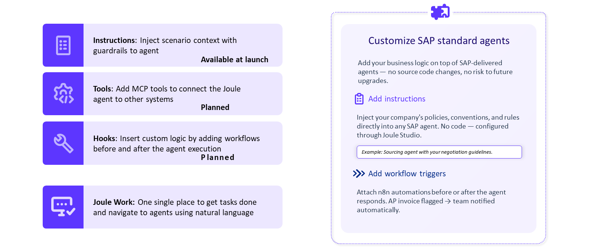

| Extension point | What it does | Status |
|---|---|---|
| **Instructions** | Inject scenario context, business rules, guardrails straight into the agent | **Available at launch** |
| **Tools** | Connect the agent to other systems via **MCP** | Planned |
| **Hooks** | Run custom logic before or after the agent executes (e.g. an n8n workflow) | Planned |

> [!WARNING]
> **⚠️ Pitfall: don't assume all three extension points are live**
> The course names Instructions, Tools and Hooks as "the three extension points" in its prose, but its own architecture diagram marks only **Instructions** as "Available at launch" — Tools (MCP) and Hooks are marked **Planned**. The worked example below *does* use a post-hook, which tells you hooks exist in some form (possibly early access) even while the course's own roadmap graphic calls them planned. Treat this as a live discrepancy in SAP's own material, not a documented stable API — check the current Agent Catalog for what's actually enabled on your tenant before you design around any extension point beyond Instructions.

- Not every agent supports every extension point — the Agent Catalog shows each agent's actual supported points when you pick one.

## 3.3 Worked example: adding an executive summary to the Sourcing Negotiation Agent

This is the course's own end-to-end walkthrough, reproduced in full because every step maps to a reusable pattern.

**The scenario:** the SAP-delivered **Sourcing Negotiation Agent** (part of SAP Ariba Sourcing) already analyzes supplier bids and recommends negotiation strategies. The extension adds an executive summary — compliance/audit considerations, competitive positioning, risks — without touching the base agent.

**Step 1 — Start a new solution, choose Extension.**

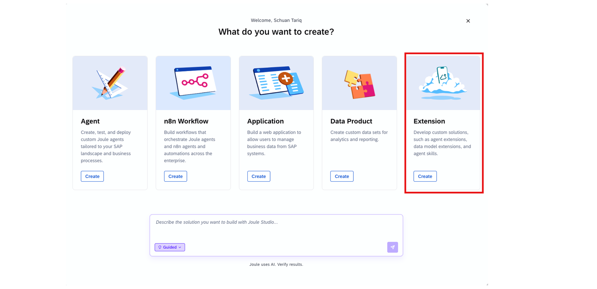

**Step 2 — Open the Agent Catalog and pick the agent to extend.**

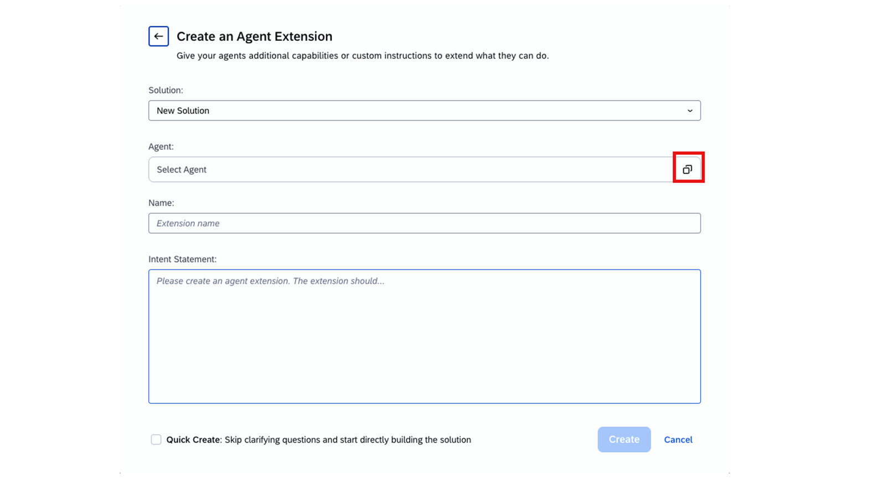

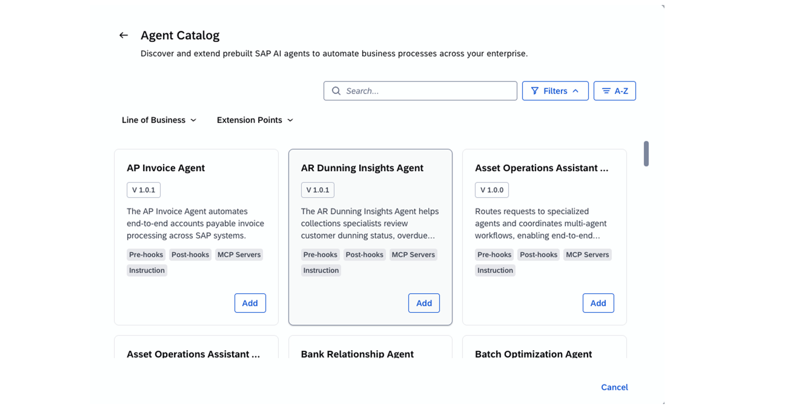

- The catalog lists each agent's **supported extension points** before you commit — check this first; it's where you'd discover Tools or Hooks aren't enabled for a given agent.

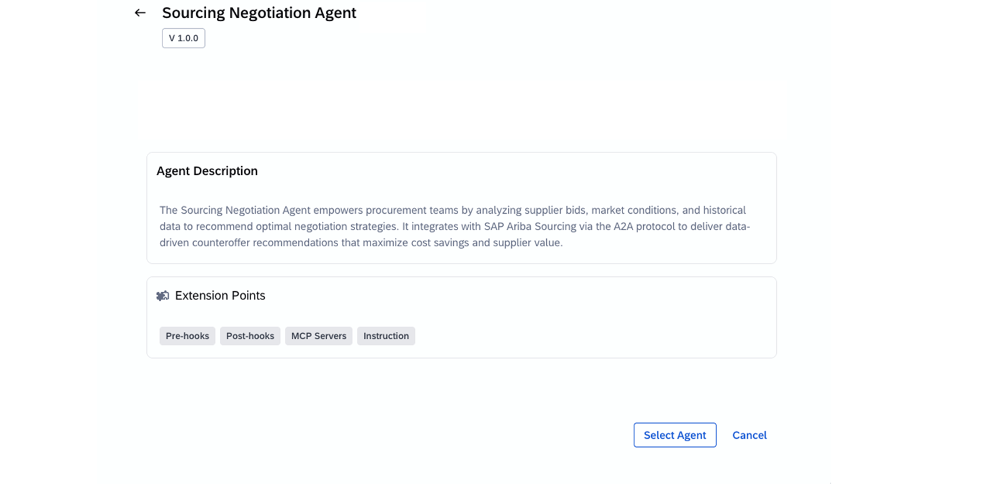

**Step 3 — Name the extension, write the intent statement.**

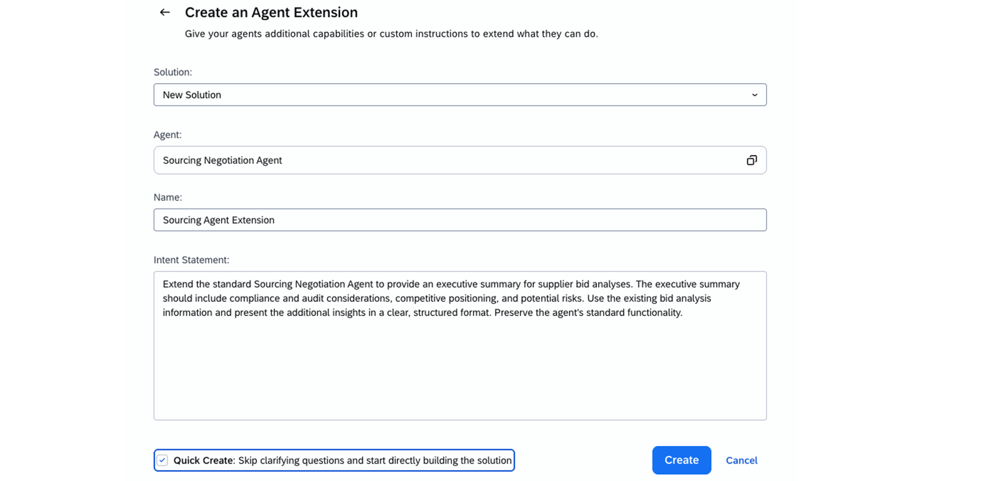

Example intent statement from the course, in full — this is a good template for your own:

```text
Extend the standard Sourcing Negotiation Agent to provide an executive
summary for supplier bid analyses. The executive summary should include
compliance and audit considerations, competitive positioning, and
potential risks. Use the existing bid analysis information and present
the additional insights in a clear, structured format. Preserve the
agent's standard functionality.
```

- Notice the last sentence: **"Preserve the agent's standard functionality"** is doing real work. An intent statement for an extension should always say what must *not* change, not just what should be added.

**Step 4 — Generation, then review the PRD.**

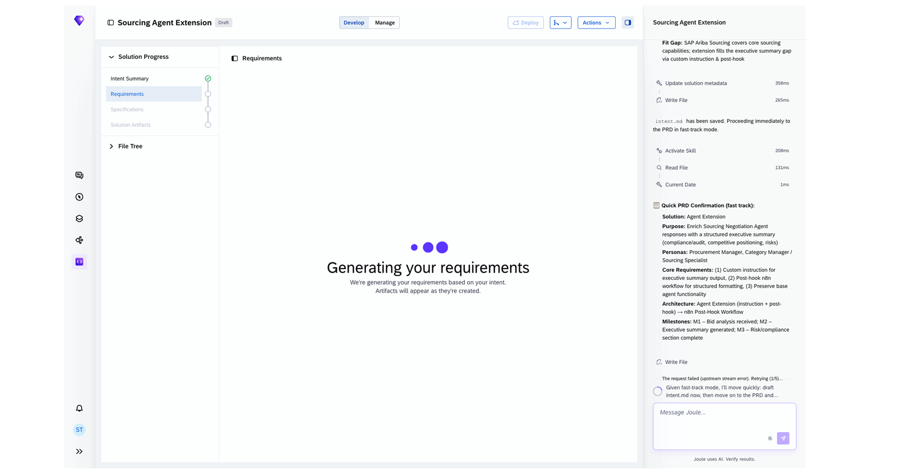

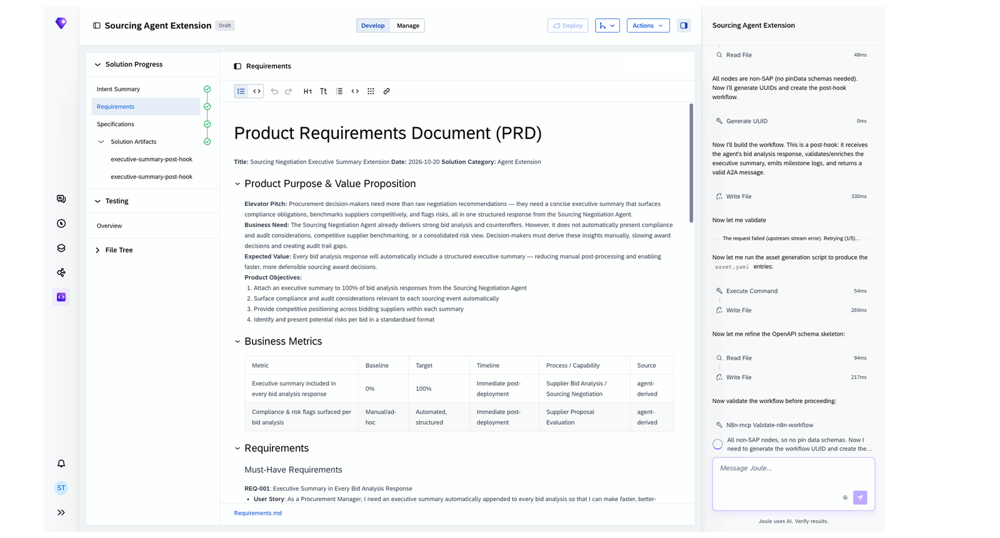

The generated PRD is a real reviewable document, not a black box — it includes a **Business Metrics** table (baseline → target → timeline) and numbered requirements written as user stories, e.g.:

> **REQ-001: Executive Summary in Every Bid Analysis Response**
> *User Story:* As a Procurement Manager, I need an executive summary automatically appended to every bid analysis so that I can make faster, better-informed decisions.

**Step 5 — Explore the generated artifacts.**

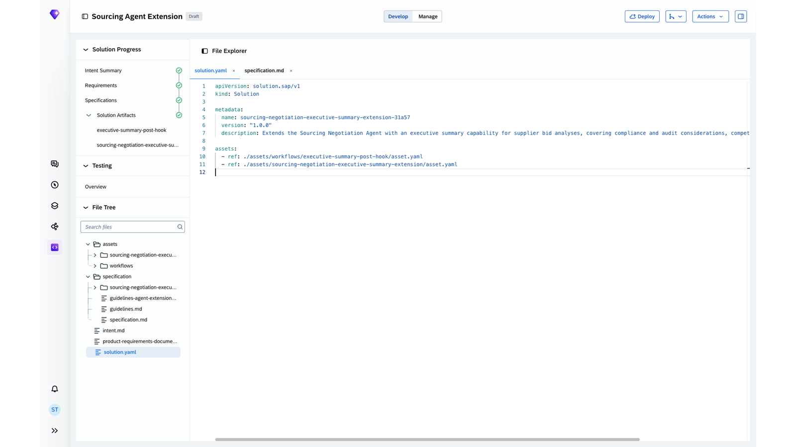

The real generated `solution.yaml`:

```yaml
apiVersion: solution.sap/v1
kind: Solution

metadata:
  name: sourcing-negotiation-executive-summary-extension-31a57
  version: "1.0.0"
  description: Extends the Sourcing Negotiation Agent with an executive
    summary capability for supplier bid analyses, covering compliance
    and audit considerations, competitive positioning...

assets:
  - ref: ./assets/workflows/executive-summary-post-hook/asset.yaml
  - ref: ./assets/sourcing-negotiation-executive-summary-extension/asset.yaml
```

- A solution is a thin manifest (`kind: Solution`) that **references** its assets by path — here, one workflow asset (the post-hook) and one extension asset. This is the same "generated artifacts are files you can inspect, not opaque config" principle from Chapter 2, 2.3.
- While Joule Studio's own build agent was assembling the post-hook, its trace showed it calling an MCP tool (`n8n-mcp`) to validate the generated n8n workflow, and described the post-hook's output as "a valid **A2A** message" — concrete confirmation that the generated artifacts speak the same MCP/A2A protocols from Chapter 2, 2.4, not a proprietary format.

**Step 6 — Deploy and monitor.**

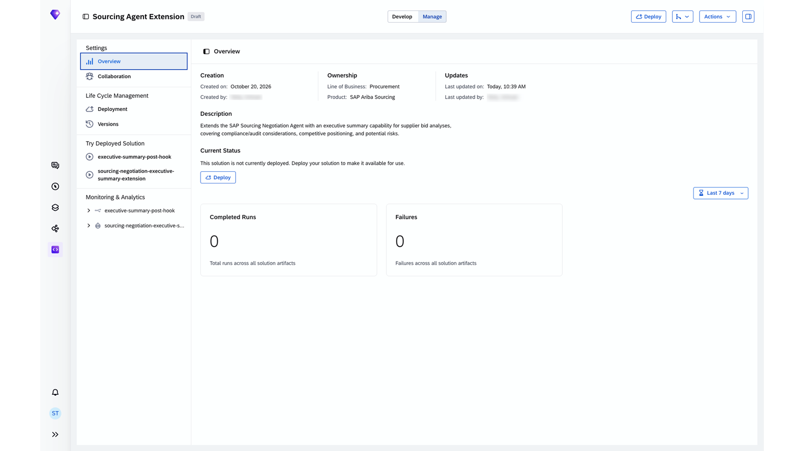

- The **Manage** tab (separate from **Develop**) tracks: **Life Cycle Management** (Deployment, Versions), **Try Deployed Solution** (run each generated artifact directly), and **Monitoring & Analytics** (Completed Runs, Failures — scoped per artifact, with a time-range filter).
- Ownership is tracked explicitly too: creator, line of business, and the SAP product the base agent belongs to (here, SAP Ariba Sourcing) — this is the "named owner" governance detail from Chapter 2, 2.2.

## 3.4 A third data point: not every solution is 100% green

The course's own material shows one more real example, an **"Accounts Receivable Collection Email"** solution — an agent that drafts personalized collection emails from SAP customer payment history and outstanding AR items, paired with a scheduler workflow:

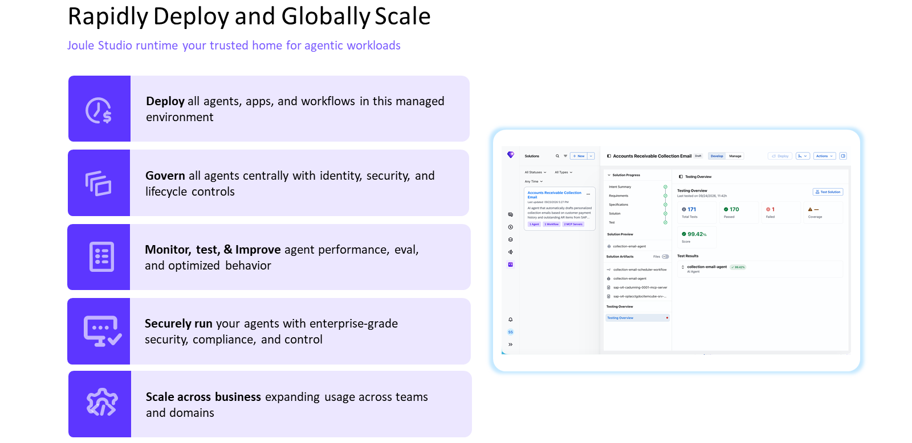

- **Solution Artifacts: 1 Agent, 1 Workflow, 2 MCP Servers** — a fourth confirmation (after the Sourcing extension, the n8n PO workflow in Chapter 4, and the Cable Roll Optimizer in Chapter 2) of the same pattern: one MCP server per SAP integration point, bundled with the agent/workflow that uses it.
- **171 Total Tests, 170 Passed, 1 Failed, 99.42% Score** — unlike every other testing screenshot in this book, this one isn't a clean sweep. Worth keeping in mind: a generated solution with a failing test is a normal, visible state in Joule Studio, not a hidden failure — the Testing Overview surfaces it the same way it would surface 100%.

## 3.5 Added by Claude, not from the sources

- The pitfall in 3.2 — pointing out that the course's own diagram contradicts its own prose about which extension points are live — is this book's own cross-check, not something the course states explicitly.
- Treating the `solution.yaml` schema as a stable interface to design against is a reasonable inference from one example, not something the course asserts as a documented, versioned schema. Verify against current Joule Studio docs before depending on exact field names in real work.
- Not run: this walkthrough is reproduced from the course's own screenshots; nothing here was independently executed, since it requires a Joule Studio tenant this book doesn't have access to.

## 3.6 Interview corner

**What interviewers listen for:** you know extensions don't touch the base agent's source, you can name which extension point is actually available today, and you'd check the Agent Catalog rather than assume.

### 🟢 Basic

<details class="qa"><summary>1. Why extend an SAP-delivered agent instead of modifying it?</summary>

- Extensions preserve clean-core: the original agent's source is unchanged and not even exposed to the extension developer, so SAP updates to the base agent don't conflict with your customization

</details>

<details class="qa"><summary>2. Name the three extension points.</summary>

- Instructions, Tools (via MCP), Hooks

</details>

### 🟡 Intermediate

<details class="qa"><summary>3. Which extension point should you actually plan around today, and why?</summary>

- Instructions — SAP's own diagram marks it "Available at launch" while Tools and Hooks are marked "Planned"
- *Stronger answer:* the worked example does ship a post-hook despite that, so "planned" doesn't mean "absent" — check the Agent Catalog's supported-extension-points list for the specific agent and tenant you're working against, rather than trusting either the prose or the roadmap slide alone

</details>

<details class="qa"><summary>4. What does solution.yaml actually contain?</summary>

- A thin manifest: `apiVersion`, `kind: Solution`, metadata (name, version, description), and an `assets` list of references to the actual implementation files
- *Stronger answer:* it's a pointer document, not the implementation — the real logic lives in the referenced asset files, which is why reviewing generated code means walking the File Explorer, not just reading solution.yaml

</details>

### 🔴 Senior

<details class="qa"><summary>5. A teammate wants to add a Hooks-based extension to a finance agent, but the Agent Catalog shows Hooks as unsupported for that agent. What do you tell them?</summary>

- Extension point availability is per-agent, not global — the catalog's supported-extension-points list for that specific agent is authoritative, not the general "three extension points" framing from the docs
- *Stronger answer:* propose the fallback that is supported (likely Instructions) first, and only escalate to request Hooks support if the business requirement genuinely can't be met with scenario context and guardrails alone — a hook is more powerful but also more to govern and monitor

</details>

> [!TIP]
> **🧩 Design question**
> *"Your extension's post-hook needs to notify a Slack channel when a flagged invoice is detected, but Slack isn't an SAP system."* Talk about: this is exactly the Hooks + n8n pattern from the worked example (the post-hook ran as an n8n asset), MCP as the likely connection point to a non-SAP tool like Slack, and why you'd still register and monitor this through the same Manage view rather than a one-off script outside Joule Studio's governance.

## Cheat sheet

| Thing | Where to find it |
|---|---|
| Which extension points an agent supports | Agent Catalog → agent detail view |
| The extension's manifest | `solution.yaml` (`kind: Solution`, references assets) |
| The actual generated logic | Files under `assets/` in the File Explorer |
| Deploy / undeploy / version | Manage → Life Cycle Management |
| Run history and failures | Manage → Monitoring & Analytics |
| Who owns it | Manage → Overview (creator, line of business, product) |

## Recap

- Agent extensions are separate artifacts layered on top of an unmodified SAP-delivered agent — clean-core for agents
- Three extension points exist (Instructions, Tools/MCP, Hooks), but SAP's own material shows only Instructions as definitely available — verify the rest per agent in the Agent Catalog
- The full lifecycle on a real example: pick Extension → pick agent from catalog → write an intent statement (including what must *not* change) → review the generated PRD (with real metrics and REQ- user stories) → inspect the generated `solution.yaml` and its referenced assets → deploy and monitor from Manage
- Generated post-hook workflows speak MCP and A2A, the same protocols from Chapter 2 — not a proprietary extension format
- A third example (across Ch2-4, four total) confirms "one MCP server per SAP integration point" as a consistent pattern, not a one-off — and shows a real, non-100% test result, which is a normal visible state, not a hidden failure

## Practice

1. Write your own one-paragraph intent statement for extending an agent you're familiar with, including an explicit "preserve" clause
2. Sketch what you'd expect a `solution.yaml` for your extension to reference in its `assets` list
3. Explain out loud why "planned" in SAP's roadmap material doesn't necessarily mean "absent in practice" — and what you'd check instead of guessing

## How this chapter was checked

- This chapter is built from two lessons of "Introducing Joule Studio" (Unit 3): "Understanding SAP-Delivered Agent Extensions" and "Extending a Standard Agent Using Joule Studio," both read in full 9 Nov 2026 (see Chapter 2 for the full course reading note).
- 11 of the course's screenshots are used here (saved to `images/`, never hotlinked): 9 covering every step of the worked example, 1 extension-points diagram, and 1 third example (Accounts Receivable Collection Email) used for its realistic non-100% test result. All were viewed in full; none were cropped or altered beyond file naming.
- Nothing here was independently run — this chapter reproduces the course's own worked example and screenshots rather than a live Joule Studio session, which this book doesn't have access to.

## Sources and further reading

- SAP Learning, *Introducing Joule Studio* — https://learning.sap.com/courses/introducing-joule-studio, lessons "Understanding SAP-Delivered Agent Extensions" and "Extending a Standard Agent Using Joule Studio" (read in full 9 Nov 2026)

Previous: [Chapter 2, Joule Studio and the agent development lifecycle](02-joule-studio-lifecycle.md) · Next: [Chapter 4, n8n workflows in Joule Studio](04-n8n-workflows.md)
