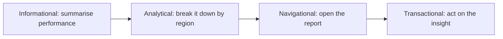
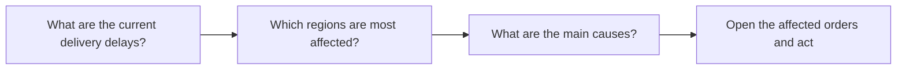

# Chapter 3: Joule for business users

*Know what your users see: five ways to ask, where Joule lives, how to write a good prompt, how conversations work.*

> [!NOTE]
> **📍 At a glance**
> - **You will learn:** the user's view of Joule: interaction patterns, where it is available, prompting, conversation management, data queries, and use cases by SAP product
> - **You will build:** nothing yet; a prompt cheat card you could hand to users
> - **Level:** beginner · **Time:** about 40 minutes
> - **Source:** SAP Learning course *Getting Started with Joule for Business Users* (free, 7 lessons and 2 quizzes), read 8 November 2026
> - **Builds on:** [Chapter 1: What is SAP Joule?](01-what-is-joule.md)

**After this chapter you can:**

- Describe how a business user starts and carries on a Joule conversation
- Name the five interaction patterns and match a request to each
- Turn a weak prompt into a strong one (goal, context, action)
- Explain how conversations, context, attachments and expiry behave
- Give example uses for SuccessFactors, S/4HANA Cloud, Ariba, Concur, Fieldglass and others
- Say why a developer should care about all of this

> [!WARNING]
> **What this chapter is**
> - A user-level course. There is no setup, code or configuration here; it shows what your customers will experience.
> - I read the lessons and quizzes in text only. The videos and demos were not seen, and no Joule tenant was used.

## 3.1 From tools to workflow support

- Most organisations use AI, but often as separate tools; you still open one system for data, another for reports, another for the task
- The shift: AI sits **inside the flow of work**, so work becomes **ask, understand, act**
- AI supports expertise (business understanding, interpretation, judgment); it does not replace it
- Joule is the entry point inside the SAP apps people already use, so they do not need to know where things are stored or which app to open first

## 3.2 Five interaction patterns

- Joule opens as a plain input field, like a chat, and often suggests prompts, example questions and quick actions
- Behind every request is one of these patterns:

| Pattern | The user wants to | Example request |
|---|---|---|
| Informational | Get an explanation or policy | "What is our travel expense policy?" |
| Navigational | Get to the right place | "Open the supplier performance report" |
| Transactional | Do something | "Create a purchase requisition for office supplies" |
| Analytical | Understand data | "Show me sales by region for this quarter" |
| **Creative** | Summarise or draft | "Summarize this customer case" |

> [!NOTE]
> **Four or five?**
> - [Chapter 1](01-what-is-joule.md) lists four types (transactional, navigational, informational, analytical).
> - This course adds a **fifth, creative** (summarise, draft a first version). It appears in the user guidance, not in the skill-type list; I keep both as found.

- Patterns mix in one conversation, and Joule keeps the context across them:



- Informational answers search SAP Help and company content, with references or links to the source
- Transactional answers connect to business systems and carry out the steps

✅ *Verified against the lesson text; nothing run.*

## 3.3 Where users find Joule

- **Inside SAP applications:** a button in the shell bar, or a launcher or embedded panel; the conversation can follow the user into other SAP apps
- **Across systems:** SAP and non-SAP environments, using the context of what the user is doing
- **Microsoft 365 Copilot:** users retrieve SAP insights and trigger SAP actions from Microsoft apps
- **Mobile:** through SAP Mobile Start; the course gives a voice example, "ask Joule in SAP Mobile Start" with Siri
- **Availability named:** SAP S/4HANA Cloud (Public and Private Edition) and SAP SuccessFactors, in multiple languages
- **Getting started is three steps:** **Find** the Joule icon, **Click** it, **Talk**

> [!NOTE]
> **Compare with Chapter 1**
> - Chapter 1 describes the Joule Work app (web, mobile, desktop). This course describes Joule embedded in SAP applications and Mobile Start. Both exist: embedded Joule is the everyday entry; Joule Work is the workspace.

## 3.4 Writing good prompts

- No special syntax is needed, but clear prompts give clearer answers
- A good prompt is **clear in its goal**, **specific enough** to guide the answer, and **easy to interpret**

| Habit | Weak | Better |
|---|---|---|
| State the goal | "Sales?" | "Show me sales performance for this quarter" |
| Add context (period, region, object) | "Show me sales performance" | "Show me sales performance for EMEA in Q2" |
| Be explicit about the action | "Supplier report" | "Open" it (navigate), "Summarize" it (inform), "Create" a record (transact) |
| Refine, do not restart | (one long prompt) | Follow up: "Break that down by region", "What caused the drop in EMEA?" |

- Small word changes change the action: *open*, *summarize* and *create* trigger different patterns
- Suggested prompts are a good place to start; users drift to their own style over time

## 3.5 Managing conversations

- A conversation is a **thread** of related questions, tasks and answers
- From the side panel a user can start a new one, switch, and see active ones
- Titles are generated from the first request; users can **rename** (for example "Supplier onboarding") and **delete**
- **Expiry:** a conversation ends after **8 hours of inactivity**; the user is told, can still look at it, but cannot continue it
- Context carries across supported SAP apps, so a follow-up like "open details for the lowest-rated one" works
- **Attachments:** Joule may ask for a file; upload by icon or drag and drop, review or remove before sending; files are scanned and limits apply to size, type and number
- **Start a new conversation** when the topic changes, the old context no longer applies, or you want a clean start
- **Feedback:** ask "I want to give feedback", or use suggested options or the main menu; ratings and free text, collected anonymously

> [!WARNING]
> **Pitfall**
> - Long mixed conversations give muddier answers. Teach users to open a new thread per topic.
> - The 8-hour expiry is a user-facing fact from this course; confirm it against current SAP Help before you build a process on it.

## 3.6 Querying business data

- Users ask what they want to understand, not how to fetch it
- Joule can summarise findings, point out trends or anomalies, and present structured results or charts
- Insight is built **step by step**:



- Results can be summaries, structured data or visualisations, depending on the scenario
- The point is the link from **insight to action**: investigate, open the related app, or act in the same flow

## 3.7 Use cases by SAP product

| Product | Typical use (from the lesson) |
|---|---|
| SAP SuccessFactors | Update a development goal, prepare compensation talking points, find candidates missing interview feedback |
| SAP S/4HANA Cloud | Ask about rescheduled orders, planned quantity of a production order, how to configure a purchase-order workflow |
| SAP Digital Supply Chain | Order status overview, equipment anomalies, how to integrate APM with Analytics Cloud |
| SAP Customer Experience | Open tasks for an account, opportunities for a customer, details for a case ID |
| SAP Signavio | Suggest matching processes, KPIs for order to cash, improving onboarding |
| SAP Ariba | Status of a requisition, sourcing events from the last 30 days, suppliers who have not responded |
| SAP Concur | Expense report for a trip, expense details, updating bank information |
| SAP Fieldglass | Create a job posting, timesheets to approve, pending approvals |

- All of them mix questions, navigation and actions; the user stays in control of decisions and data

## 3.8 Added by Claude, not from the sources

*This section is my own reasoning for developers; the course does not say it.*

- **Why a developer cares:** whatever you build in Joule Studio is used through these same patterns, so test it with real user phrasings
- **Skill descriptions matter:** Chapter 1 says Joule picks a skill using its description, role and context; ambiguous descriptions make wrong picks more likely
- **Test set per pattern:** keep 5 or more prompts for each of the five patterns, including vague ones ("Sales?") and follow-ups ("Break that down")
- **Design for expiry:** if a flow needs state beyond a conversation, do not rely on chat memory
- **A hand-out you can give users:**

```text
Goal first. Add period / region / object.
Say the action: open, summarize, create, show.
Follow up instead of restarting.
New topic = new conversation.
```

> [!IMPORTANT]
> **🏭 In production**
> - Roll out with 10 to 20 starter prompts per role, not a blank box; the course notes that suggested prompts speed up adoption.
> - *Added by Claude:* watch what users actually type for the first month and add missing skills from that log.

## 3.9 Interview corner

**What interviewers listen for:** you understand the **user experience** you are building for, you can connect the five patterns to skills, and you teach prompting without jargon.

<details class="qa"><summary>🟢 1. How does a business user start using Joule?</summary>

- Find the Joule icon (shell bar or Mobile Start), click it, then type or speak a request
- No commands to learn

*Stronger answer:* mention suggested prompts and quick actions for first-time users.
</details>

<details class="qa"><summary>🟢 2. Name the interaction patterns.</summary>

- Informational, navigational, transactional, analytical and, in this course, creative
- One example each

*Stronger answer:* say that one conversation usually mixes several.
</details>

<details class="qa"><summary>🟢 3. What makes a good prompt?</summary>

- Clear goal, relevant context (period, region, object), a specific action word
- Follow-ups to refine

*Stronger answer:* show "Sales?" turned into "Show me sales performance for EMEA in Q2".
</details>

<details class="qa"><summary>🟡 4. How do conversations work, and what are their limits?</summary>

- Threads keep context; users can rename, switch and delete
- Expire after 8 hours of inactivity; expired ones can be viewed, not continued
- Start a new thread when the topic changes

*Stronger answer:* add attachments are scanned and size, type and number are limited.
</details>

<details class="qa"><summary>🟡 5. How does Joule support work across SAP and non-SAP tools?</summary>

- Embedded in SAP apps, available on mobile through SAP Mobile Start
- Integrated with Microsoft 365 Copilot: SAP insights and actions from Microsoft apps

*Stronger answer:* the interaction stays the same across surfaces, which helps adoption.
</details>

<details class="qa"><summary>🟡 6. Why do "open", "summarize" and "create" give different results?</summary>

- Each word signals a different pattern: navigate, inform, transact
- Being explicit about the action steers Joule to the right capability

*Stronger answer:* relate it to skill selection by description (Chapter 1).
</details>

<details class="qa"><summary>🔴 7. Users say Joule's answers "got worse" in a long chat. What do you check and advise?</summary>

- Mixed topics in one thread: advise a new conversation per topic
- Vague prompts: coach goal, context and action
- Expiry or lost context after 8 hours of inactivity

*Stronger answer:* review a sample of real prompts and answers before changing any skill or agent.
</details>

<details class="qa"><summary>🔴 8. How would you measure whether a Joule rollout works for one team?</summary>

- Pick 3 to 5 tasks, time them before and after, count follow-ups and failed requests
- Collect the built-in feedback ratings and free text

*Stronger answer:* compare against the vendor's "up to" figures, which the course itself calls indicative.
</details>

> [!TIP]
> **🧩 Design question**
> A procurement team of 40 will start using Joule next month.
> - **Sketch:** a 30-minute onboarding, the starter prompts for their role, and which tasks you would measure.
> - **Say out loud:** what you do when a user asks for something Joule cannot do yet.

## 3.10 Course quiz review (18 questions)

- The course has two unit quizzes; SAP shows no answer key
- **Answers below are worked out from the lesson text (mine, not SAP's key).** Where the quiz says "choose two" or "choose three", all correct choices are listed. Wording is shortened

**Unit 1: Your Guide to Using Joule (8 questions)**

<details class="qa"><summary>1. Which two patterns describe how a user works with Joule?</summary>

- **Answer:** Informational and transactional.
- "Administrative" and "structural" are not patterns.
</details>

<details class="qa"><summary>2. How does Joule help users who work across different SAP solutions?</summary>

- **Answer:** A consistent experience using natural language.
</details>

<details class="qa"><summary>3. Which pattern is "open the supplier performance report"?</summary>

- **Answer:** Navigational.
</details>

<details class="qa"><summary>4. How does AI in the flow of work change how employees use enterprise systems?</summary>

- **Answer:** They describe what they need instead of navigating menus.
</details>

<details class="qa"><summary>5. What is AI's primary role under the workflow-support model?</summary>

- **Answer:** To support expertise by removing friction and simplifying tasks.
- Not to replace expertise or automate every decision.
</details>

<details class="qa"><summary>6. A benefit of the Joule and Microsoft 365 Copilot integration?</summary>

- **Answer:** Users can trigger SAP actions from within Microsoft applications.
</details>

<details class="qa"><summary>7. What starts a conversational interaction?</summary>

- **Answer:** Click the Joule icon to open the chat interface.
</details>

<details class="qa"><summary>8. How do you reach Joule inside an SAP application?</summary>

- **Answer:** A button in the shell bar or an embedded panel.
</details>

**Unit 2: Applying Joule Effectively (10 questions)**

<details class="qa"><summary>9. What is Joule's main focus in SAP Fieldglass?</summary>

- **Answer:** External workforce, approvals and contingent labour processes.
</details>

<details class="qa"><summary>10. What can a user do with Joule in SAP Customer Experience? (three answers)</summary>

- **Answer:** View open tasks for an account; open a service case by ID; view opportunities for a customer.
- Not "close all complaints without review".
</details>

<details class="qa"><summary>11. Main benefits of conversations? (three answers)</summary>

- **Answer:** Continue work on a topic; refine earlier requests; keep context across steps.
</details>

<details class="qa"><summary>12. Joule's role in SAP Customer Experience?</summary>

- **Answer:** Help users stay on top of interactions and reach information quickly.
</details>

<details class="qa"><summary>13. How does Joule organise requests so you can build on them?</summary>

- **Answer:** By grouping related questions and tasks into conversation threads.
</details>

<details class="qa"><summary>14. Which two traits define a high-quality prompt?</summary>

- **Answer:** Clear in its goal; specific enough to guide the response.
- Not special syntax, and not "three follow-up questions".
</details>

<details class="qa"><summary>15. Benefits of renaming conversations? (three answers)</summary>

- **Answer:** Easier to find later; helps organise work; keeps track of ongoing topics.
- It does not raise a character limit.
</details>

<details class="qa"><summary>16. How does Joule help with SAP Signavio? (three answers)</summary>

- **Answer:** Suggests matching processes; identifies KPIs to track; suggests improvements such as for onboarding.
</details>

<details class="qa"><summary>17. Which tasks can Joule help with in SAP S/4HANA Cloud? (three answers)</summary>

- **Answer:** Retrieve operational data for production orders; identify orders rescheduled by an optimiser run; learn how to configure a purchase-order workflow.
- It cannot physically move inventory.
</details>

<details class="qa"><summary>18. How is a conversation's initial title set?</summary>

- **Answer:** Generated from your first request.
</details>

## 3.11 Cheat sheet

| Topic | Remember |
|---|---|
| Start | Find, click, talk |
| Patterns | Informational, navigational, transactional, analytical, creative |
| Prompt | Goal + context + action; follow up, do not restart |
| Conversation | Thread; rename, delete; expires after 8 h idle; new topic = new thread |
| Attachments | Upload by icon or drag and drop; scanned; limits apply |
| Where | SAP apps (shell bar), Mobile Start, Microsoft 365 Copilot |
| Data | Ask step by step, then act on the insight |

## Recap

- Joule moves work from "navigate and assemble" to "ask, understand, act"
- Five patterns cover what users ask; one conversation mixes them
- Good prompts state goal, context and action, and are refined by follow-ups
- Conversations hold context, expire after 8 hours idle, and should be one per topic
- Use cases span SuccessFactors, S/4HANA, Supply Chain, CX, Signavio, Ariba, Concur, Fieldglass
- Developers should test with real user phrasing

## Practice

1. Rewrite "Sales?" in three stronger ways, one per pattern (inform, analyse, navigate).
2. Write a three-step data conversation for "late deliveries" ending in an action.
3. Draft a one-page prompt cheat card for a procurement role.
4. List five test prompts for a custom skill, including one vague and one follow-up.

## How this chapter was checked

- **Not read:** the embedded videos and demos, and the product pages the use-case section links to
- **Not run:** no Joule tenant was used

- **Read fully (7 lessons and 2 quizzes, SAP Learning, 8 Nov 2026, no login needed):** AI in Everyday Work; How to Interact with Joule; Where You Can Use Joule; Writing Effective Prompts; Managing Conversations with Joule; Querying Business Data with Joule; Joule in Action Across Business Functions; and the two unit quizzes (18 questions, answers my reading, no SAP key)
- **Differences kept as found:** four patterns (Chapter 1) vs five (this course); embedded Joule here vs Joule Work in Chapter 1
- **Facts to confirm before relying on them:** the 8-hour conversation expiry and the supported-products list

## Sources and further reading

- SAP Learning, *Getting Started with Joule for Business Users* (course): https://learning.sap.com/courses/getting-started-with-joule-for-business-users
- Lessons read, under the same course path: AI in Everyday Work; How to Interact with Joule; Where You Can Use Joule; Writing Effective Prompts; Managing Conversations with Joule; Querying Business Data with Joule; Joule in Action Across Business Functions
- Quizzes: the two unit quiz pages under the same course path

*Previous: [Chapter 2: Joule Studio](02-joule-studio.md)*
