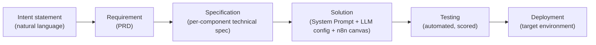
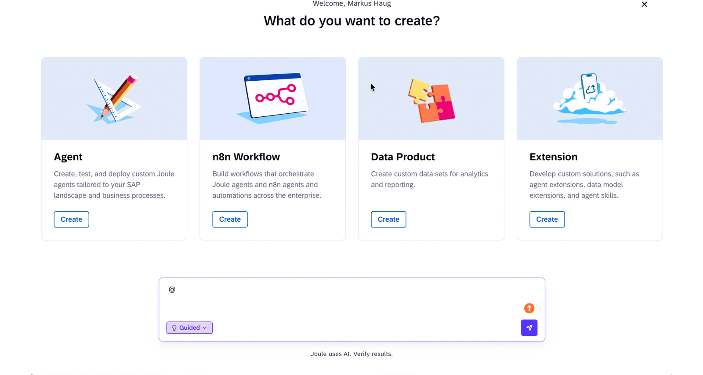
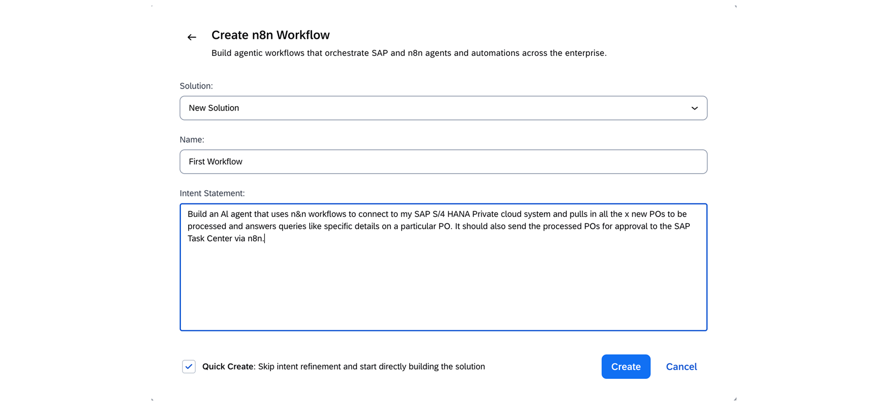
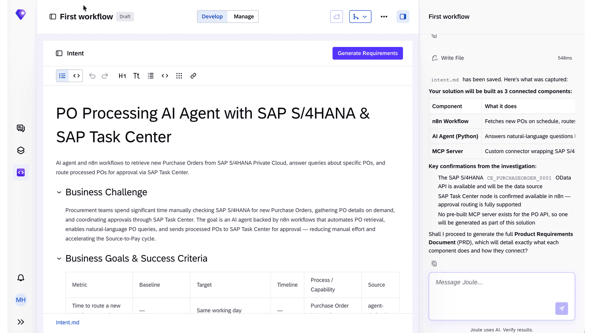
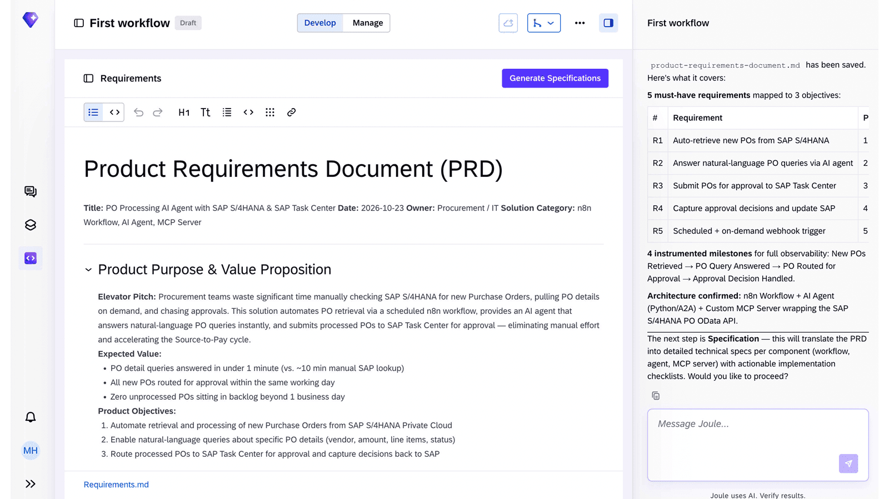
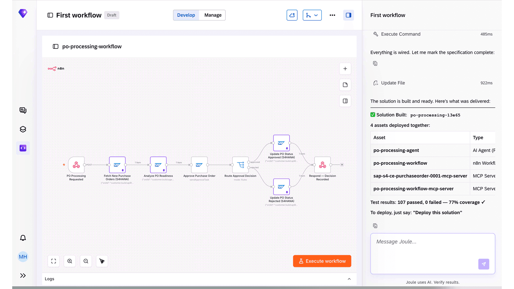
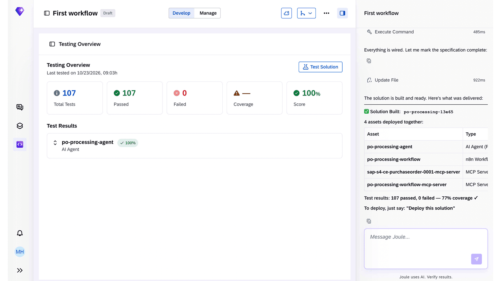
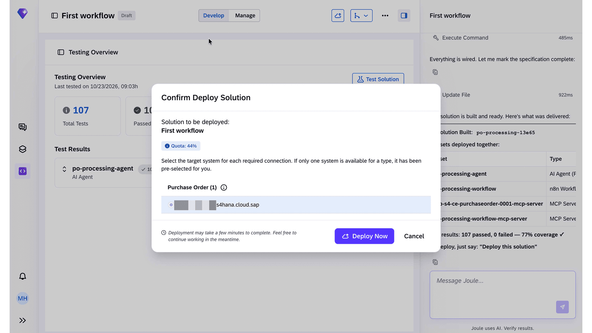

# n8n workflows in Joule Studio

*One intent statement, four deployed assets: an agent, a workflow, and two auto-generated MCP servers.*

> [!NOTE]
> **📍 At a glance**
> - **You will learn:** how Joule Studio's n8n integration turns a plain-language intent into a scheduled, multi-step automation — and what actually gets deployed underneath a "workflow"
> - **You will build:** nothing runnable here either, but you'll see the real generated architecture: an n8n canvas, an AI agent, and two MCP servers, one of them auto-wrapping an existing OData API
> - **Level:** beginner · **Time:** about 12 minutes
> - **Builds on:** [Extending an SAP-delivered agent](03-extending-a-standard-agent.md) (the extension lifecycle). **Leads to:** [Enabling Joule for other SAP products](enabling-other-products.md)

**After this chapter you can:**

- Explain what the Idea Board actually produces at each stage
- Read an n8n canvas built by Joule Studio and say what each node type is doing
- Say what gets deployed when you ship "one n8n workflow" — it's rarely just one asset
- Spot a real internal inconsistency in this course's own test-coverage numbers

## 4.1 n8n, inside Joule Studio

n8n is a low-code workflow automation tool, integrated into Joule Studio as a visual canvas for orchestrating SAP and third-party systems. The point isn't n8n itself — it's that Joule Studio wraps it in the same intent → requirements → spec → build → test → deploy lifecycle from Chapter 2, so a workflow gets the same governance and review as an agent.

The lifecycle here runs through the **Idea Board**:

## 4.2 Worked example: automating purchase order processing

**The scenario:** procurement wants new purchase orders pulled from SAP S/4HANA automatically and routed to SAP Task Center for approval, instead of being checked manually.

**Step 1 — Create, name, state intent.**

- The launcher has **four** creation types, not two: **Agent**, **n8n Workflow**, **Data Product** ("create custom data sets for analytics and reporting"), and **Extension** (Chapter 3). This book hasn't covered Data Product yet — flagging it here as a type that exists, not a gap we're silently ignoring.
- Same pattern as Chapter 3: pick a solution to group related assets, name the workflow, describe the outcome in plain language. **Quick Create** is available here too, with the same trade-off — skip clarification at the cost of a thinner PRD.

**Step 2 — intent analysis, then PRD generation.**

Before the PRD exists, Joule Studio writes an `intent.md` and reports what it found while investigating the request:

> **Your solution will be built as 3 connected components:** n8n Workflow (fetches new POs on schedule, routes...), AI Agent (Python) (answers natural-language questions...), MCP Server (custom connector wrapping SAP S/4...).
>
> **Key confirmations from the investigation:** the SAP S/4HANA `CE_PURCHASEORDER_0001` OData API is available and will be the data source · the SAP Task Center node is confirmed available in n8n, so approval routing is fully supported · **no pre-built MCP server exists for the PO API, so one will be generated as part of this solution.**

- That last line matters: Joule Studio **checks for an existing MCP server before generating a new one.** A new server isn't the default outcome of every build — it's what happens when nothing suitable already exists in your landscape. On a mature tenant with more solutions already deployed, you'd expect more reuse and fewer freshly-generated servers.
- `CE_PURCHASEORDER_0001` is a real SAP S/4HANA OData service name, not a placeholder — Joule Studio's "investigation" step resolves your intent down to an actual API before it writes a PRD.

The generated PRD restates the architecture, now as a formal line:

> **Architecture confirmed:** n8n Workflow + AI Agent (Python/A2A) + Custom MCP Server wrapping the SAP S/4HANA PO OData API.

- The agent is **Python**, communicates via **A2A**, and talks to SAP not through a hand-written integration but through the MCP server confirmed in the investigation step above.
- The PRD also defines **4 instrumented milestones** for observability: New POs Retrieved → PO Query Answered → PO Routed for Approval → Approval Decision Handled. This is the same tracing/observability thread from Chapter 2, 2.5 and Chapter 1, 1.6 — defined at requirements time, not bolted on after.

**Step 3 — Specification, then the canvas.**

> [!WARNING]
> **⚠️ Pitfall: the course's own Specification screenshot is a duplicate, not new content**
> The image captioned "Specification" on this lesson's page is byte-for-byte identical (same file, confirmed by hash) to the "PRD" image above it — SAP's own authoring reused the wrong screenshot. There's no independently-viewable Specification screen for this example; treat the PRD content above as covering both, rather than expecting distinct per-component technical detail that the source never actually shows.

- Conceptually, Specification still translates the PRD's 5 requirements into per-component technical detail (one spec per asset: the workflow, the agent, the MCP server) before anything is generated — same checkpoint discipline as Chapter 2, 2.3, and the same stage name shown doing real work in Chapter 2's Cable Roll Optimizer example (which *does* have a distinct Specification screenshot).

**Step 4 — The generated n8n canvas.**

Reading the canvas left to right:

1. **PO Processing Requested** — webhook trigger (`POST`)
2. **Fetch New Purchase Orders (S4HANA)** — calls the generated MCP server
3. **Analyze PO Readiness** — a second SAP-connected step
4. **Approve Purchase Order** — triggers `sendApprovalTask` against SAP Task Center
5. **Route Approval Decision** — a rules-based branch node (`mode: Rules`), splitting into:
   - **Update PO Status Approved (S4HANA)**
   - **Update PO Status Rejected (S4HANA)**
6. **Respond — Decision Recorded** — both branches rejoin into a single response node

- This is a real branching workflow, not a linear pipeline — the generated canvas includes conditional routing and two divergent SAP write-backs, from one intent statement.

When the build finished, the assistant reported what had actually been deployed — **not one asset, but four**:

| Asset | Type |
|---|---|
| `po-processing-agent` | AI Agent |
| `po-processing-workflow` | n8n Workflow |
| `sap-s4-ce-purchaseorder-0001-mcp-server` | MCP Server |
| `po-processing-workflow-mcp-server` | MCP Server |

> [!IMPORTANT]
> **🏭 In production: "one workflow" is usually several deployed assets**
> Notice the workflow itself gets its own MCP server (`po-processing-workflow-mcp-server`), separate from the one wrapping the SAP OData API. A Joule Studio n8n solution isn't just a canvas — it's an agent, the workflow, and an MCP server *per external integration point*, deployed and versioned together. When you're estimating the blast radius of a change, or the AI Agent Hub footprint of "one workflow," count assets, not canvases.
>
> *Added by Claude; the course shows this in the deployment summary but doesn't name the pattern explicitly.*

**Step 5 — Testing.**

> [!WARNING]
> **⚠️ Pitfall: this course's own screenshots disagree on the coverage number**
> The Testing Overview panel shows **107 total tests, 107 passed, 0 failed, 100% coverage**. The AI assistant's own chat summary of the same run (visible in the canvas screenshot, 4.2 step 4) says **"107 passed, 0 failed — 77% coverage."** Same run, two different coverage figures, in the same course. Don't trust a chat-generated summary of test results over the actual test dashboard — and if you see this discrepancy on a real tenant, treat it as a bug to report, not a rounding difference.

**Step 6 — Deploy.**

- Same deploy pattern as Chapter 3: pick a target environment (e.g. Development), Joule Studio handles packaging. From here the workflow is managed the same way the agent extension was — Life Cycle Management, Monitoring & Analytics, per-asset run history.

## 4.3 Added by Claude, not from the sources

- The "count assets, not canvases" framing in the 🏭 box is this book's own generalization from one example; the course doesn't state it as a rule.
- The coverage-number discrepancy in the ⚠️ box is an observation from comparing two screenshots in the same lesson, not something the course flags itself.
- The reading of "no pre-built MCP server exists, so one will be generated" as implying MCP-server reuse on a mature tenant (Step 2) is this book's own inference from one line of UI text, not something the course elaborates on.
- Not run: reproduced from the course's own worked example and screenshots; nothing here was independently executed.

## 4.4 Interview corner

**What interviewers listen for:** you know an n8n "workflow" in Joule Studio usually means several deployed assets, you can explain where the MCP server comes from, and you'd question a number before repeating it.

### 🟢 Basic

1. What does Joule Studio's n8n integration actually orchestrate?

- Visual, low-code workflows that connect SAP and third-party systems, built through the same intent → PRD → spec → solution → test → deploy lifecycle as an agent

2. In the worked example, how does the agent talk to SAP S/4HANA?

- Through an auto-generated MCP server that wraps the SAP S/4HANA PO OData API — the developer doesn't hand-write the API client

### 🟡 Intermediate

3. Does Joule Studio always generate a new MCP server for a new solution?

- No — it checks whether a suitable MCP server already exists first, and only generates one when nothing suitable is found
- *Stronger answer:* this implies MCP servers are a reusable, discoverable asset on a tenant, not a one-off byproduct of each build — on a mature landscape you'd expect to see more reuse over time

4. How many assets did the "First Workflow" example actually deploy, and what were they?

- Four: an AI Agent, the n8n Workflow, an MCP server wrapping the SAP OData API, and a separate MCP server for the workflow itself
- *Stronger answer:* this means reviewing or rolling back "a workflow" means reviewing or rolling back all four related assets together, not a single file

5. The chat assistant says a build passed with 77% coverage; the test dashboard says 100%. Which do you trust?

- The dashboard — it's the actual test run's recorded output, not a model-generated summary of it
- *Stronger answer:* this is a general rule, not specific to Joule Studio: never treat an LLM's natural-language summary of structured results as more authoritative than the structured results themselves

### 🔴 Senior

6. A procurement workflow built this way needs to add a new SAP system down the line. What changes?

- A new MCP server gets generated/wired for the new integration point, following the same per-integration-point pattern seen here (one MCP server per external system, not one shared server for everything)
- *Stronger answer:* flag this during the Specification stage, not after the canvas is built — the per-component spec is where a new integration point should be scoped and reviewed, same discipline as the REQ-mapped PRD from Chapter 3

> [!TIP]
> **🧩 Design question**
> *"Finance wants a similar workflow but triggered by a nightly batch instead of a webhook, with a human approval step that can time out after 24 hours."* Talk about: swapping the trigger node (schedule vs. webhook — both are n8n node types), where the approval step fits against SAP Task Center (as in the worked example), and where a timeout/escalation branch would sit in the Route Approval Decision logic.

## Cheat sheet

| Stage | What it produces |
|---|---|
| Intent | Plain-language goal |
| Requirement (PRD) | Numbered requirements + confirmed architecture line |
| Specification | Per-component technical breakdown |
| Solution | n8n canvas + agent (System Prompt, LLM config) |
| Testing | Total/passed/failed + coverage (check the dashboard, not the chat summary) |
| Deployment | Target environment, packaged assets |

## Recap

- n8n workflows in Joule Studio follow the Idea Board: **Intent → Requirement → Specification → Solution → Testing → Deployment**
- A generated workflow's PRD states its architecture up front — in the worked example, an n8n workflow, a Python/A2A agent, and an MCP server wrapping an existing OData API
- Deploying "one workflow" typically deploys **several assets together** (agent + workflow + one MCP server per integration point) — budget your mental model and your change-review process accordingly
- Joule Studio **checks for an existing MCP server before generating a new one** — a fresh server is what happens when nothing suitable exists yet, not the default outcome of every build
- Trust the **test dashboard** over a chat-generated summary of test results — this course's own material shows them disagreeing
- The source itself isn't infallible: this lesson's own "Specification" screenshot turned out to be a duplicate of its "PRD" screenshot

## Practice

1. Redraw the worked example's canvas from memory, labeling each node's type (trigger / SAP call / branch / response)
2. List the four deployed assets and say which one you'd check first if PO approvals stopped routing correctly
3. Explain out loud why an MCP server appears per integration point rather than once per solution

## How this chapter was checked

- This chapter is built from the "Creating n8n Workflows in Joule Studio" lesson and its quiz (Unit 4 of "Introducing Joule Studio"), read in full 9 Nov 2026 (see Chapter 2 for the full course reading note).
- The lesson has 8 images total; all 8 were viewed in full and 7 are used here (saved to `images/`, never hotlinked). The 8th ("Specification") was dropped after a hash check showed it's byte-for-byte identical to the PRD image — a duplicate in the source itself, not a skip on our part (see the pitfall box in 4.2, Step 3).
- The coverage-number discrepancy (4.2, Testing) was found by comparing two screenshots from the same lesson against each other, not by running anything.
- `CE_PURCHASEORDER_0001` and the "no pre-built MCP server exists, so one will be generated" line (4.2, Step 2) are transcribed directly from the intent-generation screenshot's own text, not inferred.
- Nothing here was independently run — this chapter reproduces the course's own worked example and screenshots rather than a live Joule Studio session, which this book doesn't have access to.

## Sources and further reading

- SAP Learning, *Introducing Joule Studio* — https://learning.sap.com/courses/introducing-joule-studio, lesson "Creating n8n Workflows in Joule Studio" (read in full 9 Nov 2026)

Previous: [Extending an SAP-delivered agent](03-extending-a-standard-agent.md) · Next: [Enabling Joule for other SAP products](enabling-other-products.md)
