# Chapter 4: Setting up Joule (landscape and unified setup)

*Where Joule runs, what it needs, and how to wire one Joule to many SAP systems.*

> [!NOTE]
> **📍 At a glance**
> - **You will learn:** the services behind Joule, the three landscape cases (one identity, two identities, public plus private S/4HANA), Joule Preview for non-production, and the data-centre checks
> - **You will build:** nothing yet; a landscape sketch for a customer
> - **Level:** intermediate (basic SAP BTP knowledge helps) · **Time:** about 40 minutes
> - **Source:** SAP Community blog *Joule - Unified Setup: Bridging Simplicity and Performance* (SAP author, RIG team), read 8 November 2026 including its diagrams
> - **Builds on:** [Chapter 1](01-what-is-joule.md) (architecture zones) and [Chapter 3](03-joule-for-business-users.md) (the user's view)

**After this chapter you can:**

- Name the BTP and identity services a Joule setup needs
- Choose between the three landscape cases for a customer
- Explain why non-production systems should use Joule Preview
- Say what Document Grounding adds and which sources it supports
- List what to check before choosing a data centre

> [!WARNING]
> **What this chapter is**
> - It is one SAP blog. It gives the concepts and the architecture; it has **no click-by-click steps**. Those come from the setup course (a later item) and SAP Help.
> - The blog was updated over time: it mentions a Q3 2025 service and a release roadmap graphic that says "2024 & beyond" with "planned innovation, subject to change". Check current SAP Help before you plan a customer's landscape.
> - No BTP account or Joule tenant was used.

## 4.1 The pieces

- **Joule is a service on SAP BTP** (multi-cloud, Cloud Foundry environment)
- It needs a **BTP subaccount** (directories and subaccounts split admin tasks and projects; services are found in the SAP Discovery Center)
- **SAP Build Work Zone** (foundation edition, included in the Joule licence): supports Joule interactions that use the navigation pattern; used only for Joule
- **SAP Cloud Identity Services** (IAS for authentication, IPS for provisioning): manages users across your SAP cloud solutions
- **Other services, as needed:** Destination service, Cloud Connector and Connectivity service (for private cloud), **Document Grounding**
- **Identity entitlement:** the SAP cloud solution bundle gives one production and one test Cloud Identity Services tenant; reuse existing ones instead of adding more

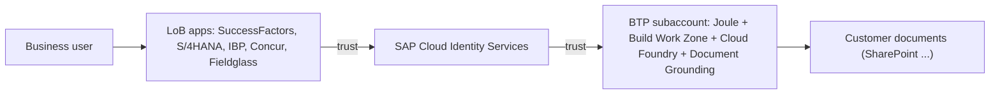

✅ *Verified against the blog text and its architecture diagram (Image 4); nothing run.*

## 4.2 What the architecture picture shows (Image 4)

- A business user works in an application client; a **UI plugin** loads Joule in the LoB app
- Numbered flow in the diagram: user on the home page, authentication, user starts Joule UI, dialog handling, transactional data access, navigation link resolving, and search of help and customer documents
- Joule uses **nav target mappings** (navigation via Build Work Zone), **destinations and connectivity** for backend data access, and **Document Grounding** for company documents
- Around it sit **Microsoft Copilot**, **Joule Studio (skills, agents)**, **Joule for Developers** and **Joule for Consultants**
- LoB side: an OData API and a CDM provider (common data model for navigation targets); Cloud Connector for private systems

## 4.3 Three Joules: business, developers, consultants

| Variant | For | Note |
|---|---|---|
| Joule for Business (J4B) | Business users in LoB apps | The focus of this chapter |
| Joule for Developers (J4D) | Developers: SAP Build Code, ABAP environments, Build Apps, Build Process Automation | Options listed in the blog |
| Joule for Consultants (J4C) | Consultants; answers grounded in SAP content | **Needs a different subaccount from J4B** today |

- Image 4(a) shows the three side by side, with a note "Available now"

> [!NOTE]
> **Compare with Chapter 1**
> - Chapter 1 gives a price of 35 AI Units per user per month for J4C. This blog does not discuss cost.

## 4.4 Document Grounding

- A BTP service that does **retrieval-augmented generation (RAG)** for Joule: answers from your own documents (HR policies, contracts, legal and regional documents, supplier contracts)
- **Supported sources named in the blog:** Microsoft SharePoint, SAP Build Work Zone Advanced Edition, ServiceNow
- Not tied to one LoB solution: activate once, use for all Joule services
- Supported file formats are listed on a linked page that I did not open

## 4.5 Three landscape cases

**Case 1: one Cloud Identity Services, many systems (recommended)**

- One BTP subaccount with Joule, Build Work Zone (Standard), Cloud Foundry runtime and Document Grounding
- One Cloud Identity Services tenant trusts all SAP systems (SuccessFactors, S/4HANA Public, SAP DSC, Customer Experience, others)
- One Joule answers across all of them

**Case 2: several identity services**

- Connect as many systems as possible through **one** identity service
- The diagram's example: a non-production subaccount and a production subaccount, each with its own identity tenant
- Systems in different Joule instances **cannot answer each other's questions** (S/4HANA in one instance will not answer SuccessFactors questions from the other)

**Case 3: public and private S/4HANA with two identity services**

- Joule supports **only one** S/4HANA integration per subaccount, public or private (SAP says a unified approach is planned)
- Use **two subaccounts**: A for SuccessFactors plus S/4HANA Public, B for S/4HANA Private
- The two Joule instances do not talk to each other

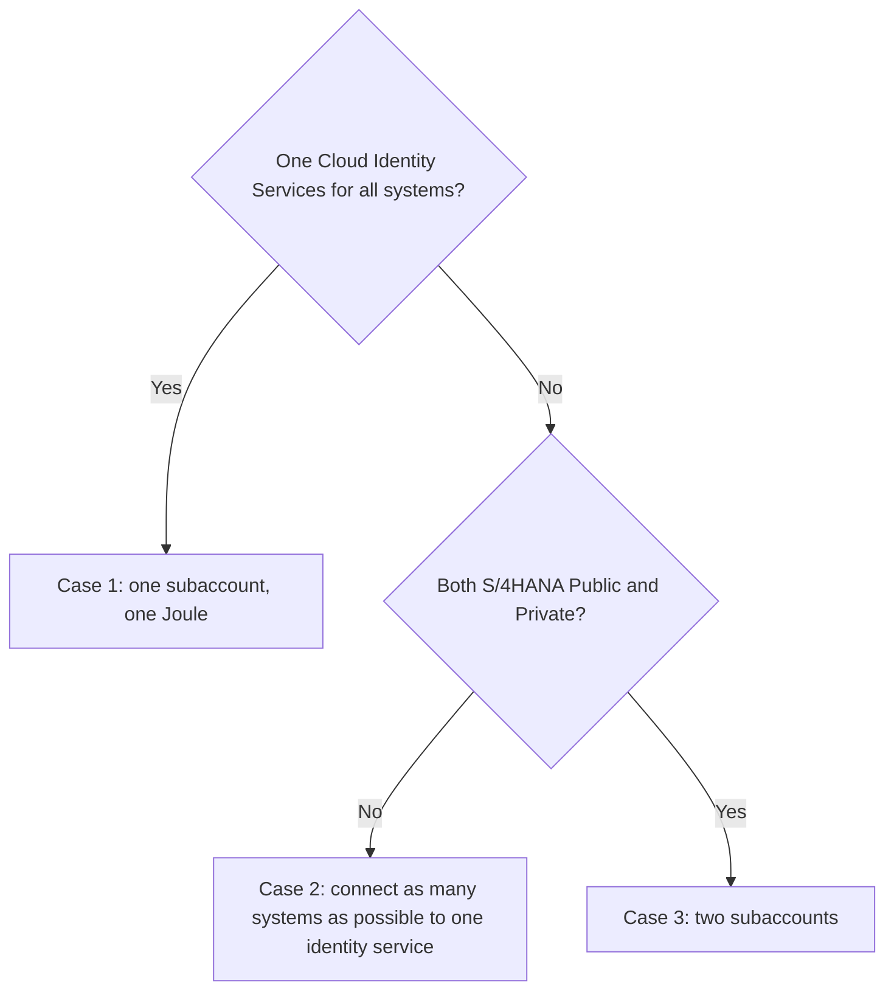

> [!WARNING]
> **Pitfall**
> - The case choice sets what Joule can answer. Decide the identity design first, then the subaccounts. Changing it later means re-forming systems.

## 4.6 A three-tier landscape and Joule Preview (Images 4(b), 6 case 2)

- The blog's reference picture ("Joule account structure in a 3-tier landscape") shows Dev, QA and Prod rows, each with LoB systems, identity tenants, Joule subaccounts, and Microsoft 365 Copilot attached to QA and Prod through Entra
- **Joule Preview** (new in Q3 2025): use it for **all non-production** accounts (sandbox, dev, test)
- Why: validate new capabilities **before** they reach production
- **Build services** can share the Joule subaccount; if Build services already sit elsewhere under the same identity service, connect them to the Joule formation
- **Microsoft 365 Copilot:** set it up with production; if there is a separate non-production Entra, connect that to the Joule test system

> [!IMPORTANT]
> **🏭 In production**
> - Put Joule Preview in non-production subaccounts and plain Joule in production, as the blog recommends.
> - Test new Joule capabilities in the Preview subaccount before users see them.

## 4.7 Which systems, and when (Image 5)

- The release graphic splits "Available" from "2025": available then included SuccessFactors, S/4HANA Cloud Public and Private, IBP, Product Lifecycle Management, Mobile Start, BTP cockpit, Build Code, Regulatory Change Management, Analytics Cloud; early-adopter care for Ariba, Asset Performance Management, Sales Cloud, Signavio, Concur
- Planned for 2025 on that graphic: Commerce Cloud, Field Service Management, Fieldglass, Business Network, Datasphere, Consumer Industries, CX AI Toolkit
- **Treat as a snapshot.** The graphic carries the label "planned innovation, subject to change"; Chapter 3 already lists Ariba, Concur and Fieldglass use cases, so the status moved on

## 4.8 Changing the formation later

- You can **expand** the setup to more systems at any time
- For existing customers: include or exclude a system in the Joule **formation** through the documented process, because **the Booster cannot be re-run** for that
- Constraints and privacy are covered by two SAP Help pages (not opened)

## 4.9 Data centres and regions

- Joule runs in many BTP data centres on AWS, Azure and Google Cloud; there is **no fixed mapping** from your LoB data centre to a Joule data centre
- Check before you pick:
  - Is the data centre approved by your company?
  - How do LoB data centres map to the Joule data centre (latency)?
  - Legal view if there is no local Joule data centre; in-country or regional rules
- **EU access only:** for GDPR with SAP EU Access, choose BTP subaccount **EU11**; if it is not available to you, ask your account executive or customer success partner
- **Maintenance windows:** different time zones lengthen total end-to-end downtime or limit availability
- **Unified setup needs:** a common identity domain (for example `*.ondemand.com` or `*.cloud.sap`)

## 4.10 Added by Claude, not from the sources

*My own reasoning; the blog does not say it.*

- **Decision order for a customer:** (1) list LoB systems and editions, (2) count identity tenants, (3) pick the case, (4) pick a region, (5) plan Dev/QA/Prod with Preview
- **Ask early:** "Does the customer have both S/4HANA Public and Private?" It forces Case 3 and two Joules
- **Document the formation:** keep a table of which system belongs to which Joule instance, so support can explain "why can't Joule answer this?"
- **Test one question per system** after setup, plus one cross-system question

## 4.11 Interview corner

**What interviewers listen for:** you can draw the landscape, name the services, and explain trade-offs between the cases.

🟢 1. What does a Joule setup need on SAP BTP?

- A subaccount with Joule, SAP Build Work Zone, Cloud Foundry runtime, and optionally Document Grounding
- SAP Cloud Identity Services for users

*Stronger answer:* add the Destination service and Cloud Connector for private systems.

🟢 2. What is Document Grounding?

- RAG over your own documents (policies, contracts)
- Sources named: SharePoint, Build Work Zone Advanced, ServiceNow

*Stronger answer:* it is not tied to one LoB solution.

🟡 3. Describe the recommended landscape.

- Case 1: one identity service connected to all systems, one subaccount, one Joule
- Gives cross-system answers

*Stronger answer:* explain what you lose when you have several identity services.

🟡 4. Why use Joule Preview?

- For sandbox, dev and test accounts
- Validate new features before production

*Stronger answer:* say Microsoft 365 Copilot is wired to production, with a non-production Entra tied to the test system.

🔴 5. A customer has S/4HANA Public, S/4HANA Private and SuccessFactors, with two identity services. What do you propose?

- Two subaccounts: A for SuccessFactors and S/4HANA Public; B for S/4HANA Private
- Explain the limit: one S/4HANA integration per subaccount and the two Joules do not talk to each other

*Stronger answer:* flag that SAP says a unified option is planned, and that users must know which Joule to open.

🔴 6. The customer adds a new system after go-live. What do you do?

- Include it in the Joule formation using the documented process; the Booster cannot be re-run for this
- Test the new system with a Preview subaccount first

*Stronger answer:* update the formation table and retest cross-system questions.

> [!TIP]
> **🧩 Design question**
> A group has SuccessFactors and S/4HANA Public in the EU, one identity tenant, and a separate US business using S/4HANA Private with its own identity tenant.
> - **Sketch:** the subaccounts, the identity tenants, and the Dev/QA/Prod layout with Preview.
> - **Say out loud:** the region choice for the EU part and what you tell US and EU users about which Joule answers what.

## 4.12 Cheat sheet

| Topic | Remember |
|---|---|
| Services | Joule, Build Work Zone, Cloud Foundry, Document Grounding, Cloud Identity Services |
| Case 1 | One identity service, one subaccount (recommended) |
| Case 2 | Several identity services: Joules cannot answer across instances |
| Case 3 | Public plus private S/4HANA: two subaccounts |
| J4C | Different subaccount from J4B |
| Non-prod | Use Joule Preview |
| Add a system | Formation process; Booster cannot be re-run |
| EU | EU11 for SAP EU Access |

## Screenshots and figures from the sources

*Images saved from the source pages, in the order they appear there.*

### Images: Joule Unified Setup (SAP Community blog)

*Source: [Joule Unified Setup (SAP Community blog)](https://community.sap.com/t5/technology-blog-posts-by-sap/joule-unified-setup-bridging-simplicity-and-performance/ba-p/13924542)*

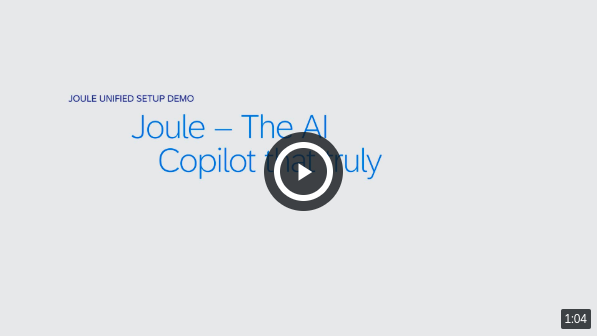

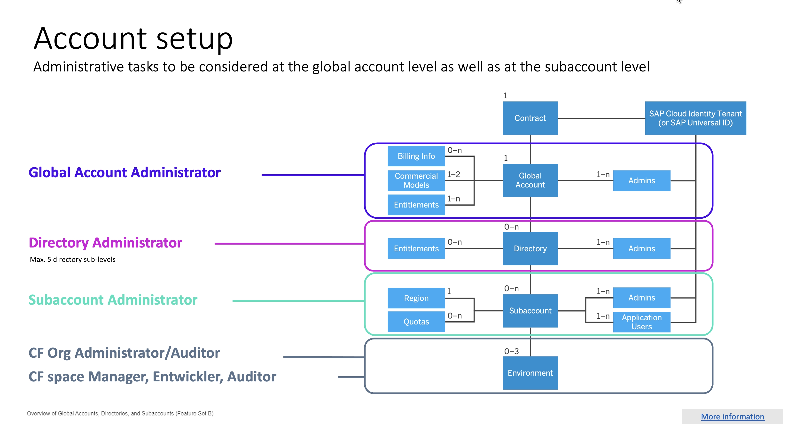

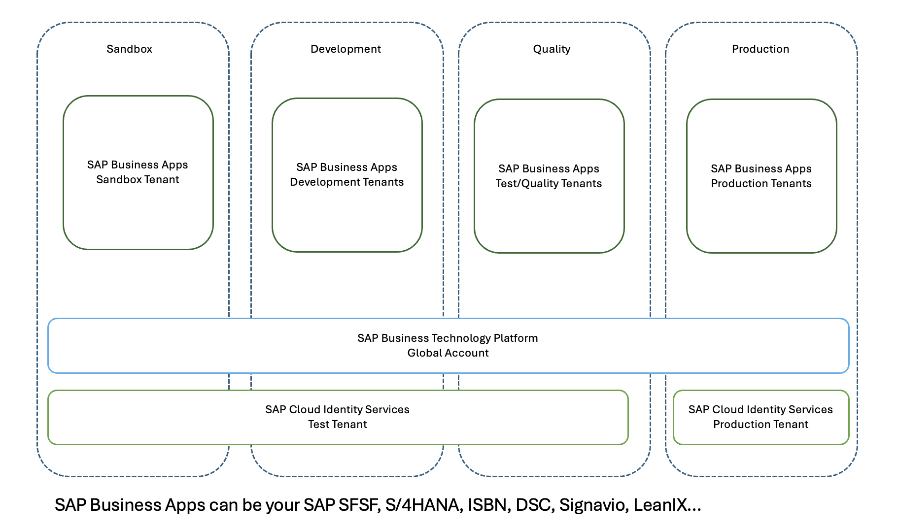

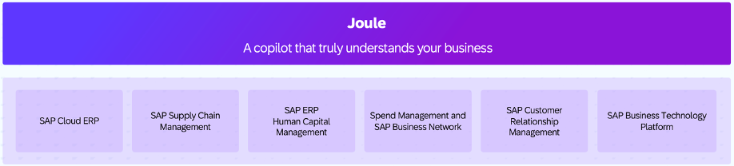

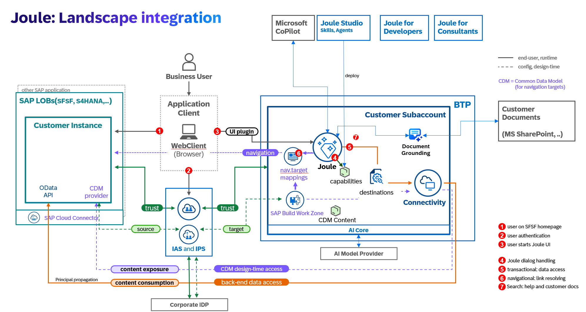

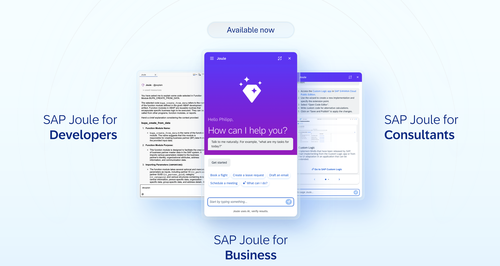

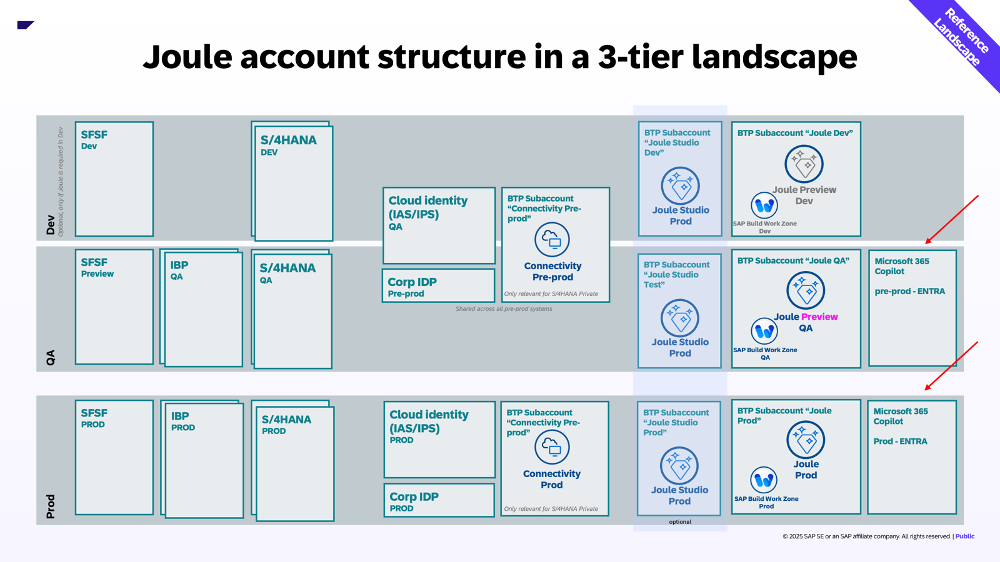

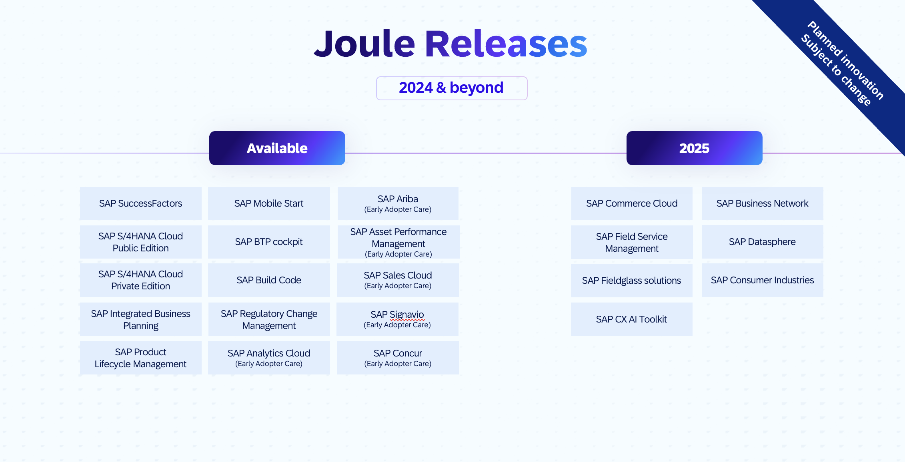

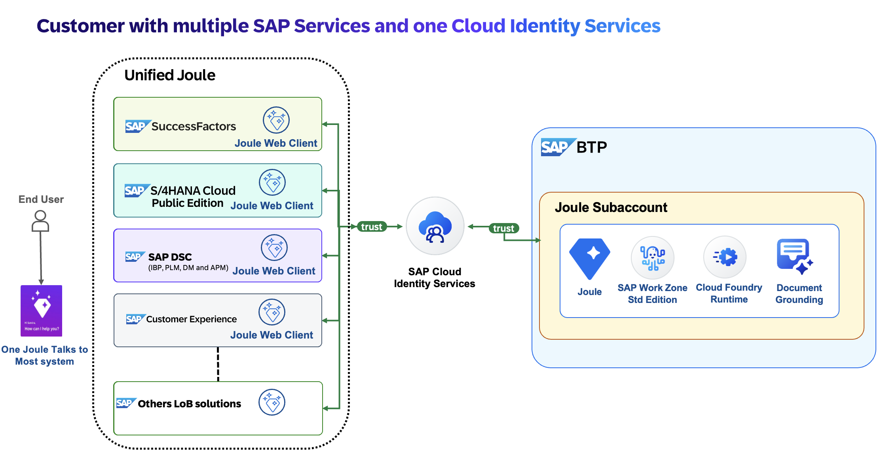

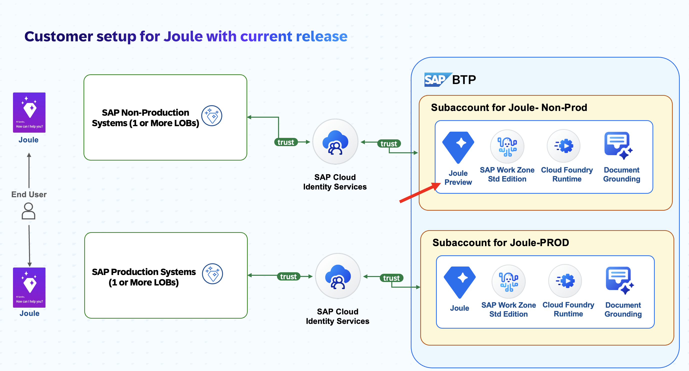

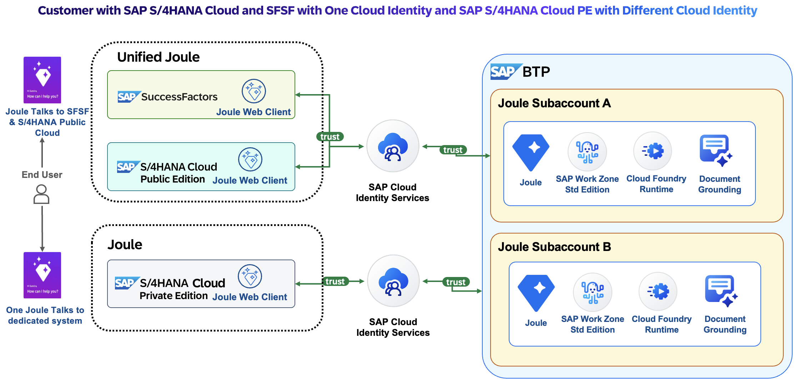

## Recap

- Joule is a BTP service that relies on Build Work Zone and Cloud Identity Services
- One identity service across systems is the recommended pattern
- Public plus private S/4HANA needs two subaccounts today
- Use Joule Preview for non-production
- Document Grounding adds answers from company documents
- Check data centre, legal and maintenance-window points before choosing a region

## Practice

1. Draw Case 1 for a customer with SuccessFactors, S/4HANA Public and Ariba.
2. Redraw it for two identity tenants and say what breaks.
3. List the questions you would ask a customer before choosing the subaccount region.
4. Write the test questions you would run after adding a system.

## How this chapter was checked

- **Read fully:** the whole blog text and all 10 distinct images (Images 1 to 7, including 4(a), 4(b) and the three cases). Three further image elements on the page were repeats of Images 1, 2 and 4
- **Not read:** the 1-minute demo video at the top; the pages the blog links to (setup guides, SAP Help pages, supported file formats, data-centre list, the earlier "SAP Business AI Overview" blog)
- **Not run:** no BTP account or Joule tenant was used
- **Dated points:** Joule Preview (Q3 2025) and the release graphic ("2024 & beyond") may be out of date
- **Wording kept as found:** the blog says "copilot"; Chapter 3 uses "assistant" for user guidance

## Sources and further reading

- SAP Community blog, *Joule - Unified Setup: Bridging Simplicity and Performance* (SAP author; text and all images read): https://community.sap.com/t5/technology-blog-posts-by-sap/joule-unified-setup-bridging-simplicity-and-performance/ba-p/13924542

---

*Previous: [Chapter 3: Joule for business users](03-joule-for-business-users.md)*

*Next: [Chapter 5: Setting up Joule product by product](05-setting-up-joule-by-product.md)*
