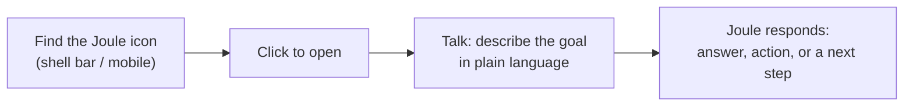
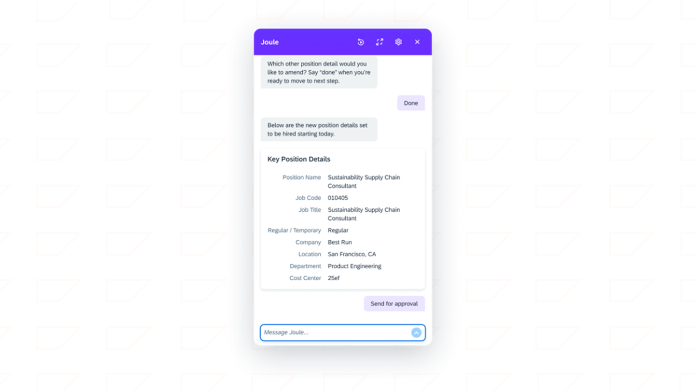

# How business users actually use Joule

*A short, deliberately light chapter — enough context to design good agent Instructions, not a UX course.*

> [!NOTE]
> **📍 At a glance**
> - **You will learn:** the basic Joule Work interaction loop, the five request types SAP calls "interaction patterns," and what makes a prompt effective — kept brief on purpose
> - **You will build:** nothing — this is background, not a build chapter
> - **Level:** beginner · **Time:** about 6 minutes
> - **Builds on:** [What Joule actually is](01-what-is-joule.md) (Joule Work) and [Joule Studio and the agent development lifecycle](02-joule-studio-lifecycle.md). **Leads to:** [Enabling Joule for SAP SuccessFactors](enabling-successfactors.md)

**After this chapter you can:**

- Describe the basic "find, click, talk" loop a business user goes through
- Name the five interaction patterns and recognize one in a user's phrasing
- Write (or coach someone else to write) a clearer request to an agent you've built

## 5.1 The loop

No menus to learn, no commands to memorize — a user states what they want, in the same conversation, and can keep refining it with follow-ups without starting over. That's the entire UX model.

## 5.2 Five interaction patterns

Every request a user types falls into one of five patterns. This matters to you as a developer mainly because it's the same vocabulary used for Skill types back in Chapter 1 — a request's pattern roughly predicts which kind of Skill ends up handling it.

| Pattern | What the user wants | Example |
|---|---|---|
| **Informational** | An answer, explained | "What's our travel policy?" |
| **Navigational** | Taken to the right place | "Open the supplier report" |
| **Transactional** | Something done, inside the conversation | "Create a purchase requisition" |
| **Analytical** | Data, summarized or charted | "Show sales by region this quarter" |
| **Creative** | Content drafted or summarized | "Summarize this customer case" |

A real transactional example — creating a new position in SuccessFactors, with a structured confirmation card and an explicit approval action, entirely inside the chat:

- One conversation usually chains several patterns — ask a question (informational), drill into a region (analytical), jump to the report (navigational), act on it (transactional) — without the user starting over. Joule holds context across the whole exchange.

## 5.3 What makes a request work well

- State the **goal**, not just a keyword ("sales?" vs. "show me sales performance for this quarter").
- Add **context** that narrows it: a time period, a region, a specific object.
- Be explicit about the **action type** — "open," "summarize," and "create" trigger different patterns from the same underlying noun.
- Use **follow-ups** to refine rather than restating the whole request each time.

## 5.4 Where this shows up, and one limit worth knowing

Joule Work appears the same way everywhere a user meets it: embedded in SAP applications (shell bar), on **SAP Mobile Start** (mobile), and integrated with **Microsoft 365 Copilot** (retrieve SAP insights or trigger SAP actions without leaving Microsoft apps). One operational detail worth carrying into your own testing: **a Joule Work conversation expires after 8 hours of inactivity** — if you're testing or demoing an agent and the session goes quiet that long, expect a fresh conversation, not a resumed one.

## Interview corner

Why would a developer care about "interaction patterns" meant for business users?

- They're the same vocabulary as Skill types (Chapter 1) — recognizing which pattern a request falls into helps you predict, and design for, which Skill or Agent should handle it

What happens to a Joule Work conversation after 8 hours of inactivity?

- It expires. It can still be referenced, but not continued — a new conversation is needed

## Recap

- The user-facing loop is **find → click → talk**, with no commands to memorize
- Five interaction patterns: **Informational, Navigational, Transactional, Analytical, Creative** — the same split that shows up at the Skill level
- Good requests state a clear goal, add context, and get refined through follow-up rather than restated from scratch
- Joule Work shows up the same way everywhere (SAP apps, SAP Mobile Start, Microsoft 365 Copilot); conversations expire after 8h idle

## How this chapter was checked

- All 7 lessons and both unit quizzes of "Getting Started with Joule for Business Users" (learning.sap.com/courses/getting-started-with-joule-for-business-users) were read in full, 10 Nov 2026 — the same read used to mark SJ009 "Excluded by you" in the master, now given a deliberately short write-up instead of none at all, per the owner's request.
- This chapter is intentionally trimmed: no "Added by Claude" section, no graded interview tiers, no cheat sheet or practice section — the full course has no further dev-relevant depth to draw out beyond what's above.
- 1 of the course's 13 images is used here (saved to `images/`, never hotlinked): a real transactional-flow screenshot. The rest illustrate interaction patterns and UI chrome already covered by the table and text above.

## Sources and further reading

- SAP Learning, *Getting Started with Joule for Business Users* — https://learning.sap.com/courses/getting-started-with-joule-for-business-users (all 7 lessons + 2 quizzes, read in full 10 Nov 2026)

Previous: [Document grounding, analytics, and developer tooling](joule-advanced-capabilities.md) · Next: [Enabling Joule for SAP SuccessFactors](enabling-successfactors.md)
