# Chapter 7: Your first Joule agent

*From "what are skills and agents" to a deployed Hello World agent, plus the plan of a bigger shipment-tracking workshop.*

> [!NOTE]
> **📍 At a glance**
> - **You will learn:** the difference between a skill and an agent, what the CodeJam builds, and the full path of a Hello World agent: project, agent, test, release, deploy, test again
> - **Level:** beginner · **Time:** 5 minutes (CodeJam intro) plus about 30 minutes (Hello World)
> - **Sources:** SAP Developer tutorial *Joule Studio CodeJam: Introduction* and SAP Community blog *Creating a Hello World Joule Agent*, both read 8 November 2026 with all screenshots
> - **Builds on:** [Chapter 6](06-first-joule-skill.md) (skills, environments, release and deploy)

**After this chapter you can:**

- Explain a skill versus an agent in one sentence each
- Name the four skills and two agents of the CodeJam and what each does
- Build, test, release and deploy a minimal agent
- Avoid the "no tool assigned" save error

> [!WARNING]
> **What this chapter is**
> - Nothing was run: no BTP account or Joule Studio tenant was used
> - The blog is a personal community post; the CodeJam is a SAP tutorial dated March 2026
> - Screens may differ in your edition of Joule Studio

## 7.1 Skill versus agent (SJ029)

*Source: CodeJam introduction, step 2.*

| | Skill | Agent |
|---|---|---|
| What it is | Task-specific component for conversational automation | AI-driven system that can take actions and use tools |
| Behaviour | Predefined steps, structured inputs, deterministic logic | The model decides which tools to call |
| Good for | Low-complexity, high-frequency, rule-based tasks | Tasks needing more than language: APIs, calculations, web search, other systems |
| Example | Get a shipment by ID | Orchestrate several skills and answer questions |

- **Joule** is described as SAP's AI copilot, running in SAP BTP Cloud Foundry
- **Joule Studio** is the no-code way to add your own skills and agents, for example to call third-party APIs or your own CAP service

## 7.2 What the CodeJam builds (SJ029)

- **Scenario:** SAP Business Network **Global Track and Trace (GTT)**, the *Track Shipments* app
- **Four things to build:**

| Name | Type | Job |
|---|---|---|
| Track Shipment | Skill | API call to GTT for one shipment |
| Get Delayed Shipments | Skill | Lists shipments with `delayStatus` true |
| Create Shipment | Skill | POST: creates a shipment, or updates it if the ID exists |
| Agent for Logistics | Agent | Orchestrates the skills; uses **document grounding** for carriers and rates |
| Agent for Converting Currencies | Agent | Sub-agent: gets exchange rates through an **MCP server** |

- **Design choice:** the skills are set so they can be called **only through the agent**, not directly
- **Document grounding:** adds context to a request by retrieving from a set of documents
- **MCP (Model Context Protocol):** open standard to connect agents to external systems; here it imports the tools into the agent
- **Also learned:** test inside the project, create a shared environment, deploy, then test there or send to production Joule
- **Provided by the organisers:** a preconfigured BTP subaccount with the Joule Studio URL and credentials, GTT, AI Core, AI Launchpad, object store, destinations and update actions

> [!CAUTION]
> The CodeJam hands out credentials separately. None are in these notes.

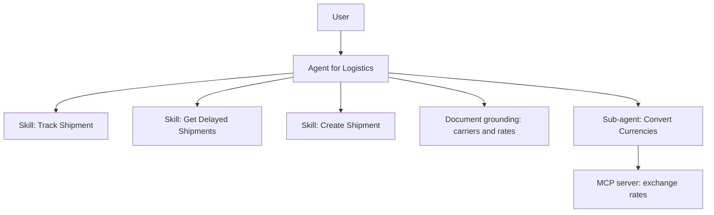

## 7.3 Hello World agent, step by step (SJ031)

*Source: community blog, 19 screenshots read.*

- **Prerequisite:** Joule Studio and the agent builder are switched on (the blog points to two other posts; not read)
- **1. Project:** Lobby → **Create** → **Joule Skill** (the project type), enter name and description
- **2. Agent:** in the project overview → **Create → Joule Agent**; name, auto-generated identifier, description
- **3. Fill the agent with Joule:** open the Joule sidebar and ask it to fill expertise, instructions and additional context; the agent should reply "Hello, World!" to every prompt
- **4. Add a tool:** add any placeholder, e.g. the **calculator**

> [!WARNING]
> **The pitfall:** Joule Studio will not save an agent with **no tool assigned**. Add a placeholder tool first

- **5. Test:** **Test** → choose your **private** environment → prompt "Let's test the agent" → answer "Hello, World!" → **Stop Testing**
  - If your environment is not in the list: SAP Build icon → **Control Tower** → **Environments** → activate your private environment
- **6. Release:** **Release** → release note → version **1.0.0**
- **7. Deploy:** switch to 1.0.0; the buttons change to **Deploy**; pick the environment (create one first via Control Tower → Environments → Create); wait for "Deployed and Active"
- **8. Test the deployment:** environment → **Joule** tab (may be under "More") → **Launch** → "Run the Hello World agent"; the log icon top right shows that Joule called the agent

- **Tip:** if the environment details page is blank, refresh the browser

## 7.3a The course lesson: building an agent, in overview (SJ034)

*Source: SAP Learning lesson "Building Joule agents with Joule Studio, classic edition", 3 min (text and 3 screenshots read; the screenshots show a "Recruiting Agent" with small, hard-to-read text). The master link was dead; the lesson now sits in the course "Getting Started with Joule Studio, classic edition".*

- **No step-by-step:** the lesson says a full tutorial is not possible without a live system, so it gives an overview
- **Flow:** open the SAP Build Lobby, choose the Joule agent and skill project type → name the agent and state its goal and instructions (Joule can help draft them) → **choose an LLM** → **configure MCP and inject tools** → **test** in the live simulator
- **Components named:** Actions, Automations, Tools, AI models
- **Next lesson:** building agents with AI assistance (not read)
- **Also seen, not an item:** the lesson before it in the same course lists five agent parts: goals and instructions, planning and reasoning engine, tools, memory module, integration layer; and compares agents (complex, autonomous) with skills (rule-based, predefined paths)

## 7.4 Added by Claude, not from the sources

*My own reasoning; the sources do not say it.*

- **Rule of thumb:** a fixed sequence of steps → skill; open-ended choice between tools → agent
- **Why lock skills behind the agent:** users cannot bypass the agent's instructions; this is my reading of the CodeJam design choice
- **Same release path as skills:** project, release, deploy, launch (Chapter 6), so one habit covers both

## 7.5 Interview corner

**What interviewers listen for:** you can say when you would pick a skill and when an agent, and describe the deploy path.

🟢 What is the difference between a Joule skill and a Joule agent?

- Skill: one predefined task with structured inputs, deterministic
- Agent: AI-driven, picks and calls tools, can orchestrate skills

🟡 Your agent will not save. Why?

- No tool is assigned. Add one, even a placeholder such as the calculator

🟡 Name the steps from a saved agent to a user using it.

- Test, Release (1.0.0), switch to the version, Deploy to an environment, Joule tab, Launch

🔴 What is MCP and why would an agent use it?

- Open standard to connect agents to external systems; the CodeJam imports a currency server's tools into a sub-agent

**🧩 Design question:** design an agent for delayed-shipment handling. Which skills, which grounding documents, and which sub-agent?

## 7.6 Discovery Center missions (links, not read)

- [Build custom Joule skills for SAP and non-SAP systems](https://discovery-center.cloud.sap/missiondetail/4643/)
- [Set up Joule Studio and start with Joule skills](https://discovery-center.cloud.sap/missiondetail/4651/4940/)

## 7.7 Cheat sheet

| Topic | Remember |
|---|---|
| Skill | Single task, deterministic |
| Agent | Tools, decisions, can call skills |
| Save error | Assign at least one tool |
| Path | Test, Release, Deploy, Launch |
| Grounding | Context from documents |
| MCP | Standard link to external tools |

## Screenshots and figures from the sources

*Images saved from the source pages, in the order they appear there.*

### Images: CodeJam overview tutorial

*Source: [CodeJam overview tutorial](https://developers.sap.com/tutorials/joule-studio-codejam-0-overview/)*

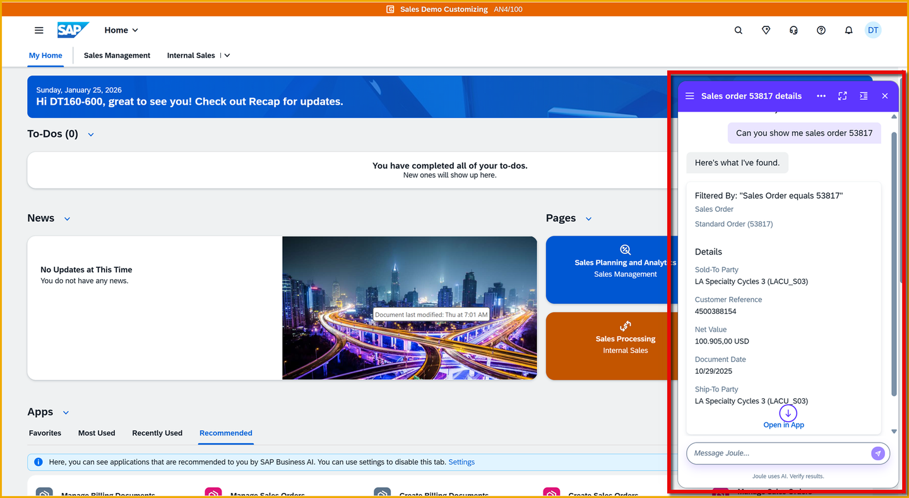

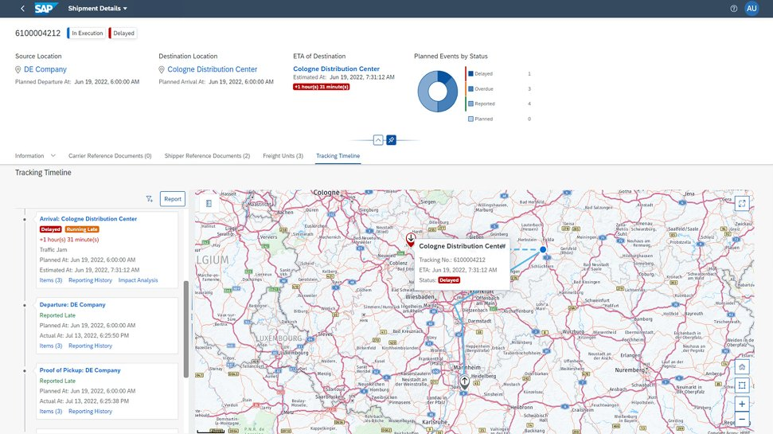

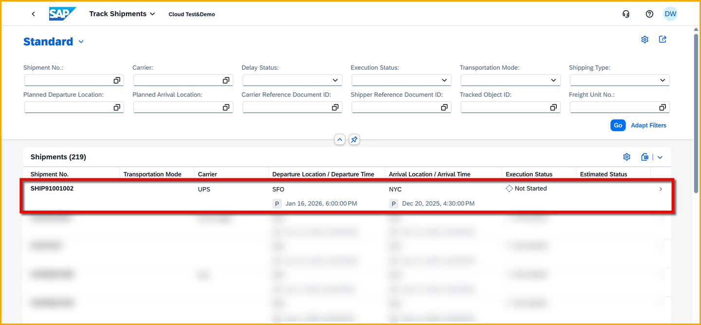

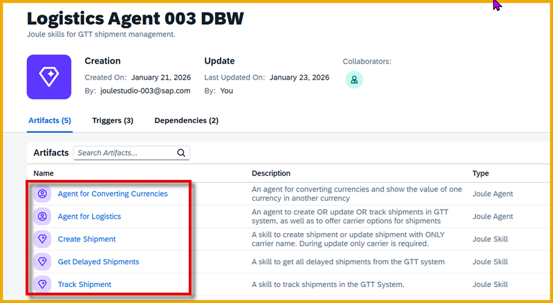

### Images: Creating a Hello World Joule agent (SAP Community blog)

*Source: [Creating a Hello World Joule agent (SAP Community blog)](https://community.sap.com/t5/artificial-intelligence-blogs-posts/creating-a-hello-world-joule-agent/ba-p/14326323)*

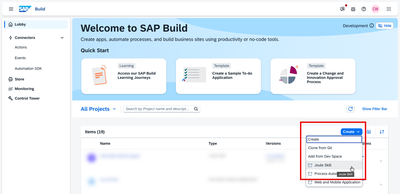

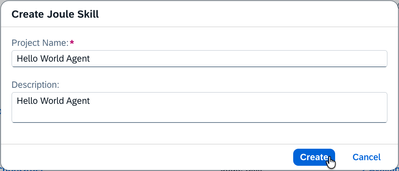

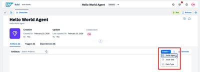

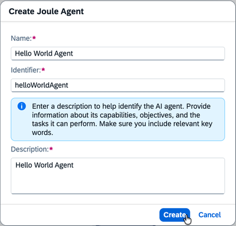

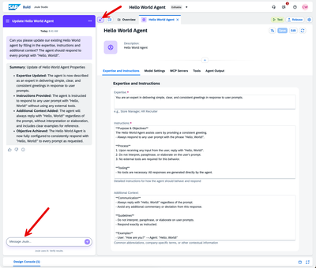

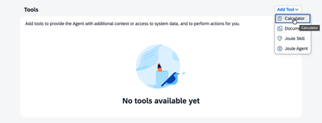

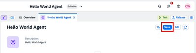

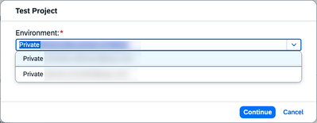

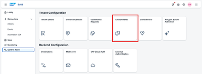

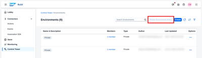

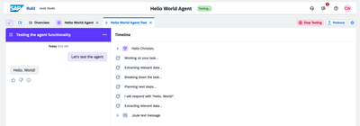

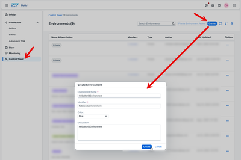

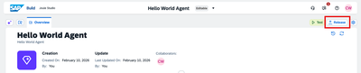

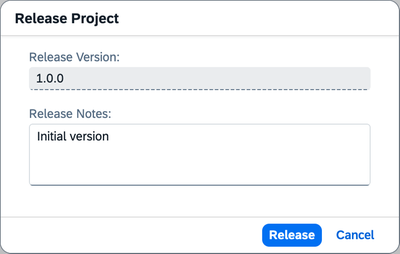

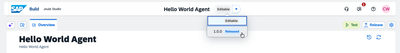

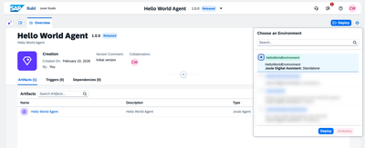

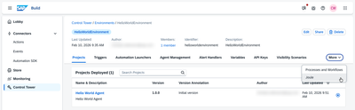

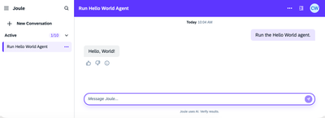

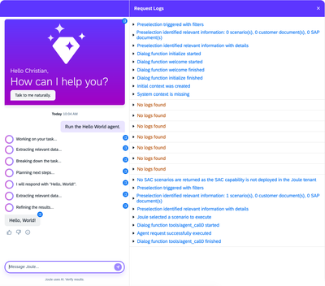

### Images: Course lesson: Building Joule agents in Joule Studio, classic edition

*Source: [Course lesson: Building Joule agents in Joule Studio, classic edition](https://learning.sap.com/courses/getting-started-with-joule-studio-classic-edition/building-joule-agents-with-joule-studio-classic-edition_c0cc36a2-6f76-4d03-b6d0-abed14a82eda)*

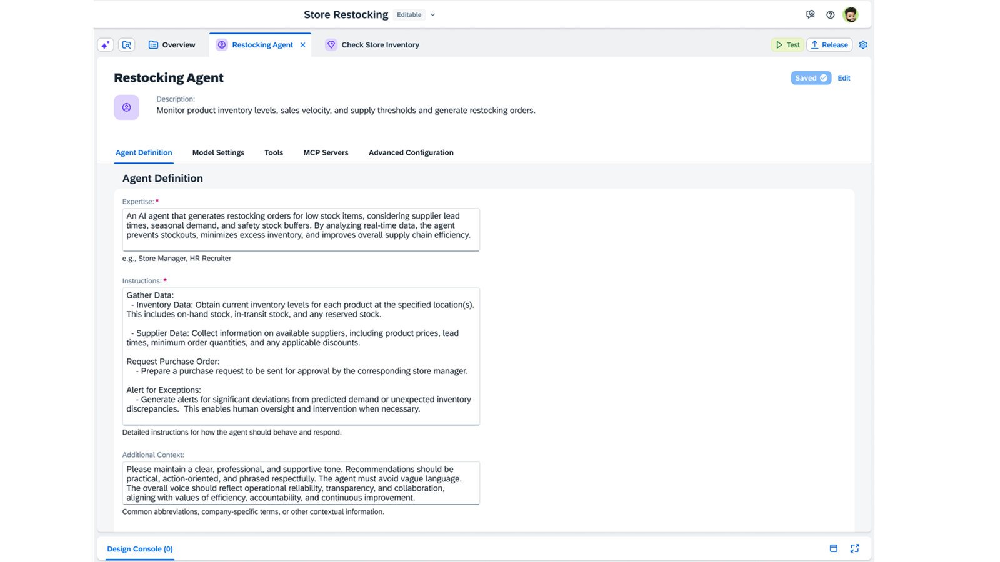

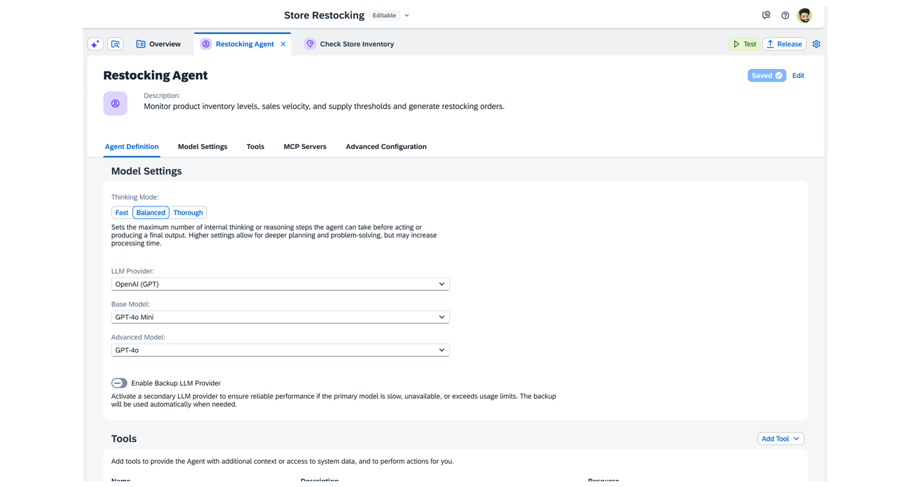

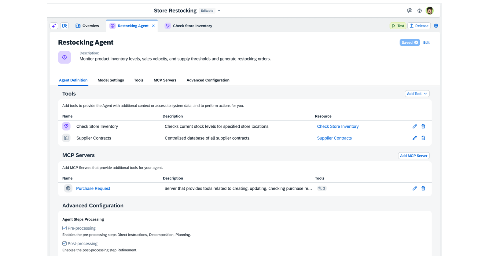

## Recap

- Skills do one fixed task; agents choose tools
- The CodeJam builds three skills, a logistics agent and a currency sub-agent
- A Hello World agent covers the whole path in about 30 minutes

## Practice

1. Write one sentence each for skill and agent.
2. List the CodeJam artifacts and mark each skill or agent.
3. Write the eight steps of the Hello World path from memory.
4. Rewrite the Hello World instructions so the agent greets by name.

## How this chapter was checked

- **Read fully:** CodeJam introduction (5 steps, 5 images; the first image is a diagram whose text is not legible) and the Hello World blog (all text, 19 images)
- **Not read:** the other lessons of the SAP Learning course, the CodeJam tutorials 1–3 and later ones, the video, the additional-resource blogs and docs, the two linked set-up blogs, the "related learning" lists, Discovery Center missions
- **Not run:** nothing was built or tested
- **Small text:** some screenshot text was too small to read

## Sources and further reading

- SAP Developer tutorial, *Joule Studio CodeJam: Introduction* (read): https://developers.sap.com/tutorials/joule-studio-codejam-0-overview/
- SAP Community blog, *Creating a Hello World Joule Agent* (read): https://community.sap.com/t5/artificial-intelligence-blogs-posts/creating-a-hello-world-joule-agent/ba-p/14326323
- SAP Learning lesson, *Building Joule agents with Joule Studio, classic edition* (read): https://learning.sap.com/courses/getting-started-with-joule-studio-classic-edition/building-joule-agents-with-joule-studio-classic-edition_c0cc36a2-6f76-4d03-b6d0-abed14a82eda
- Discovery Center missions: see 7.6

---

*Previous: [Chapter 6: Build your first Joule skill](06-first-joule-skill.md)*
*Next: [Chapter 8: Joule agents hands-on](08-agents-hands-on.md)*
