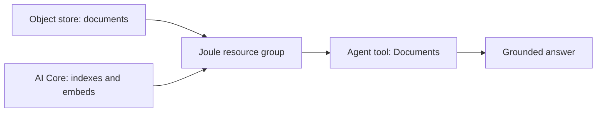
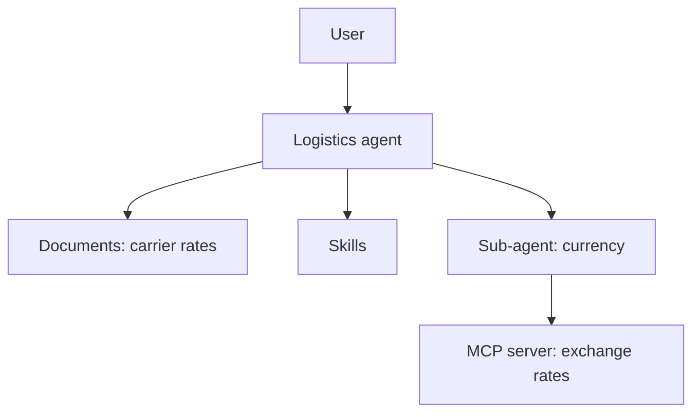

# Chapter 8: Joule agents hands-on (Joule Studio, Classic Edition)

*Four tutorials: a stock-checking agent, a document-grounded agent, the shipment CodeJam agent with tests, and a currency sub-agent with an MCP server.*

> [!NOTE]
> **📍 At a glance**
> - **You will learn:** how to write an agent (expertise, instructions, context), give it skills, documents and an MCP server as tools, test it, and deploy it
> - **You will build:** a Maintenance Fulfillment Validator, a Maintenance Compliance Agent, a Logistics agent and a currency sub-agent
> - **Level:** beginner · **Time:** about 30 + 30 + 15 + 10 + 15 minutes
> - **Sources:** five SAP Developer tutorials (two by Martin Plummer, three by Daniel Wroblewski), read 8 November 2026 with all screenshots
> - **Builds on:** [Chapter 6](06-first-joule-skill.md) (skills, destinations, release and deploy) and [Chapter 7](07-first-joule-agent.md) (skill vs agent)

**After this chapter you can:**

- Write expertise, instructions and additional context for an agent
- Add skills, documents and an MCP server as tools
- Switch skills so only an agent can call them
- Test an agent in a private environment and read the timeline
- Use one agent as a sub-agent of another

> [!WARNING]
> **What this chapter is**
> - It follows **Joule Studio, Classic Edition**; screens differ in other editions
> - The tutorials use sample backends supplied by the authors (a maintenance service, a shipment-tracking system); I ran none of it
> - Tutorials are dated January 2026, updated August 2026
> - Agent answers vary from run to run, the tutorials say so

> [!CAUTION]
> **Credentials**
> - The tutorials ask you to edit destination files with your own AI Core and Object Store keys, and the CodeJam hands out logins. None of that is in these notes

## 8.1 The anatomy of an agent (SJ035)

*Source: CodeJam tutorial 6, "Create Agent to Coordinate Skills", 15 min.*

- **Four abilities:**

| Ability | Meaning |
|---|---|
| Planning | Chooses the order of actions and tools |
| Reflection | Checks its own steps and corrects |
| Tool usage | Calls Build actions, skills, APIs |
| Collaboration | Works with other agents and with humans |

- **Skill vs agent:** skills say *what* can be done; the agent says *how* they are combined to meet a goal
- **Only agents can use:** **document grounding**, **MCP servers**, and **LLM settings** (provider, base model, advanced model, pre- and post-processing steps)

| Text field | Purpose |
|---|---|
| Expertise | Identity and field (e.g. supply chain); shapes tone and scope |
| Instructions | Goal, rules and limits; the most important field |
| Additional context | Specific or changing information, tone, examples |

- **Logistics agent, as built:** the instructions have numbered rules, one per tool: create shipment, suggest carriers, track shipment, delayed shipments, then a tool-selection rule (the user may ask in any order)
  - Each rule has example prompts and what to display
  - Missing fields: ask only for the required ones
  - Carriers: shown as a table; the user picks, then the agent updates the shipment
- **Model settings used:** OpenAI, GPT-4o for base and advanced; backup provider off; execution steps left as default
- **Tools:** an agent needs **at least one**. Add the three skills, then a **Documents** tool ("Carrier Selection Guide") pointing at a resource group
- **Output:** switch on **Allow Joule to interpret the output of the agent** so Joule formats the answer
- **Lock the skills:** on each skill's Trigger, switch **off** *Allow skill to be started directly by a user*, so only the agent calls them
- **Pitfall:** a skill with a **confirmation message** fails when called from an agent; move the data action right after the trigger and delete the confirmation and status messages
- **Questions the tutorial leaves open:** why were the skill's messages not shown; why block direct calls; advantages of an agent; better instructions?

> [!WARNING]
> **Not read:** the instructions code box on this page is cut off after rule 5 ("Tool Selection Logic") by a "Show all 43 lines" control that would not expand. The text after that line is not in these notes.

## 8.2 Tutorial A: the maintenance-order validator (SJ032)

*Source: SAP Developer tutorial, 30 min, 7 steps (text and all 22 images read).*

- **Scenario:** a maintenance planner must know if the materials for an order are in stock; today that is manual, across systems
- **Backend:** a CAP service on BTP through a destination; the skills are **imported**, not built here
- **Steps:**
  - **1 Destination:** import the sample destination file in BTP Cockpit (Connectivity → Destinations → Create → From File), then **Check Connection**
  - **2 Private environment:** Lobby → Control Tower → Environments → **Activate Private Environment**; then Control Tower → Destinations → Add, choose all environments (convenient while learning)
  - **3 Import project:** Lobby → **Import** an `.mtar` file; you get five skills and a published action project
  - **4 Create agent:** Create → Joule Agent; name `Maintenance Fulfillment Validator`; a clear, business-oriented description matters because Joule uses it to pick the agent
  - **5 Behaviour:** fill expertise, a long instructions text (get order ID first; do not proceed until validated; fetch operations and components; check stock including reservations; report shortfalls with quantities and reasons; recommend actions such as procurement, expediting or transfer; end with a clear summary) and additional context (tone: professional, no vague words); keep default model settings; add all five skills with **Add Tool → Joule Skill**; Save
  - **6 Test:** **Test** → choose private environment and the destination → prompt asking if Maintenance Order 1 can be fulfilled → open **Timeline** and click a skill to see inputs and outputs → **Stop Testing**
- **Execution steps:** optional pre- and post-processing that makes the agent break the work down
- **Skipped by design:** document grounding (needs SAP AI Core and extra set-up)
- **Quiz (step 7):** "SAP Core AI is necessary for all skills and agents": answer not shown; by the text, **false**

## 8.3 Tutorial B: document grounding (SJ033)

*Source: SAP Developer tutorial, 30 min, 6 steps (text and all 25 images read).*

- **Prerequisites:** tutorial A done; SAP AI Core and an S3-type object store; two sample guideline documents uploaded to the store
- **Steps:**
  - **1 AI Core destination:** import the sample file, replace placeholders with your AI Core service key values, **Check Connection**
  - **2 Object store destination:** same with the object-store key
  - **3 Document grounding:** Lobby → Control Tower → **Document Grounding** → Add: name (a Joule "resource group", not the same as an AI Core one), AI Core destination, object-store destination; wait for status **Pending → Completed** (an Error may show first; give it time)
  - **4 Agent:** Versions → **Save as New Project**; create `Maintenance Compliance Agent`; **Add Tool → Documents** with a name, description and the resource group
  - **5 Test:** ask for a policy summary and whether a partially confirmed order may be released; the answer cites the documents; open the timeline to see the grounding call
- **Design choice:** keep this agent separate from tutorial A's, to show grounding clearly
- **Quiz (step 6):** "a project can contain more than one agent": answer not shown; the tutorial's own design (two skills-plus-agents in a project, a logistics agent and a sub-agent in the CodeJam) suggests **true**

## 8.4 CodeJam: test the shipping agent (SJ036)

*Source: CodeJam tutorial 7, 10 min (text and all 10 images read).*

- **Setup:** save the project; **Test**; choose private environment and the two test destinations (one to write to the shipment system, one to read)
- **Prompt sequence:**
  - ask to create a shipment, Joule lists the required fields (ID, source, destination, pick-up date)
  - give the values, Joule reports the shipment is created
  - ask for best carriers on the route, Joule uses the grounded rate document
  - update the shipment with a chosen carrier, Joule shows the update success message
  - track the shipment, then list delayed shipments
- **Questions left open:** the downside of how document grounding is exposed; how to make skill responses constant; why agent responses vary

## 8.5 CodeJam: a sub-agent with an MCP server (SJ038)

*Source: CodeJam tutorial 8, 15 min, 7 steps (text and all 22 images read).*

- **Two ideas:** a **sub-agent** is a normal agent added as a tool of another; once used as a tool it **cannot be called directly**. An **MCP server** exposes tools that an agent can use
- **Steps:**
  - **1–2** create `Agent for Converting Currencies`; expertise: converts amounts and takes precedence for conversion; instruction: use the MCP server's latest-rate tool; context: show a table with currency codes as column headers
  - **3 Add MCP Server:** name, description for the agent, choose the destination; the dialog lists the server's tools; **Add Server** (the count of exposed tools shows)
  - **4** in the logistics agent: **Add Tool → Joule Agent** → pick the currency agent
  - **5** change the carrier rule: if the user asks for a non-USD currency, call the conversion agent and show two columns
  - **6 Test:** ask for carriers and prices in euros; open the logs: scenario selected, agent **Plan** (document grounding first, then conversion), **MCP Server** call with today's rate; compare to a public rate to confirm it is live
- **Questions left open:** advantage and limits of sub-agents; was one needed here (the author says the MCP server could have gone straight into the logistics agent)

## 8.6 Added by Claude, not from the sources

*My own reasoning; the tutorials do not say it.*

- **Write instructions like a procedure:** numbered rules, one per tool, with example prompts and the exact output format
- **Name the tool in the instruction** (the CodeJam does this) so the model picks it reliably
- **Test order:** timeline first, then the tool's input and output, then the instruction text
- **Why lock skills:** if users can call skills directly, they bypass the agent's rules; this is my reading
- **Grounding vs skills:** use documents for policy and rate tables, skills for live system data

## 8.7 Interview corner

**What interviewers listen for:** you can name the three agent text fields, the tool types, and what breaks.

🟢 What are the three text fields of an agent?

- Expertise, instructions, additional context

🟡 Which tools can an agent use that a skill cannot?

- Document grounding, MCP servers, other agents (sub-agents), plus LLM settings

🟡 A skill works alone but fails inside an agent. What do you check?

- Confirmation or status messages in the skill; remove them (CodeJam pitfall)

🔴 What must exist before document grounding works in Joule Studio?

- AI Core and an object store with documents, a destination to each, then a Document Grounding resource group showing Completed

**🧩 Design question:** design an agent that checks purchase-order approvals against a policy document and a live system. Which parts are skills, documents, MCP?

## 8.8 Discovery Center missions (links, not read)

- [Build custom Joule skills for SAP and non-SAP systems](https://discovery-center.cloud.sap/missiondetail/4643/)
- [Set up Joule Studio and start with Joule skills](https://discovery-center.cloud.sap/missiondetail/4651/4940/)

## 8.9 Cheat sheet

| Topic | Remember |
|---|---|
| Agent fields | Expertise, instructions, context |
| Tools | Skills, Documents, MCP servers, other agents |
| Minimum | One tool to save |
| Test | Private environment, timeline, Stop Testing |
| Grounding | Object store + AI Core + resource group Completed |
| Skills under an agent | Switch off direct start; remove confirmation messages |
| Sub-agent | An agent used as a tool; no direct calls |

## Recap

- An agent plans, calls tools and reflects; its text fields steer it
- Documents and MCP servers are agent-only tools
- Skills that an agent calls should not show their own confirmations
- The timeline and logs show how the agent decided

## Practice

1. Write the expertise, instructions and context for an agent that checks leave requests.
2. List the set-up steps for document grounding in order.
3. Explain why a skill with a confirmation message fails under an agent.
4. Draw the logistics agent with its tools.

## How this chapter was checked

- **Read fully:** the page text and all images of SJ032, SJ033, SJ036 and SJ038, and the page text and all images of SJ035 except the part named below
- **Not read:** the end of the SJ035 instructions box (after rule 5), the quiz answer options, the linked set-up blogs and sample files, Discovery Center missions, the related-learning lists
- **Not run:** nothing was built or tested
- **Small text:** some screenshot text was too small to read; first images of the CodeJam pages are diagrams with illegible text
- **Dated points:** the tutorials use GPT-4o in the CodeJam; models change

## Sources and further reading

- SAP Developer tutorial, *Use Joule Studio, Classic Edition to Create an Agent* (read): https://developers.sap.com/tutorials/joulestudio-agent-create
- SAP Developer tutorial, *Use Joule Studio, Classic Edition with Document Grounding* (read): https://developers.sap.com/tutorials/joulestudio-document-grounding
- CodeJam 6, *Create Agent to Coordinate Skills* (read, instructions box partly hidden): https://developers.sap.com/tutorials/joule-studio-codejam-6-agent
- CodeJam 7, *Test the Shipping Agent* (read): https://developers.sap.com/tutorials/joule-studio-codejam-7-test-agent
- CodeJam 8, *Add Subagent to Convert Currency Using MCP Server* (read): https://developers.sap.com/tutorials/joule-studio-codejam-8-subagent-mcp
- Discovery Center missions: see 8.8

---

*Previous: [Chapter 7: Your first Joule agent](07-first-joule-agent.md)* · *Next: [Chapter 9: MCP server for mobile development](09-mdk-mcp.md)*
