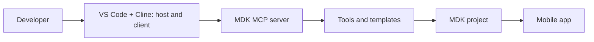

# Chapter 9: An MCP server for mobile development (MDK)

*Three tutorials: set up the MDK MCP server in VS Code with Cline, generate an app from a prompt, then evolve it.*

> [!NOTE]
> **📍 At a glance**
> - **You will learn:** what MCP is, how to install the MDK MCP server, connect it to an AI coding agent, generate and deploy a Mobile Development Kit app by prompt, and change it by prompt
> - **Level:** beginner · **Time:** 20 + 20 + 25 minutes
> - **Sources:** three SAP Developer tutorials by Jitendra Kansal, read 8 November 2026 with all screenshots
> - **Builds on:** [Chapter 8](08-agents-hands-on.md) (MCP servers as agent tools). This chapter is the other side: you use MCP in a **coding** agent, not in Joule

**After this chapter you can:**

- Explain host, MCP client and MCP server
- Install the MDK MCP server and register it in Cline
- Write a rules file that limits what the AI may change
- Name the four MDK tools and what each does
- Generate, deploy and enhance an MDK app with prompts

> [!WARNING]
> **What this chapter is**
> - These tutorials are about **mobile app development**, not Joule. They are in the list because they teach MCP in practice
> - The tutorials were created January 2026, updated August 2026
> - I ran nothing: no BTP account, device or editor was used
> - Generated code and answers vary; the tutorials say so

> [!CAUTION]
> **Credentials**
> - You log in to Cloud Foundry with single sign-on and enter your own AI provider key. No keys or codes are in these notes

## 9.1 MCP in three parts (SJ039)

*Source: "Set Up MCP Server for MDK Development", 20 min, 5 steps (text and all 12 images read).*

| Part | Role |
|---|---|
| Host application | What the user talks to: a chat or an AI code editor |
| MCP client | Inside the host; turns requests into MCP and talks to servers |
| MCP server | Exposes a tool or data source to the AI |

- **MDK MCP server:** open source; gives the agent MDK best practices, project-aware context, project templates and MDK command-line tools

## 9.2 Set-up steps (SJ039)

- **Install:** Node.js (version named in the tutorial), the MDK MCP server from the npm registry (`npm install -g @sap/mdk-mcp-server`) or from the open-source repository, and the Cloud Foundry CLI
- **Editor:** Visual Studio Code, the **SAP Mobile Development Kit Editor** extension, and the **Cline** extension
- **LLM provider:** Cline's built-in provider (free model), your own paid key, or SAP AI Core (needs a BTP production account); the tutorial uses "bring my own API key"
- **Register the server in Cline:** Manage MCP Servers → Settings → Configure MCP Servers → add an `mdk-mcp` entry of type `stdio` with the command `mdk-mcp` and a schema-version argument
  - Supported schema versions listed: 26.6 (default), 26.3, 25.9, 25.6, 24.11, 24.7
  - A green status means active; restart VS Code if tools do not appear
- **The four tools:**

| Tool | What it does |
|---|---|
| `mdk-create` | Creates projects or entity metadata from templates (CRUD, list-detail, base) |
| `mdk-gen` | Generates pages, actions, i18n files and rule references |
| `mdk-manage` | Build, deploy, validate, migrate, show QR code, mobile app editor |
| `mdk-docs` | Searches MDK documentation, component schemas, properties, examples |

- **Rules file:** in Cline, create a rule `AGENTS.md` with limits such as: do not generate the service metadata file, do not generate an XML file in the Services folder, do not change the project JSON file, and do not modify the project when you only ask "how to" or for suggestions
- **Quiz questions** (step 3 and 5): purpose of the MDK MCP server; required steps to configure the client. Answer options were not shown

## 9.3 Generate and deploy an app (SJ040)

*Source: "Create Your First MDK Application Using MCP Server", 20 min, 5 steps (text and all 17 images read).*

- **1 Log in:** empty folder in VS Code; in the terminal `cf login -a <API endpoint> --sso`; open the URL, get a temporary code, paste it, choose org and space
- **2 Mobile Services:** command palette → **MDK: Open Mobile App Editor** → create an app (name, ID, default security **XSUAA**, tick the sample OData **ESPM** service); wait 2–3 minutes for **Started**; pick the sample service destination and **Add App to Project**; this adds a `.service.metadata` file
- **3 Generate:** ask Cline for an offline project showing customers, products, sales order headers and items with local transactions; it calls `mdk-create`; the project appears in seconds
- **4 Deploy:** ask it to deploy and show the onboarding QR code; it calls `mdk-manage`; the QR code is saved in the project's `.build` folder
- **5 Run:** onboard the MDK client on Android or iOS (both shown); the main page lists entities; edits are saved to an **offline request queue**; **Sync Changes** uploads and then refreshes the offline store

## 9.4 Evolve the app (SJ041)

*Source: "Evolve Your MDK App with Agentic AI using MCP Tools", 25 min, 5 steps (text and all 17 images read).*

- **1 Ask:** explain a line of client code; ask how to limit uploads to 2 MB; the agent uses `mdk-docs` and answers with a **Form Cell Attachment** example and a README; ask how an offline app works
- **2 Change screens by prompt:** main page as a bottom bar with icons, remove caption and Sync option; regenerate the sales order list (order ID, customer, price with currency, styled status, date-time formatter); the agent validates and deploys
- **3 Run:** **Check for Updates** → **Now**; the bottom navigation appears
- **4 Business logic:** ask for the page caption to show the total number of sales orders; the agent writes an **MDK rule in JavaScript** and binds it to the caption property
- **5 Test:** check for updates again; the caption shows the count
- **Quiz questions:** which tool gives documentation (answer by the text: `mdk-docs`); how the count was displayed (by the text: a generated rule bound to the caption); answers not shown by the page

## 9.5 Added by Claude, not from the sources

*My own reasoning; the tutorials do not say it.*

- **Why the rules file matters:** it is a guardrail; the agent may otherwise rewrite files you manage by hand
- **Pattern:** the same three parts (host, client, server) appear in Joule Studio, where Joule is the host and your MCP server is a tool of an agent (Chapter 8)
- **Review generated code** before deploying, as you would a colleague's change

## 9.6 Interview corner

**What interviewers listen for:** you can explain MCP roles and name a guardrail.

🟢 What are the three roles in MCP?

- Host application, MCP client (inside it), MCP server

🟡 Which MDK tool deploys a project, and which looks up documentation?

- `mdk-manage` deploys; `mdk-docs` searches documentation

🟡 How do you stop the AI from editing files it should not touch?

- A rules file (`AGENTS.md` in Cline) listing what not to generate or change

🔴 Why use an MCP server instead of pasting docs into the prompt?

- The server gives project-aware context, templates and live tools (build, deploy), so the agent acts, not only answers

**🧩 Design question:** design an MCP server for your own system: which four tools, and which rules would you give the agent?

## 9.7 Cheat sheet

| Topic | Remember |
|---|---|
| MCP | Host, client, server |
| Install | `@sap/mdk-mcp-server` from npm |
| Register | `mdk-mcp`, stdio, schema version |
| Tools | create, gen, manage, docs |
| Guardrail | Rules file |
| Deploy | Ask the agent; QR code onboards the app |

## Recap

- MCP lets an AI agent use a server's tools in a standard way
- The MDK server adds MDK knowledge and commands to a coding agent
- Prompts can generate, deploy and change an app, but rules keep it safe

## Practice

1. Draw host, client and server for this set-up.
2. List the four tools and one example prompt for each.
3. Write a rules file for your own project.
4. Explain what **Sync Changes** does in an offline app.

## How this chapter was checked

- **Read fully:** the page text and all images of the three tutorials, including both device tabs shown by images
- **Not read:** quiz answer options, linked blog posts, sample repositories, videos, related-learning lists
- **Not run:** nothing was installed or built
- **Small text:** some screenshot text was too small to read

## Sources and further reading

- SAP Developer tutorial, *Set Up MCP Server for MDK Development* (read): https://developers.sap.com/tutorials/cp-mobile-dev-kit-mcp-setup
- SAP Developer tutorial, *Create Your First MDK Application Using MCP Server* (read): https://developers.sap.com/tutorials/cp-mobile-dev-kit-mcp-app
- SAP Developer tutorial, *Evolve Your MDK App with Agentic AI using MCP Tools* (read): https://developers.sap.com/tutorials/cp-mobile-dev-kit-mcp-enhance

---

*Previous: [Chapter 8: Joule agents hands-on](08-agents-hands-on.md)*
