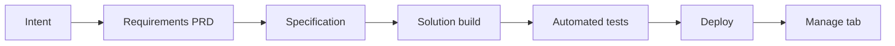

# Chapter 12: Intent-based agents in Joule Studio: ten business scenarios

*One build pattern, ten scenarios: finance close, balance confirmations, budget variance, collections, demand spikes, sales goals, HR and supplier risk.*

> [!NOTE]
> **📍 At a glance**
> - **You will learn:** the intent-based development pipeline, how to write an intent statement, what a generated PRD fixes (automation level, LLM limits, guardrails), and how ten SAP sample agents use it
> - **Level:** beginner · **Time:** about 45 minutes of reading
> - **Sources:** ten SAP Developer tutorials (Agent Lab), read 8 to 9 November 2026 (text and screenshots)
> - **Builds on:** [Chapter 10](10-pro-code-agents-a2a.md) (A2A and MCP) and [Chapter 11](11-joule-build-code-and-developers.md) (Joule Work)

**After this chapter you can:**

- List the phases from intent to deployed agent
- Write an intent statement that names purpose, data, decisions and guardrails
- Explain "hybrid automation" and the human approval gate
- Say which tasks the LLM does and which a rule engine does
- Pick the right scenario pattern for a new agent idea

> [!WARNING]
> **What this chapter is**
> - All ten tutorials run on a **pre-release Joule Studio** (Agent Lab); screens, names and behaviour may change
> - They are for **learning, not production**; the tutorials say deployment to production is not done from Joule Studio
> - The scenarios and figures are **illustrative** (fictional companies and sample data)
> - I ran nothing; the screenshot notes in 12.5 are from viewing the pictures, not from using the product

> [!CAUTION]
> **Write-backs**
> - Several agents write to S/4HANA or SuccessFactors. Every tutorial puts a human approval step before the write; keep that in any agent you copy

## 12.1 The pipeline every tutorial follows

*Sources: SJ060, SJ061, SJ062, SJ065, SJ066, SJ068 (the nine-step tutorials) and SJ063, SJ064, SJ067 (the shorter five- and seven-step versions).*

- **Intent:** a name and a plain-language statement in the Create Agent dialog
  - **Quick Create** adds "Fast Track": it skips clarifying questions
  - You are still asked to confirm **business goals** (a mandatory step)
  - Output: `intent.md`, a **fit-gap analysis** and an **intent fit** score
- **Requirements:** a Product Requirements Document (PRD) with purpose, business metrics, requirements, architecture and automation behaviour
- **Specification:** a generated file tree; nothing is built yet and you can review it
- **Solution:** type `execute specification/specification.md` or "Build the solution" (the older tutorials also accept "Implement the Solution")
  - Output: a Python agent plus generated **MCP servers**, one per SAP OData API
  - Low-code view shows the LLM, agent settings (circuit breaker, thread TTL, summarisation trigger) and MCP servers
  - An **Evaluation** area can generate test scenarios
- **Tests:** run on their own; if one fails Joule usually tries to fix it, or you chat with it
- **Deploy:** Deploy twice to confirm; the agent goes to the SAP managed service on BAIP
  - `deploy_result.json` in `specification/` records the endpoint, runtime ID and time
  - Deployed agents are found by Joule on their own, so users need not know they exist
  - The **Manage** tab shows runtime status, usage and audit logs
- **Optional:** GitHub sync under Actions

> [!TIP]
> **Intent fit score**
> - SJ060, SJ062, SJ065 and SJ066 say 90% or higher is a very high match; SJ068 says above about 80% is strong
> - If it is low, refine the intent statement and re-submit

## 12.2 Writing the intent statement

- The tutorials say a strong statement covers **four things:** what the agent does, what data it uses, what decisions it supports, and what rules it must follow
- Examples range from one sentence (SJ068, SJ067, SJ063) to a long paragraph (SJ060, SJ066)
- **Put the key differentiator in the statement:** SJ060 says naming "sequence" and "reasoning" is what makes Joule build a dependency engine and not a status dashboard
- **Put the guardrails in the intent:** SJ059 says "recommends only" and "single next action" belong in the intent so they are design limits, not afterthoughts
- Joule Work can **draft** the intent for you (SJ059):
  1. Turn 1: ask the real question; Joule Work admits it has no live data (this shows the gap)
  2. Turn 2: describe the agent, ask for a structured breakdown plus one paste-ready paragraph
  3. Check eight anchors: name, scope, priority logic, output format, anomaly handling, missing-data behaviour, execution boundary, response shape
  4. The reply wording changes each run; that is expected

## 12.3 The ten scenarios

| ID | Agent | Pattern | Writes to SAP? |
|---|---|---|---|
| SJ059 | Financial Close Recommendation Agent (intent only, in Joule Work) | Intent drafting | No (nothing is written) |
| SJ060 | Financial Closing Advisor | Dependency graph and recommendation | Yes, only after controller confirms a status update |
| SJ061 | Balance Confirmations | Classify, reconcile, draft letter | No (read-only); letters sent automatically only when figures match |
| SJ062 | Budgeting Agent for Cost Center Increases | Detect, propose, approve, write back | Yes, after approval |
| SJ063 | AR Collection Email | Draft emails from payment history | Not stated; clerk reviews drafts |
| SJ064 | Collections Workbench | CAP app + n8n workflow + agent | Not stated |
| SJ065 | Demand Spike Delivery Prioritization | Score and rank customers | Yes, delivery schedules after approval |
| SJ066 | Sales Goal Advisor | Conversation, then write goals | Yes, SuccessFactors goals after explicit confirmation |
| SJ067 | HR Virtual Assistant | Q&A and attrition insight on simulated data | No |
| SJ068 | Supplier Performance Assistant | Monitor, flag, suggest alternatives | No (read-only) |

## 12.4 What each scenario teaches

### Finance close: SJ059 and SJ060

- **Three task states:** actionable, blocked, at-risk
- **Two MCP servers:** a read/write Closing Cockpit server (writes only after confirmation) and a read-only financial data server for root-cause analysis
- **Engine vs LLM:** the LLM narrates but never decides task state
- **Four guardrails** include predecessor validation and stale-status protection
- **Needs:** a configured Financial Closing Cockpit task list in S/4HANA Cloud

### Balance confirmations: SJ061

- **Three request types:** verification, balance list, exception-only
- **Hybrid automation:** matching cases go out automatically; discrepancy or dispute cases go to a person
- **LLM** classifies and writes the letter; a **deterministic engine** reconciles
- **Guardrails:** read-only APIs, low-confidence goes to a human, API outage queues requests and notifies, letters pass template validation
- **Three MCP servers:** business partner, GL account line items, accounting documents
- Result in the tutorial text: 92% intent fit, 42 tests, 100% pass (the screenshot shows 135 tests, see 12.5)

### Budget variance: SJ062

- **Three events:** spot, sustained and cascade increase
- **Flow:** detect against thresholds, find affected cost centres, propose a revised plan, draft an approval email with a chart, write back after approval, log for audit
- **Autonomous:** detection; **human:** the write-back to S/4HANA

### Collections: SJ063 and SJ064

- **SJ063:** an email-drafting agent; the clerk reviews every draft; tone escalates from friendly to firm to legal by days overdue or prior reminders
- **SJ064:** one prompt builds three things: a workbench app (CAP), an automated reminder sequence (n8n workflow) and a drafting agent
- You can run the workflow from the UI with **Execute workflow**
- Joule maps the problem to SAP's reference business architecture and uses SAP Knowledge Graph, LeanIX and domain models
- Both are test-only in the lab and were **not deployed** in the tutorials

### Demand spikes: SJ065

- Scores customers on open order volume, year-to-date revenue and credit rating
- Produces a prioritised delivery batch plan for a reviewer
- Approval needed to change delivery schedules **or** to override scoring weights

### Sales goals: SJ066

- **Three goal types:** pipeline, activity, growth
- Reads CRM territory data and the SuccessFactors profile and goals, then guides a conversation
- Two MCP servers on SuccessFactors Goal Plan and Employee Profile APIs
- **Needs:** a CRM with territory data via API and a SuccessFactors API user

### HR assistant: SJ067

- Answers HR questions, analyses workforce data and predicts attrition on **simulated** HCM data
- Test prompt: "Show me the profile for employee E0001"
- Deployed agents can be tried through **A2A** with "Try now"

### Supplier risk: SJ068

- **Three signals:** delivery, quality, price or contract drift
- **Three data sources:** supplier evaluation scorecard, operational score and purchase order APIs
- **Guardrails:** read-only, approved suppliers only, partial data is flagged, prompt-injection is blocked
- The manager decides; the agent advises
- SAP Ariba is explicitly **out of scope**
- Troubleshooting tips: scorecard tests need evaluation templates and scoring periods; threshold mismatch between PRD and tests needs reconciling

## 12.5 What the screenshots add

*Viewed on 9 November 2026: SJ059 (4 images), SJ060 (19), SJ061 (18), SJ062 (23), SJ063 (16), SJ064 (11), SJ065 (20), SJ066 (23), SJ067 (32), SJ068 (16). Some are placeholder graphics.*

- **The create screen differs by lab version:**
  - Three tiles in some tutorials: Agent, Data Product, Extension (SJ060, SJ061, SJ062, SJ066)
  - Four tiles in others: Agent, **n8n Workflow**, Data Product or **Application**, Extension (SJ063, SJ064, SJ065, SJ067, SJ068)
  - The create dialog has Solution, Name, Intent Statement and a **Quick Create** checkbox
- **Joule Studio layout:** Develop and Manage tabs, Deploy and Actions buttons, a Solution Progress list (Intent Summary, Requirements, Specifications, Solution Artifacts, Testing, Preview) and a File tree
  - The newest screens show a bar: Intent → Requirement → Specification → Solution → Testing → Deployment, with View, Design and Code switches
- **Business goals screen (SJ060):** Joule proposes a metrics table and you pick Confirm, Edit, Add or Remove, then Submit Answer
  - Proposed values: time-to-close down 20%, 90% of tasks in the correct sequence, escalation handling time down 50%, blocked-task resolution within 15 minutes
  - SJ062 asked for two measurable goals, for example "from 5 days to same-day"
- **Test overviews do not always match the text:**

| Tutorial | Text says | Screenshot shows |
|---|---|---|
| SJ060 | verify all tests pass | 168 tests, 158 passed, 10 failed (94.05%); one test group shows a very low percentage I could not read |
| SJ061 | 42-test suite | 135 tests, 135 passed |
| SJ062 | all pass | 33 of 33 |
| SJ065 | all pass | 157 of 157 |
| SJ066 | all pass | 148 of 148 |
| SJ067 | all pass | 58 of 58 |
| SJ068 | all pass | 113 of 113; coverage threshold 70%, overall 76% |

- **Generated names differ from the typed name:** SJ066's intent page is titled "Sales Goal Coach Agent" and the artifact is `sales-goal-coach-agent`; SJ062's is "Cost Increase Detection & Budget Adjustment Agent"; SJ068's agent is `supplier-performance-monitor-agent`
- **SJ060 build summary:** 49 specification items, a LangGraph agent, three runtime skills (task analysis, blocker diagnosis with four blocker types, escalation management), two SAP API-based MCP servers plus a mock-data server
- **SJ061 architecture:** agent, S/4HANA MCP tools, a letter-generation skill and an OpenTelemetry audit logger
- **SJ064 solution view:** a CAP app with Aging Dashboard and Reminder Activity tabs, an n8n workflow canvas ("Payment Reminder Sequence") with an **Execute workflow** button, and an agent chat; Joule also asked clarifying questions about the landscape even without a Quick Create tick
- **SJ067 deployment:** a Deployment tab with Current Deployment, Deployment History and a **Try now** button; the deployed agent shows suggested prompts. Both tabs of the text were read: "Ideate and Plan" means deselect Quick Create, answer clarifying questions, then type `Create requirements`, `Create specification` and `Build solution for this project`
- **SJ063 "Ideate and Plan":** uncheck Quick Create and answer the clarifying questions in the table (users, pain points, data, escalation, landscape, success)
- **SJ059 in Joule Work:** the progress list shows Joule handing the request to a "Financial Closing Assistant", although the reply says it cannot see live data
- **Not readable:** a yellow notice in the SJ065 deploy dialog, small percentages on some test screens, and the intent fit numbers on small thumbnails

## 12.6 Added by Claude, not from the sources

*My own reasoning; the sources do not say it.*

- **The pattern repeats:** read data, apply rules, let the LLM explain, ask a human before any write. Reuse that skeleton
- **Judge a PRD by its "automation" section first;** it shows where the agent can do harm
- **Sample data hides real data problems:** the tutorials need configured cockpits, scorecards or CRM data in a real tenant
- **Fit scores differ by run:** treat 80 to 90% as a prompt to read the gaps, not as proof

## 12.7 Interview corner

**What interviewers listen for:** you can describe the pipeline, name the guardrails and say where a human stays in the loop.

🟢 What are the phases of intent-based development in Joule Studio?

- Intent, requirements (PRD), specification, solution build, tests, deploy

🟡 What does "hybrid automation" mean in these PRDs?

- Safe reads and analysis run alone; writes to business systems or edge cases need human approval

🟡 Why is the LLM kept away from some decisions?

- Rules are repeatable and auditable: a dependency engine decides task state, a reconciliation engine decides matches; the LLM classifies text, narrates and drafts

🔴 Your intent fit score is 70%. What do you do?

- Read the fit-gap analysis, check the statement names purpose, data, decisions and guardrails, refine and re-submit

🔴 A supplier-risk agent must never touch SAP data. How do you enforce it?

- State read-only in the intent, check the PRD guardrails, and confirm the generated MCP servers and tests only read

**🧩 Design question:** design an agent for purchase-order approvals. Name the data, the rule engine, what the LLM does, the human gate and three guardrails.

## 12.8 Discovery Center missions (links, not read)

- [Build custom Joule skills for SAP and non-SAP systems](https://discovery-center.cloud.sap/missiondetail/4643/)

## 12.9 Cheat sheet

| Topic | Remember |
|---|---|
| Quick Create | Fast Track; goals still confirmed |
| Build command | `execute specification/specification.md` or "Build the solution" |
| Fit score | About 80 to 90% or more is the tutorials' bar |
| Hybrid automation | Read alone, write with approval |
| MCP servers | One per OData API |
| Deploy | Twice to confirm; Manage tab for logs |
| Production | Not deployed from Joule Studio |

## Recap

- One pipeline, ten scenarios
- The intent statement carries purpose, data, decisions and rules
- PRDs fix automation level, LLM limits and guardrails
- Human approval comes before every write
- The lab is pre-release: expect change

## Practice

1. Draw the six phases from memory.
2. Rewrite one tutorial's intent in four short bullets (does, data, decides, rules).
3. For SJ061, list what is automatic and what goes to a person.
4. Write the guardrails for an agent of your own.

## How this chapter was checked

- **Read fully (text and screenshots):** SJ059 to SJ068
- **Not read:**
  - small text inside some screenshots (see 12.5)
  - the "Related learning" lists and linked tutorials, videos, and Discovery Center missions
- **Not run:** nothing was built or deployed
- **Dated points:** pre-release Agent Lab content (tutorial dates October 2026)
- **Small inconsistencies noted:** SJ061 mentions a "Batch Stock MCP server" and a "cutting stock algorithm" that do not fit a balance-confirmation agent (looks like leftover text from another tutorial; not used here); SJ066 says the generated code includes an "anomaly detection engine" and "chart generation", also leftover from the budget tutorial; SJ062 mentions "Selina" with no introduction

## Sources and further reading

- SAP Developer, *Draft a Financial Close Recommendation Agent Intent with Joule Work* (read): https://developers.sap.com/tutorials/get-productive-with-joule-work-for-financial-closing-advisor
- SAP Developer, *Guide Financial Closing Activities with an Intelligent Closing Advisor Agent* (read): https://developers.sap.com/tutorials/financial-closing-advisor-agent
- SAP Developer, *Automate Balance Confirmation Workflows in Financial Accounting with a Custom Joule Agent* (read): https://developers.sap.com/tutorials/balance-confirmation-agent
- SAP Developer, *Automate Budget Variance Management for Cost Centers with a Custom Joule Agent* (read): https://developers.sap.com/tutorials/budget-variance-agent
- SAP Developer, *Use Joule Studio to Create an FI Collection Email Drafting Assistant* (read): https://developers.sap.com/tutorials/joule-studio-fi-collection-assistant
- SAP Developer, *Use Joule Studio to Create an FI Collection Workbench* (read): https://developers.sap.com/tutorials/joule-studio-fi-collection-workbench
- SAP Developer, *Build an Agent to Handle Demand Spikes* (read): https://developers.sap.com/tutorials/build-a-demand-spike-agent
- SAP Developer, *Build a Sales Goal Advisor Agent with Joule Studio, CRM, and SAP SuccessFactors* (read): https://developers.sap.com/tutorials/build-a-sales-goal-advisor-agent
- SAP Developer, *Use Joule Studio to Create an HR Onboarding Assistant* (read): https://developers.sap.com/tutorials/joule-studio-hr-onboarding-assistant
- SAP Developer, *Build a Supplier Performance Assistant Agent with Joule Studio and SAP S/4HANA Cloud* (read): https://developers.sap.com/tutorials/build-a-supplier-performance-assistant-agent
- Discovery Center missions: see 12.8

---

*Previous: [Chapter 11: Joule in SAP Build Code, for ABAP developers, and in Joule Work](11-joule-build-code-and-developers.md)*
