# Chapter 14: Troubleshooting Joule: setup problems in SuccessFactors and S/4HANA, and MCP destinations

*A symptom-to-fix guide built from two SAP blog posts, one Q&A thread and one hub page; the support KBAs behind it were behind a login.*

> [!NOTE]
> **📍 At a glance**
> - **You will learn:** the common reasons Joule fails after setup (trust, destinations, IP limits, roles, cookies) and what to check first
> - **Level:** intermediate · **Time:** about 35 minutes of reading
> - **Sources:** SJ090 (Q&A thread), SJ096 (SuccessFactors issues blog, 19 issues), SJ101 (S/4HANA Public Cloud issues blog), SJ105 (S/4HANA Private Edition hub page); read 9 November 2026 (text and screenshots)
> - **Builds on:** [Chapter 5](05-setting-up-joule-by-product.md) (setting up Joule by product) and [Chapter 10](10-pro-code-agents-a2a.md) (MCP)

**After this chapter you can:**

- Work through a "Joule does not work" report in a sensible order
- Fix the two most common SuccessFactors causes (trusted domains, IP restrictions)
- Explain why entitlements, CSP settings and destination names matter
- Recognise the MCP destination error and what the one known answer says

> [!WARNING]
> **Read before you change settings**
> - Each fix changes identity, trust or IP settings; try it in a test system first
> - Adding IP restrictions "for BTP only" can lock out other logins (the SuccessFactors post warns about this)
> - The posts are dated; menus move. I ran none of these steps

> [!CAUTION]
> **Credentials**
> - Screenshots in these posts show destinations and service keys; keep real client secrets and passwords out of notes, tickets and chats

## 14.1 Where to start

*Sources: SJ096, SJ101, SJ105.*

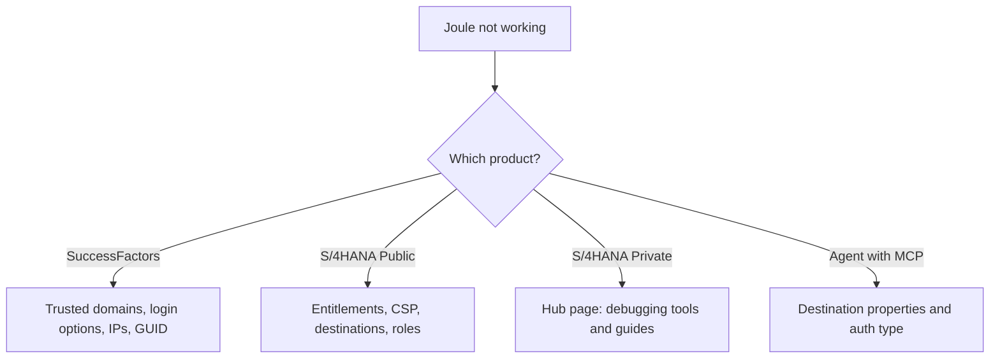

- **First questions:** all users or one? Normal and incognito window? Which error text?
- **Always check:** trust between the BTP subaccount and Cloud Identity Services (CIS), destinations, Work Zone content channel sync, roles

## 14.2 SuccessFactors (SJ096): 19 issues in short

*Source: SJ096, a SAP blog by an SAP author team. All screenshots (39) were viewed.*

| # | Symptom | Cause | Fix |
|---|---|---|---|
| 1 | Joule does not work | Trusted domains missing | Re-do trusted domains in Authorization and Trust Management and in CIS |
| 2 | Choice of Default Login and IAS Login | Default identity provider is also available for logon | In the subaccount Trust Configuration, untick "Available for User Logon" on the default provider; clear cookies |
| 3 | Blank screen (Azure AD or Okta in front of CIS) | CIS is a proxy | Turn off "forward all SSO requests"; set the corporate provider as default in conditional authentication |
| 4 | `LPS_SFSF_dt` check fails with 401 or the channel cannot be created | Wrong URL, user, password or IP rule | Check the URL ending, IP restrictions (use the NAT IPs of your region), reset password; use a technical user whose password never expires |
| 5 | Chat history seen in a colleague's system | Dummy email shared by all users in Dev or Preview | Use real emails, or switch CIS subject name identifier to login name |
| 6 | Navigation button missing | `NavigationService` token type, or channel role not refreshed | Make the token service URL type "Dedicated"; refresh the content channel; role count should read 19/19; wait about 30 minutes |
| 7 | Channel manager launch error | User sync not finished | Add the user to the admin role; run "Refresh Synthetic Group Data" |
| 8 | No Work Zone target in provisioning | Identity Provisioning on Neo | Migrate to multi-cloud (about 1 hour to 1 day) |
| 9 | SCIM versus OData in the source system | Groups need SCIM 2.0 | Copy the source system and change values, or use the supplied JSON files |
| 10 | Quick setup | Use the two supplied files (rename `.txt` to `.json`) | Import source and target, map the X.509 certificate in SuccessFactors |
| 11, 14 | Fails in private or incognito mode | Third-party cookies blocked | Allow them (a SAP Note is cited) |
| 12 | Which groups exist? | Jobs may not have run | Check roles for the user in Work Zone settings |
| 13 | Booster fails to validate the URL | New Common Super Domain | Use the migration guide's admin URL |
| 15 | Booster fails | Trust to CIS not established | Set trust before running the booster |
| 16 | "Oops, something went wrong" | GUID mismatch, IP restrictions, or user API login exceptions | See 14.3 |
| 17 | Phone number behaviour | n/a | A KBA is cited |
| 18 | Processing error, WebSocket error | Network blocks the WebSocket | Ask IT to allow it |
| 19 | Use cases fail after a monthly release | n/a | A SAP Note is cited |

### 14.3 The "Oops, something went wrong" decision path

- **Case 0:** GUID mismatch; see the KBA the post cites
- **Case 1:** the system has IP Restriction Management entries; add the BTP NAT IPs for your region (one at a time)
  - If the page is empty, **do not** add any
- **Case 2:** a user has an IP listed under "Set API login exceptions"; append the NAT IPs for that user
- **Find your NAT IPs:** the Cloud Foundry API endpoint (for example `us10`) → regions list → "NAT IPs (egress)"

## 14.4 S/4HANA Cloud Public Edition (SJ101): six issues

*Source: SJ101 (SAP blog; its intro mistakenly says SuccessFactors). 11 images viewed.*

| Symptom | Cause or check | Fix |
|---|---|---|
| Booster: "entitlements not available in the selected subaccount" | Joule or Work Zone standard edition not entitled | Add both in the global account's entity assignments; buy Joule if missing |
| Booster: sync with CIS failed | n/a | A KBA is cited |
| Booster: "No Registered Systems of type S/4HANA" | S/4HANA not registered in the global account | Redo the registration step |
| Joule icon missing | Content Security Policy, cache, domain or CIS settings | Add the Joule URL to trusted content; test in incognito; match the CIS domain (`ondemand.com` or `cloud.sap`) between BTP trust and S/4HANA login; same conditional authentication for both apps |
| Some prompts do not work | CDM content not synced, or missing roles | Use "Report" in Channel Manager; check groups and roles; recheck user provisioning and CSP |
| "Not authorised" | Name mismatch | The CN in destination `S4HANA_PUB_SSO` must match the S/4HANA communication system's signing-certificate issuer |

- If none fits, open an incident under component CA-JOULE

## 14.5 MCP destination error (SJ090)

*Source: SJ090, a community Q&A thread (January 2026). No images.*

- **Question:** an agent in Joule Studio (classic) cannot add an OData MCP server; "Unable to find MCP server tools for destination" appears, with a bad-credentials message
  - The team had built the MCP server, deployed it on BTP, and created a destination; they tried OAuth2Password, OAuth2ClientCredentials and OAuth2JWTBearer
- **Only answer:** add the custom destination property `sap-joule-studio-mcp-server` with value `true`
- **Status:** the asker said it was already set; a later reader (September 2026) asked if it was ever solved
  - So the thread **does not confirm a fix**; treat the property as a first check, not the cure

## 14.6 The Private Edition hub (SJ105)

*Source: SJ105, a SAP Community topic page. One decorative photo viewed.*

- Lists learning videos and blogs on: getting started, architecture and troubleshooting, missing business roles, inactive ICF and OData services
- Troubleshooting blogs cover wrong BTP destinations, failed user provisioning and principal propagation errors
- **Tools named:** Joule Debugging Tool, App Inspector, SAP Gateway error logs and traces, Internet Communication Manager monitor
- It also lists a "Work Zone and Joule health checks" blog and a four-part administrator troubleshooting series (titles only; not opened)

## 14.7 Support articles I could not read (SJ091 to SJ095)

- SJ091 (skill works in test, fails from an agent: destination not found), SJ092, SJ093, SJ094 ("Oops", partly covered by 14.3 Case 0) and SJ095 are SAP KBAs
- Without a login only the symptom paragraph shows; causes and fixes are not visible to me, so they are **not** in this chapter

## 14.8 Added by Claude, not from the sources

- **Order of checks:** (1) one user or all, (2) trust and domains, (3) destinations and their properties, (4) roles and sync jobs, (5) browser and network
- **Write the error text exactly** before searching; many of the above are matched by their wording

## 14.9 Interview corner

**What interviewers listen for:** a calm order of checks, not a guess.

🟢 Joule shows both Default Login and IAS Login. Why?

- The default identity provider is still available for user logon; untick it in the subaccount trust configuration

🟡 The Joule icon is missing in S/4HANA Public Cloud. What do you check?

- Content Security Policy trusted content, an incognito test, matching CIS domains, and the same conditional authentication on both apps

🟡 Why is "Oops, something went wrong" tricky in SuccessFactors?

- It can be a GUID mismatch, system IP restrictions or per-user API login exceptions; add NAT IPs only where restrictions already exist

🔴 An MCP server destination fails even with the Joule Studio property set. Next steps?

- Check the authentication type and token flow, test the destination on its own, confirm the MCP server is reachable and returns its tools, and look for platform logs; the thread offers no confirmed fix

🔴 Joule works for you but not for all employees. What do you suspect?

- A network rule blocking the WebSocket or the app; compare an external network and inspect the browser's network tab

**🧩 Design question:** write a one-page runbook for a help desk that gets "Joule is broken" tickets: questions to ask, the first three checks and when to escalate to CA-JOULE.

## 14.10 Discovery Center missions (links, not read)

- [Build custom Joule skills for SAP and non-SAP systems](https://discovery-center.cloud.sap/missiondetail/4643/)

## 14.11 Cheat sheet

| Topic | Remember |
|---|---|
| Joule dead for everyone | Trusted domains and trust to CIS first |
| Two login options | Untick "Available for User Logon" on the default provider |
| Blank screen with Azure AD or Okta | CIS proxy settings |
| 401 on `LPS_SFSF_dt` | URL, user, IP restrictions |
| "Oops" | GUID, IP restriction, API login exceptions |
| Icon missing (S/4) | CSP, domain, conditional authentication |
| MCP destination | Property `sap-joule-studio-mcp-server=true` (not confirmed as the fix) |

## Screenshots and figures from the sources

*Images saved from the source pages, in the order they appear there.*

### Images: Common configuration issues: S/4HANA Public Edition

*Source: [Common configuration issues: S/4HANA Public Edition](https://community.sap.com/t5/technology-blog-posts-by-sap/common-configuration-issues-joule-for-sap-s-4hana-cloud-public-edition/ba-p/14272269)*

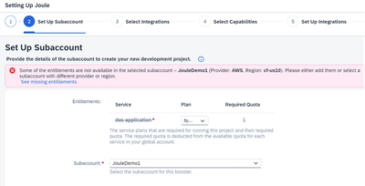

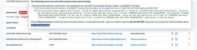

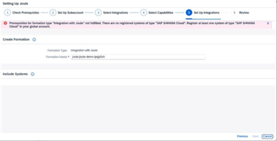

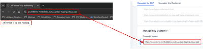

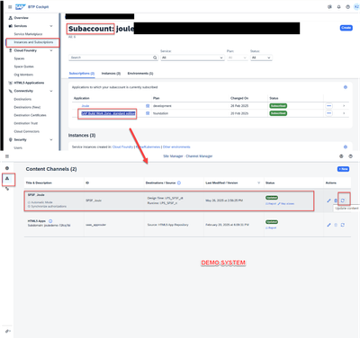

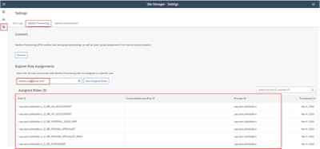

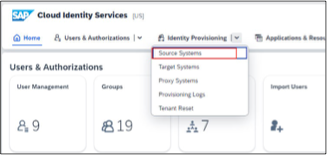

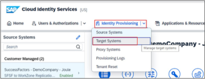

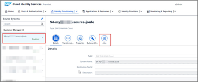

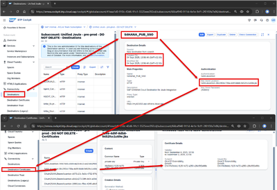

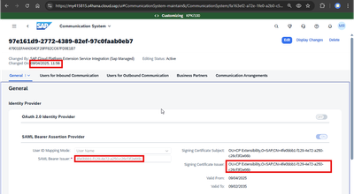

### Images: Joule with SuccessFactors: common setup issues

*Source: [Joule with SuccessFactors: common setup issues](https://community.sap.com/t5/technology-blog-posts-by-sap/joule-with-sfsf-common-setup-issues/ba-p/13650311)*

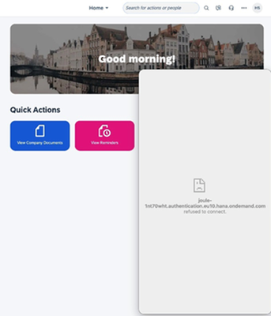

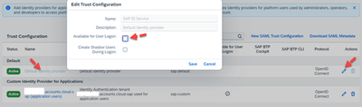

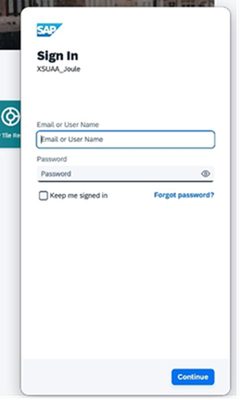

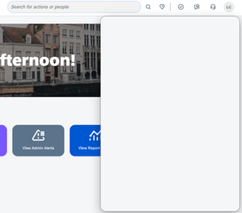

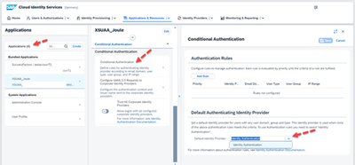

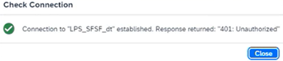

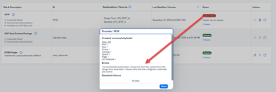

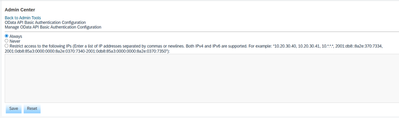

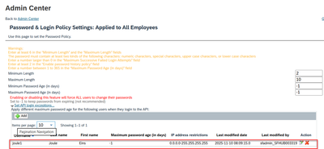

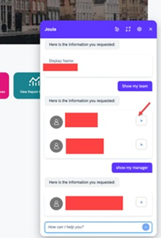

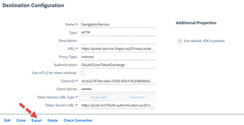

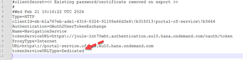

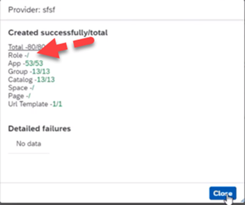

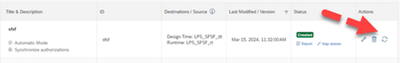

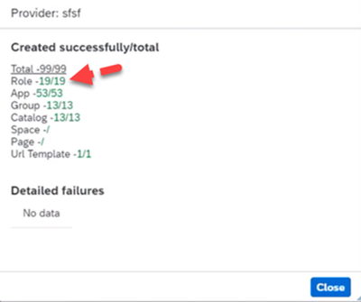

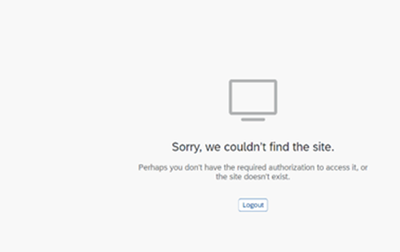

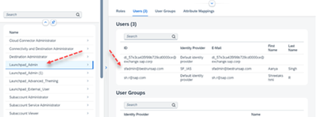

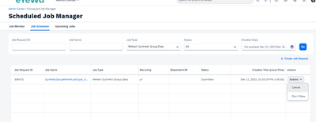

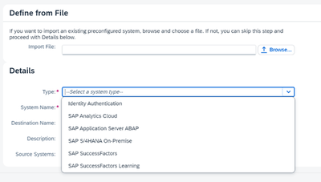

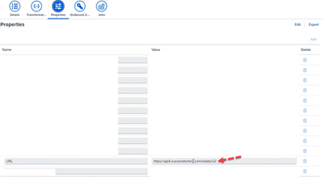

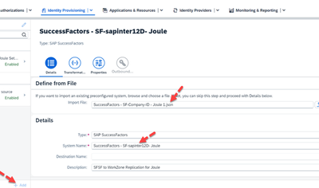

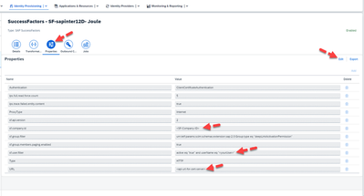

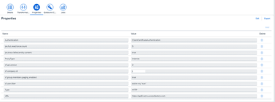

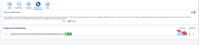

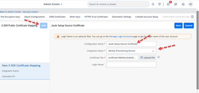

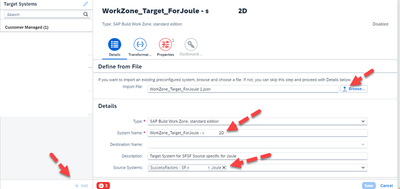

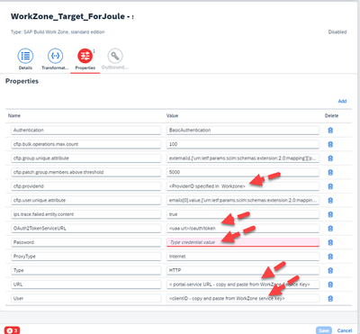

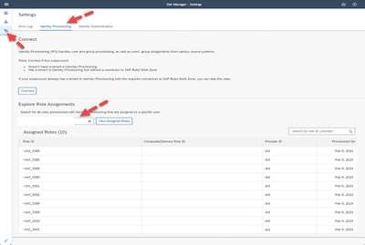

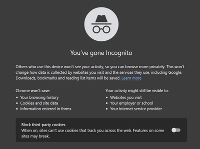

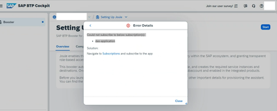

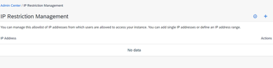

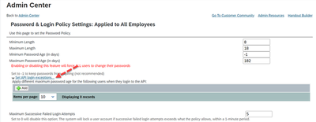

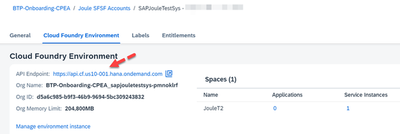

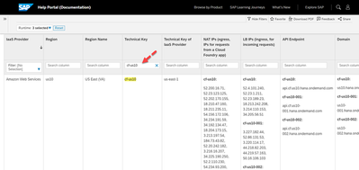

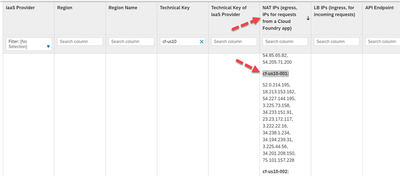

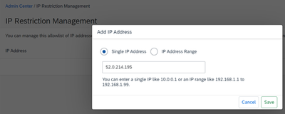

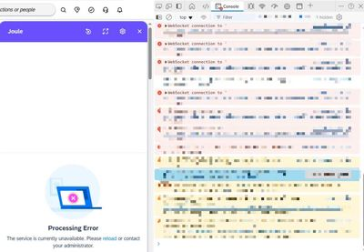

### Images: Joule for S/4HANA Cloud Private Edition (topic page)

*Source: [Joule for S/4HANA Cloud Private Edition (topic page)](https://pages.community.sap.com/topics/joule/joule-for-sap-s-4hana-cloud-private-edition)*

## Recap

- Check trust, destinations, roles and sync before blaming Joule
- IP restrictions are fixed only where they already exist
- Entitlements and CSP cause most S/4HANA setup trouble
- Some answers sit behind support logins

## Practice

1. Order the checks for "Joule works for me but not my colleague".
2. Explain why the dummy-email problem shows other people's chat history.
3. List what you would capture before raising a CA-JOULE incident.

## How this chapter was checked

- **Read fully (text and screenshots):** SJ090, SJ096, SJ101, SJ105
- **Not read:**
  - SJ091 to SJ095 (login-protected KBAs)
  - the two attached `.txt` files in SJ096 and the linked SAP Notes, KBAs and help pages
  - the other blogs and videos listed on the SJ105 hub
- **Not run:** none of the fixes was tried
- **Dated points:** SuccessFactors post from 2024 era; SJ101 and SJ090 from 2026

## Sources and further reading

- SAP Community, *SAP Joule Agent with SAP oData MCP Issue* (read): https://community.sap.com/t5/technology-q-a/sap-joule-agent-with-sap-odata-mcp-issue/qaq-p/14304268
- SAP Community, *Joule with SFSF: Common Setup Issues* (read): https://community.sap.com/t5/technology-blog-posts-by-sap/joule-with-sfsf-common-setup-issues/ba-p/13650311
- SAP Community, *Common configuration issues: Joule for SAP S/4HANA Cloud Public Edition* (read): https://community.sap.com/t5/technology-blog-posts-by-sap/common-configuration-issues-joule-for-sap-s-4hana-cloud-public-edition/ba-p/14272269
- SAP Community, *Joule for SAP S/4HANA Cloud Private Edition* topic page (read): https://pages.community.sap.com/topics/joule/joule-for-sap-s-4hana-cloud-private-edition
- SAP KBAs 3775459, 3707705, 3735129, 3488269, 3767485 (not read; login needed)
- Discovery Center missions: see 14.10

---

*Previous: [Chapter 13: More Joule Studio scenarios](13-more-agent-scenarios-extensions-n8n.md)*

