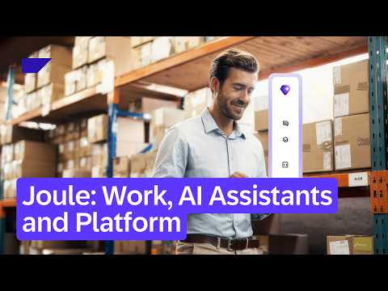
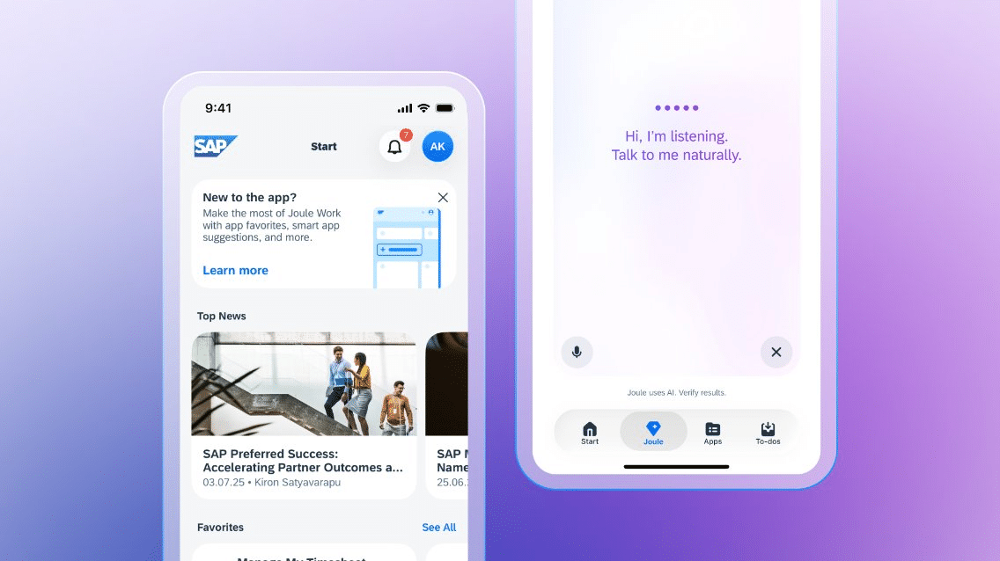
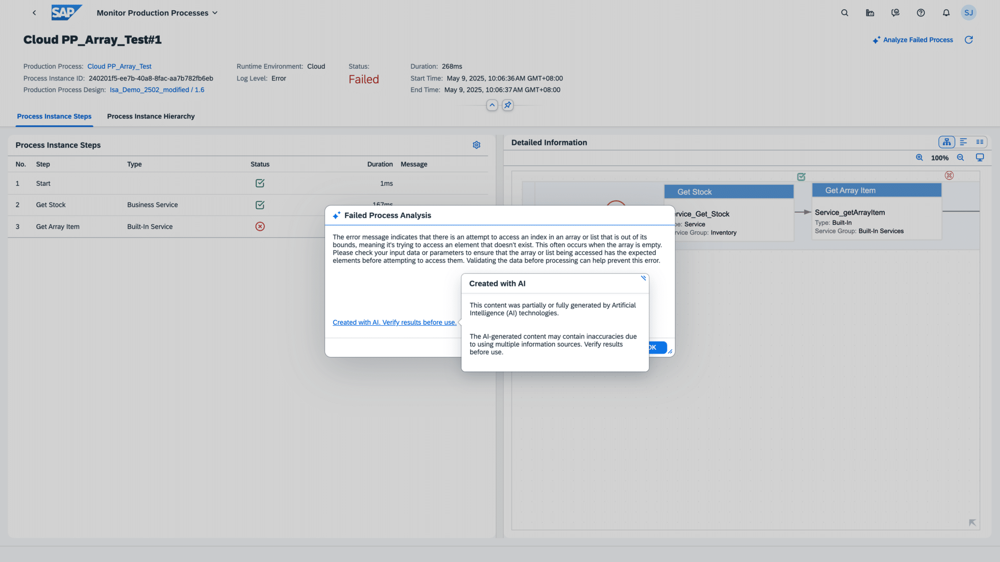
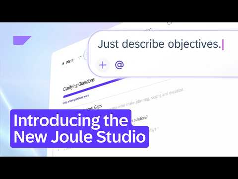
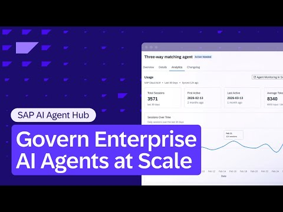
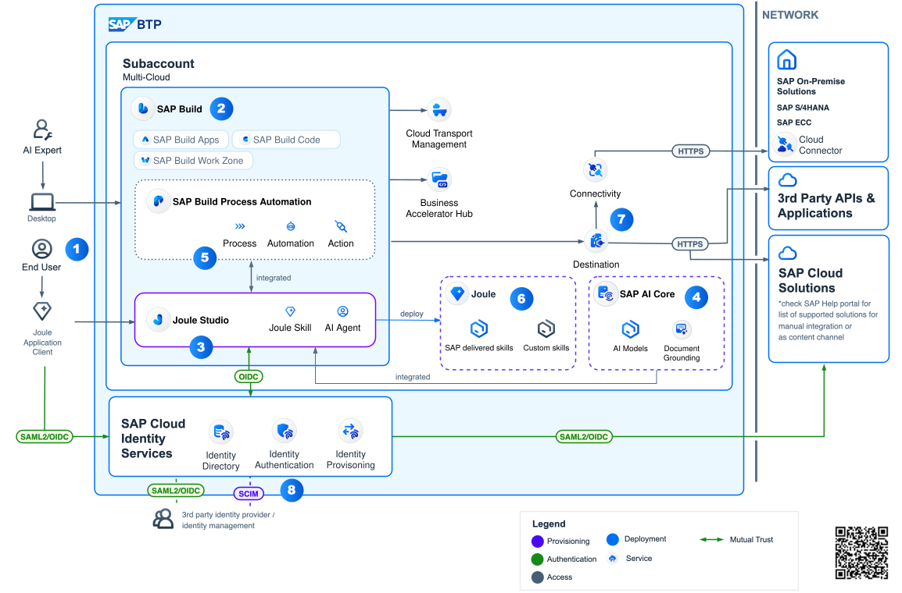
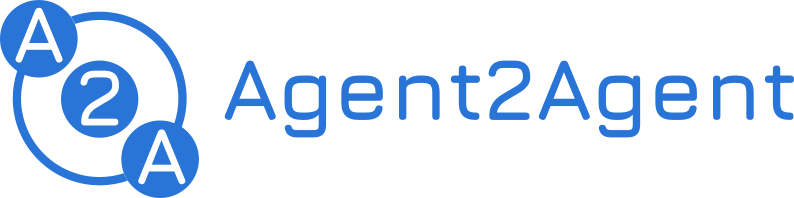
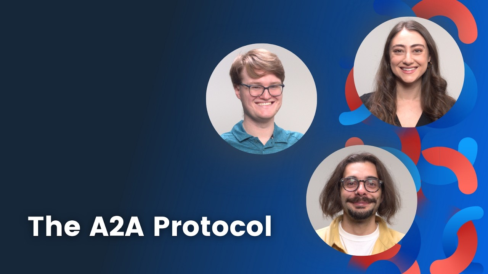

# Chapter 15: Keeping current: Q2 2026 release news, pricing and the golden path

*What SAP shipped in Q2 2026, how SAP AI is priced, and SAP's own dos and don'ts for Joule skills.*

> [!NOTE]
> **📍 At a glance**
> - **You will learn:** what is new in Joule and the Business AI Platform (Q2 2026), the three pricing tiers and AI Unit rates, and the golden-path rules for building Joule skills
> - **Level:** beginner to intermediate · **Time:** about 25 minutes of reading
> - **Sources:** SJ106 (SAP News, release highlights Q2 2026), SJ114 (SAP AI pricing page), SJ110 (Architecture Center golden path: Joule Skills), SJ117, SJ118, SJ121 (reference and hub sites); read 9 November 2026 (text and images)
> - **Builds on:** [Chapter 13](13-more-agent-scenarios-extensions-n8n.md) and [Chapter 6](06-first-joule-skill.md)

**After this chapter you can:**
- name the main Joule and Business AI Platform items released April to June 2026
- explain Base AI, Premium AI and Custom-built AI, and what is free
- work out the AI Unit cost of an agent action and of Joule for Consultants
- apply the golden-path dos and don'ts when building a skill

---

## 15.1 Q2 2026 release highlights (SJ106)

*Source: SJ106. Covers AI offerings released 1 April to 30 June 2026.*

### The vision in one paragraph
- Theme from Sapphire: the **Autonomous Enterprise**, where AI agents run critical workflows and people oversee them
- Four pillars named: reimagined **Joule Work**, the **SAP Autonomous Suite**, the **SAP Business AI Platform**, and **Industry AI**

### Customer results quoted
- Bosch Digital: 20% productivity gain with Joule for Developers; unit-test generation 15 to 20% faster
- Aeropuertos Argentina: its SNOW winter-operations agent cut direct costs 16% and admin effort 90%
- PwC: a tax tool built on AI Foundation handled VAT on international transfers 60% more efficiently for one pharma client
- LC Waikiki: an HR agent built on Joule cut HR cycle times 40 to 60%
- These are SAP's estimates; the article itself carries a disclaimer that benefits may vary

### Joule
- **Joule Work:** the user-facing workspace; users state intent, **Joule Assistants** (smart teammates organised by function) coordinate **Joule Agents**. Early Adopter Care; registrations closed
- **Joule Work mobile app:** generally available; on iPhone and iPad you can say "Hey Siri, ask Joule in Joule Work"
- **Voice for Joule:** new partnership with LiveKit for real-time voice; Early Adopter Care
- **Multi-system support:** several S/4HANA Cloud Private Edition systems or clients, and several Public Edition systems, in one Joule formation
  - Admin steps: destinations with naming conventions, add systems via System Landscape, map system identifiers in the Joule Admin Center

### Business AI Platform: Build
- **New Joule Studio** (Early Adopter Care): starts from business intent, uses your own process and data context, can generate requirements and technical specs, and applies eval-based guardrails to AI coding assistants
  - A migration path from the original Joule Studio is promised
- **S/4HANA custom code migration agent** (GA, in Joule for Developers, ABAP AI)
  - Runs readiness checks with ABAP test cockpit across custom code packages
  - High-confidence fixes applied automatically; lower-confidence ones added as comments for review
  - Every change recorded in transport requests

### Business AI Platform: Contextualize and Reason
- **Generative AI hub (SAP AI Core):**
  - Batch API for high-volume, non-urgent model workloads; results go to an object store
  - Inference observability service: logs prompts and responses, lets users rate answers, exports datasets
  - Speech-to-speech support
  - New models listed: Gemini 3.1 Flash Lite, Claude Opus 4.7, GPT Realtime, Mistral Small, GPT 5.4, GPT 5.4-nano, GPT 5.3-Codex
- **Joule for Consultants:** custom knowledge grounding (indexes your methods and templates via AI Core) and an expert workspace that keeps project context
- **Document AI:** choice of LLM, three new standard document types, configurable low/medium/high confidence ranges shown as red, orange, green
- **SAP Domain Models:** trained on SAP code, data, metadata and processes; run under the hood of Joule and Joule Studio and are not exposed directly

### Business AI Platform: Govern
- **AI Agent Hub:** one control pane for agents, LLMs and MCP servers; discovery now includes ServiceNow and SAP AI Core besides Microsoft, Google and AWS
  - Planned next: runtime observability, identity and access control, agent-in-process mining, workforce impact mapping
- **Process Consulting Agent** and **Enterprise Content Research Agent** (LeanIX): GA

### By business area (selected)
- **Autonomous Finance:** Project Billing Price Verification Agent (beta); localized business data management in S/4HANA Public Edition (GA)
- **Autonomous Spend:** Expense Automation Agent (GA, first draft of trip expenses); Ariba contract creation from prompts; Concur policy rule generator (early adopter)
- **Autonomous CX:** Order Reliability Agent (beta); Joule with Order Management Services (beta); Revenue Growth Management promotion and deal-sheet generation
- **Autonomous SCM:** Digital Manufacturing production-engineering and description-enhancement features (GA)
- **Also:** WalkMe AI features, LeanIX AI-assisted decisions, calculations and automations, Cloud ALM document summary, Signavio context analyzer

> [!TIP]
> Release status labels matter: **GA**, **Beta release**, **Early Adopter Care**. Check the label before promising a feature to a customer.

## 15.2 How SAP AI is priced (SJ114)

*Source: SJ114, the SAP AI pricing page.*

### Three tiers
- **Base AI:** included with every SAP cloud subscription, no AI Units
  - Joule Work, base: natural-language questions, navigation, guidance, everyday actions
  - Embedded AI inside SAP applications (availability varies by solution)
- **Premium AI:** paid with **AI Units**
  - Joule Work, Agentic Thinking: priced per action, two thinking modes
  - Joule Agents: **standard** and **advanced** types, priced per action
  - AI Features: priced per request or per record processed
  - Joule for Consultants: per user per month
- **Custom-built AI:** free to design, paid at runtime
  - Joule Studio authoring is free (AI-assisted development within fair-use limits)
  - Production runtime billed on compute, storage, agent memory, workflow execution and AI tokens, via BTPEA, CPEA or pay-as-you-go

### AI Units
- One shared virtual currency for all Premium AI; bought annually (SKU 8019164)
- Consumed only when Premium AI does work (agent steps, orchestration, indexing)
- Unused units expire after 12 months; Base AI uses none
- Activation and near-real-time balance tracking are in SAP for Me
- If you exceed your purchase, use continues and the excess is charged at the contract rate

### Rates to remember

| Item | Rate |
|---|---|
| Standard agent | 0.02 AI Units per action |
| Advanced agent | 0.05 AI Units per action |
| Joule for Consultants | 35 AI Units per user per month |
| Consultants pooled allowance | 22,900 requests per user per month, pooled across users |
| Consultants overage | 2 AI Units per 1,000 requests |

- An **agent action** is one step, such as calling a service, triggering a workflow or generating a response
- A task can need many actions; an idle agent costs nothing
- **Joule Assistants have no separate price**; you pay for the agents they run
- Extending an agent with text instructions adds no charge; it keeps the same per-action rate
- **Joule Studio access:** needs Joule deployed (AI Unit entitlement or the zero-cost Joule Base SKU) plus BTPEA, CPEA or pay-as-you-go

> [!WARNING]
> Worked example (my arithmetic from the rates above): a task of 40 steps on a standard agent uses 40 × 0.02 = 0.8 AI Units; the same task on an advanced agent uses 2.0. Check the SAP AI Features Guide for the current price list before quoting.

## 15.3 Golden path: Joule skills (SJ110)

*Source: SJ110, Architecture Center page "Joule Skills with Joule Studio on SAP Business AI Platform" (updated 26 October 2026).*

### What it covers
- Building custom Joule scenarios (skills) in Joule Studio, deploying them, and connecting S/4HANA, SuccessFactors, Ariba and third-party systems through OData

### Prerequisites
- Enterprise account (CPEA, BTPEA or subscription) with SAP Build entitlement
- SAP Build developer licence for building, testing, deploying
- Joule entitlement to deploy to production
- Role assignments for Joule Studio, and destinations in the cockpit

### Build workflow
- Create a Joule scenario project from the SAP Build lobby
- Design the skill: inputs and outputs, actions (API calls), conditions, response templates
- Wrap OData APIs in **action projects** and configure destinations
- Map data with the skill editor and formula editor
- Test in the standalone Joule assistant first

### Two deployment targets
- **Standalone (testing):** isolated, quick iteration, not connected to production Joule
- **Shared (production):** unified Joule across line-of-business products; skills appear beside SAP-delivered ones
- On-premise S/4HANA needs Cloud Connector

### Dos and don'ts
- Do reuse existing SAP Build automations; don't rebuild them
- Do handle errors with friendly messages; don't expose technical errors
- Do test in standalone first; don't deploy straight to production

### Four rules worth remembering
- **Confirmation steps:** for create, update and delete, always show what will change and get approval (an AI-ethics prerequisite)
- **Message generation:** use Joule's generated responses instead of fixed templates
- **Scenario dependencies:** chain simple skills, but use a custom agent for complex reasoning, cross-session state, external models or beyond-chaining needs
- **Asynchronous calls:** use them for long-running operations to avoid timeouts

> [!TIP]
> This matches Chapter 6 (first skill) and Chapter 12 (agents): skills for fixed, simple flows; agents when the task needs reasoning.

## 15.4 Reference and hub sites (SJ117, SJ118, SJ121)

*Sources: SJ117 (A2A site home page), SJ118 (OData documentation index), SJ121 (SAP Discovery Center home). All three are landing pages, so these notes are short.*

### A2A protocol (SJ117), links to [Chapter 10](10-pro-code-agents-a2a.md)
- An open standard for **agent-to-agent** communication between agents built on different frameworks (LangGraph, CrewAI, Semantic Kernel, custom)
- Agents stay **opaque**: they do not share internal memory, tools or logic
- **MCP vs A2A:** MCP connects an agent to its tools; A2A connects an agent to other agents; they are complementary, not competitors
- What A2A is not: not an agent framework, not a sub-agent or tool-call protocol, not a replacement for MCP, not a chat app
- Governance: started at Google, donated to the Linux Foundation; the steering committee includes SAP, AWS, Cisco, IBM Research, Microsoft, Salesforce, ServiceNow and Google
- Official SDKs: Python, JavaScript, Java, C#/.NET, Go, Rust; an A2A command-line tool is listed too; Apache 2.0 licence

### OData (SJ118), links to the OData APIs used by skills in Chapters 6 and 15.3
- Standardised by OASIS and approved as an ISO/IEC standard; current documents are version 4.01
- Reading order the site suggests: beginner tutorial, advanced tutorial, Part 1 Protocol, Part 2 URL Conventions, CSDL (XML), then the JSON format
- Older versions listed: 3.0 and 2.0
- The detailed specification PDFs were not opened

### SAP Discovery Center (SJ121)
- Sections: Business AI (Joule Assistants and Agents, AI Estimator for cost forecasting, AI maturity assessments), Platform Services, Business Data Cloud
- **Missions:** step-by-step guided implementations; includes "Build custom Joule skills" and "Build custom AI agents" with Joule Studio, classic edition
- **Adoption framework:** maturity journey, maturity assessments, best practices
- Partner AI agents catalogue; links to Help Portal, Architecture Center, tutorials, communities, Road Map Explorer
- Highlights pages named the classic edition of Joule Studio, which matches the "new Joule Studio" story in 15.1

## 15.5 Not read in this batch
- SJ115 (Inclusion Cloud article on controlling AI Unit spend): blocked, the browser has no access to that site
- SJ116 (Redress Compliance pricing guide): the link returns "Page Not Found"
- SJ120 (SAP Road Map Explorer): redirects to a sign-in page
- The "AI Features Guide" named in the pricing FAQ was not opened

## 15.6 Added by Claude, not from the sources
- The 40-step cost example in 15.2 is my own calculation
- The pointer to Chapters 6 and 12 in 15.3 is my link between chapters

---

## Screenshots and figures from the sources

### Images: Q2 2026 release highlights (SJ106)

### Images: Golden path, Joule Skills (SJ110)

*The pricing page (SJ114) had no usable figures: its only image was a 375-byte placeholder, not saved.*

### Images: A2A protocol home page (SJ117)

*Discovery Center (SJ121) showed only marketing tiles and customer-story photos; not saved.*

---

## Recap
- Q2 2026 brought Joule Work mobile, multi-system Joule, a new Joule Studio (early adopter), a custom-code migration agent and AI Agent Hub growth
- Pricing has three tiers: free Base AI, AI-Unit Premium AI, and free-to-build, pay-at-runtime custom AI
- Agent actions cost 0.02 (standard) or 0.05 (advanced) AI Units; Joule for Consultants is 35 units per user per month
- A2A is agent-to-agent, MCP is agent-to-tool; OData is the API standard behind skills
- Golden path: reuse, handle errors, test standalone, confirm writes, use agents for complex cases

---

*Previous: [Chapter 14: Troubleshooting Joule setup and Joule Studio](14-troubleshooting-joule-setup-and-studio.md)*
