# Chapter 17: SAP Joule for Consultants: the full course

*What the product is, who it is for, what it costs, how to activate it, and how to use it well in each SAP Activate phase. Built from the nine lessons and two quizzes of SAP's course "Introducing SAP Joule for Consultants".*

> [!NOTE]
> **📍 At a glance**
> - **You will learn:** what SAP Joule for Consultants does, the roles it serves, activation prerequisites and pricing, the UI limits, and how to write good prompts
> - **Level:** beginner · **Time:** about 40 minutes of reading
> - **Source:** SJ056, the SAP Learning course "Introducing SAP Joule for Consultants" (1 h 14 min; two units; all nine lessons and both quizzes were opened); read 9 November 2026 (text and images)
> - **Builds on:** [Chapter 11](11-joule-build-code-and-developers.md) §11.6 (the course landing page) and [Chapter 15](15-release-news-pricing-golden-path.md) (pricing)

**After this chapter you can:**
- explain how Joule for Consultants differs from a generic AI chatbot and from Joule for Developers
- list the technical and commercial prerequisites and the nine activation steps
- calculate the AI Unit cost of a team
- write a role-aware prompt and know the file and conversation limits

---

## 17.1 What it is (Unit 1, lesson 1)

- A **purpose-built AI for SAP project delivery**, not a development tool and not a generic business chatbot
- Answers come from a curated SAP knowledge base: **over 12 TB**, **25 million+ SAP documents** (help pages, learning content, community) and **3 million+ non-public documents** (SAP Notes, KBAs, Simplification Lists, implementation guides)
- Available around the clock in **eight languages** (English, French, German, Spanish, Portuguese, Chinese, Japanese, Korean)
- Compared with **Joule for Developers**: Consultants explains, configures and advises; Developers generates code, unit tests and remediation inside the development tools. The boundary is the **task**, not the person

### Five things that set it apart
- **Exclusive SAP knowledge:** all lines of business and industries, RISE with SAP and SAP Activate, plus gated content; most sources refresh as soon as SAP publishes
- **SAP code intelligence:** a fine-tuned ABAP model trained on 300 million+ lines of ABAP and 30 million lines of CDS; explains code to non-developers and can draft small snippets
- **Expert, phase-aware guidance:** answers fit your role and project phase
- **LLM flexibility:** prompts are routed to the best model through the generative AI hub, with data-residency rules respected
- **Responsible AI:** under SAP's AI ethics policy; no model is trained on customer content; conversation data is kept 7 days and cannot be tied to a user; contracts forbid LLM partners from keeping or reviewing prompts

### Human-first
- It does not replace the consultant: you verify, apply judgment and advise the client

## 17.2 Business value (lesson 2)

- **Headline claims:** up to 14% faster delivery (1.5 to 2.5 months in a 12 to 18 month project), up to 1.5 hours saved per consultant per day, up to 40% less time interpreting code, up to 50% less rework
- Where each comes from:
  - **1.5 hours/day:** many small searches that now take seconds, not one big task
  - **40% code interpretation:** removes the back-and-forth between consultant and developer
  - **50% rework:** the right best-practice guidance arrives when the design decision is made, not in Realize
  - **14%:** the three effects compounding across the team
- **Task-level evidence from one consulting firm:** error troubleshooting in half the time, functional specs 40% faster, extensibility exploration twice as fast
- **Quoted firms:** KPMG (current SAP knowledge), q.beyond (part of its academy), SEIDOR (always up-to-date information)
- Firms that apply the practices see about 1 to 2% better project execution quality each year
- A "Business Value Three-Pager" link is on the page; I did not open it

> [!WARNING]
> These are SAP's own claims with "up to" wording and fair-use caveats. Treat them as vendor figures, not measurements of your project.

## 17.3 Who it is for (lesson 3)

| Persona | Typical use |
|---|---|
| Functional consultant | configuration questions, fit-gap, documentation; role-filtered prompts |
| Technical consultant | root-cause analysis, ABAP explanations, SAP Notes and KBAs |
| Enterprise architect | clean core checks, extension and integration boundaries, EA Reference Library; matters most in Explore and Realize |
| Project manager (RISE migrations) | Activate phase deliverables, readiness criteria, risks |
| Internal IT administrator | configuration settings, change implications, the right SAP Note |

## 17.4 Prerequisites and activation (lesson 4)

### Technical
- A **BTP global account** with a dedicated **subaccount**
- A **Cloud Identity Services** tenant for sign-in (SSO via company e-mail, or username and password)
- Subaccount in a **supported region:** EU10, EU11, US10, EU20, AP10, JP10 (otherwise create one in a supported region)

### Commercial
- A valid agreement with SAP; provisioning starts only after it is final; **no free trial**
- **AI Units** in the agreement

### Access and support
- An **S-user ID** is needed for gated content (Notes, KBAs, Simplification Lists); without it you can still use the tool but not that content
- Admins are provisioned in BTP to reach usage metrics and tenant settings in the console
- Support component: **CA-GAIF-SCC**

### The nine activation steps (from the infographic)
- 1. Check the service entitlement in the BTP cockpit
- 2. Create a subaccount (region and plan)
- 3. Configure trust with the identity authentication tenant
- 4. Subscribe to SAP Joule for Consultants (Instances and Subscriptions)
- 5. Run the Joule booster
- 6. Assign BTP roles
- 7. Activate the package and set the user count in SAP for Me
- 8. Manage user groups in SAP Cloud Identity Services
- 9. Launch SAP Joule for Consultants
- The lesson points to the Discovery Center mission, a community setup blog and the Help Portal topic "Provisioning SAP Joule for Consultants" as the authoritative reference

## 17.5 Commercial model (lesson 5)

- Premium AI (needs AI Units); base AI is free with cloud subscriptions (see [Chapter 15](15-release-news-pricing-golden-path.md) §15.2)
- **Per-User-Per-Month (PUPM):** 35 AI Units per assigned user per month
- **22,900 requests per user per month included**, pooled across all users
- **Overage:** 2 AI Units per 1,000 requests beyond the pool
- **Billing:** by the highest number of assigned users in the month (high-watermark); add or remove users any time
- **AI Units:** SKU 8019164, bought annually, central pool, expire after 12 months; a new SKU, so older AI Units do not carry over; **minimum purchase 100 AI Units**
- **Activation:** buy units from your account executive, activate at me.sap.com, assign users in Cloud Identity Services
- **Tools:** SAP for Me (consumption and balance), AI Feature Catalog and AI Unit Estimator (Discovery Center; the estimator works without login)

> [!TIP]
> Worked example (my arithmetic): 20 consultants for 12 months = 20 × 35 × 12 = 8,400 AI Units for seats alone. Pooled requests = 20 × 22,900 = 458,000 per month before overage.

## 17.6 Unit 1 quiz topics
- Estimating units without login (Discovery Center estimator); Consultants vs a generic LLM; Consultants for interpretation vs Developers for generating code; where the 1.5 hours comes from; PUPM pricing; freshness of the knowledge base; sources used; architect use in Explore; project-manager persona; Cloud Identity Services as a prerequisite
- **Pass mark:** 8 of 10

## 17.7 Across the SAP Activate lifecycle (Unit 2, lesson 1)

- **Discover:** research and feasibility (for example what a Simplification List covers for a release)
- **Prepare:** methodology guidance, setup sequence, quality gates
- **Explore:** fit-gap questions and clean core checks; early design decisions lock in here
- **Realize:** the biggest payoff; explain ABAP/CDS code, investigate errors with SAP Notes, validate configuration; about 30% of a standard 12 to 18 month project
- **Deploy:** migration validation, quality gates, last-minute Notes
- **Run:** hypercare, optimisation, release changes
- The "14%" chart shows each phase's share of project time before and after (for example Realize 30.0% before, 26.3% after; total 100 to 86.2)

## 17.8 Role-specific value and prompt structure (lesson 2)

### The core principle
- A good prompt says **who you are**, **what the problem is**, and **how you want the answer shaped** (steps, table, comparison, list of Notes)

### Example prompts by role (paraphrased)
- **Functional:** automatic payment run set-up in FI-AP; intercompany reconciliation best practice; fit-gap for dunning on a subscription billing model
- **Technical:** explain a pasted ABAP program in functional terms and flag Z-code upgrade risks; diagnose a goods-receipt error from an uploaded screenshot; integration approach with a third-party warehouse system using standard APIs
- **Architect:** SAP S/4HANA to Ariba integration options under clean core; standard alternatives to custom pricing logic from ECC; review an extension approach for compliance risk
- **Project manager:** readiness criteria before Explore; common Deploy risks; a go-live readiness checklist as a table
- Also covers CAP and Cloud SDK documentation for BTP side-by-side work

### Worked example
- An architect compares enterprise business functions FICAX and FICAC for an upgrade to S/4HANA 2023 Cloud Private Edition; a prompt with role, context and a request for documented evidence and a recommendation gets a specific, sourced answer
- "The difference is not the tool. It is the quality of the input."

### Prompt Library
- Pre-written prompts by role and area; each entry holds the prompt, a less effective alternative, the objective and a description; reached through Quick Links

## 17.9 Interface, limits and files (lesson 3)

| Item | Limit or rule |
|---|---|
| Active conversations | up to 50 |
| Inactivity | expires after 8 hours; kept in the expired list |
| Retention | 7 days, then permanently deleted |
| Prompt length | 10,000 characters (use file upload beyond that) |
| File size | 10 MB per file |
| Images | PNG, JPEG, JPG, WEBP, up to 3072 × 3072 |
| PDF | about 100 pages and 600,000 characters |
| Word and text files | 600,000 characters |
| Excel (.xlsx) | supported |

- **Quick Links:** Prompt Library, Console, Experts, What's New, admin settings
- **Console:** everyone sees release updates and the Prompt Library; admins also see usage and consumption and organisation settings (such as welcome messages)
- **Favorites:** star a prompt; favorites show in a filter and in the Prompt Guide
- **Custom prompts (admins):** fill the Excel template, upload through Manage Custom Prompts, published to all users at once
- **Attachments apply to the current prompt only**, not across sessions
- **Web search:** off by default; an administrator must enable it; web sources are then marked beside SAP citations
- **Feedback:** thumbs up or down with an optional comment

## 17.10 Four task walk-throughs (lesson 4)

- **Interpreting unfamiliar ABAP:** paste the code with context (migration ECC to S/4HANA); ask for a functional explanation, tables and BAPIs used, and S/4HANA problem patterns; up to 40% less time
- **Troubleshooting errors:** describe it or upload a screenshot; get likely causes and Notes; roughly half the time
- **Pricing procedures:** state the scenario (intercompany billing, a discount after base price but before freight); get condition types, access sequence and transaction codes; about an hour of research becomes seconds
- **Integration research:** one prompt on standard APIs, the Integration Suite pattern and clean core implications for a third-party logistics link
- The lesson also links a video and a webinar; neither was opened

## 17.11 Staying current (lesson 5)

- **What's New** in the console (fastest); **SAP Help Portal** (filter "New Features" and sort by date)
- **Road Map Explorer** (roadmaps.sap.com, filter for the product); **Discovery Center** mission (the recommended starting point with this course)
- **SAP Learning** and **SAP Community** for real usage; feedback through thumbs and your account executive
- A linked news story about Tech Mahindra adopting the product was not opened

## 17.12 Unit 2 quiz topics
- Which Activate phase suits feasibility (Discover); enabling web search (admin); screenshot upload for unfamiliar errors; what each Prompt Library entry holds; efficient error diagnosis; Realize-phase use case; targeted prompts (role, version and component, observed behaviour); returning to a conversation after 10 hours (it has expired but is still reachable); improving a vague pricing question; the fastest way to see changes (What's New)
- **Pass mark:** 8 of 10

## 17.13 Not read or not opened
- The "Business Value Three-Pager", the Activation Guide, the video, the webinar and the Tech Mahindra story linked from the lessons were not opened
- The quiz answer keys are not shown by the course before submission; I did not submit answers

## 17.14 Added by Claude, not from the sources
- The seat-cost arithmetic in 17.5 is mine
- The remarks that the figures are vendor claims, and the table layout, are mine
- The nine activation step titles come from reading a small-print infographic and may be abbreviated

---

## Screenshots and figures from the sources

### Images: Unit 1
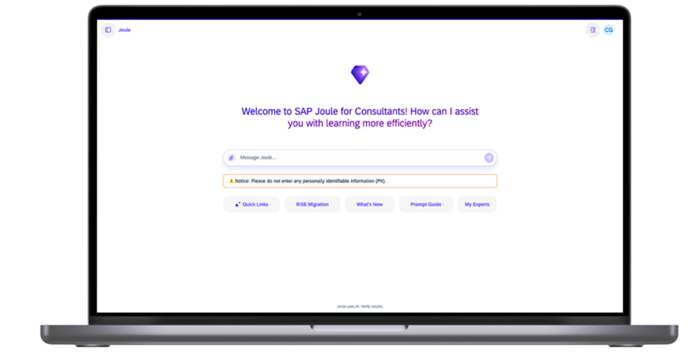
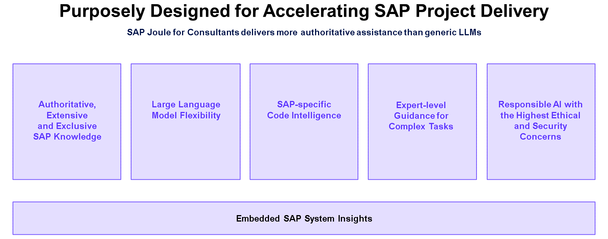
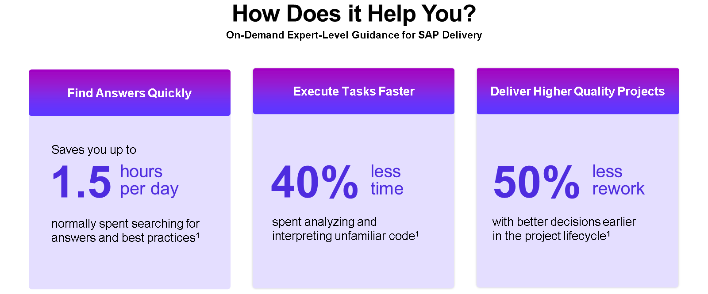
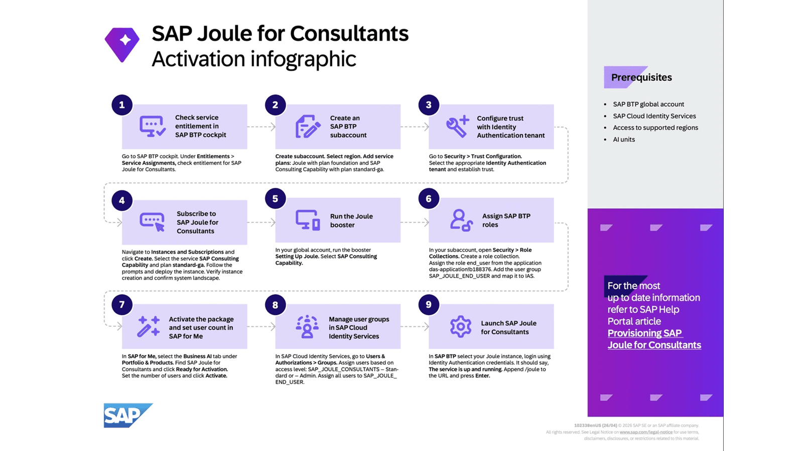
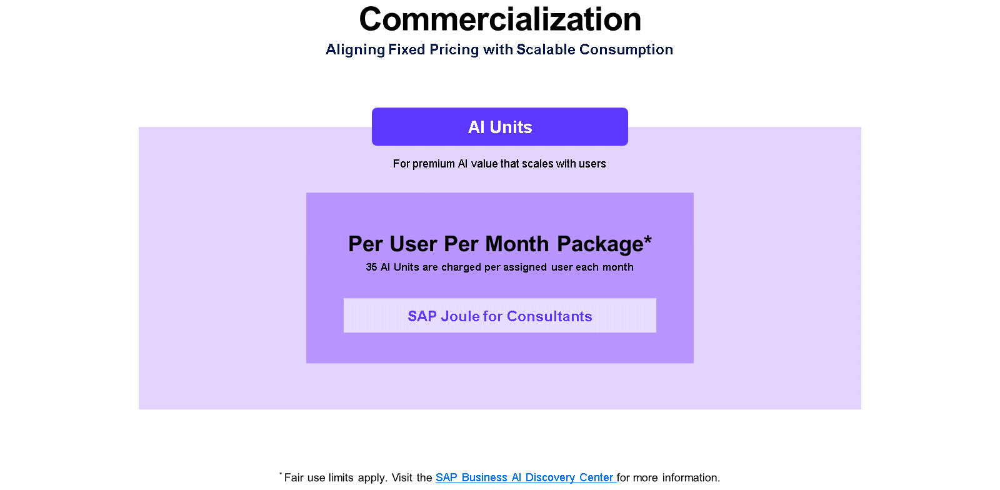

### Images: Unit 2
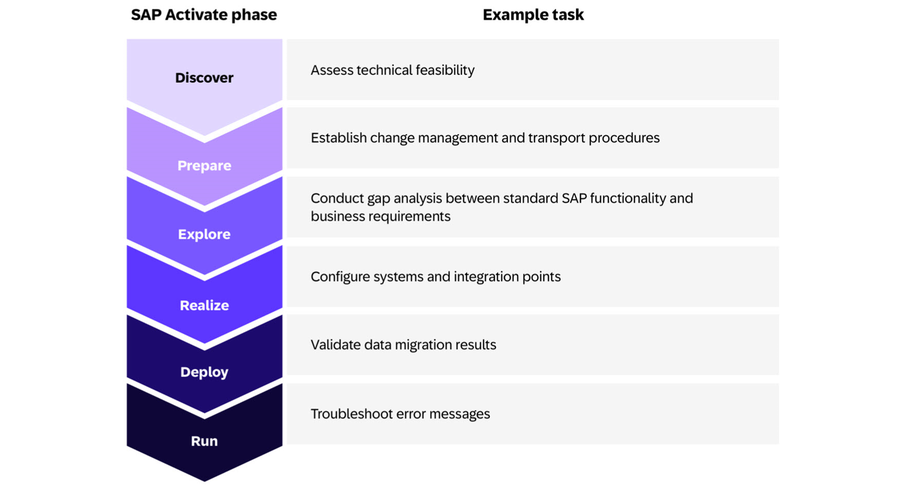
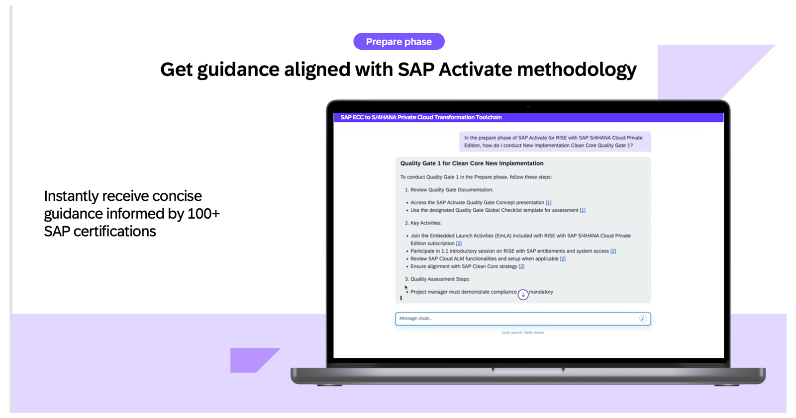
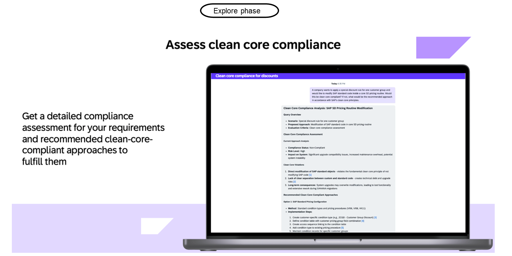
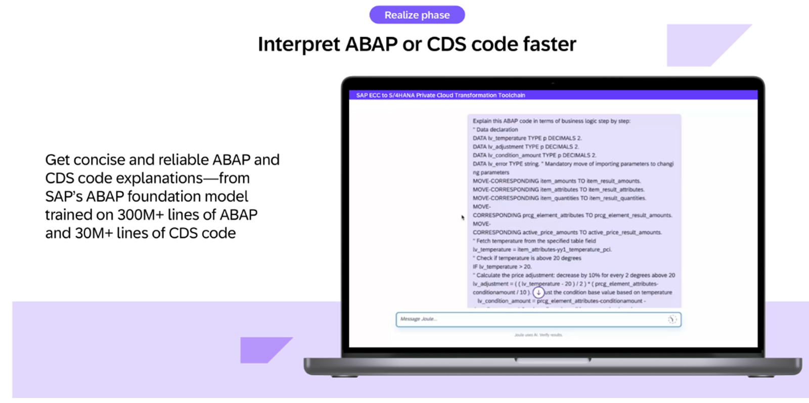
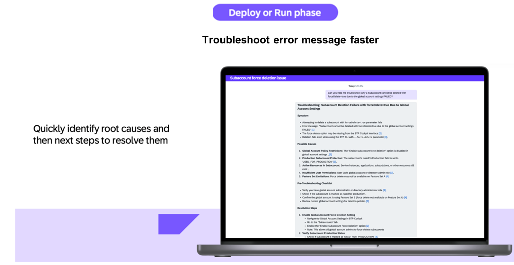
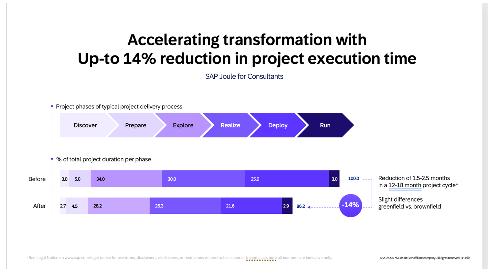
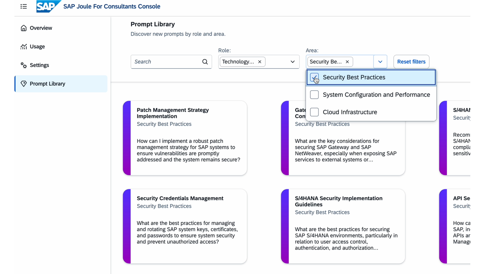
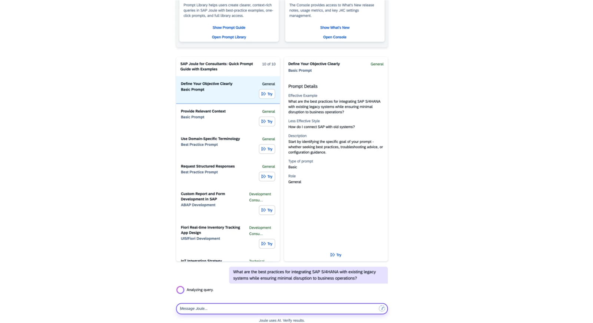
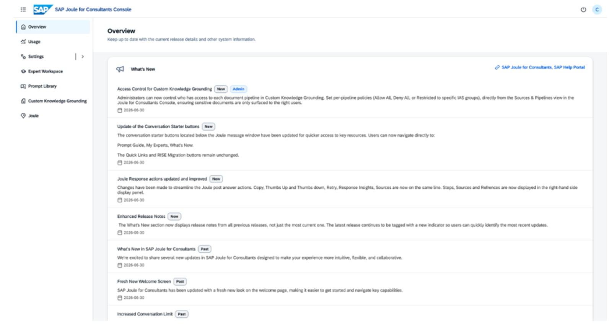

---

## Recap
- Joule for Consultants is a premium, SAP-only knowledge and code-explanation tool for project delivery; Developers is the separate code tool
- Activation needs BTP, Cloud Identity Services, a supported region, an agreement with AI Units and S-users for gated content
- Pricing: 35 AI Units per user per month, 22,900 pooled requests per user, 2 units per 1,000 beyond
- Write prompts that state who you are, what you need and the format; upload screenshots for errors
- Limits to remember: 50 conversations, 8 hours inactive, 7 days kept, 10,000 characters, 10 MB files

---

*Previous: [Chapter 16: The fusion sample: Build Code with Joule, a RAP service and SAP Build Apps](16-fusion-sample-build-code-rap-build-apps.md)*

*Next: [Chapter 18: The Joule onboarding guide: customer-managed provisioning, step by step](18-onboarding-guide-customer-managed-provisioning.md)*
