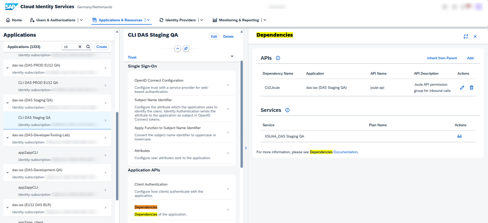
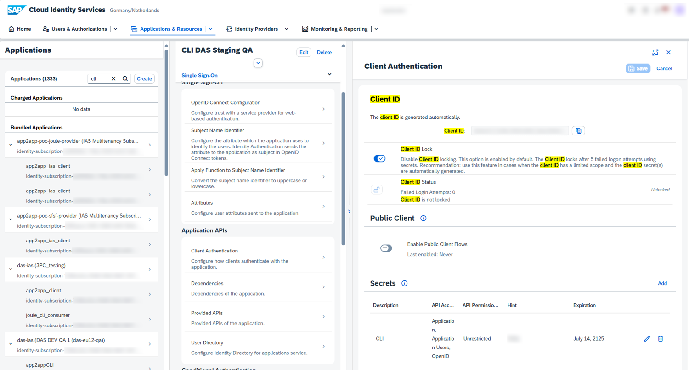

# Chapter 18: The Joule onboarding guide: customer-managed provisioning, step by step

*SAP's admin manual "Integrating Joule with SAP Solutions" (document dated 2026-11-04, 236 pages). This chapter covers the front part: the preview landscape, prerequisites, Work Zone, trust, the booster, formations, developer onboarding and roles. Written for a Gen AI developer who has to make the platform side work.*

> [!NOTE]
> **📍 At a glance**
> - **You will learn:** what you must have before you can switch Joule on, the exact order of the setup steps, what the booster does, and which pieces matter to developers (App2App, roles)
> - **Level:** intermediate · **Time:** about 25 minutes of reading
> - **Source:** SJ022, the Joule Onboarding Guide PDF, pages 1 to 29 of 236 (read in full); read 9 November 2026
> - **Builds on:** [Chapter 4](04-setting-up-joule.md) (landscape and unified setup) and [Chapter 5](05-setting-up-joule-by-product.md) (setup by product)

**After this chapter you can:**
- list the prerequisites for customer-managed provisioning, including entitlements and plans
- run the setup in the right order: trust, user attributes, booster, then domains
- explain the one-formation, one-Work-Zone, one-tenant rules and what the booster error means
- set up the App2App client that the Joule command-line tools need
- assign the two Joule roles

---

## 18.1 What the guide is

- **Audience:** system administrators and technical consultants
- **Three jobs:**
  - check the setup requirements for your SAP solution
  - follow the onboarding process to get Joule ready
  - integrate each SAP solution (part 4) and set up document grounding (part 5)
- **Two ways to get Joule:**
  - **Customer-managed provisioning** (this chapter): you run everything in SAP BTP yourself; full control over subaccounts, entitlements and integrations
  - **SAP-managed provisioning:** SAP does the technical setup; **required for Joule Work** (the unified workspace for conversational AI, organising work and building custom AI solutions); SAP now **recommends** this simpler route
- **Quick check:** if you already see the Joule icon in your product (for example the BTP cockpit), it is already provisioned; click it, nothing more to do

## 18.2 The Joule preview landscape

- **Why it exists:** content used to go to every tenant at once, with no test or production split; the preview lets you **validate new framework and content before production**
- **Where:** EU10 and EU30 data centres only, more planned
- **Release timing:**

| What | Stays in preview | Then |
|---|---|---|
| Joule framework | 2 weeks | goes to production |
| Joule content | 4 weeks | goes to production |

- **How you get it:** run the booster **Setting Up Joule - Preview** (see 18.7); the integration purpose must be **Testing**
- **Developer tip:** use the preview tenant to test your skills and agents against new framework releases before they reach production

## 18.3 Prerequisites

### Licence and account
- A valid licence for an SAP product that supports Joule (for example SuccessFactors or S/4HANA Cloud Private Edition) in a supported data centre
- The AI Unit SKU **8019164**, or Joule Base
- An **SAP BTP enterprise global account** (Joule entitlements can go into an existing one)
- The SAP product must already be integrated with **Identity Authentication (IAS)**; Joule reuses it for login
- **Joule with SAP Start** is only available under the Early Adopter Care programme

### Identity rules (these cause the most trouble)
- Joule **and every SAP product in the formation use the same Cloud Identity Services tenant**
- Users must carry the **same Global User ID** everywhere; it is set through the SAML assertion attribute `user_uuid` in the IAS application
- If it is wrong, one person looks like several users across Joule and the apps, and features that depend on user identity break
- You need entitlements for **Identity Authentication** and **Identity Provisioning**; Identity Provisioning moves identities and their authorisations to SuccessFactors, the IAS tenant and Build Work Zone
- **One IAS tenant per independent entity**, and each entity runs from its own BTP subaccount

### Entitlements
- Required applications:

| Application | Technical name | Plan | Quota |
|---|---|---|---|
| Joule | `das-application` | Foundation | 1 |
| Joule Preview | `das-application-preview` | Foundation | 1 |
| Build Work Zone, standard | `sap-launchpad` | Foundation or Standard | 1 |
| Build Work Zone, advanced | `sap-workzone` | Standard or advanced | 1 |
| SuccessFactors Work Zone | `sap-workzone-hr` | Standard or advanced | 1 |

- Required service for Work Zone: `build-workzone-standard` (Foundation or Standard), or `sap-workzone` / `sap-workzone-hr`
- A BTP global account already includes the **Foundation plan** of Work Zone standard edition; choose the **same plan** for the application and the service
- For the preview tenant you need a subaccount in EU10 or EU30; other regions cannot get the preview entitlements
- Joule's **conversational search** does not need Work Zone; navigation and role-based access do

### One of each
- One Joule subscription can serve several products (SuccessFactors, S/4HANA Cloud Private Edition, Work Zone), but **only one tenant of each product**; you cannot put two systems of the same product into one formation
- Joule can talk to **only one Work Zone instance**; the standard, advanced or SuccessFactors edition, never more than one
- Create a **subaccount** (Cloud Foundry environment) to hold Joule

## 18.4 The order of the setup

- **Do these in this order:**
  1. Configure trust to the IAS tenant (18.6)
  2. Configure user attributes from the identity directory (18.6)
  3. Run the Joule booster (18.7)
  4. Add trusted domains in IAS and BTP (18.8)
- **Caution in the guide:** finish steps 1 and 2 **before** you run the booster
- **Work Zone first:** if the product needs navigation, make sure a Work Zone instance exists (18.5)

## 18.5 SAP Build Work Zone and SAP Start

- **Why Joule needs it:** navigation to apps and role-based access use the **navigation service** of Work Zone, which resolves intent-based navigation targets defined in the back end
- **Two flows:**
  - **Content exposure:** the product (source system) exposes its roles and content; steps differ per product
  - **Content consumption:** Work Zone (target system) fetches that content through a **design-time destination**
- **All cloud systems must run under the same domain**
- **Change from 13 October 2025:** for setups after that date you **no longer create the navigation-service destination yourself**; the booster does it

### Create the Work Zone subscription and instance
- Subscription: BTP cockpit, subaccount, Service Marketplace, **SAP Build Work Zone, standard edition**, Create, keep defaults
- Give yourself the **Launchpad_Admin** role collection (Security, Role Collections, edit, add your user)
- Instance: Marketplace again, Create; **Cloud Foundry must be enabled and a space created first**
- Create a **service key** (needed for the old manual destination and for reference)

### The old manual `NavigationService` destination (now deprecated)

| Field | Value |
|---|---|
| Name | `NavigationService` |
| Type | HTTP |
| URL | the `portal-service` URL from the service key |
| Proxy type | Internet |
| Authentication | `OAuth2UserTokenExchange` |
| Client ID / Secret | from the service key |
| Token service URL type | Dedicated |
| Token service URL | `https://<uaa url>/oauth/token` |
| Additional property | **Use default JDK trust store**: enable |

- **After the booster:** open **Site Settings** in Work Zone and **enable the Joule setting**; the Joule icon then appears in the site header
- If Joule is in a different subaccount from Work Zone, **both subaccounts must trust the same IAS tenant**

### SAP Start
- Run the **manual setup** of SAP Start (the automated one cannot reuse an existing subaccount)
- Run the booster; in the product and capability drop-downs (steps 3 and 4) **select nothing**
- Then add the Joule system to the **SAP Start formation**: System Landscape, Formations, formation of type "Integration with SAP Start", Include Systems, pick the system whose type is Joule, Next Step, Include

## 18.6 Trust and user attributes

### Establish trust to Identity Authentication
- Need: subaccount administrator, an IAS tenant tied to the customer IDs of your global account, and **the same IAS tenant for every app in the formation**
- Steps:
  - Cockpit, subaccount, Security, Trust Configuration, **Establish Trust**
  - Pick the IAS tenant, then the domain; **the IAS domain must match the trust setup of the SAP system** or single sign-on fails
  - Optionally rename it, view the origin key, set a link text for logon
  - Review, Finish
- **Result:** an application named `das-ias (<subaccount name>)` appears in the IAS admin console

### Attributes the IAS application must send
- In the IAS admin console: Applications and Resources, Applications, the auto-created app, Trust tab, Single Sign-On, **Attributes**, Self-defined Attributes, Expand All

| User attribute | Name shown |
|---|---|
| `email` | Email |
| `Email_verified` | Email Verified |
| `family_name` | Last Name |
| `given_name` | First Name |
| `groups` | Groups |
| `user_uuid` | Global User Id |

- Missing one: Add, name it, choose the **Identity Directory** source, pick a value, save

## 18.7 Run the Joule booster

- **Which booster:** **Setting Up Joule** (production) or **Setting Up Joule - Preview** (EU10 or EU30 only; any other region returns an error with a link to the missing entitlements)
- **Where:** global account, **Boosters**, search, Start; you must be **global account administrator**
- **Before you start:**
  - the SAP systems are **registered in System Landscape** (otherwise they do not show up)
  - trust and user attributes are done
  - the product's own prerequisites are done
- **The steps:**

| Step | What you do |
|---|---|
| Check prerequisites | Backend checks the admin role, service entitlements and the IAS tenant |
| Set up subaccount | Pick the subaccount for Joule |
| Select integrations | Choose the solutions where the Joule icon appears; mark each **Testing or Productive** (preview must be Testing); this step only sets up technical integrations, and **S/4HANA PCE is not listed here by design** |
| Select capabilities | Choose the solutions whose capability packages are deployed; **choose whether Joule logs conversation data**; S/4HANA PCE is enabled here |
| Set up integrations | Name the **formation**, pick the systems, pick the IAS system of the Joule subaccount |
| Validation | Product checks; on failure go back and change the system or subaccount |
| Review | Check, then Finish |

- **Result:** a **Joule formation** in System Landscape holding the Joule system and the chosen systems
- **Constraint:** S/4HANA Cloud Public Edition and Private Edition **cannot be combined**

### The error you will meet
- Running the booster twice gives: *"Could not include system das-application-ias to the formation… can be part of only one formation of type Integration with Joule"*
- **Fix:** do not re-run; **include the systems in the existing formation** instead

### Include or exclude a system later
- Include: System Landscape, Formations, a formation in **Ready** state (type Integration with Joule or Joule Preview), **Include Systems**, pick system, Next Step, then per system choose **Enable Capability Deployment** and/or **Enable the Joule Icon in the Integrated System**, Review, Include
- Exclude: open the formation, click the system, right panel **Exclude System**, confirm
- **You cannot change the consent** for Conversation Insights and the Integration Landscape once set
- If the formation no longer exists, you must run the booster again

### Delete the formation
- Delete Formation removes the per-product configuration and the Joule icon from the product
- **It does not delete the Joule subscription**; delete the formation **first**, then the subscription, or the existing integration errors out

## 18.8 Trusted domains, logs and leaving Joule

### Trusted domains
- **In IAS:** you need the **Manage Tenant Configuration** role; Tenant Settings, Customization, **Trusted Domains**, Add, enter the host name or a wildcard (for example `*.example.com`); wildcards are risky, use them only for domains you trust; save shows "Trusted Domains updated"
- **In BTP:** subaccount, Security, Settings, add the host name (for example `https://store.example.com`); **all trusted domains together may not exceed 2048 characters**

### Conversation log opt-in or out
- Chosen during the booster; to change it later:
  - **recommended:** raise a ticket to the team `CA-Joule-CI` with the subject "Toggle Opt-in/Out of Conversation Log Storage" and your Joule tenant ID with the landscape
  - or unsubscribe and re-run the booster (this **erases all tenant data**)

### Unsubscribe
- Cockpit, subaccount, Instances and Subscriptions, find **Joule**, Delete
- **Everything goes:** configuration, services in the setup, stored data, your assistant and chat history; it cannot be undone
- You may **not be able to re-subscribe in the same subaccount**; use another subaccount or raise a ticket to `CA-DAS-TO`

## 18.9 Onboarding for Joule developers (App2App)

- **What it is for:** the **pro-code development tools for Joule** (the command-line tools) sign in with the **OAuth Resource Owner Password Credentials flow**; this needs an App2App application in IAS
- **Steps in the IAS admin console:**
  - create an **App2App application** (see "Configuring Applications")
  - under Application APIs, **Dependencies**: bind it to the target tenant; the **Dependency Name must be `Cli2Joule`**
  - under Application APIs, **Client Authentication, Secrets**: generate a **client secret**
  - **save the Client ID and the secret**; you need both at login
- **The two screens in the guide:**

- **What the screens show, for a developer:**
  - the dependency calls the `joule-api` API, "Joule API permission group for inbound calls"
  - the client ID locks after **5 failed logons** by default
  - **public client flows are off**; the secret is confidential
  - a secret has a description, API access scope and an expiry date

## 18.10 Assign roles

| Role | Who | What it allows |
|---|---|---|
| `extensibility_developer` | developers | open the **standalone Joule web client**; **compile and deploy capabilities**, with restrictions |
| `end_user` | business users | use the Joule web client to get information in natural language |

- **How:** BTP cockpit, subaccount, Security, Role Collections, create a collection (name and description), open it, Roles, **Edit**, add the role (pick the one with the application identifier for your region, press F4 for the list), Add, Save; then assign the collection to users or groups
- **Tie to Chapter 14:** a missing `extensibility_developer` role is a likely cause when a developer can open Joule but cannot deploy

## 18.11 The product list the guide integrates

- The next chapters cover each product; this table is the index from the guide

| Solution | Needs Build Work Zone |
|---|---|
| Analytics Cloud (analytical insights) | Yes |
| SuccessFactors | Yes |
| S/4HANA Cloud Private Edition | Yes |
| S/4HANA Cloud Public Edition | Yes |
| Integrated Product Development | No |
| Asset Performance Management | No |
| Digital Manufacturing | No |
| Integrated Business Planning | Yes |
| Ariba solutions | Yes |
| Intelligent Clinical Supply Management | No |
| Ariba Intake Management | No |
| Joule for Microsoft 365 Copilot | No |
| Field Service Management | No |
| Concur | No |
| Risk and Assurance Management | No |
| Sports One | No |
| Batch Release Hub for Life Sciences | No |

## 18.12 Added by Claude, not from the sources
- The "tie to Chapter 14" remark about the missing developer role is my inference, not a statement in the guide
- The developer tip about the preview tenant is my suggestion
- The ordering list in 18.4 collects what the guide says in several places
- The table in 18.11 is the guide's own list, reformatted

---

## Screenshots and figures from the sources
- The two App2App screens are shown in 18.9
- Other pages in this part are text and tables only; the cover page and the contents pages carry no figure worth saving

---

## Recap
- Provision order: trust, user attributes, **booster**, trusted domains; finish the first two before the booster
- One IAS tenant and one Global User ID (`user_uuid`) across Joule and every product
- One formation, one Work Zone instance, one tenant per product; do not re-run the booster, include systems instead
- Preview tenant: EU10 or EU30 only; framework waits 2 weeks, content 4 weeks
- Developers need an IAS App2App client with the dependency `Cli2Joule` and the role `extensibility_developer`
- Deleting the subscription wipes all tenant data

## Practice
- Without looking, write the six SAML attributes the IAS application must send
- Explain why running the booster a second time fails and what to do instead
- List what you must create in IAS for the command-line tools to log in

---

## How this chapter was checked
- All 29 text pages of this part were read in full; both images on page 28 were opened and described
- The entitlement and destination tables were copied field by field from the guide

## Sources and further reading
- SAP Help Portal, *Integrating Joule with SAP Solutions* (Integration Guide, 2026-11-04, PDF, pages 1 to 29): https://help.sap.com/doc/de3af3c0f81642dbaa4d36172ed57a72/CLOUD/en-US/79bfc83ab386450c8cd9c7937ce26a3a.pdf
- SAP Discovery Center, Joule missions: https://discovery-center.cloud.sap/missiondetail/4538/

---

*Previous: [Chapter 17: SAP Joule for Consultants: the full course](17-joule-for-consultants-course.md)*

*Next: [Chapter 19: Analytical insights: wiring SAP Analytics Cloud into Joule](19-analytical-insights-sap-analytics-cloud.md)*
