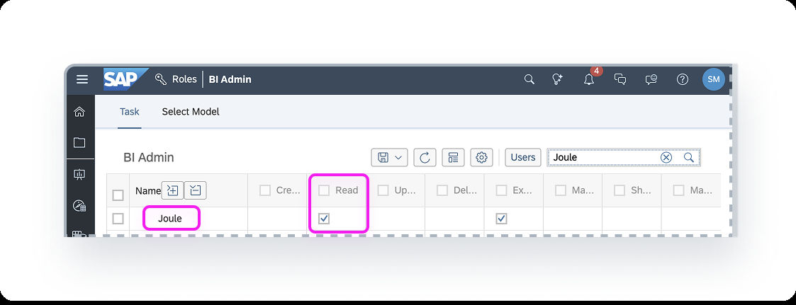
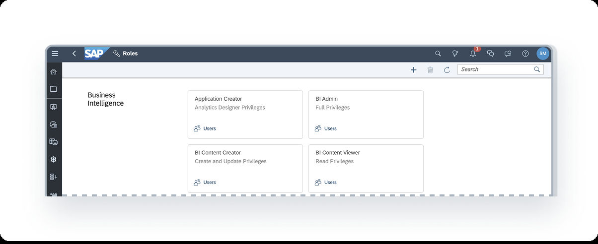
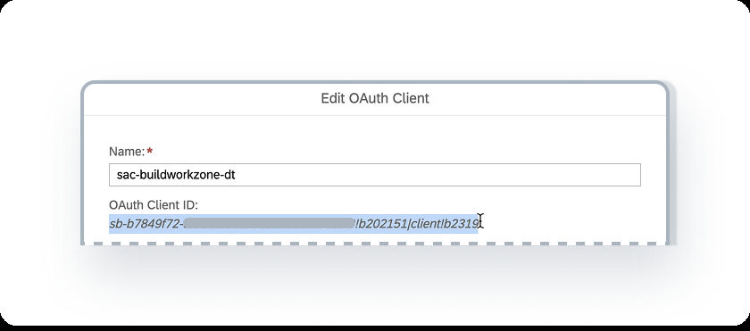
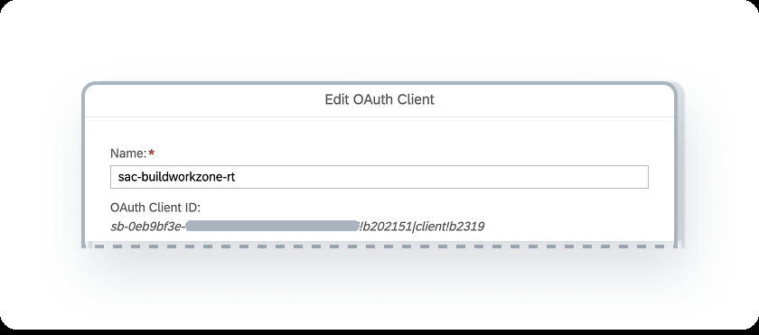
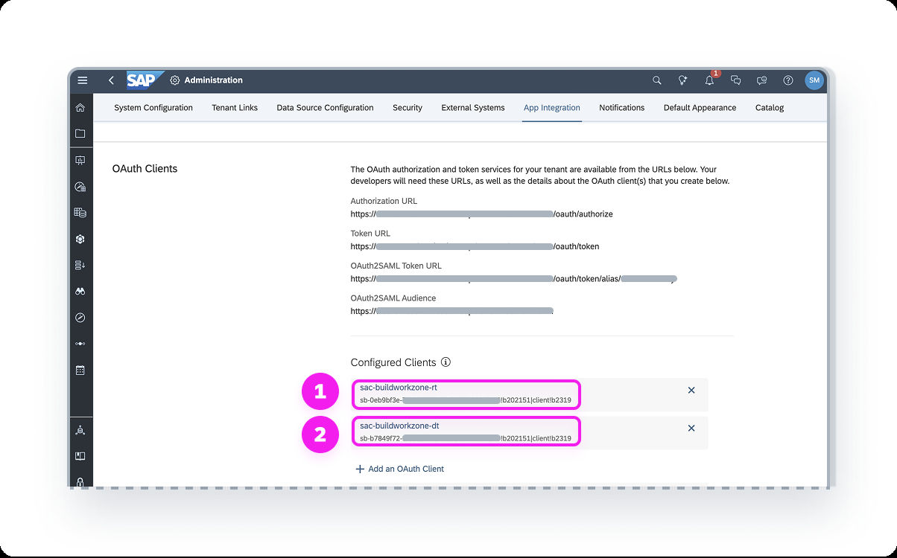
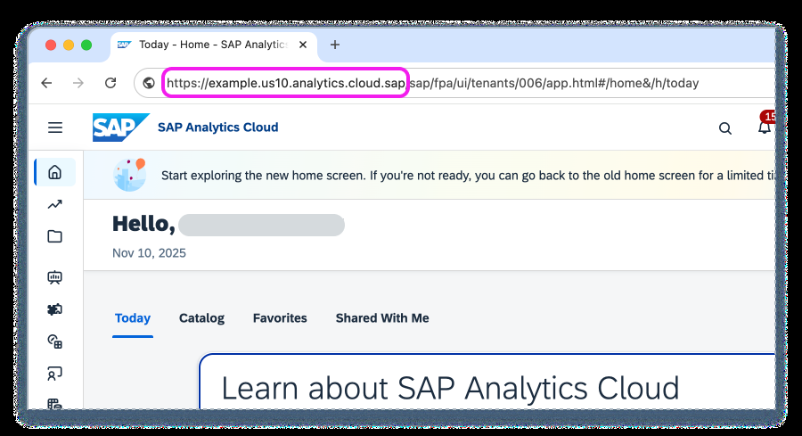
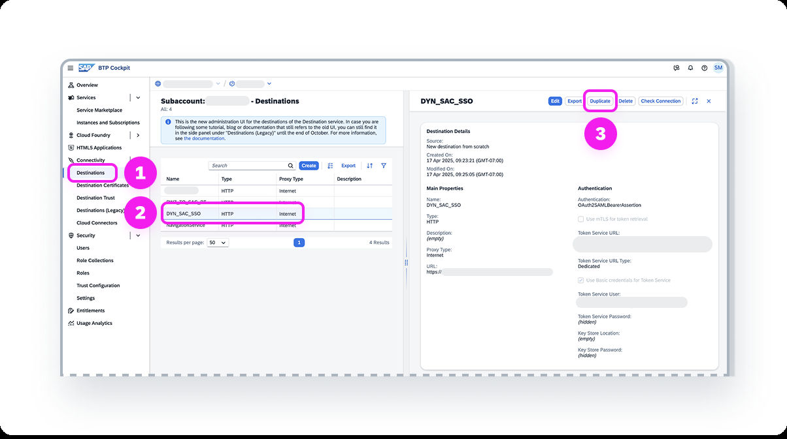
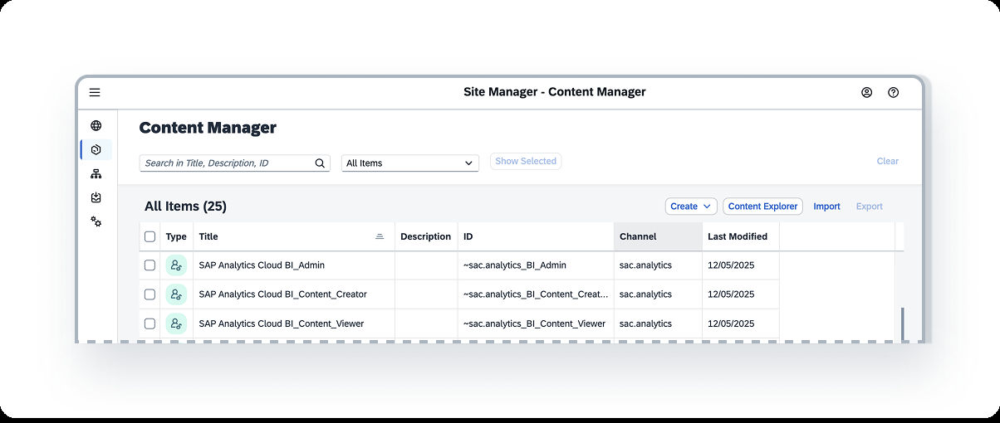
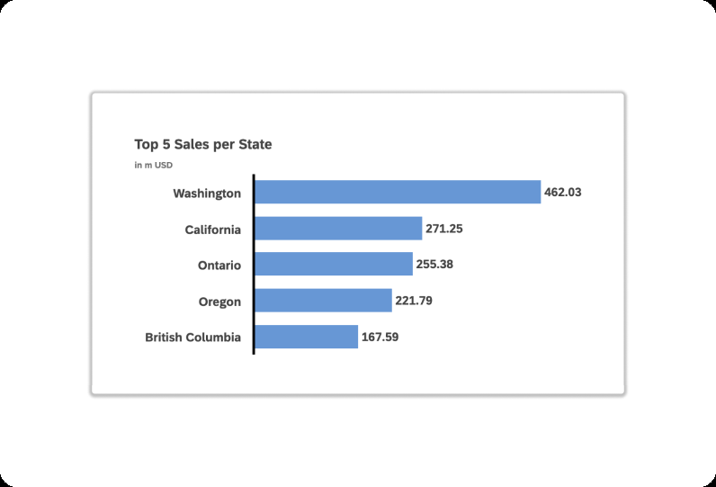

# Chapter 19: Analytical insights: wiring SAP Analytics Cloud into Joule

*The most technical integration in the guide: two OAuth clients, two destinations, a Work Zone content provider and an identity-provisioning job, all so that a user can ask Joule "Show me sales by state year to date" from another SAP product and get a chart.*

> [!NOTE]
> **📍 At a glance**
> - **You will learn:** the four-part setup for Joule's analytical insights capability, with every property value, and what each piece is for
> - **Level:** advanced · **Time:** about 25 minutes of reading
> - **Source:** SJ022, the Joule Onboarding Guide PDF, section 4.1, pages 30 to 48 (read in full); read 9 November 2026
> - **Builds on:** [Chapter 18](18-onboarding-guide-customer-managed-provisioning.md) (booster, formation, Work Zone) and [Chapter 5](05-setting-up-joule-by-product.md) §5.6a (the announcement blog)

**After this chapter you can:**
- explain what the capability does and what it does **not** do (Joule does not open inside Analytics Cloud)
- enable it with the booster or by including the system in an existing formation
- create the two OAuth clients and two destinations, with the right grant types
- set up the content provider and the identity-provisioning (IPS) job
- index data in Just Ask and test with the sample model

---

## 19.1 What this is

- **Capability:** Joule's **analytical insights**, powered by SAP Analytics Cloud (SAC); users in **another SAP product** ask analytical questions and get answers and charts
- **Not this:** these steps **do not put Joule inside SAC**; the Joule icon is not available in SAC itself
- **Change in release 2506:** **SAP Build Work Zone is now required**, to provision and sync users and roles from SAC to Work Zone; if you activated analytical insights before 2506 you **must redo the setup** with this guide
- **Four parts:**

| Part | What |
|---|---|
| 1 | Enable the capability in Joule (19.3) |
| 2 | Consume SAC roles and teams as CDM content in Work Zone (19.4) |
| 3 | Provision users from SAC to Work Zone with IPS (19.5) |
| 4 | Index data with Just Ask and test (19.6) |

## 19.2 Prerequisites

- You are a **BTP global account administrator**
- You have the Joule entitlements and the **Work Zone entitlements**
- **Authentication in SAC** is SAP Cloud Identity Services, **or** SAML SSO where the mapping attribute is **Email** (or a custom SAML mapping with valid emails); the guide points to SAP note 3601035
- **Exactly one SAC tenant** in the formation, with **at least three free OAuth client slots**; more than one tenant gives an error, so exclude the extra ones
  - check slots: SAC, System Administration, App Integration, Configured Clients; an **Add a New OAuth Client** button means a slot is free
- User accounts have **Read permission on the Joule privilege** in SAC
- The **Just Ask** feature is enabled: System Administration, Default Appearance, Conversational Analytics, Just Ask toggle on

- For custom roles, **set this privilege yourself**

## 19.3 Part 1: enable the capability

### Option A: no Joule formation yet (run the booster)
- Use the steps of [Chapter 18](18-onboarding-guide-customer-managed-provisioning.md) §18.7 with these settings:

| Booster step | Setting |
|---|---|
| Select Integrations | Pick the **product where users will open Joule**; **do not pick SAC** (Joule cannot be opened from SAC); mark Testing or Productive |
| Select Capabilities | Pick the **SAP Analytics Cloud capability package**; choose conversation logging |
| Set Up Integrations | Name the formation; pick **your SAC system** (the tenant where Just Ask and your indexed models live); pick the IAS system trusted by this subaccount |

- **Side effect:** the booster automatically adds a **new OAuth client** and a **new trusted identity provider** in SAC, System Administration, App Integration

### Option B: a formation already exists
- **Do not run the booster again**
- Include the SAC system as in §18.7 (formation, Include Systems); in step 4a pick your SAC system, in step 4c **make sure Enable Capability Deployment is on**
- Same side effect: a new OAuth client and trusted identity provider appear in SAC

## 19.4 Part 2: roles and teams as CDM content

- **Why:** a user's SAC account, roles, teams and permissions must exist in Work Zone before IPS can sync them; first the **role and team definitions** are imported as **CDM content**
- **Three jobs:**
  - two OAuth clients in SAC (design time and runtime)
  - two destinations in the Joule subaccount
  - a content provider in Work Zone

### The two OAuth clients (SAC, System Administration, App Integration, Add an OAuth Client)

| Field | Design-time client | Runtime client |
|---|---|---|
| Example name | `sac-buildworkzone-dt` | `sac-buildworkzone-rt` |
| Purpose | API Access | API Access |
| Access | **User Provisioning** | **Data Export Service** |
| Authorization grant | **Client Credentials** | **SAML 2.0 Bearer** |
| Token lifetime | positive integer with unit; if empty, infinite | same |

- After **Add**, a secret is generated; **Copy Secret now**; it cannot be shown again (lose it and you delete and recreate the client)
- The **Client ID** is shown in the Edit OAuth Client dialog; copy it for the destinations

### Design-time destination (create from scratch)

| Property | Value |
|---|---|
| Name | `SAC_SWZ_DT` |
| Type | HTTP |
| URL | `https://<your SAC domain>/api/v1/cdm` |
| Proxy type | Internet |
| Authentication | `OAuth2ClientCredentials` |
| Client ID / Secret | from the **design-time** OAuth client |
| Token Service URL | the **Token URL** shown in SAC, App Integration, OAuth Clients |
| Token Service URL type | Dedicated |
| Use Basic credentials for Token Service | selected |
| Token Service User / Password | the same client ID and secret |
| Additional property | `HTML5.SetXForwardedHeaders` = `false` |
| Additional property | `URL.headers.x-sap-sac-custom-auth` = `true` |

- **How to find your SAC domain:** copy everything in the browser address bar before the first `/sap/fpa/ui/...`; then append `/api/v1/cdm`

### Runtime destination (clone the one the booster made)
- Find **`DYN_SAC_SSO`** (authentication `OAuth2SAMLBearerAssertion`, URL = your SAC domain), choose **Duplicate**, and name it, for example `SAC_SWZ_RT`
- Replace **Token Service User** and **Password** with the **runtime** client ID and secret (the guide's table says "the secret you previously copied when you created the OAuth client for the design time destination" for the password; read it as the runtime client's secret, which is the logical reading, but note the wording)
- Under SAML Properties set **Client Key** = runtime client ID
- Additional properties: `sap-card-nominations-path` = `/api/v1/interest-cards`, `sap-start` = `true`

### Content provider (Work Zone Site Manager, Channel Manager, New Content Provider)

| Field | Value |
|---|---|
| Title and ID | `sac.analytics` |
| Design-time destination | `SAC_SWZ_DT` |
| Runtime destination | `SAC_SWZ_RT` |
| Runtime destination for dynamic data | use default runtime destination |
| Automatically add all content items to subaccount | true |
| Use the Identity Provisioning service to provision user authorisations | true |
| Include group and catalog assignments to roles | false |

- **Result:** the roles and teams appear in **Content Manager** (for example `SAP Analytics Cloud BI_Admin`, `BI_Content_Creator`, `BI_Content_Viewer`, channel `sac.analytics`)
- **The System Owner role is never imported**; that person needs another account and role to use analytical insights

### Automatic re-sync and restrictions
- **Auto re-import** happens when: the Read or Execute permission for the Joule privilege changes on a role; a role with the privilege is added to or removed from a team; a team with such a role is created or deleted
- Introduced with SAC **2026.4 and Q2 2026**; you must **press refresh once** on the `sac.analytics` provider in Channel Manager after that release, and again if the tenant is moved or restored from backup
- **Restrictions:** if a role and a team have the same name, **the role syncs, the team does not**; teams named `SAP_BuildWorkZone_Users` are not exported (used by the SAC and SAP Start integration)

## 19.5 Part 3: provision users with IPS

- **Steps:**
  1. **Source system in IPS:** a **new, unique** source connection to the SAC tenant just for this integration (you may reuse the username and password); **before the first save** set `sac.api.version` = `2` (otherwise reset the transformations) and `ips.http.header.x-sap-scim-groups-v3` = `true`
  2. **Target system in IPS:** Build Work Zone standard edition; as source pick the SAC source system (distinct from others); property `cflp.providerId` = **`sac.analytics`** (must equal the content provider ID)
  3. **Simulate:** source system, Jobs tab, **Run Now** on the Simulate Job; check Identity Provisioning, Provisioning Logs; no errors
  4. **Run:** **Run Now** on the **Read Job**; check logs
  5. **Validate:** in Work Zone as a user with `Launchpad_Admin`: Settings, Identity Provisioning tab, enter a SAC user's email, check the role IDs; if roles are missing, try **Run Now** on the **Resync Job**
  6. **Schedule:** IAS admin, Identity Provisioning, Source Systems, your SAC system, Jobs, **Schedule** on the Read Job row

## 19.6 Part 4: index data and test

- **What users can ask about:** models indexed by **Just Ask** in SAC:
  - **acquired models** with data imported into SAC
  - **analytic models from SAP Datasphere** that are in an SAP Business Data Cloud formation which also includes your SAC system
- **Permissions:**
  - index models: **Maintain** on the **Just Ask** privilege
  - ask questions and see charts: **Read** on the **Joule** privilege
- **Sample:** `My Files/Samples/Sales_SampleModel` is indexed by default
- **Test:** open Joule in any SAP product that has it and ask *"Show me sales by state year to date"*; a bar chart is returned

## 19.7 For a Gen AI developer: what to notice

- **Two token routes:**
  - design time uses **client credentials** (a service reads the role model)
  - runtime uses **SAML 2.0 bearer** (each call acts as the end user), which is why the IAS and `user_uuid` rules of Chapter 18 matter
- **Content provider ID is a contract:** `sac.analytics` appears in Work Zone **and** in the IPS property `cflp.providerId`; a mismatch breaks the sync
- **Retrieval is a SAC feature:** Joule does not query your model directly; whatever Just Ask has indexed is what the user can ask about

## 19.8 Added by Claude, not from the sources
- The remark in the runtime destination bullet about the password wording is my reading of an apparent copy error in the guide
- Section 19.7 is my interpretation for developers
- The four-part table in 19.1 is my summary of the guide's own list

---

## Screenshots and figures from the sources
- All nine figures are placed inline above (19.2 to 19.6); pages 31 to 34 and 45 to 47 have none

---

## Recap
- Analytical insights is used from **other** SAP products, not inside SAC; it needs Work Zone since release 2506
- Four parts: enable, roles and teams as CDM content, IPS provisioning, Just Ask indexing
- Two OAuth clients (User Provisioning with client credentials; Data Export Service with SAML bearer), two destinations (`SAC_SWZ_DT`, `SAC_SWZ_RT`), one content provider `sac.analytics`
- Exactly one SAC tenant, three free OAuth slots, Joule privilege Read on roles
- IPS: set `sac.api.version` to 2 before the first save; `cflp.providerId` must be `sac.analytics`

## Practice
- Which grant type does each OAuth client use, and why does the runtime one need SAML bearer?
- Which two property names go on the design-time destination under Additional Properties?
- What do you do when the user's roles do not appear after the Read job?

---

## How this chapter was checked
- All 19 pages of this section were read in full; all nine screenshots were opened
- Property tables were copied value by value

## Sources and further reading
- SAP Help Portal, *Integrating Joule with SAP Solutions* (Integration Guide, PDF, pages 30 to 48): https://help.sap.com/doc/de3af3c0f81642dbaa4d36172ed57a72/CLOUD/en-US/79bfc83ab386450c8cd9c7937ce26a3a.pdf
- SAP Discovery Center, Joule missions: https://discovery-center.cloud.sap/missiondetail/4538/

---

*Previous: [Chapter 18: The Joule onboarding guide](18-onboarding-guide-customer-managed-provisioning.md)*

*Next: [Chapter 20: Integrating Joule with SAP SuccessFactors](20-integrating-joule-with-successfactors.md)*
