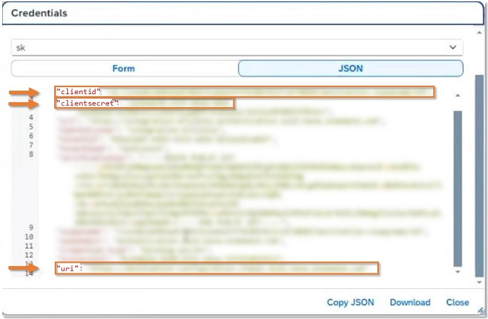

# Chapter 23: Integrating Joule with IBP, Signavio, Ariba and the documentation-only products

*Four products with real setup work (Integrated Business Planning, Signavio, Ariba) and three that only add conversational access to their help documentation.*

> [!NOTE]
> **📍 At a glance**
> - **You will learn:** what each product needs, the destinations and groups to create, and the constraints that differ from the large ERP integrations
> - **Level:** intermediate · **Time:** about 25 minutes of reading
> - **Source:** SJ022, the Joule Onboarding Guide PDF, sections 4.5 to 4.10, pages 92 to 122 (read in full); read 9 November 2026
> - **Builds on:** [Chapter 20](20-integrating-joule-with-successfactors.md), [Chapter 21](21-integrating-joule-with-s4hana-private-edition.md), [Chapter 22](22-integrating-joule-with-s4hana-public-edition.md) and [Chapter 5](05-setting-up-joule-by-product.md) §5.5a

**After this chapter you can:**
- tell which products only need a SAP note and which need the booster
- follow the IBP path decision chart
- set up Signavio groups for base, premium and restricted-data skills
- create the Ariba OAuth credentials and the two content providers

---

## 23.1 The documentation-only products (4.5 to 4.7)

| Product | What Joule does there | Where the steps are |
|---|---|---|
| SAP Integrated Product Development | conversational access to its **Help Portal documentation** from the Fiori apps | SAP note 3503056 |
| SAP Asset Performance Management | same | SAP note 3503073 |
| SAP Digital Manufacturing | same | SAP note 3506025 |

- None of them needs Work Zone (see the table in Chapter 18)

## 23.2 SAP Integrated Business Planning (IBP), section 4.8

- **What Joule can do:** navigate to apps, run and monitor jobs, share selected content, answer questions about IBP apps and processes
- **Entitlement:** an extra entitlement may be needed (Joule Base page); IBP needs **Joule Premium activated** (SAP note 3689440)
- **Prerequisites:**
  - same **email address** in IBP and in IAS
  - security information read
  - enterprise BTP global account, licence type **CUSTOMER**
  - the IBP system **registered** in the global account and registration triggered in the IBP tenant
  - in the subaccount: trust to IAS, the **`user_uuid` assertion mapped to Global User ID**, a Work Zone standard application and instance, and a **navigation service destination**

### Which path? (the guide's decision chart)

- **First time:** expose content to Work Zone, set up IPS, trusted domain in BTP and IAS, run **Setting up Joule** booster, configure IPS source and target, maintain the CSP
- **Joule already used with another product:** **include the IBP system in the existing formation**; if the formation has no Work Zone, include **Work Zone as well**
- **Joule already integrated with a different IBP capability:** **exclude IBP from its formation and delete that formation**, finish the preparation steps, then run the booster
- **Icon:** the booster creates the arrangement for **`SAP_COM_0882` (SAP Digital Assistant Services)**; the **Plug-In Activation State** works as in Chapter 22: empty means all users, `ROLE` means users with the catalog `SAP_CORE_BC_UI_JOU_PC`; never delete the arrangement
- **Verify:** the Joule icon appears at the top right of the IBP launchpad shell bar

### IPS for IBP
- Source: IBP, with the communication arrangement for `SAP_COM_0193`; if you have the **Identity Provisioning bundle** with IBP and basic authentication, **reuse the existing communication**
- Target: Work Zone standard edition
- Run **Jobs, Resync Job, Run Now**

### Content security policy
- After the booster, in IBP open **Manage Content Security Policy**, Trusted Sites, **Resources Scripts (`UI_RESOURCES_SCRIPTS`)**, New under Managed by Customer (use **Add** if the section is missing), enter the **Joule tenant URL**
- Find the URL in BTP, System Landscape, Formations, the booster's formation, details; it looks like `https://<subaccount>.<region>.sapdas.cloud.sap`

### IBP constraints
- Not every IBP language, and not the same accessibility standards
- **One IBP instance per Joule tenant:** test and productive IBP need **separate Joule tenants**; so does every extra productive system
- **No custom domains**
- No personal or sensitive data in Joule
- iFrame and third-party cookies needed; Joule uses **cookie partitioning**, so SSO keeps working after Chrome removes third-party cookies
- SSO needs a shared IAS session (no forced corporate-IdP login for a proxy IdP)
- The booster enables Joule for all IBP users

## 23.3 SAP Signavio, section 4.9

- **What it gives:** informational, navigational and transactional Joule patterns inside Signavio
- **Not available** for Signavio **Process Insights** and **Process Governance**
- **Prerequisites:** a Signavio tenant (Process Manager with Enterprise Plus, or Process Modeler licence); **only one Signavio tenant per Joule tenant**; the **same Cloud Identity Services** account for Joule and Signavio; admin access to Signavio, BTP and Cloud Identity Services
- **Entitlement:** the **Joule Base SKU 8019544**, from the SAP Store or your account executive

### Four steps
1. **Entitlement** (above)
2. **Identity (only for workspaces created before 25 November 2025):** set up SAML SSO with IAS as IdP; create an IAS application of type **SAP Signavio solution**, parent none, protocol **SAML 2.0**; upload the workspace's metadata; set **Global User ID as the Name ID**; attribute `Email address` from the identity directory; **log in to Signavio at least once** so it receives the Global User ID
   - workspaces created **after 25 November 2025** have SSO with Cloud Identity Services **activated automatically**; do not change it
3. **Set up Joule:**
   - create a **Work Zone formation** (type "Integration with SAP Build Work Zone" with systems Signavio, Work Zone, Cloud Identity Services) or include Signavio in an existing one; wait for **Ready** (5 to 10 minutes)
   - **IPS:** source system of type **Identity Authentication** (named `Identity Authentication`, properties ClientCertificateAuthentication, Internet, HTTP, the tenant URL; **Generate** the outbound certificate, **renew at expiry**), then an IAS administrator system `IPS` with rights Manage Applications, Manage Corporate Identity Providers, Manage Users, Read Users, Manage Groups, Manage Tenant Configuration, and upload the certificate; target Work Zone with the usual service-key values and `cflp.providerId` = the Signavio content channel ID; run Read or Resync; schedule at least daily; roles take 24 to 48 hours
   - **run the booster** with Signavio and Work Zone selected; it creates an application in Cloud Identity Services that is **Charged** by default; edit it to type **SAP Signavio solution**, protocol **OpenID Connect**, so it moves to **Bundled**
4. **User groups (recommended):** in IAS create groups
   - **`grp_joule_skills_personal_data_restricted`**: for skills that may process personal data (processed, **not stored**)
   - **`sap.sig.base`**: base capabilities
   - **`sap.sig.premium`**: premium features

- **Document grounding:** optional but highly recommended (informational type, uses your documents and the Help Portal)

### Destinations (mandatory for now)
- Needed because Signavio is not yet on Work Zone; later you will just exclude and re-include Signavio and re-run the booster
- Create a **Destination Service** instance (plan `lite`) and a binding (for example `Joule-Signavio-DS`), open its JSON and copy `clientid`, `clientsecret` and `uri`

| `SIGNAVIO_WZ_CONFIG` | Value |
|---|---|
| Type | HTTP |
| URL | the copied `uri` plus `/destination-configuration/v1/destinations/` |
| Proxy type | Internet |
| Authentication | `OAuth2UserTokenExchange` |
| Client ID / Secret | from the binding JSON |
| Token Service URL type / URL | Dedicated / `https://<subdomain>.authentication.<region>.hana.ondemand.com/oauth/token` |
| Additional | **Use default JDK trust store** on |

| `SIGNAVIO_WZ_RUNTIME` | Value |
|---|---|
| Type / Proxy | HTTP / Internet |
| URL | base URL of your Signavio client, for example `https://editor.signavio.com` |
| Authentication | NoAuthentication |
| Additional | **Use default JDK trust store** on |

### Signavio troubleshooting table

| Symptom | Likely cause | Action |
|---|---|---|
| Blank screen | user not authenticated through Cloud Identity Services | log in with the right URL |
| Browser compatibility | iFrame and cookies | allow third-party cookies; **Safari: turn off Prevent Cross-Site Tracking** |
| Domain mismatch (`ondemand.com` vs `cloud.sap`) | Signavio URL not trusted in BTP | check trusted domains in BTP and IAS; download metadata again |
| Joule icon not visible | Signavio not in the formation, or formation "Synchronizing" | in Formations, check status and **re-include** Signavio |
| Login works, Joule fails | different Cloud Identity Services accounts | use the same one everywhere |
| SSO fails after setup | metadata out of sync | download SP metadata again and upload to IAS |

## 23.4 SAP Ariba, section 4.10

- **Entitlement:** an extra entitlement may be needed
- **Warning:** do **not use Joule in shared desktop or kiosk setups**; each user needs a separate operating-system session; do not rely on browser logout only
- **Prerequisites:** initial setup done; Work Zone configured (needed for transactional use) with roles and permissions for Joule users; Ariba integrated with IAS for login
- **Steps:** trust to IAS, trusted domain in BTP, user attributes, trusted domains in IAS, **booster**, navigation destination, OAuth credentials for the CDM API, destinations, **IPS from Ariba to IAS**, **IPS from IAS to Work Zone**
- **One Joule per child realm:** you can connect only one instance of each system type to one Joule instance, so in an FCP or multi-ERP setup run the booster **separately for each child realm**; each child realm then gets its own Joule instance and navigation can differ between them
- If IAS was enabled manually, raise a support ticket to request Joule onboarding; **Joule is not supported in TDD, Dev or Supplemental realms**

### OAuth credentials for the CDM API
- Sign in to the **Ariba Developer Portal** (https://developer.ariba.com/api/home) as an **Organisation admin**, pick the data centre
- Manage Applications, pick the application, **Actions, Request API Access**
- Choose the API: **SAP Build Work Zone CDM Content API for Sourcing** or **for Procurement**; pick the tenant (Sourcing or Procurement); **select all realms**; submit
- The **Open API team must approve**; then Actions, generate the **OAuth secret**

### Destinations and content providers (one set per solution)

| | Sourcing | Procurement |
|---|---|---|
| Design-time name | suffix `dt`, lowercase | suffix `dt`, lowercase |
| Design-time URL | `https://<data center>.openapi.ariba.com/api/sourcing-cdm-content/v1/prod/cdmForJoule?realm=<realm>` | `https://<data center>.openapi.ariba.com/api/procurement-cdm-content/v1/prod/cdmForJoule?realm=<realm>` |
| Authentication | `OAuth2ClientCredentials` | same |
| Client ID, secret, token URL | from the Developer Portal CDM API | same |
| Additional | `URL.headers.apiKey` = the API key | same |
| Runtime name | suffix `rt`, lowercase, no underscore | same |
| Runtime URL | `https://s1-<data center>.ariba.com` (for example `s1-eu`, `s1-us`) | same |
| Runtime authentication | NoAuthentication | same |
| Runtime additional | `sap-start` = `true`; `ariba.realm` = realm name | same |
| Content provider ID | `ariba_sourcing` | `ariba_buyer` |

- Content provider options for both: design-time and runtime destinations, dynamic data default, **Automatically add all content items = true**, **Use IPS = true**; status goes "Creating" then "Created"; the **Report** link counts roles, apps and so on
- (The guide's table for the Sourcing design-time destination labels the Client Secret value as "Copy the clientid field value"; the Procurement table correctly says `clientsecret`; read both as the secret)

### IPS from Ariba to IAS
- Ariba source system: follow the standard steps **plus** remove `FamilyName` from the transformation and add the filter **`ariba.applications.user.filter`** (user names like `John.Doe`)
- IAS target system: standard steps **plus** remove `givenName`, `FamilyName`, `middleName`, `honorificPrefix` and set **`ias.support.patch.operation` = `True`**

### IPS from IAS to Work Zone
- IAS as source; group entity `Ignore` = `false`; mapping `$.id` to `entityIdSourceSystem`
- Properties (from the service key): URL `portal-service`, BasicAuthentication, `clientid`/`clientsecret`, Internet, HTTP, **`ias.api.version` = `2`**, retry attempts `2`, interval `60`, and trace flags (`ips.trace.created.entity` true, `failed.entity` true, `failed.entity.content` false, `skipped.entity` true, `skipped.entity.content` false, `updated.entity` true)
- **Target systems:** create a target of type Work Zone standard edition with the IAS source selected; add the group mapping `$.displayName` to `$.externalId` with a function that **replaces spaces with underscores**
- Target properties: URL, BasicAuthentication, `clientid` and `clientsecret` from the service key, Internet, HTTP, `OAuth2TokenServiceURL`, `cflp.group.unique.attribute` (`externalId` plus `providerId`), `cflp.patch.group.members.above.threshold` = `5000`, **`cflp.providerId` = `ariba_buyer`**, `cflp.user.unique.attribute`, `ips.trace.failed.entity.content` = `true`
- **Create a second target for sourcing** with `cflp.providerId` = `ariba_sourcing` (tip: export the first target, import it and change the value)
- **Run replication:** the IAS source system, Jobs, Read or Resync; roles can take **24 to 48 hours** to show in the navigation service

## 23.5 Added by Claude, not from the sources
- The Client Secret remark in 23.4 is my reading of an apparent copy error in the guide
- The grouping of the three documentation-only products is mine

---

## Screenshots and figures from the sources
- The IBP decision chart and the Signavio service-binding dialog are placed inline above; other pages in this range have none

---

## Recap
- IPD, APM and Digital Manufacturing: documentation access only, steps in SAP notes
- IBP: needs Joule Premium; one IBP system per Joule tenant; three paths depending on existing formations
- Signavio: Joule Base SKU 8019544; groups for base, premium and restricted-data skills; two destinations until it moves to Work Zone
- Ariba: Developer Portal OAuth with Open API team approval; sourcing and procurement each get a `dt`/`rt` pair and a content provider; one Joule per child realm
- All use IPS to send users and roles to Work Zone; `cflp.providerId` must match the content channel ID

## Practice
- Which Signavio group do you create for skills that may process personal data?
- Why does a multi-realm Ariba setup need several booster runs?
- What must you do before running the booster if IBP was already integrated for another capability?

---

## How this chapter was checked
- Pages 92 to 122 were read in full; both images were opened

## Sources and further reading
- SAP Help Portal, *Integrating Joule with SAP Solutions* (PDF, pages 92 to 122): https://help.sap.com/doc/de3af3c0f81642dbaa4d36172ed57a72/CLOUD/en-US/79bfc83ab386450c8cd9c7937ce26a3a.pdf
- SAP Discovery Center, Joule missions: https://discovery-center.cloud.sap/missiondetail/4538/

---

*Previous: [Chapter 22: Integrating Joule with SAP S/4HANA Cloud Public Edition](22-integrating-joule-with-s4hana-public-edition.md)*

*Next: [Chapter 24: Integrating Joule with next-gen Ariba, Clinical Supply, Intake Management, Microsoft 365 Copilot, Datasphere and Field Service](24-integrating-joule-ariba-next-gen-m365-datasphere-and-field-service.md)*
