# Chapter 24: Integrating Joule with next-gen Ariba, Clinical Supply, Intake Management, Microsoft 365 Copilot, Datasphere and Field Service

*Six smaller integrations. Datasphere is the large one: a Work Zone formation, an OAuth client, a dedicated IPS source system and a long transformation. The others are mostly "run the booster, then trust and domains".*

> [!NOTE]
> **📍 At a glance**
> - **You will learn:** what each product requires, the OIDC rule for Clinical Supply, the one-to-one Entra tenant rule for Microsoft 365 Copilot, the Datasphere setup in full and what the booster creates for Field Service
> - **Level:** intermediate · **Time:** about 25 minutes of reading
> - **Source:** SJ022, the Joule Onboarding Guide PDF, sections 4.11 to 4.16, pages 123 to 143 (read in full); read 9 November 2026
> - **Builds on:** [Chapter 18](18-onboarding-guide-customer-managed-provisioning.md), [Chapter 19](19-analytical-insights-sap-analytics-cloud.md) (the SAC pattern that Datasphere repeats)

**After this chapter you can:**
- run the booster for next-gen Ariba, Clinical Supply Management and Intake Management
- explain why Clinical Supply needs OIDC trust and what to do when a subaccount uses SAML
- set up Joule for Microsoft 365 Copilot and explain the 1:1 Entra rule
- set up Datasphere: formation, OAuth client, IPS source and target, simulate, run, validate, schedule
- list what the booster creates for Field Service

---

## 24.1 Next-gen SAP Ariba (4.11)

- Extra entitlement may be needed
- **Same kiosk-mode warning as Chapter 23**: no shared browsers
- **Two steps only:** configure **single logout** for Joule, then run the booster

## 24.2 SAP Intelligent Clinical Supply Management (4.12)

- **Prerequisites:** the onboarding guide read; a BTP subaccount; global account administrator; a Joule entitlement **in the same Cloud Foundry global account** as the Clinical Supply Management entitlement; Clinical Supply Management subscribed; an identity provider that uses **OpenID Connect (OIDC)**
- **Steps:** Boosters, Setting up Joule, Start; pick a Cloud Foundry subaccount with a space; on **Select Integrations** pick Clinical Supply Management; on **Setup Integrations** pick the system where Joule appears; then trusted domains in IAS and in BTP for that product's domain
- **The OIDC rule:** use the **same subaccount** where Clinical Supply Management is subscribed, with **OIDC trust to the IAS tenant**
  - **SAML and OIDC cannot coexist in the same IAS tenant on BTP**; if your subaccount uses SAML consider migrating
  - if you need a **cross-subaccount setup** or Clinical Supply uses SAML, pick a **different subaccount** in the booster that has OIDC trust to the same IAS tenant

## 24.3 SAP Ariba Intake Management (4.13)

- Prerequisites: initial setup and security information, a subaccount for Joule, and **the same Cloud Identity Services tenant** as the identity provider for both
- Setup: **run the booster**

## 24.4 Joule with Microsoft 365 Copilot (4.14)

- **Prerequisites:**
  - at least one SAP business tenant (for example S/4HANA Private Cloud or SuccessFactors) already integrated with Joule
  - trust between **Microsoft Entra and IAS**, with Entra as the **corporate IdP using OIDC**
  - all users who will use Joule from Copilot exist in the **IAS user store**
  - a Microsoft 365 Copilot licence, rolled out to the users
- **Entra application:** the Entra app used for federation with IAS must be extended with the Joule permissions and APIs (a separate blog describes how)
- **1:1 rule:** Joule has a **one-to-one relationship with a Microsoft Entra tenant**; one Entra tenant cannot serve several Joule environments, so **development and production cannot share an Entra tenant**; for a test setup use a **dedicated M365 tenant**
- **Landscape steps:**
  - note the **M365 tenant ID** of the productive Copilot or Teams deployment
  - in the BTP cockpit System Landscape add a system of type **M365 Copilot for SAP Joule** with that tenant ID
  - first time: activate the integration in the booster; already running: **include the new system in the formation**
- **Connect Copilot to Joule:** install the **SAP Joule app** in the Microsoft 365 Admin Center; after installing the custom engine agent, it can take **up to two hours** before Joule shows in Copilot Chat
- **Connect Joule to Copilot:** a separate SAP document describes how to let Joule pass requests to Copilot
- **Notes:** all output should be reviewed; no sensitive personal data; SAP does not control data processed by Copilot, and its use is under your agreement with Microsoft

## 24.5 SAP Datasphere (4.15)

### Prerequisites
- Product and Joule prerequisites; the Work Zone **foundation plan** entitlement
- The role **DW Joule Consumer**, or a **global** role with the Joule privilege (a scoped role is not enough)
- The Datasphere **tenant administrator activates Joule** ("Enable SAP Business AI and Joule for SAP Datasphere")

### Setup (integration steps)
1. A BTP global account and a **Cloud Foundry-enabled subaccount** on a landscape that supports Joule; roles: Global Account Administrator, Subaccount Administrator, **Org Manager** and **Space Manager** in Cloud Foundry
2. A subscription-based **CPEA** or SAP-managed Datasphere tenant with **at least one free OAuth client slot**
3. Entitlements for **`das-service`** and **`das-application`**, standard plans
4. **IAS tenant:** the one assigned to the CRM ID of your global account for the Datasphere tenant; set the **subject name identifier** of the subaccount XSUAA application to match the Datasphere tenant IdP (for example `email`); add the Datasphere **trusted domains** to the Joule IAS: `*.cfapps.orca.dev.sap`, `*.hcs.cloud.sap`, `*.ondemand.com`, `*.projectorca.cloud`, `*.datawarehouse.cloud.sap`, `*.hanacloudservices.cloud.sap` (do not delete the extra trusted IdP and OAuth client entries created later); add the IAS as **OIDC trust** to the Joule subaccount; configure the SAML assertion attributes

| Assertion attribute | User attribute |
|---|---|
| Groups (expression `sac`, see "Enable a custom SAML Identity Provider") | Groups |
| Email | Email |
| Email_verified | Email Verified |
| family_name | Last Name |
| given_name | First Name |
| groups | Groups |
| user_uuid | Global User Id |

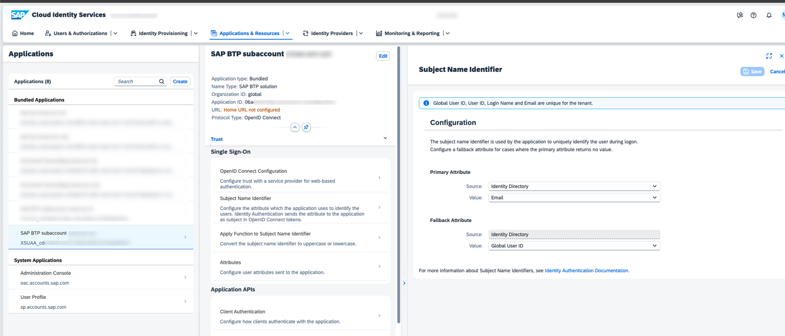

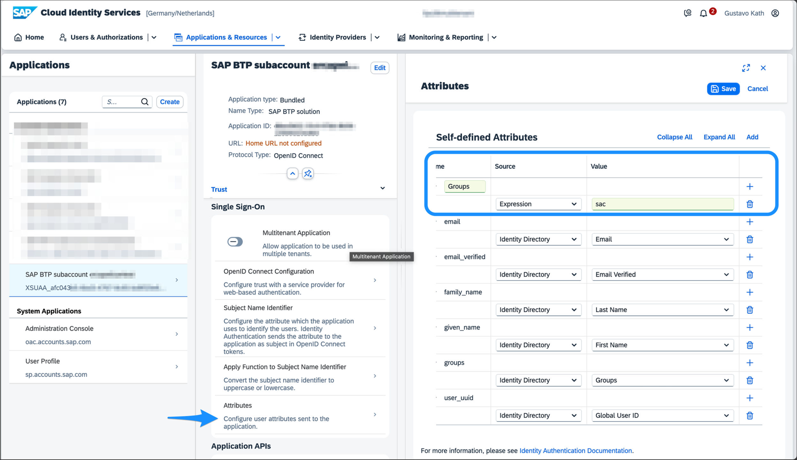

### Part A: role definitions as CDM content (a formation)
- **Prerequisite:** entitlement for `build-workzone-standard` (foundation or higher); the **same Work Zone instance and the same Datasphere tenant** must be in the Joule formation; different instances or tenants are **not supported**
- Steps: System Landscape, Formations, Create Formation; name it (tip: prefix `bwz-` plus the Datasphere host, for example `bwz-my-datasphere-host`); type **Integration with SAP Build Work Zone**; select the Work Zone system and the Datasphere system; Review, Create

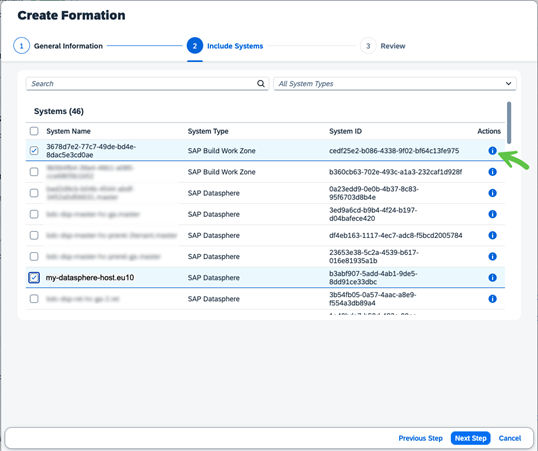

- **Result:** three new destinations in the Joule subaccount: `[xxx]_dt`, `[xxx]_rt_data`, `[xxx]_rt_default` (prefix is part of the subaccount name plus a generated UUID); in Work Zone Channel Manager a **Datasphere content provider** appears with status **Created** or **Updated**

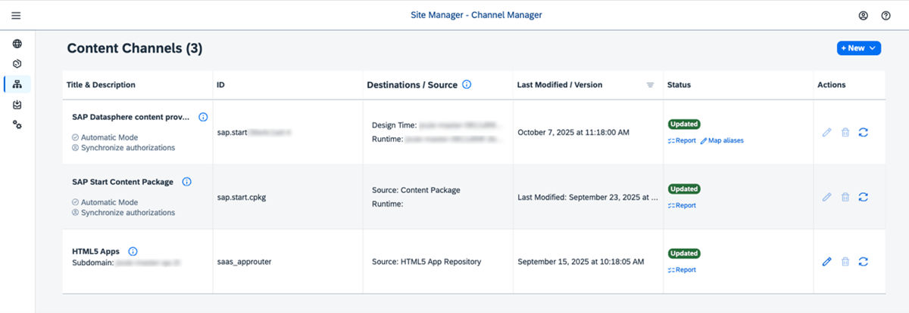

- Roles are imported (visible in Content Manager); **changes to roles in Datasphere are reflected automatically and promptly**

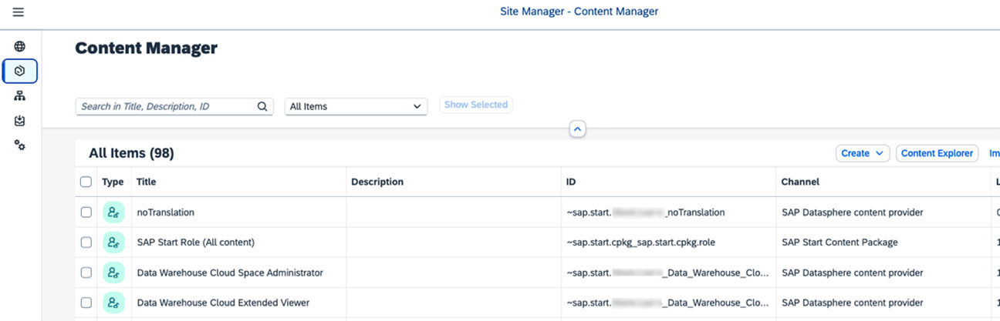

### Part B: provision users with IPS
1. **OAuth client in Datasphere:** System Administration, App Integration; note the **Token URL**; Add an OAuth Client; name with the prefix `BWZ_IPS_<UUID>` (the UUID from the clients `BWZ_dt` or `BWZ_rt_data` created by the formation); **Purpose: API Access**; **Access: User Provisioning**; **Authorization grant: Client Credentials**; Add; save the ID and secret

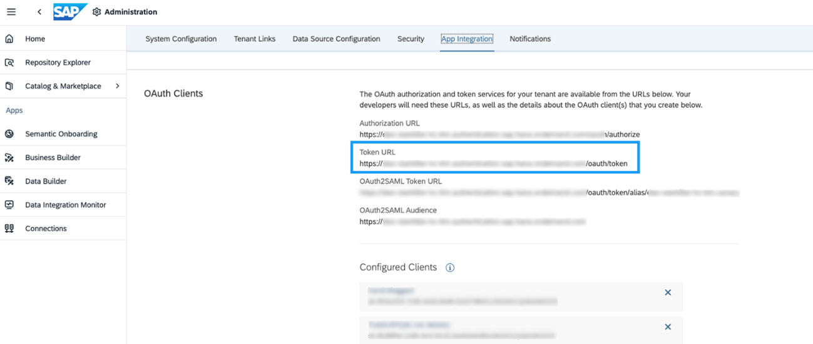

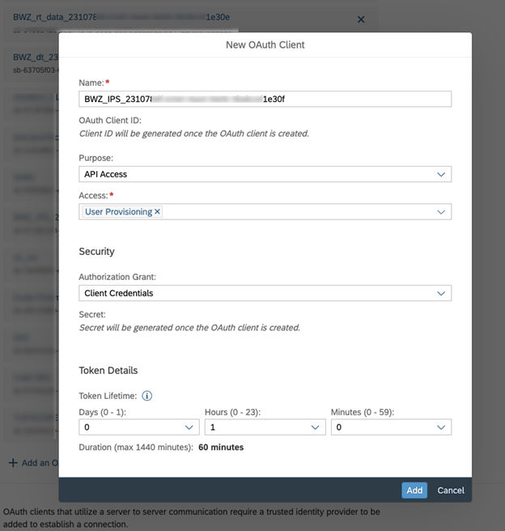

2. **Work Zone service instance and key** in the Joule space (`build-workzone-standard`, foundation or higher), key name for example `ips-integration`; note `portal-service`, `clientid`, `clientsecret` and `url`

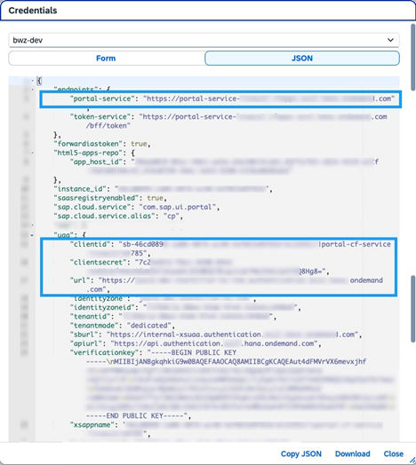

3. **Source system in IPS** (a new one, unique to this integration; type **SAP Analytics Cloud**); set **`sac.api.version` = `2`** before saving, then properties:

| Property | Value |
|---|---|
| `ips.http.header.x-sap-scim-groups-v3` | `true` |
| `OAuth2TokenServiceURL` | the token URL from the Datasphere App Integration page |
| Password / User | the `BWZ_IPS` client secret / ID |
| URL | the Datasphere tenant URL |
| Authentication / ProxyType / Type | BasicAuthentication / Internet / HTTP |
| `ips.trace.failed.entity.content` | `false` |

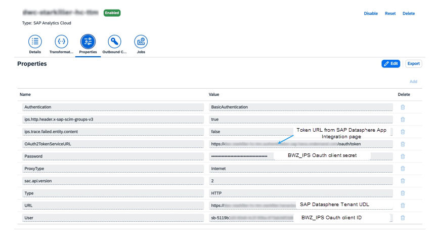

   - Transformations: switch to JSON mode, **delete all code and paste the guide's transformation**; it passes `schemas`, `id` (entity ID), `userName` (correlation), `name`, `displayName`, `active`, `emails` (and the primary email as a correlation value), `roles`, `groups` (with an optional `%sac.group.prefix%`) and the **manager ID** into the enterprise extension; groups pass `displayName` (optional prefix), `members`, `roles`, the SAP extension `applicationId` from `%ips.application.id%`, `type` and `supportedOperations`

4. **Target system in IPS** (Work Zone standard edition; pick the Datasphere source; **distinct** from other Datasphere sources):

| Property | Value |
|---|---|
| `cflp.providerId` | the channel ID of the Datasphere content provider (from Channel Manager) |
| `OAuth2TokenServiceURL` | the `uaa` URL from the service key plus `/oauth/token` |
| Password / User | `clientsecret` / `clientid` from the service key |
| URL | the `portal-service` URL |
| also shown | `cflp.bulk.operations.max.count` 100, `cflp.patch.group.members.above.threshold` 5000, `cflp.support.bulk.operation` true, `ips.delete.threshold.groups` and `.users` 10000 |

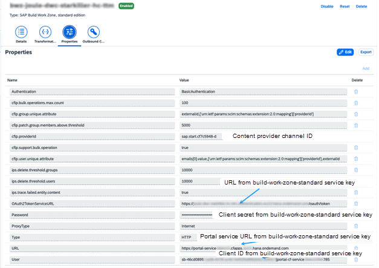

5. **Simulate** (Jobs, Simulate Job, Run Now; check Provisioning Logs), **run** (Read Job), **validate** (Work Zone as `Launchpad_Admin`, Settings, Identity Provisioning tab, enter a user's email; if roles are missing, **Resync Job**), **schedule** (IAS, Identity Provisioning, Source Systems, Jobs, Schedule on the Read Job)

## 24.6 SAP Field Service and Asset Management (4.16)

- **Prerequisites:**
  - system and company configured; initial Joule setup done; general prerequisites; trust to IAS
  - the system is **discovered in the BTP system landscape**
  - **SSO with IAS** and **OpenID Connect** configured
  - the **`GENERATIVE_AI`** role assigned
  - **Intelligent Filtering** enabled for the company
- **Security caution:** **rotate the client secret** of the client `<account ID>-sap-joule` regularly (find it in the BTP destination and in the system)
- **Steps:** run the booster, choosing **SAP Field Service Management** in the integrations step and your account in step 5; configure Joule user attributes (Chapter 18)

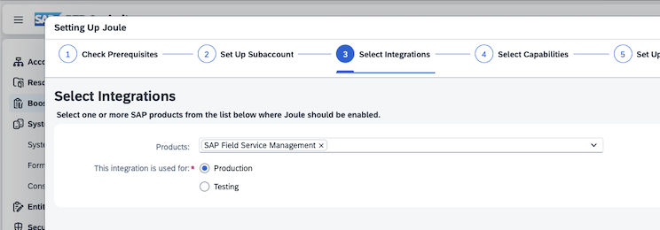

- **What the booster creates:** a formation including Joule and the system; a Joule subscription; a BTP destination **`FSM_SSO`**; a client named **`<account ID>-sap-joule`** in the Field Service account; a SAML configuration for trust; and an account configuration **`sap.joule`** that points to the Joule endpoint
- **Verify:** the Joule icon appears in the top right bar, including the Admin portal

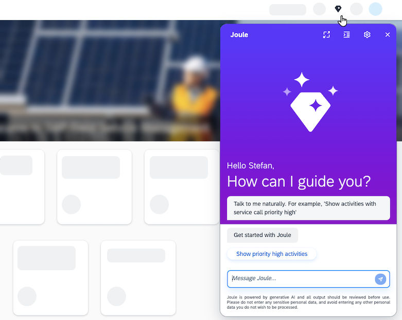

## 24.7 Added by Claude, not from the sources
- The comparison with Chapter 19 (Datasphere repeats the SAC pattern with a different source system type) is my observation; the guide itself even tells you to create the Datasphere source as type "SAP Analytics Cloud"
- The transformation is summarised, not copied
- I read the first assertion attribute row ("Groups" with expression `sac`) from the screenshot together with the table

---

## Screenshots and figures from the sources
- All twelve figures are placed inline in 24.5 and 24.6; pages 123 to 127 and 137 to 141 have none

---

## Recap
- Next-gen Ariba: single logout plus booster; Intake Management: booster with the same Cloud Identity Services tenant
- Clinical Supply Management needs **OIDC** trust; SAML and OIDC cannot coexist in one IAS tenant
- M365 Copilot: one Entra tenant per Joule environment; add the system type **M365 Copilot for SAP Joule**; up to two hours before it appears
- Datasphere: Work Zone formation (three destinations), OAuth client (User Provisioning, client credentials), IPS source typed as SAC with `sac.api.version` 2, Work Zone target, simulate, run, validate, schedule
- Field Service: booster creates `FSM_SSO`, the `-sap-joule` client and `sap.joule`; rotate the secret

## Practice
- Why can't development and production share one Entra tenant?
- Which three destinations does the Datasphere formation create?
- What must be true of the Work Zone instance and Datasphere tenant in the Joule formation?

---

## How this chapter was checked
- All 21 pages were read in full; all twelve screenshots were opened

## Sources and further reading
- SAP Help Portal, *Integrating Joule with SAP Solutions* (PDF, pages 123 to 143): https://help.sap.com/doc/de3af3c0f81642dbaa4d36172ed57a72/CLOUD/en-US/79bfc83ab386450c8cd9c7937ce26a3a.pdf
- SAP Discovery Center, Joule missions: https://discovery-center.cloud.sap/missiondetail/4538/

---

*Previous: [Chapter 23: Integrating Joule with IBP, Signavio, Ariba and the documentation-only products](23-integrating-joule-ibp-signavio-ariba-and-docs-only-products.md)*

*Next: [Chapter 25: Integrating Joule with SAP Concur, Fieldglass and the smaller products](25-integrating-joule-with-concur-fieldglass-and-smaller-products.md)*
