# Chapter 25: Integrating Joule with SAP Concur, Fieldglass and the smaller products

*Concur is the most detailed one here: buying Joule Base, an SAP Support case, Cloud Identity Services, a GUID import, the booster, and an optional pilot mode that limits Joule to a group of users. Then five short sections: Fieldglass, Logistics Management, Risk and Assurance Management, Sports One, Batch Release Hub and Incentive Management.*

> [!NOTE]
> **📍 At a glance**
> - **You will learn:** the full Concur onboarding path, the GUID mapping import, the three ways to run Joule pilot mode, and the prerequisites of the smaller products
> - **Level:** intermediate · **Time:** about 25 minutes of reading
> - **Source:** SJ022, the Joule Onboarding Guide PDF, sections 4.17 to 4.23, pages 143 to 176 (read in full); read 9 November 2026
> - **Builds on:** [Chapter 18](18-onboarding-guide-customer-managed-provisioning.md) and [Chapter 24](24-integrating-joule-ariba-next-gen-m365-datasphere-and-field-service.md)

**After this chapter you can:**
- buy Joule Base for Concur in the right scenario and raise the right support case
- configure Cloud Identity Services in Concur and import the Global User ID mapping
- run the booster or include Concur in an existing formation, then do the post-integration checks
- run Joule for a pilot group in three different ways
- state the prerequisites of Fieldglass, Logistics Management, Sports One and Batch Release Hub

---

## 25.1 Concur: overview

- Extra entitlement and authorisation may be needed
- **Steps:** trust to IAS, trusted domain in BTP, user attributes, trusted domains in IAS, **booster**, then "Getting Started with Joule Base"
- **Concur does not use AI Units**

## 25.2 Concur: purchase Joule Base

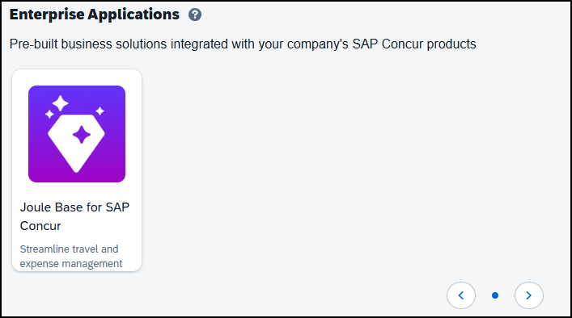

- **Where:** SAP Concur App Center, **Joule Base for SAP Concur**, **Visit SAP Store**; the purchase is **$0**
- **Three scenarios:**

| Scenario | Who | What to do |
|---|---|---|
| Concur only | no other SAP products, may have no SAP Store account | **Register** for an SAP ID, activate and sign in, Buy now; enter company name and address **exactly as in your Concur billing details**; accept terms, Place Order |
| Concur plus other SAP products | has SAP Store access and S-users | Sign in with an S-user **with purchase rights** (SAP note 1511008); **check the SAP account** on the order; buying under the wrong account can create duplicate entitlements |
| Already has a Joule entitlement | bought Joule, or owns it through another SAP product | Review entitlements in SAP for Me first; if more is needed buy with the S-user of the account that owns the existing entitlement |

- After approval (**one to three days on average**) you get an email to activate your S-user and sign in to **SAP for Me**; then **create a case** in SAP for Me to begin the Joule setup
- If unsure whether you have SAP products, raise a case with the subject "Assistance with Joule Activation"
- **Custom AI terms:** talk to your SAP account executive before buying
- Customers who already have **AI Units from another line of business** get a Joule entitlement in BTP automatically; customers with entitlements under the **same CRM/account ID** do not buy again, but **must still do the Concur-specific activation**
- **Sign-up:** during sign-up choose the BTP tenant where Joule will be contracted; Concur-only customers choose **New BTP Account**; **new BTP provisioning and the Joule contract can take up to 48 hours**

## 25.3 Concur: support case and Cloud Identity Services

- **Create the case in the SAP for Me portal, not in Concur Support**; component **`CON-INT-SSO-SD`**, subject **"Set up SAP Cloud Identity Services for Concur"**
- Answer up front: any other SAP products (yes or no); whether you already use Identity Authentication; your **customer number**; needs an S-user that may open incidents (SAP notes 1511008, 2891528, 1296527)
- **After the incident:** in Concur, Home, Administration, Company Admin, **SAP Cloud Identity Services**, Configure; choose one method:

| Method | Meaning |
|---|---|
| Basic Authentication | moves authentication and password policy to IAS; you keep managing users in Concur |
| SAP Identity Authentication Service | IAS manages authentication **and provisioning**; for new customers |
| Other Authentication Service | IAS is a **proxy** to your existing IdP (Entra, Okta); users keep logging in there |

- Then choose your tenant (Refresh if the list is empty), review, **Finish**, **Configure tenant**; afterwards pick the right **IPS transformation** for your organisation

### Global User ID (GUID) mapping
- The GUID must match in Concur and IAS or Joule will not work
- With the **SAP Identity Authentication Service** option, IPS imports automatically
- Otherwise (manual): export users from IAS to get each user's global ID; create a **UTF-8 text file**: the mandatory first line `"100","0","SSO","UPDATE","EN","N","N"` and, per user, a **record type 315** line with the Concur user ID and the IAS GUID
- Concur: Tools, Import/Export Monitor, Imports, Upload; import name **Employee**; Run Now; **Last Run Status = Success**

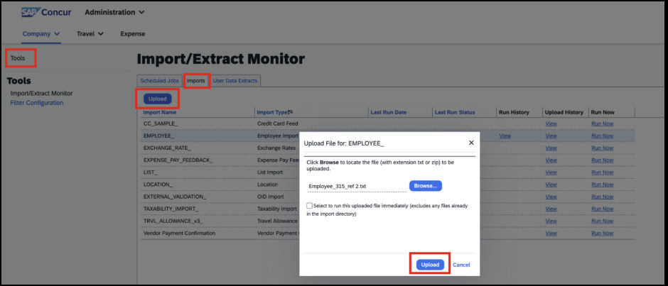

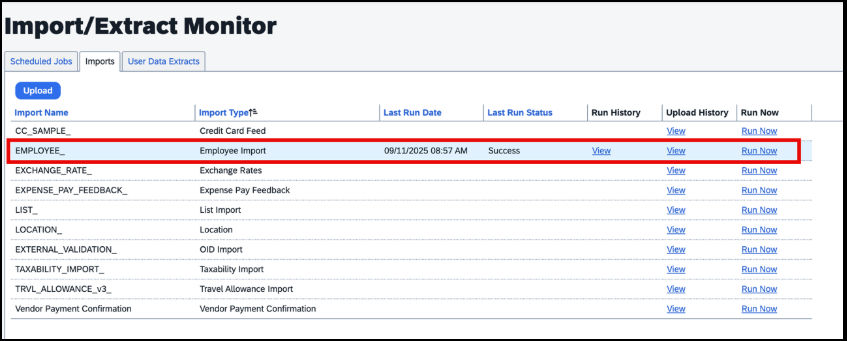

- Concur has **no built-in per-user check** of the mapping; verifying through the API needs the Concur web service licence; otherwise raise a ticket

## 25.4 Concur: the booster

### Validation first
- In the BTP global account, System Landscape, Systems: **both the Concur tenant and the IAS tenant must be listed**; if not, raise a support case so the back-end tenant alignment is checked

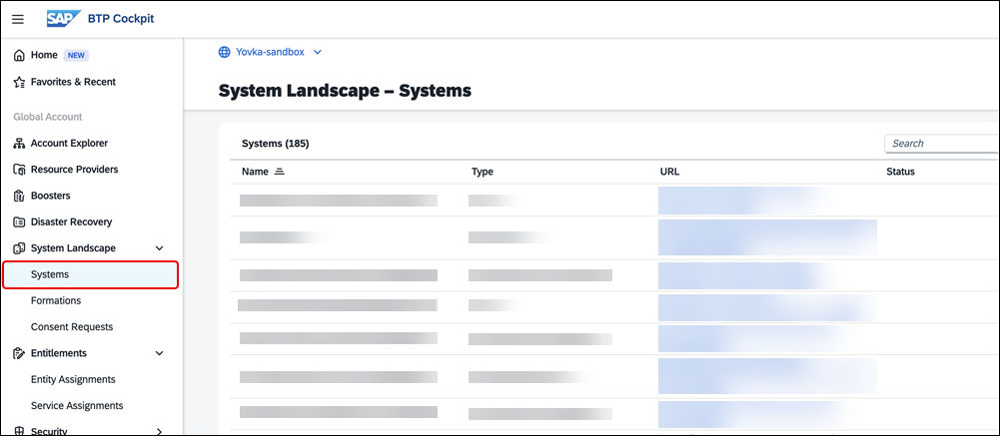

### New Joule setup
- Run the booster and **select the SAP Concur system**; the formation must reach **Ready**; the Joule icon then appears in Concur

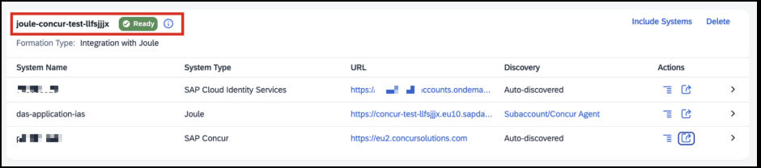

### Existing Joule setup
- Formations, the existing formation, **Include Systems**; **the same Cloud Identity Services as your unified setup**

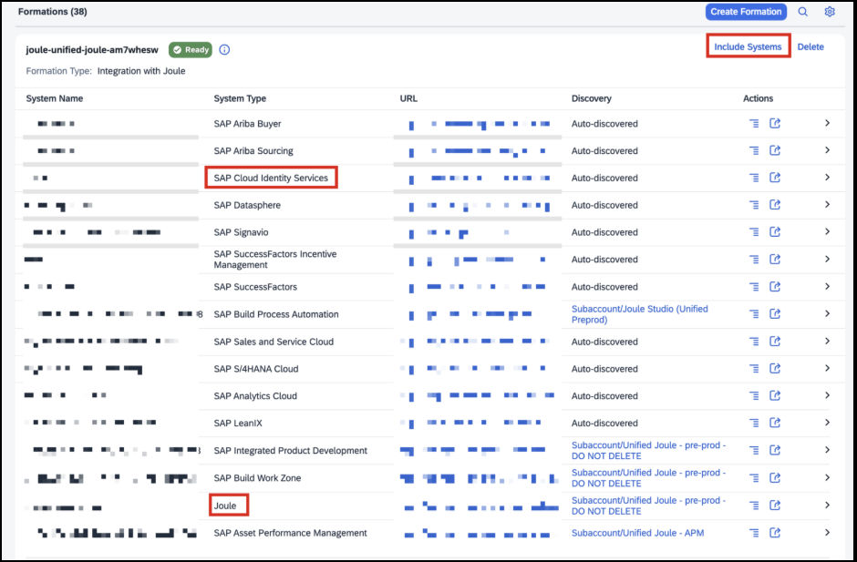

- Filter the list by **SAP Concur**, select the system, Next Step; tick **Enable Capability Deployment** and **Enable the Joule Icon in the Integrated System**; Review; Include

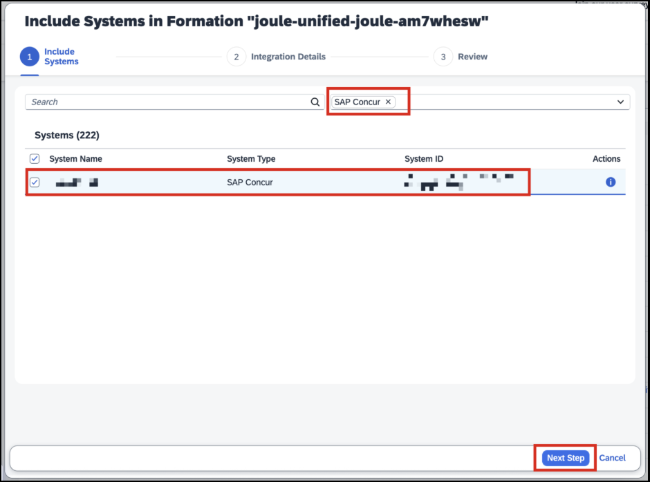

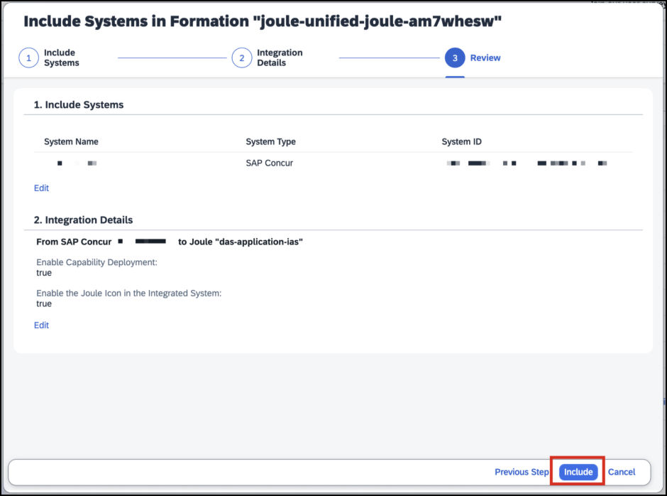

- Setup normally takes **5 to 8 minutes**, from a processing message to **Ready**

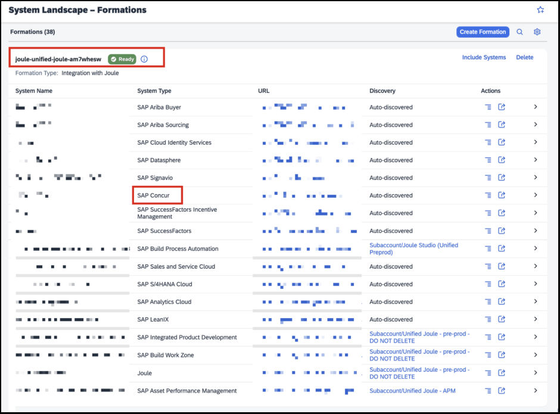

### Post-integration checks
- **Application list in IAS:** several applications are created in the background; check they exist

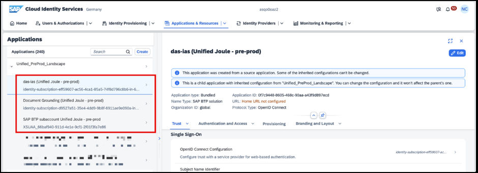

- **Trusted domains:** in IAS, Applications and Resources, Tenant Settings, Customization, Trusted Domains, Add, your Concur URL, Save; and in the BTP subaccount, Security, Settings, add the Concur domain

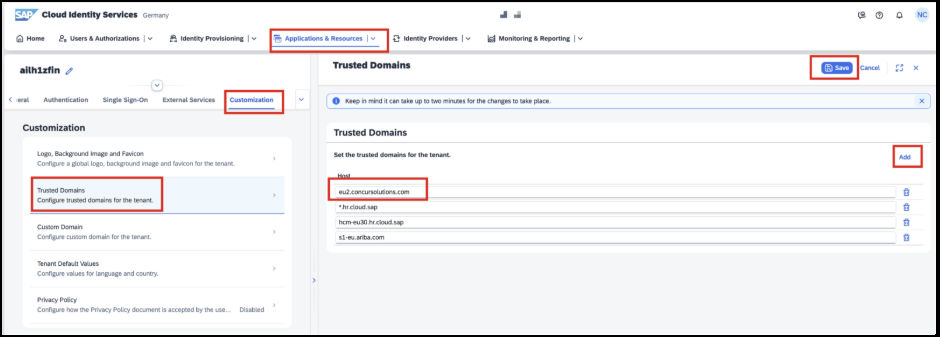

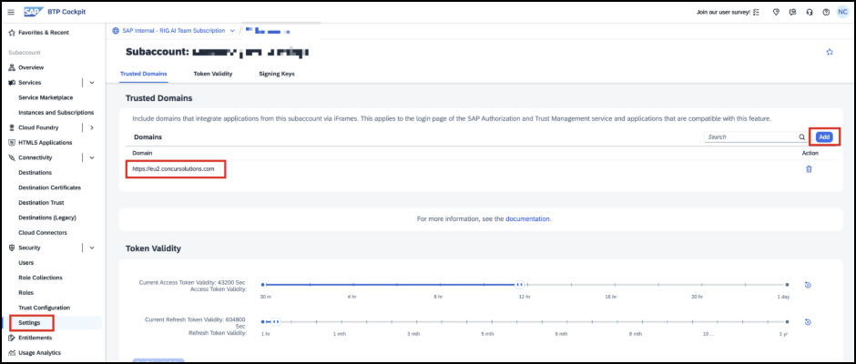

- **Test:** log in to Concur and click the Joule icon; the guide points to "SAP Concur Solutions AI Resources" for the list of scenarios

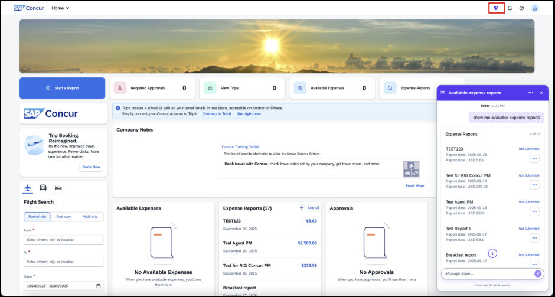

- **After go-live, support:** raise an incident in SAP for Me with component **`BNS-CON-JOULE`**

## 25.5 Concur: Joule pilot mode (selective access)

- **What it is:** limit Joule in **production** to a small **Joule Pilot User** group
- **Order:** can be switched on before or after the other activation steps
  - **before:** once Joule is fully enabled, only pilot users see the icon
  - **after:** users who had Joule **lose it** unless they are added to the group
- **Step 1:** pilot mode is enabled **once per company** by opening a **Service Delivery request**
- **Step 2:** choose a management method; access is controlled by a group named exactly **`Joule Pilot User`**

| Option | Use when | How |
|---|---|---|
| A: in Concur Administration | you want to manage pilots inside Concur | Administration, Company Admin, User Administration, View Users, open the user, **Joule Pilot** section, **Enable Joule pilot for this user**, save (only visible after pilot mode is on) |
| B: retrieve the group from Concur | **Concur is the system of record** and you use IPS | IPS source = Concur with a user and group transformation; group filter `concur.group.filter = displayName eq Joule Pilot User`; target = IAS local directory; then add users in IAS Groups; then sync back with the reverse job |
| C: create the group manually in IAS | users are managed elsewhere (for example SuccessFactors) | create the group `Joule Pilot User`, add users, IPS source = the local identity directory with `idds.group.filter = displayName eq "Joule Pilot User"` (and optionally `idds.user.filter`), target = Concur with a group transformation that skips create and delete for users |

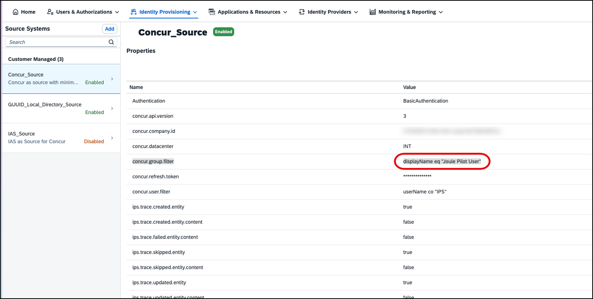

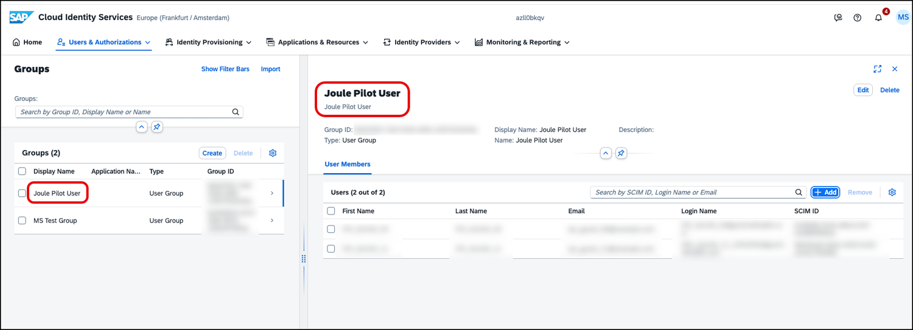

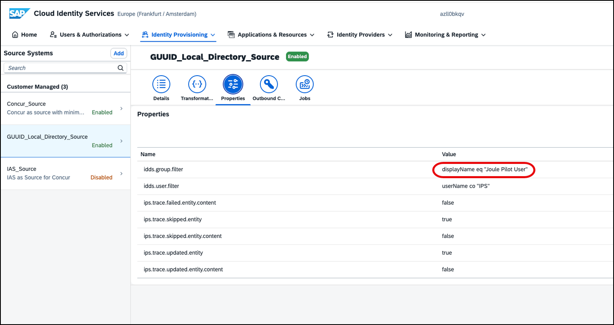

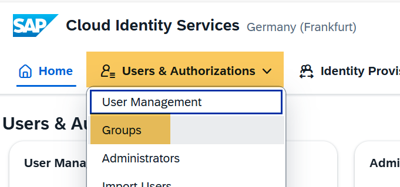

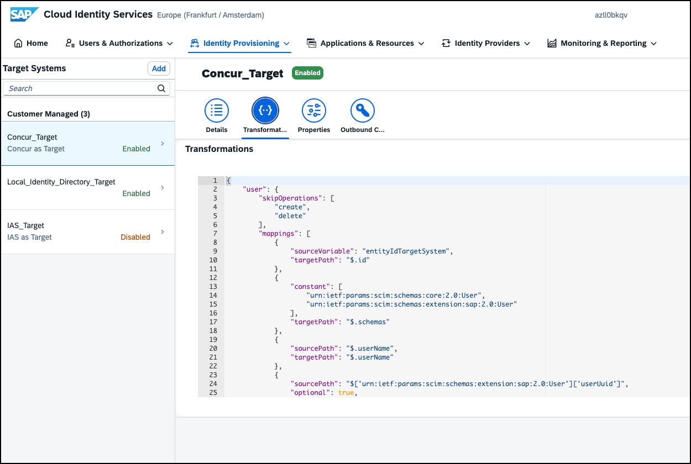

- **Concur target properties (Option C):** BasicAuthentication, `concur.api.version` = `3`, `concur.company.domain`, `concur.company.id`, `concur.datacenter` (for example `EU2`), `concur.refresh.token`, `concur.support.patch.operation` = `true`, `concur.user.unique.attribute` = `userName`, `ips.trace.failed.entity.content` = `false`, ProxyType Internet, Type HTTP
- **Option B step 3 (sync back):** IAS local directory as source; transformation that **skips create and delete**, passes `userName` and `userUuid`, and for groups only those with the optional prefix; filter `dds.group.filter = displayName eq Joule Pilot User`; optionally restrict users with `idds.user.filter = groups.display eq "Joule Pilot User"`; target Concur; run the job
- **Step 3 for users:** pilot users log in to Concur; **no further configuration**
- **Guardrails:**
  - the group name must be **exactly** `Joule Pilot User`
  - pilot mode is **not for broad rollout**; **disable it** to enable Joule for everyone
  - **filters are strongly recommended** to avoid provisioning unintended users

## 25.6 SAP Fieldglass (4.18)

- **Sandbox warning:** the IAS/IPS configuration takes about **24 hours** in sandbox environments; wait until it is complete
- **Prerequisites:** SSO configured; the Fieldglass and Cloud Identity Services integration is configured
- **IAS is responsible for** user management (users are loaded into IAS and distributed to Fieldglass) and login management (all users calling the Fieldglass URL are routed to IAS, which authenticates directly or through the buyer's own identity system)
- **IPS provisions users from IAS to Fieldglass** and updates them as they change
- **All users must be created and managed in IAS**; you cannot create users in the Fieldglass UI, and Fieldglass edits are limited to attributes IAS does not hold
- **Product enablement:** an enterprise BTP global account; subscribe to **Work Zone standard edition** and configure the navigation service destinations
- **Enable Joule:**
  1. create a formation including **Fieldglass, Cloud Identity Services and Work Zone**; wait for **Ready**
  2. create the Joule formation, either with the booster (type **Integration with Joule**, including Work Zone) or a new formation containing **Joule, Fieldglass, Cloud Identity Services and Work Zone**; if a Joule formation already exists, make sure Fieldglass and Work Zone are in it
  3. enable the **Use Joule** permission on every user role that should use the assistant

## 25.7 SAP Logistics Management (4.19)

- **What Joule does:** navigate to apps, run and monitor jobs, share content, ask about apps and processes
- **Prerequisites:** subscribed and set up; **region rule: if you are in US20 (US West, WA), set Joule up in US21 (US East, VA)** because Joule is not yet in US20 (cross-subaccount); **Work Zone** (standard edition recommended) as the entry point and navigation service; the **Joule launchpad plugin** deployed in Work Zone; **user groups and role collections created**; which capabilities a user gets depends on the **authorisation policies**; the technical and business integration with the external back end (S/4HANA Private or Public Edition) done; the **organisational model imported** before Joule setup
- **Setup:** the customer-managed provisioning of Chapter 18

## 25.8 The remaining short sections

| Product | What the guide says |
|---|---|
| Risk and Assurance Management (4.20) | Three steps: complete Joule onboarding, set up capabilities, **configure single logout**; the admin guide needs an S-user; an extra entitlement may be needed |
| Sports One (4.21) | Check the integration path; general prerequisites; trust to IAS; the system is **discovered in the BTP landscape**; then run the booster |
| Batch Release Hub for Life Sciences (4.22) | Needs **both a preview and a production landscape**; run **Setting Up Joule - Preview** and **Setting Up Joule**; prerequisites as for Clinical Supply Management (Chapter 24): Cloud Foundry subaccount, Joule entitlement in the same global account, subscription, **OIDC** identity provider (SAML to OIDC migration: SAP note 3416734; one IAS tenant cannot hold both); add the **enriched assertion attributes** `first_name` = `${first_name}` and `last_name` = `${last_name}` (IAS, Identity Providers, the provider, Trust, Enriched Assertion Attributes); select the product, choose the system, add trusted domains in IAS and BTP |
| Incentive Management (4.23) | Joule AI is available in **Incentive Management on Hyperscalers** and **enterprise edition**; the prerequisites and steps are in each product's own documentation |

## 25.9 Added by Claude, not from the sources
- The scenario table in 25.2 and the option table in 25.5 condense the guide's longer procedures
- In Option B the guide names the filter `concur.group.filter` in step 1 and `dds.group.filter` in step 3; I kept both as written (the second may be a typo for `idds.group.filter`)
- The IPS transformations are summarised, not copied
- The guide's Option C properties table contains an example user filter value; I left it out

---

## Screenshots and figures from the sources
- All eighteen figures are placed inline in 25.2 to 25.5 (one very thin strip on page 166 was not kept)

---

## Recap
- Concur needs Joule Base ($0) bought in the right scenario, a **SAP for Me** case (`CON-INT-SSO-SD`), IAS configured in Concur, the **GUID** mapping, then the booster or an include
- Check trusted domains in IAS and BTP; support component after go-live is `BNS-CON-JOULE`
- Pilot mode: group named exactly `Joule Pilot User`; three management options; use filters; not for broad rollout
- Fieldglass: users live in IAS; formation with Work Zone; **Use Joule** permission on roles
- Logistics Management in US20 needs Joule in US21
- Batch Release Hub needs OIDC, enriched assertion attributes and both landscapes

## Practice
- Which support component do you use to request Cloud Identity Services for Concur?
- What happens to existing users if you switch pilot mode on after Joule is live?
- Why must a Logistics Management customer in US20 use a US21 subaccount?

---

## How this chapter was checked
- All 34 pages were read in full; the screenshots were opened as a contact sheet; one thin strip on page 166 was dropped

## Sources and further reading
- SAP Help Portal, *Integrating Joule with SAP Solutions* (PDF, pages 143 to 176): https://help.sap.com/doc/de3af3c0f81642dbaa4d36172ed57a72/CLOUD/en-US/79bfc83ab386450c8cd9c7937ce26a3a.pdf
- SAP Discovery Center, Joule missions: https://discovery-center.cloud.sap/missiondetail/4538/

---

*Previous: [Chapter 24: Integrating Joule with next-gen Ariba, Clinical Supply, Intake Management, Microsoft 365 Copilot, Datasphere and Field Service](24-integrating-joule-ariba-next-gen-m365-datasphere-and-field-service.md)*

*Next: [Chapter 26: Document grounding, part 1: setup, repositories and pipelines](26-document-grounding-setup-and-pipelines.md)*
