# Chapter 29: Customer case studies: Bosch, WEL Networks, Uniper, Zensar and Capgemini

*Five real Joule projects, read for what a Gen AI developer can reuse: the architecture, the agent pattern, the numbers claimed and the prerequisites that bit.*

> [!NOTE]
> **📍 At a glance**
> - **You will learn:** how five customers used Joule or Joule Studio agents, what architecture each used, and which claims are verified numbers versus marketing
> - **Level:** intermediate · **Time:** about 15 minutes of reading
> - **Source:** SJ080 Bosch Power Tools deck (14 pages), SJ081 Capgemini landing page, SJ083 Uniper one-pager, SJ084 WEL Networks and Deloitte deck (8 pages), SJ085 Zensar case study (4 pages); all read in full on 9 November 2026
> - **Builds on:** [Chapter 13](13-more-agent-scenarios-extensions-n8n.md) and [Chapter 21](21-integrating-joule-with-s4hana-private-edition.md)

**After this chapter you can:**
- describe the "classification agent replaces static rules" pattern from Bosch
- list the prerequisites WEL met for Joule on S/4HANA Private Edition
- explain the Uniper pattern: one agent, many systems, delivered in Microsoft Copilot
- judge which numbers in vendor case studies to trust

---

## 29.1 Bosch Power Tools: a classification agent for service tickets

- **Source type:** SAP Innovation Awards 2025 entry deck
- **Problem:** more than 1.5 million e-mail tickets a year in about 38 countries; the deck gives both "up to 40%" and "60 to 70%" of tickets misrouted (the two figures are printed on different pages), more than 200 static workflow rules, slow system and manual dispatch
- **Solution:** the **SAP CX AI Toolkit** (an add-on built on SAP BTP) with an **AI Agent Builder**; a **Case Classification agent** reads each ticket and sets routing properties in SAP Sales and Service Cloud from **business rules written as a natural language prompt**
- **Two parts:**
  - agent side: a no-code classification agent in the backend (example prompt: classify all incoming tickets for Germany by rules a, b, c and alter the routing properties)
  - user side: a Joule assistant embedded in the agent desktop (ticket summary in 10 lines, problem and solution ideas, reply in the sender's language, draft a knowledge base article from a closed incident)
- **Claims (self-reported):**
  - classification accuracy up **35%** in initial tests; 90% routing and categorisation accuracy expected
  - about **80 man-days** a year of IT effort saved; hundreds of workflow rules replaced by one prompt
  - expected savings per Germany contact centre: 200 h (routing), 1,000 h (response preparation), 1,300 h (knowledge base documentation), headline "up to 2,500 h"
  - changes to routing logic in **minutes instead of weeks**
- **Status:** live since **1 March 2025** in the first German contact centre, about 400 agents, 5,000 documents in the knowledge base; wider rollout in progress; about seven months from start to go-live, with a November 2024 co-innovation hackathon at SAP Stuttgart-Gerlingen
- **Architecture (see figure):** user SSO through Bosch IDM and Microsoft Active Directory on Azure; the desktop client uses OAuth to Sales and Service Cloud; the Cloud talks to the CX AI Toolkit on BTP over an **HTTPS destination**; trust between the Bosch IdP and Azure AD
- **Technology list:** CX AI Toolkit, Sales and Service Cloud, SAP Customer Data Platform (proof of concept), a planned Joule plus S/4HANA "lead to cash" extension, BTP Integration Suite for ingesting SAP and non-SAP data, AI Core and the AI Foundation
- **Developer takeaway:** replacing a pile of rules with a prompt-driven classifier is a pattern you can copy; the risk the deck does not discuss is how a prompt change is tested before it is live

## 29.2 WEL Networks and Deloitte: Joule on S/4HANA Private Edition, early adopter

- **Who:** WEL Networks, the sixth largest electricity distributor in New Zealand (over 99,000 connections); Deloitte as implementation partner; deck dated May 2025
- **Timeline:** SAP ECC in 2011, RISE with SAP and a brownfield S/4HANA Private Cloud migration in 2024, **Joule early adopter in 2025** (joined the **Early Adopter Care programme in February 2025**)
- **Programme steps:** kick-off, discovery sessions, activation, testing, ongoing review; benefits include back-office support, direct feedback to product and a follow-up interview with a business expert
- **State:** Joule is in the **test system** being assessed; not yet in production
- **Prerequisites and architecture (as listed):**
  - **minimum S/4HANA 2023 FPS01** in RISE; more Joule capabilities from **FPS02**
  - **SAP Build Work Zone, standard edition** for navigation and role-based access
  - Joule in the **same BTP subaccount** as the Work Zone
  - **IAS and IPS**: Joule must use the **same Cloud Identity Services tenant** as S/4HANA
  - the **Joule booster** can be used, or the steps done manually
  - **principal propagation** must be active in the S/4HANA landscape
  - **one Joule instance connects to one S/4HANA instance** (compare the multi-system feature in [Chapter 28](28-multi-system-support-troubleshooting-and-constraints.md))
  - connection through **Cloud Connector** (production and shadow) with secure tunnels
- **Capabilities:** appears on the Fiori launchpad, unrestricted natural language prompts, three conversation patterns (**transactional, navigational, informational**)
- **Open considerations before production:** governance, data privacy, usage and credits, business-process embeddedness; future: proactive insights, mobility
- **Screenshots in the deck:** the Joule panel on a Fiori launchpad, a purchase order lookup, a "how do I view a general ledger" answer with source documents, and a navigation answer that opens the Manage Sales Orders app
- **Developer takeaway:** the checklist doubles as a pre-flight list for your own Private Edition pilot

## 29.3 Uniper: a custom procurement agent in Joule Studio

- **Who:** Uniper SE (energy, 6,863 employees); delivered with SAP experts under the MaxAttention programme; one-page case study dated December 2025
- **Starting point:** an existing purchase requisition automation that had improved search accuracy by 95% and removed 50% of manual effort
- **Solution:** a **custom AI agent built in Joule Studio** (SAP Build) that answers employees' questions in natural language by pulling status of purchase requisitions, procurement guidelines and new orders from several systems, including **SAP Ariba Buying and Invoicing and the Ariba Catalog**, **integrated through SAP BTP**
- **Channel:** users talk to the agent through **Microsoft Copilot**
- **Results listed (qualitative):** faster retrieval, better adherence to procurement rules, less time on repetitive tasks, a base for agents that manage transactions end to end
- **Developer takeaway:** the pattern is "Joule Studio agent, BTP connectivity, a non-SAP front end"; the one-pager gives **no new numbers** for the agent itself

## 29.4 Zensar: Joule with SuccessFactors Employee Central

- **Who:** Zensar as IT partner for the UK's largest motoring organisation (revenue about 1.3 billion dollars); four-page case study, 2024 copyright
- **Scope:** integrate Joule with **SuccessFactors Employee Central** for automated employee query resolution, workforce planning recommendations and HR analytics
- **How:** built on **SAP BTP**, embedded in the SuccessFactors UI, using **SAP AI Core** for processing
- **Reported impact:** **30 to 50% fewer HR support tickets**, up to **26% better employee satisfaction** within months, faster time to decision; the document itself says it is "still early in the journey"
- **Developer takeaway:** no architecture diagram or implementation detail; use it only as a reference customer, and see [Chapter 20](20-integrating-joule-with-successfactors.md) for the real setup

## 29.5 Capgemini: RFQ Negotiation Agent (landing page only)

- **Source type:** an SAP asset page; the page has **only an abstract**, and I checked that no PDF download exists behind it
- **What it says:** Capgemini built a **multi-agent Procure-to-Pay MVP in three weeks** with the no-code Agent Builder of Joule Studio, classic edition; native SAP integrations and standard APIs provide data and context, connectivity spans SAP and non-SAP, agents **reason over policies, coordinate tasks and keep humans in the loop**
- **Developer takeaway:** the keywords (multi-agent, human in the loop, policy reasoning) match the patterns in [Chapter 7](07-first-joule-agent.md) and [Chapter 10](10-pro-code-agents-a2a.md); there are no further details to extract

## 29.6 Patterns across the five

| Case | Pattern | Evidence level |
|---|---|---|
| Bosch | Prompt-driven classification agent plus embedded assistant | Detailed deck, self-reported numbers |
| WEL | Standard Joule on S/4HANA Private Edition | Prerequisites are concrete; no results yet |
| Uniper | Joule Studio agent over several systems, surfaced in Copilot | Qualitative only |
| Zensar | Joule inside SuccessFactors | Percentages, no method |
| Capgemini | Multi-agent P2P MVP | Abstract only |

## 29.7 Added by Claude, not from the sources
- The "developer takeaway" lines and the evidence-level table are my own assessment
- The remark about testing prompt changes at Bosch is my suggestion; the deck is silent on it
- The two misrouting figures at Bosch (40% and 60 to 70%) are both as printed; I did not reconcile them

---

## Screenshots and figures from the sources

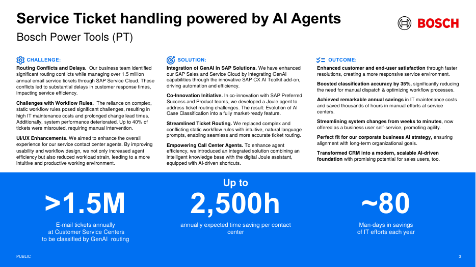

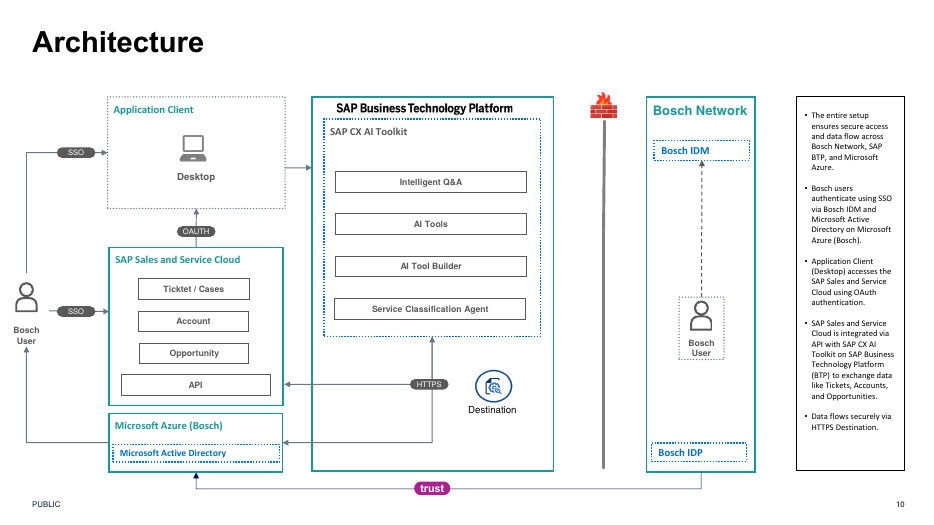

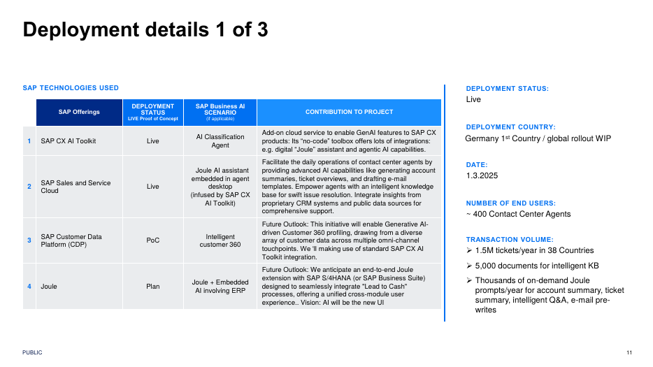

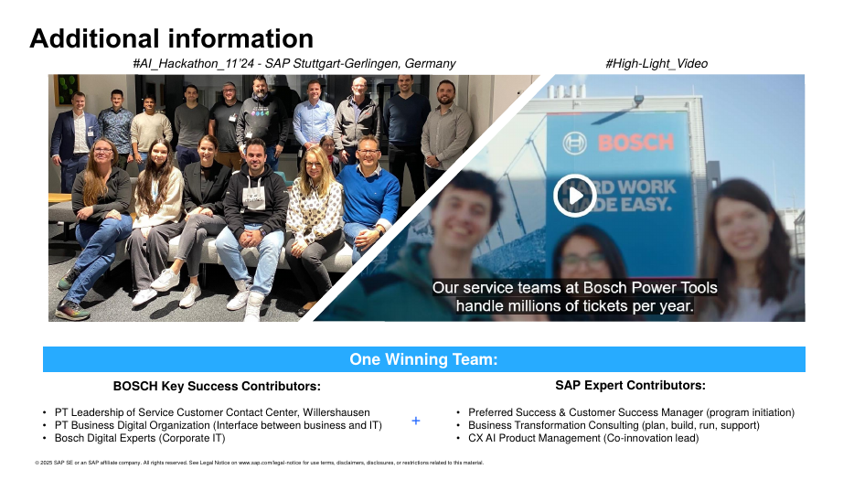

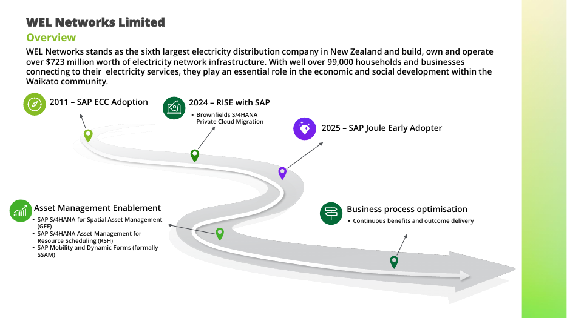

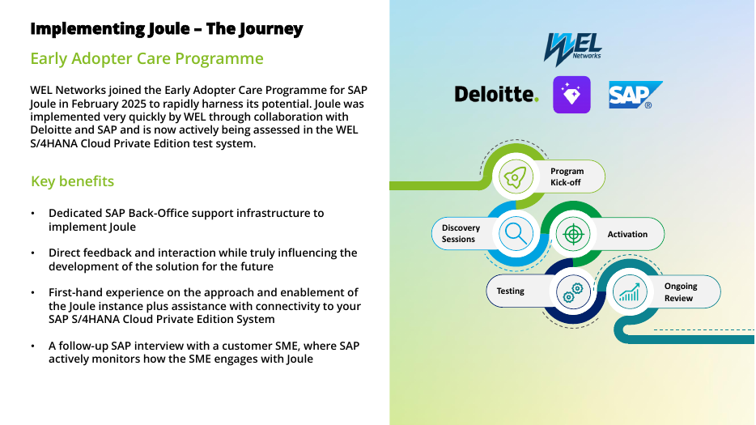

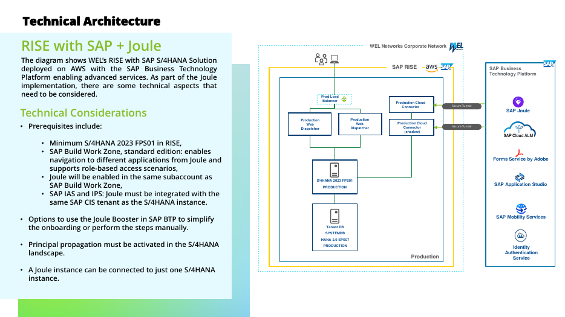

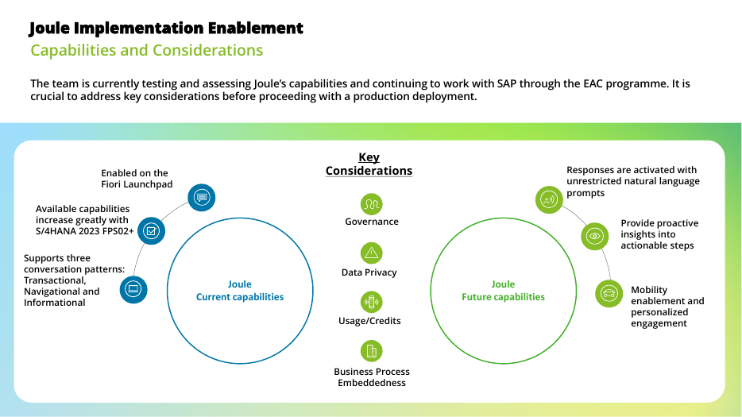

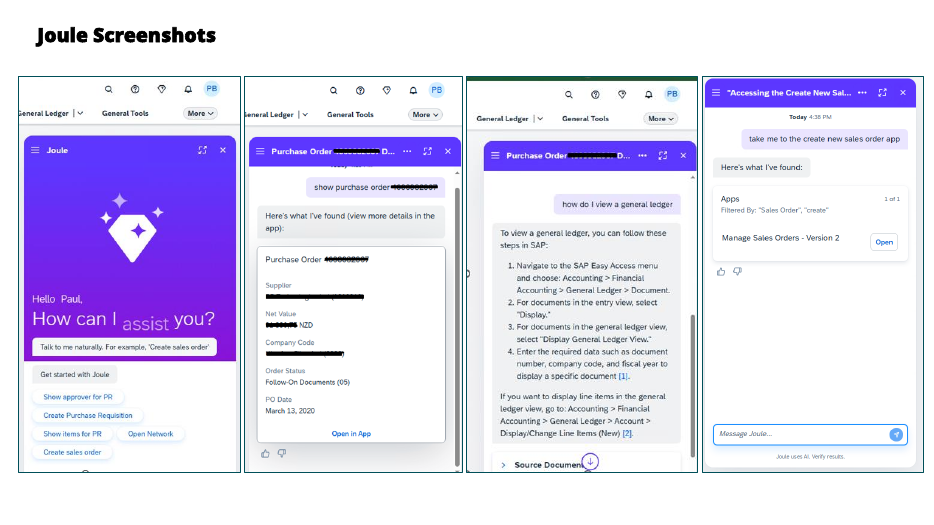

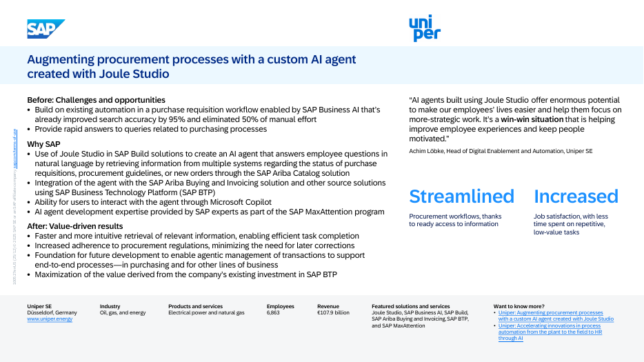

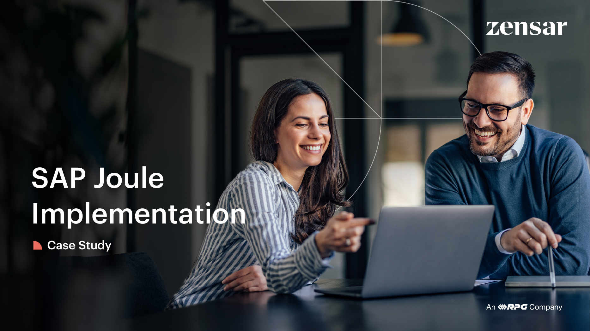

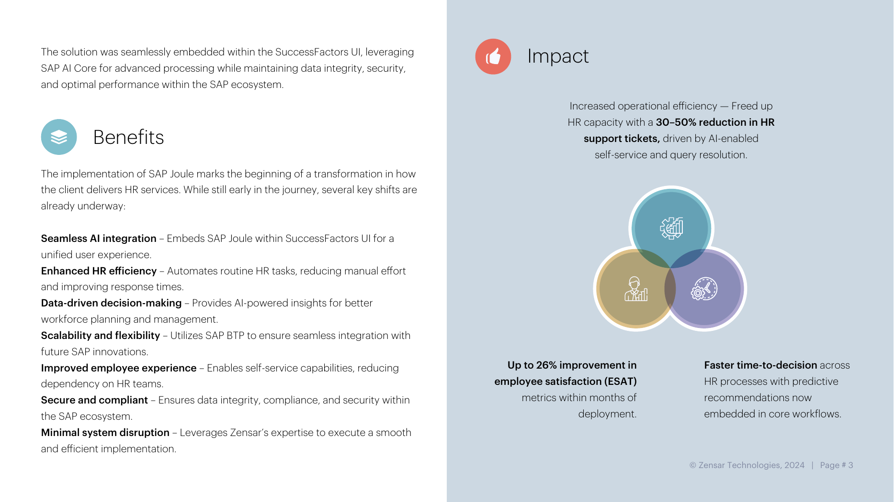

- The decks' other pages (title slides, legal text, agenda) have no extra figures

---

## Recap
- Bosch: **a prompt replaced 200+ routing rules**; go-live 1 March 2025, about 400 agents
- WEL: Private Edition pilot needs 2023 FPS01+, Work Zone standard, same IAS tenant, principal propagation; **one Joule per S/4HANA system**
- Uniper: a Joule Studio agent over Ariba and other systems, used through Microsoft Copilot
- Zensar: Joule in SuccessFactors, 30 to 50% fewer HR tickets claimed
- Capgemini: three-week multi-agent MVP, human in the loop; abstract only

## Practice
- Which prerequisite in the WEL deck explains why a second S/4HANA system needs Chapter 28's multi-system setup?
- Why should the Bosch numbers be called "expected" or "self-reported"?
- How would you test a prompt-based routing agent before switching it on for 1.5 million tickets?

---

## How this chapter was checked
- All four PDFs were read in full and the pages rendered and viewed; numbers were compared with the page text; the Capgemini page was opened and confirmed to have no downloadable PDF

## Sources and further reading
- Bosch Power Tools, SAP Innovation Awards 2025: https://www.sap.com/belgique/documents/2025/03/6ea1f54c-fc7e-0010-bca6-c68f7e60039b.html
- Capgemini RFQ Negotiation Agent: https://www.sap.com/assetdetail/2025/10/8436afc5-287f-0010-bca6-c68f7e60039b.html
- Uniper: https://www.sap.com/netherlands/documents/2025/12/d28940d0-317f-0010-bca6-c68f7e60039b.html
- WEL Networks and Deloitte: https://assets.dm.ux.sap.com/nz-sap-business-unleashed-innovation-day-auckland/pdfs/007_deloitte.pdf
- Zensar: https://zensar.com/assets/files/35c3WXeb9JvdN4IHnvuYyI/SAP-Joule-Implementation.pdf
- SAP Discovery Center, Joule missions: https://discovery-center.cloud.sap/missiondetail/4538/

---

*Previous: [Chapter 28: Multi-system support, troubleshooting and constraints](28-multi-system-support-troubleshooting-and-constraints.md)*
