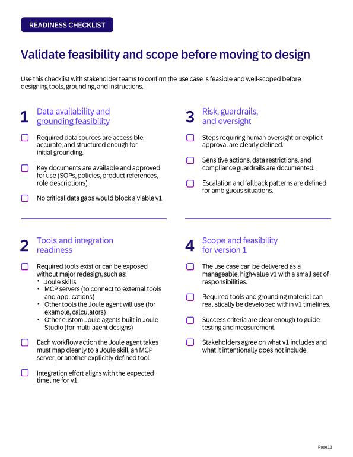
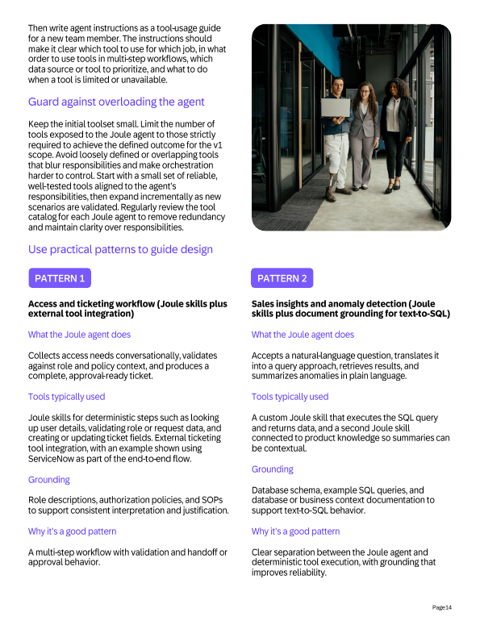
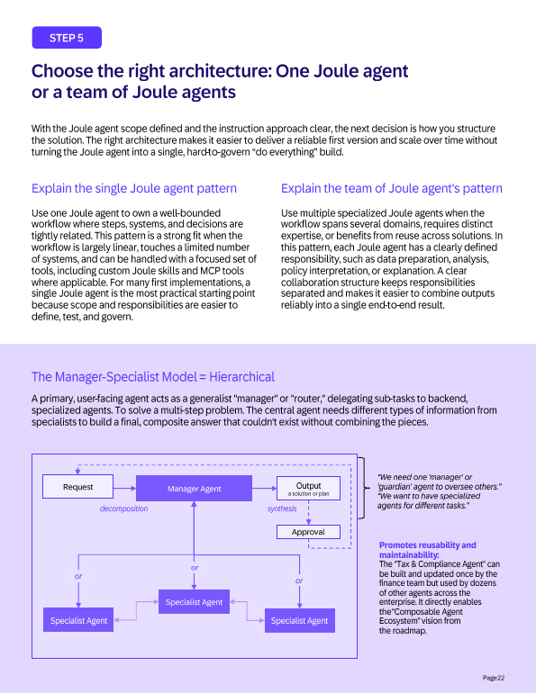
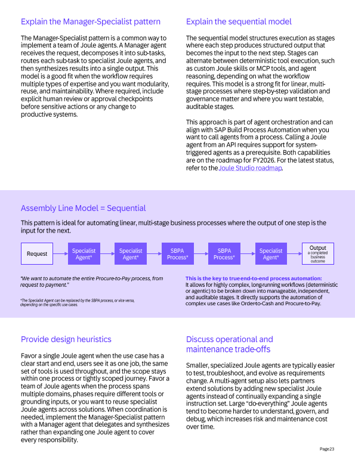
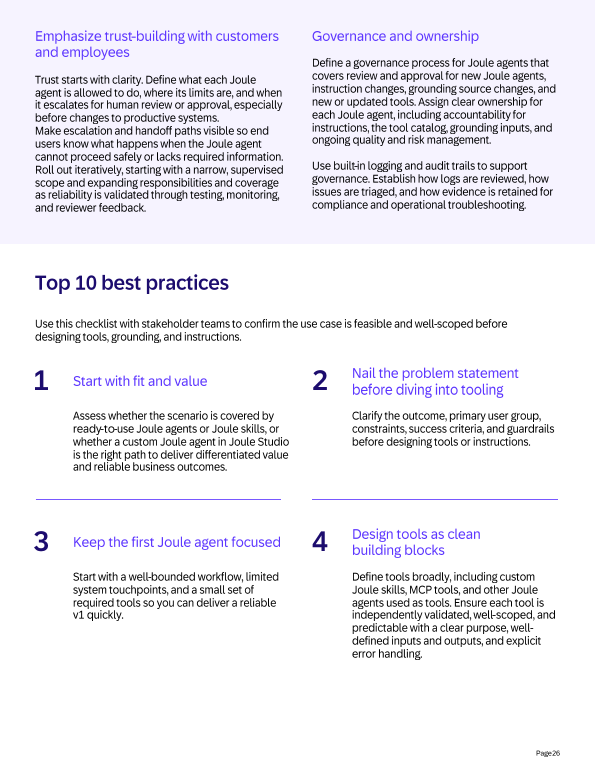
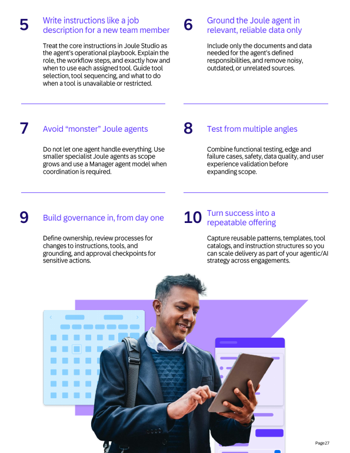

# Chapter 30: Best practices for building custom Joule agents in Joule Studio

*SAP's partner guide (February 2026) as a developer playbook: when to build, how to scope, what tools and grounding to give the agent, how to write instructions, which architecture to pick, and how to test and govern.*

> [!NOTE]
> **📍 At a glance**
> - **You will learn:** a six-step method from "should I build this?" to governance, four tool patterns, single versus multi-agent architecture, an instruction template, and the ten best practices
> - **Level:** intermediate to advanced · **Time:** about 25 minutes of reading
> - **Source:** SJ111, SAP "Best Practices for Building Joule Agents with Joule Studio" (PDF, 29 pages, February 2026); read in full on 9 November 2026
> - **Builds on:** [Chapter 7](07-first-joule-agent.md), [Chapter 8](08-agents-hands-on.md) and [Chapter 10](10-pro-code-agents-a2a.md)

**After this chapter you can:**
- decide between a ready-to-use agent, a skill and a custom agent
- write an agent spec and pass the readiness checklist
- split work between "thinking" (agent) and "doing" (tools)
- write instructions with the guide's structure and guardrails
- choose single, manager-specialist or sequential architecture and test it at three levels

---

## 30.1 What a Joule agent is (as the guide defines it)

- **Agent:** a goal-oriented AI capability that **plans and executes multi-step workflows**, using context and data to decide and act **within defined guardrails**
- **Versus scripted automation:** agents start from intent, reason, plan and invoke tools dynamically; they handle unstructured data and edge cases that stall classic bots
- **Ready-to-use agents:** prebuilt for common workflows; the work is enablement, activation, configuration and adoption
- **Custom agents (Joule Studio):** built when a ready-to-use agent does not fit, and typically need four things:
  - a clear outcome and scope
  - an **instruction set** (role, process, guardrails, escalation paths)
  - a focused set of **deterministic tools**, including Joule skills
  - **grounding inputs** (documents and data)

## 30.2 Step 1: decide whether to build

- **Fit to standard:** check SAP's published catalog and roadmap first; if standard content covers most of it, adopt and extend; build custom only for what is specific
- **Differentiation:** prioritise workflows that affect cost, speed, risk or employee experience
- **Feasibility:** good first candidates are **bounded, end-to-end processes with clear inputs and outputs**; vague or constantly changing processes need refinement first
- **Agent versus automation:** use an agent for ambiguous input, unstructured content, reconciling sources or context-dependent decisions; if the work is **deterministic and rule-based**, prefer workflow automation or **custom skills**
- **Build custom when** the work spans systems and data sources and must adapt to exceptions, missing inputs or policy constraints
- **Spotlight (HCLTech):** quality inspection agent on the SAP Business Agent Framework: creates inspection lots from S/4HANA vendor history, reads results from a vision model, decides next actions

## 30.3 Step 2: define the agent (the spec)

- **Outcome:** one well-defined workflow and a repeatable result (a validated access request, a decision-ready summary, a flagged anomaly); start narrow
- **Primary user and touchpoints:** who uses it, how often, what "done" looks like, tone and auditability needs
- **Triggers:** for **Q1 2026 the primary trigger is Joule conversational**; proactive triggers (events, APIs, workflow stages, schedules) are planned for later releases; document **preconditions**
- **Systems and data:** list systems and data types; decide what is fetched **deterministically through skills** versus supplied as **documents for grounding**
- **Decisions and constraints:** what it may decide, where **human approval** is required, and **prohibited actions** (anything that changes productive data without approval: posting, modifying sensitive records, granting access, irreversible actions)
- **Outputs:** text, markdown, JSON or structured fields; match the consumer (human or system)
- **Success measures:** accuracy and completeness, consistency of reasoning, time-to-output, manual work removed, adoption; track failure modes such as missing inputs, policy conflicts and skill errors
- **Write it down:** one **agent spec** as the single source of truth for business, IT and delivery
- **Four core questions:** what problem; what steps and tools; what data to fetch, validate or generate; what to automate and where the output goes
- **Spotlight (Accenture):** HR agent that checks whether a cost centre, org unit or legal entity already exists, checks the manager's permission by country, and creates a **ServiceNow ticket** only when HR must step in

### Readiness checklist (see figure)
- **Data and grounding:** sources accessible and structured enough; key documents approved; no critical data gap for v1
- **Tools and integration:** tools exist or can be exposed (skills, **MCP servers**, calculators, other custom agents); **every workflow action maps to a skill, an MCP tool or another defined tool**
- **Risk and oversight:** approval steps, sensitive actions, data restrictions, escalation and fallback defined
- **Scope for v1:** manageable, high-value, realistic timeline, clear success criteria, agreed exclusions

## 30.4 Step 3: skills, tools and grounding

- **Thinking versus doing:** the agent reasons over context and **plans**; tools **execute** and return results; keep non-deterministic work in the agent and deterministic work in tools
- **Decompose the workflow** into steps such as retrieve, validate, decide, act, summarise, and map each to a tool type
- **Reuse first:** an existing skill, MCP tool or agent beats a new one; otherwise create a custom skill
- **Tool types:** custom **Joule skills** (can reuse SAP Build actions and automations), **document grounding**, **other agents as tools**, **MCP server tools**, **human-in-the-loop** (on by default as part of the responsible AI approach), **calculator**
- **Destinations for actions:** **Principal Propagation** runs the action as the authenticated user with platform identity mapping; **User Propagation** forwards the user identity and should be used **only when end-to-end user context is required**
- **Tool contracts:** purpose in business language, inputs, outputs and error conditions, permission boundaries, latency and throughput; **validate each tool on its own before assigning it**
- **Grounding strategy:** inventory process docs, policies, SOPs, FAQs, role descriptions and system data; decide tool access versus reference material; **leave out noisy, outdated or unrelated sources**
- **Do not overload:** keep the v1 toolset small, avoid overlapping tools, review the catalogue regularly
- **Write instructions as a tool-usage guide** for a new team member (which tool, in what order, what to do when one is unavailable)

### Four patterns (see figures in 30.9)

| Pattern | Tools | Grounding |
|---|---|---|
| 1 Access and ticketing | skills for user lookup, role validation, ticket create or update; external ITSM (example ServiceNow) | role descriptions, authorisation policies, SOPs |
| 2 Sales insight and anomaly detection | a custom skill that runs the **SQL**, a second skill tied to product knowledge | database schema, **example SQL queries**, business context (text-to-SQL) |
| 3 Tool expansion with MCP | MCP servers configured in Joule Studio | n/a |
| 4 Multi-agent (agents as tools) | specialist custom agents as tools; MCP when a specialist needs third-party tools | n/a |

- **Spotlight (sovanta):** text-to-SQL anomaly agent with schema and example-query grounding plus product knowledge; **LeverX:** access request agent; both keep scope narrow and use tools for ticket creation and validation

## 30.5 Step 4: write and refine instructions

- **Treat instructions as a core build artefact**, not a finishing step; they join purpose, tools and grounding into one strategy
- **Recommended structure:**
  - **Introduction and role:** who the agent is in business terms, which workflow, what outcome, and its boundaries
  - **Process and tooling:** logical steps (retrieve, validate, decide, act, summarise), when and how to call each tool, how to combine outputs, what to do when a tool fails or returns partial data
  - **Guidelines and guardrails:** terminology, detail level, language, tone; **must-do and must-never** rules (validate key identifiers, **never fabricate IDs**, **never claim an action succeeded if it did not**); handling of ambiguity (focused follow-ups, escalate, or return a safe partial output)
- **Model and processing settings (Joule Studio):** enable **pre-processing** only when the task needs guidance, decomposition or upfront planning; enable **post-processing** when the answer needs refinement across steps; choose the **base model for response generation**, the **advanced model for planning and tool selection**, and optionally a **backup LLM** for reliability
- **Worked example in the guide, "Access request agent":**
  - description and expertise statement, then a mission and three objectives (capture, validate against policies and role catalogues, create a complete ticket)
  - six steps: identify the user (user-lookup skill), capture the request, map to roles and policies (role-catalogue skill plus grounded SoD documents), validate completeness, create the ticket (ITSM skill, with a fallback message if it fails), confirm next steps with the ticket ID
  - guardrails: never create a ticket before the request is complete, never invent roles or override policy, flag conflicts in the ticket, **do not change access or productive records; escalate sensitive or policy-restricted requests**
- **Pitfalls:** vague "help with anything" instructions, too many responsibilities, weak escalation guidance
- **Iterate:** use test results, feedback and failure patterns; **version the instructions** and link each change to an observed behaviour change; update when the workflow, tools or grounding change
- **Spotlight (IBM):** the analytical sequence (steps, checks, calculations) is encoded in the instructions, with an output format that stays the same every time

## 30.6 Step 5: single agent or a team

- **Single agent:** one bounded, largely linear workflow, a limited number of systems and one toolset; the guide calls it the most practical start
- **Team of agents:** several domains, distinct expertise, different tools or grounding per phase, or reuse across solutions
- **Manager-specialist (hierarchical, see figure):** a user-facing manager decomposes the request, routes sub-tasks to specialists and synthesises one result, with optional approval checkpoints; the guide's example is a Tax and Compliance specialist built once and reused by many agents
- **Sequential, "assembly line" (see figure):** stages where each output feeds the next; stages can alternate between agents and **SAP Build Process Automation (SBPA)** processes; suited to Procure-to-Pay and Order-to-Cash
  - **Roadmap caveat:** calling an agent from a process and from an API (system-triggered agents) are on the **FY2026 roadmap**, not yet available at the time of the guide
- **Heuristics:** one job with one toolset means one agent; several domains or reuse means manager-specialist; **avoid "monster" agents**, which are harder to understand, govern and debug

## 30.7 Step 6: test, govern, build trust

- **Test at four levels:**
  - **tool level:** each skill and MCP tool alone with varied, edge and invalid inputs
  - **agent level:** end-to-end business scenarios; check tools are called correctly and outputs match expectations
  - **edge and failure:** missing data, tool failures, timeouts, ambiguous input; it must fail safely and follow escalation
  - **multi-tool and multi-agent:** confirm each tool is invoked from Joule conversational prompts; verify standard and customised content types
- **Test set design:** common cases plus rare, complex and historically problematic ones, conflicting or incomplete inputs; involve business and technical reviewers
- **Human in the loop:** oversight is on by default for critical decisions; make outputs **easy to review** (context used, key inputs, rationale, recommended next steps, what was and was not done); give reviewers ways to flag issues and override
- **Trust:** state what the agent may do and where it escalates; roll out **iteratively, starting narrow and supervised**
- **Governance:** review and approval for new agents, instruction changes, grounding changes and tool changes; **named ownership** for instructions, tool catalogue, grounding and risk; use **built-in logging and audit trails** and define how logs are reviewed and evidence retained

## 30.8 Top 10 best practices (see figures)
1. Start with fit and value
2. Nail the problem statement before tooling
3. Keep the first agent focused
4. Design tools as clean building blocks
5. Write instructions like a job description for a new team member
6. Ground the agent in relevant, reliable data only
7. Avoid monster agents
8. Test from multiple angles
9. Build governance in from day one
10. Turn success into a repeatable offering (templates, catalogues, instruction structures)

## 30.9 Added by Claude, not from the sources
- The "four levels" of testing merge the guide's wording (tool, agent, edge and failure, multi-tool); the guide itself speaks of "multiple levels"
- The pattern table condenses the guide's four pattern boxes
- I did not follow the guide's links (Agent Extensibility roadmap, workshop toolkits, partner pages); they are outside this item
- Two guide sentences mention "soon" and "future releases" (conversations as a trigger, deeper extension of SAP-delivered agents); these are roadmap statements, not features

---

## Screenshots and figures from the sources

- The remaining pages carry stock photos and partner logos only

---

## Recap
- Build custom only when a ready-to-use agent or a skill does not fit; write a one-page **agent spec** first
- **Agent thinks, tools do**; small, validated toolset; skills for deterministic work, MCP for external tools
- Instructions: role, process and tooling, guardrails; never fabricate IDs, never claim false success; version them
- Start with a single agent; use manager-specialist for several domains; avoid monsters
- Test tools, then agent, then failure modes; keep humans in the loop; build governance and logging in from day one

## Practice
- Which of your workflows is deterministic enough to be a skill instead of an agent?
- Draft the six-step instruction outline for an agent in your own domain, with two must-never rules
- When would you choose the sequential model over manager-specialist, and what roadmap item blocks calling an agent from an API?

---

## How this chapter was checked
- All 29 pages were read in full and the figure pages rendered and viewed; names and limits were compared with the page text

## Sources and further reading
- SAP, *Best Practices for Building Joule Agents with Joule Studio* (PDF, February 2026): https://www.sap.com/documents/2026/02/2ee2d341-417f-0010-bca6-c68f7e60039b.html
- SAP Discovery Center, Joule missions: https://discovery-center.cloud.sap/missiondetail/4538/

---

*Previous: [Chapter 29: Customer case studies](29-customer-case-studies-bosch-wel-uniper-zensar-capgemini.md)*
