# Extending Joule beyond a single application

*There is no public API for Joule. If someone proposes calling it directly from a non-SAP app, this chapter is the correction.*

> [!NOTE]
> **📍 At a glance**
> - **You will learn:** how Joule reaches users outside a single SAP app (Work Zone, Mobile Start, Microsoft 365 Copilot), and the two supported ways to connect Joule to non-SAP systems — plus what's explicitly not supported
> - **You will build:** nothing — this is the architectural boundary every extension idea has to fit inside
> - **Level:** intermediate · **Time:** about 24 minutes
> - **Builds on:** [Joule's identity and platform foundation](btp-identity-foundation.md). **Leads to:** [What Joule actually is](01-what-is-joule.md)

**After this chapter you can:**

- Explain what SAP Build Work Zone and SAP Mobile Start add to Joule beyond a single app
- Walk through the real 7-stage Joule Booster wizard for Work Zone, standard edition, and name the one missed checkbox that causes the most common activation failure
- Describe the Joule ↔ Microsoft 365 Copilot integration, walk through its concrete activation steps, and name its one hard tenant constraint
- Explain what Joule inside the SAP BTP Cockpit actually is, and why it's a different activation path entirely from the Booster
- State, correctly, why you can't call Joule as a public API — and what to build instead
- Choose between Joule Studio and the Joule Action Bar for a given non-SAP integration need

## 1. The experience layer: SAP Build Work Zone and SAP Mobile Start

Up to the identity/platform setup in the previous chapter, Joule is enabled *within* individual SAP applications. SAP Build Work Zone and SAP Mobile Start extend it into the **enterprise experience layer** — where users start their day, across systems, not inside one app.

- **SAP Build Work Zone** is a role-based launchpad aggregating applications, content, and navigation from multiple SAP systems.
- **SAP Mobile Start** extends the same experience to mobile, reusing the same Work Zone site and identity configuration — not a separate setup.

With Joule integrated here, it can resolve user intents across connected systems, navigate users to authorized applications and tasks, and stay available consistently across desktop and mobile — rather than being locked to a single application's context.

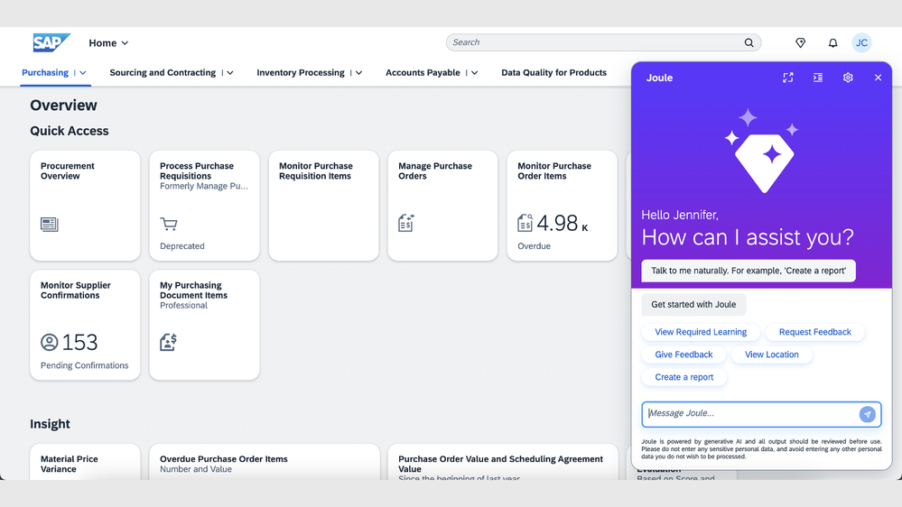

Prerequisites specific to this step: a unified Joule instance already provisioned (previous chapter), SAP Build Work Zone standard edition in the same subaccount, SAP applications already exposing navigation content, and consistent Cloud Identity Services configuration across systems.

### 1.1 Activating Joule in Work Zone, standard edition — the concrete steps

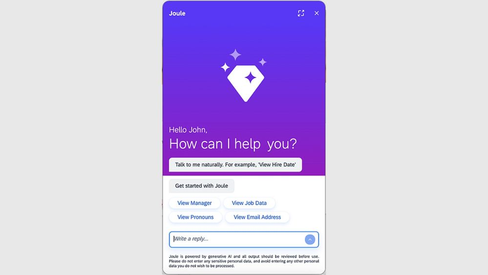

- **Identity prerequisite, stated as a hard gate:** Joule requires **SAP Cloud Identity Services – Identity Authentication** for user login. If your Work Zone site hasn't already switched over from an older identity setup, that switch has to happen *first* — it's not something Joule's own activation steps will do for you.
- **Activation runs through the Joule Booster**, a guided wizard. The real wizard (not just the 3-step summary SAP's announcement gives) has **7 stages**: Check Prerequisites → Set Up Subaccount → Select Integrations → Select Capabilities → Set Up Integrations → Validation → Review.

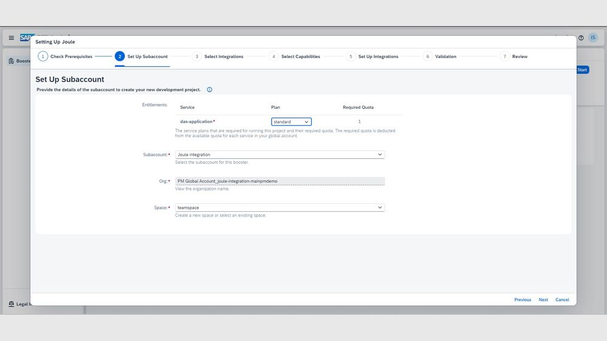

- The **Set Up Subaccount** step checks the same **`das-application` entitlement** already covered in [the SuccessFactors chapter](enabling-successfactors.md) — this isn't a SuccessFactors-specific check, it's the general Joule entitlement gate, surfaced again here for Work Zone.

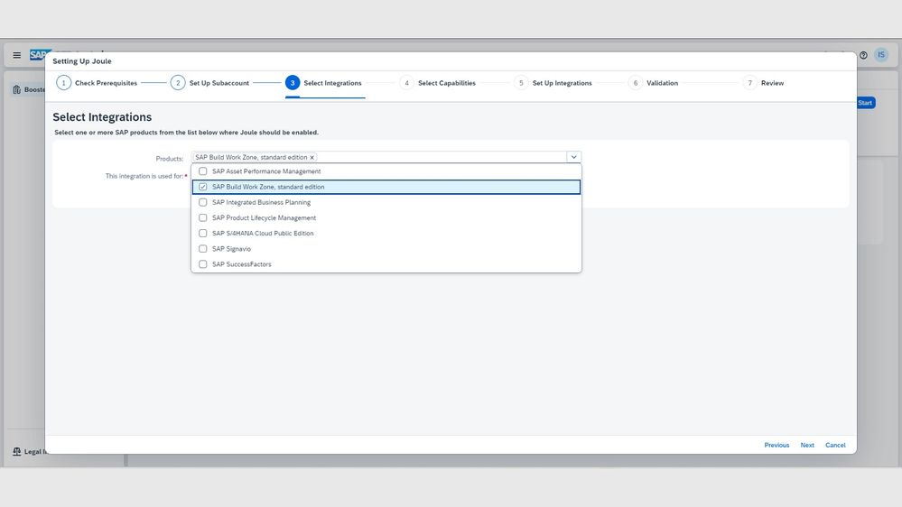

- The **Select Integrations** step is where you pick which already-activated SAP products Joule should connect to from Work Zone — this is the step a real reported failure traced back to (see the pitfall below).

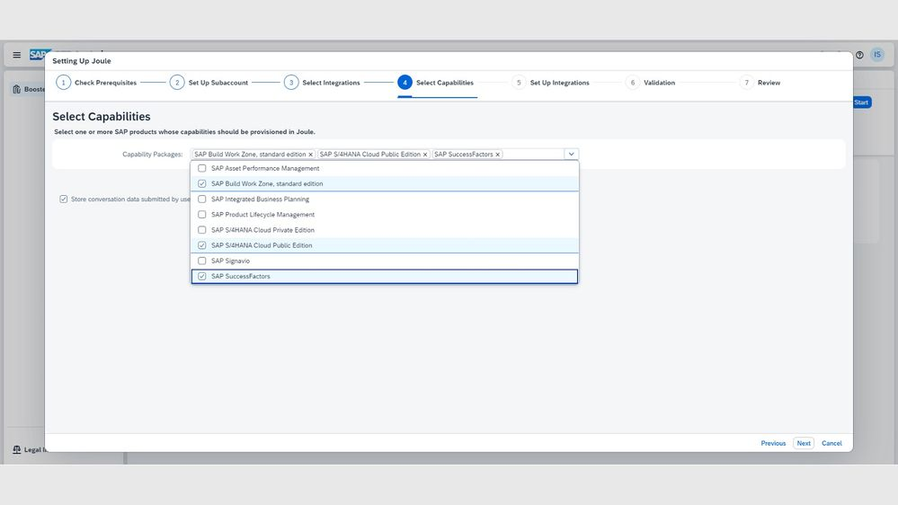

- The **Select Capabilities** step provisions the actual capability packages per product — and carries its own explicit, visible consent control: a **"Store conversation data submitted by users"** checkbox. This is a real governance decision made at activation time, not a hidden default — worth flagging to whoever owns data-retention policy before clicking through.
- **After the Booster completes:** go to the site's **Site Settings → Services**, and enable **Joule** there — only then does the Joule icon appear in the runtime site's header for end users.
- **If Joule and Work Zone live in different BTP subaccounts**, older setups required manually configuring Work Zone's navigation-service destination from Joule's side. For any setup done after **13 October 2025**, this is handled automatically by the Booster — only pre-existing cross-subaccount setups still need that manual destination maintained.

> [!CAUTION]
> **🔒 Joule is not available in SAP BTP trial accounts, full stop**
> This isn't a quota limitation to work around — trial accounts lack the backend integration Joule's value actually depends on. If you're evaluating Joule on a trial landscape and the Booster won't cooperate, this is almost certainly why, not a configuration mistake.

> [!WARNING]
> **⚠️ Pitfall: "no Joule option in Site Settings" usually traces back to one missed checkbox**
> A real reported case: after running the Booster, no Joule entry appeared under Site Settings → Services at all. The fix, confirmed by SAP: **SAP Build Work Zone, standard edition** has to be explicitly selected as one of the integration targets *during* the Booster's Select Integrations step — it's easy to assume Work Zone is included automatically since you're running the Booster from inside it, but it isn't.

- **Known gaps, as of the source (Dec 2024) — worth re-verifying before assuming either is still true:** approving or rejecting **SAP Build Process Automation** instances directly through Joule inside Work Zone was not yet supported; integration into **Work Zone advanced edition** (standard edition only, at the time) was described as roadmap for 2025. Neither was confirmed shipped as of this chapter's own check — treat both as "ask current docs," not settled facts.

### 1.2 Work Zone, Advanced Edition — what's different

That 2025 roadmap item has since shipped: Joule now reaches **Advanced** edition too, as well as **SAP SuccessFactors Work Zone** — completing coverage across every Work Zone edition plus SAP Start and Mobile Start.

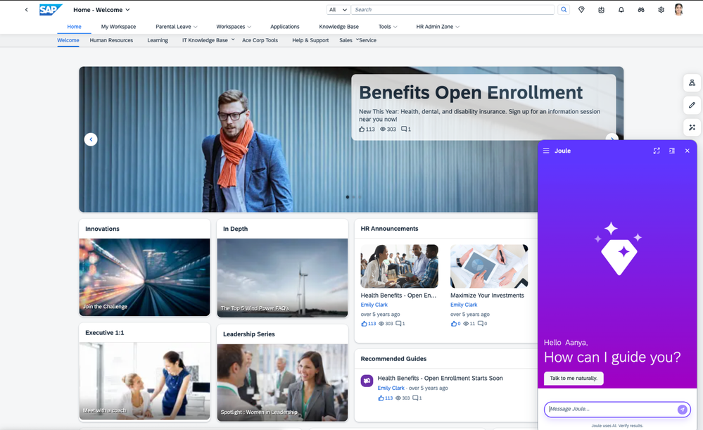

What's actually different from the Standard-edition flow already covered above:

- An extra prerequisite step: the SAP system has to already be registered on the **System Landscape** page in the SAP BTP cockpit — only registered systems are selectable later in the Booster. (This System Landscape page is also where [Joule in the BTP Cockpit](#2-joule-inside-the-sap-btp-cockpit) below gets configured, so it's worth knowing regardless of which edition you're activating.)
- You additionally **configure trust to the Identity Authentication tenant** and **configure user attributes for Joule** directly from the Identity Directory — steps that don't appear in the Standard-edition flow.
- Post-Booster activation is identical either way: Site Settings → Services → enable Joule.

> [!CAUTION]
> **🔒 Picking both Work Zone editions in one Booster run breaks the integration**
> Stated directly by SAP: *"When running the Joule booster or formation, choose integration with only a single SAP Build Work Zone edition. Choosing both standard and advanced editions will cause the integration to fail."* If you're not sure which edition a customer actually runs, confirm it before starting the Booster — don't hedge by selecting both.

- **Open question, unresolved in the source's own comments:** a reader asked whether there's a supported migration path from Standard to Advanced edition once Joule is already active on Standard — no answer was given. Treat this as something to confirm with current SAP guidance rather than assume either way.

## 2. Joule inside the SAP BTP Cockpit

This is a separate, much simpler surface from everything above — Joule answering questions about **BTP administration itself**, directly inside the BTP cockpit, not routed through the Joule Booster at all.

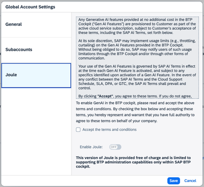

- **Activation**: Global Account Administrator → **Global Account Settings → Joule tab** → accept the terms and conditions → toggle **Enable Joule**. That's the entire setup — no destinations, no communication arrangements, no formation.
- **Hard constraint**: the cockpit has to be accessed via SAP's **default identity provider**, not a third-party IdP, for this specific feature to work.
- **Cost, stated explicitly in the UI itself** (not just the announcement text): *"This version of Joule is provided free of charge and is limited to supporting BTP administration capabilities only within SAP BTP cockpit."*

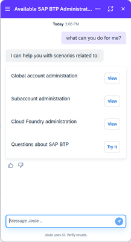

- **What it actually does**: pre-defined BTP admin tasks across global account, subaccount, and Cloud Foundry administration — strictly bound by the asking user's own cockpit authorizations, the same "never exceeds the user's existing permissions" pattern every other Joule surface in this book follows. It also answers natural-language questions against **SAP Help Portal** documentation, with a clickable source-document citation on each answer.

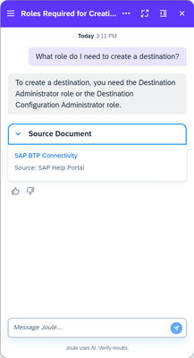

- Same **8-hour conversation expiry** as Joule Work elsewhere in this book; works best one request at a time, using the suggested actions it offers, and adding context (e.g. a specific subaccount ID) for a more precise answer.
- **Not available on BTP trial accounts** — the third time this exact constraint shows up across sources in this book, confirming it's a platform-wide rule, not a per-feature one.
- **Open issue, unresolved**: a reader on a production (non-trial) global account reported the Joule toggle simply not appearing at all, and asked whether the Booster is a prerequisite here too — SAP's own representative replied only that they'd "look into it internally," with no public resolution visible. If you hit this, it may be a genuine gap rather than something you're doing wrong.

## 3. Microsoft 365 Copilot: bi-directional, opt-in, Teams first

Many SAP customers live in Microsoft 365 day to day. SAP and Microsoft provide a **bi-directional integration** between Joule and Microsoft 365 Copilot so users can reach SAP-grounded AI without leaving Microsoft tools.

- Entry point: **Microsoft Teams**, first.
- **Transparency is explicit**: responses are labeled as coming from Joule or from Microsoft 365 Copilot — the two systems are connected, not merged into one.
- Prerequisites: a licensed Microsoft 365 Copilot environment, an already-activated Joule instance, identity alignment between SAP and Microsoft environments, and trust/network configuration for secure cross-platform communication.

> [!WARNING]
> **⚠️ Pitfall: this integration is opt-in on both sides**
> It is not enabled by default for either Joule or Microsoft 365 Copilot — someone has to explicitly activate it. Don't assume it's "just there" once both products are licensed.

### 3.1 Activation, concretely — and why this is the most fragile integration in this book

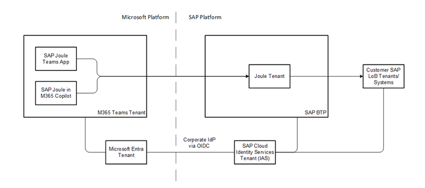

> [!CAUTION]
> **🔒 Joule maintains a strict 1:1 relationship with a Microsoft Entra ID tenant**
> One Entra tenant cannot back multiple Joule environments — your DEV and PRD Joule instances **cannot share one Entra tenant**. If you need to test this integration safely, use a dedicated Microsoft 365 tenant just for that, not a slice of production.

Concrete setup, in sequence (this assumes a prerequisite step — configuring OIDC trust between SAP Cloud Identity Services and Microsoft Entra ID — is already done):

1. **Grant admin consent** for the SAP Teams-Bot app in Entra (client ID `2cf32c47-cb71-49f6-a648-d8fe234042f8`).

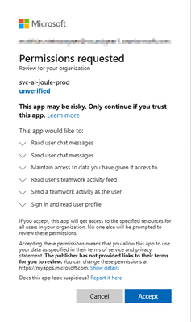

2. Under **API Permissions**, add the `svc-ai-joule-prod` API with the delegated **`access_as_user`** permission, then grant admin consent for it.

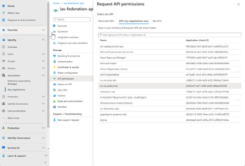
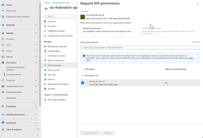
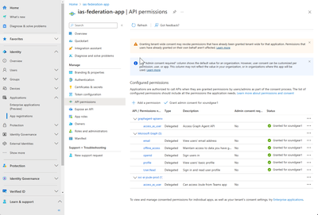
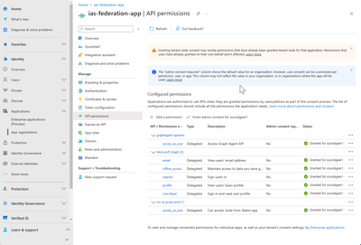

3. Under **Expose an API**, add 3 specific client applications as Authorized client applications: SAP Teams-Bot, Teams Desktop, and Teams Mobile.

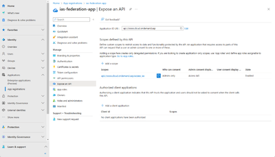
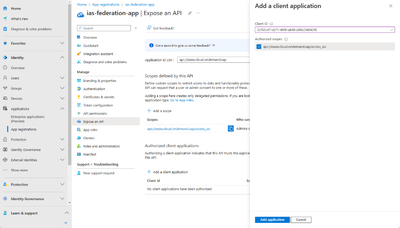
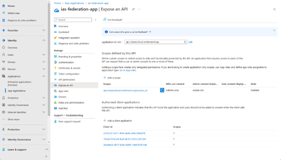

4. In SAP BTP, add a system of type **"Microsoft 365 Copilot for SAP Joule"** to the system landscape and Joule formation — via the Booster if this is a first-time setup.
5. Test by saying "Hello" to Joule from inside Microsoft Teams / Copilot Chat.

> [!TIP]
> After installing the SAP Joule app via the Microsoft 365 Admin Center, allow **up to 2 hours** before the Joule agent is actually reachable from Copilot Chat — a real propagation delay, not a sign something's broken.

> [!CAUTION]
> **🔒 SAP does not control what Microsoft 365 Copilot does with the data it receives**
> Once a request reaches Microsoft 365 Copilot, data handling there is governed entirely by the customer's own agreement with Microsoft — not SAP. This is worth stating plainly to anyone assuming SAP's own data-governance posture extends across this integration boundary.

> [!WARNING]
> **⚠️ Pitfall: this is a genuinely fragile integration in practice, not just in theory**
> Across a 19-comment thread spanning May 2025 through April 2026, at least 7 different users reported generic activation failures ("Something went wrong," "Your request has not been processed") that persisted through multiple rebuild attempts — **with no working fix given in the thread**; SAP's standard response was to open a support ticket or book the paid "Joule Readiness Service." One user couldn't even find "Microsoft 365 Copilot for SAP Joule" as an option in the Booster at all. If you're scoping a project around this integration, budget time for exactly this kind of unresolved friction rather than assuming a clean first-try activation.

- **The prerequisite "Part 1" blog** (configuring OIDC trust between Cloud Identity Services and Microsoft Entra ID specifically) is referenced repeatedly by this source but isn't itself tracked as a source in this book yet — if you hit trust-configuration specifics this chapter doesn't cover, that's where they'd live.
- The **reverse direction** — Joule calling *into* Microsoft 365 Copilot, rather than Copilot calling Joule — is referenced as a separate, distinct doc ("Enable Joule to Pass Requests to Microsoft 365 Copilot") also not yet tracked here.

## 4. Connecting Joule to non-SAP systems: the one rule to internalize

This is the single most important architectural fact in this chapter, stated plainly by SAP's own material:

> [!CAUTION]
> **🔒 Joule is not a public API**
> SAP does not provide a general-purpose API that lets a third-party application call Joule directly as a standalone AI service. No public REST API for arbitrary consumption, no native hosting of Joule inside a non-SAP app, no direct LLM access outside SAP-managed contexts, and identity/authorization are **never** delegated to a non-SAP system. If a design assumes "we'll just call Joule's API from our app," that design is wrong before you write a line of code.

Instead, Joule is **extended**, never embedded, into non-SAP environments — through two supported approaches:

### Approach 1 — Joule Studio

[Joule Studio](02-joule-studio-lifecycle.md) is the primary extensibility mechanism for both SAP and non-SAP integration. Through it you can:

- Extend Joule Skills that call non-SAP system APIs
- Build custom Joule Agents orchestrating workflows across SAP and non-SAP applications
- Use pro-code tools, including the **Joule Studio CLI**, to build, compile, and deploy
- Ground Joule responses in data retrieved from external systems
- Keep lifecycle management, security, and governance centralized

The key architectural point: **Joule Studio does not expose Joule externally.** It lets Joule invoke external systems securely from inside SAP BTP, through approved mechanisms like destinations and action projects — the non-SAP system is always a backend data or action provider, never a peer that calls Joule.

### Approach 2 — WalkMe and the Joule Action Bar

SAP's acquisition of **WalkMe** gave Joule a second extension path: the **Joule Action Bar**, an omnipresent AI overlay available across both SAP and non-SAP *web* applications.

- Uses **screen-level context** to determine user intent — it reads what's on screen, rather than needing code-level integration
- Delivers proactive assistance, summaries, and recommendations
- Routes all interactions through SAP-managed services, preserving SAP security and identity — nothing is embedded into the non-SAP app's own codebase

### Which approach, when

| Scenario | Use |
|---|---|
| Integrating APIs of non-SAP systems | Joule Studio |
| Cross-system workflow orchestration | Joule Studio (Agents) |
| AI assistance across multiple web apps, no code changes to those apps | WalkMe + Joule Action Bar |
| Unified experience without embedding | WalkMe |
| Backend automation and data retrieval | Joule Studio Skills |

## 5. Added by Claude, not from the sources

- The "Joule Studio vs. WalkMe" framing as two *architecturally distinct* extension mechanisms (API-integration vs. overlay) is this book's synthesis of the source's own decision table — the underlying facts are the source's, not inferred.
- Section 2's placement as a standalone numbered section (rather than folding it into section 1) reflects that it's architecturally a separate surface from Work Zone, even though both live under "extending Joule beyond a single application" — editorial grouping, not a source claim.
- Not run: this chapter is architecture and integration guidance, not code; nothing was independently executed.

## 6. Interview corner

**What interviewers listen for:** you state confidently (not hesitantly) that there's no public Joule API, and you can pick the right extension mechanism for a stated scenario without hedging.

### 🟢 Basic

1. Can a third-party application call Joule directly as a standalone API?

- No. SAP does not provide a general-purpose public API for that; Joule is extended into non-SAP contexts through Joule Studio or the WalkMe-based Joule Action Bar, never exposed directly

2. What's the first Microsoft tool through which the Joule/M365 Copilot integration is accessed?

- Microsoft Teams

3. A Work Zone Booster run completes with no errors, but no Joule entry shows up under Site Settings → Services. What's the single most likely cause?

- SAP Build Work Zone, standard edition wasn't explicitly selected as an integration target during the Booster's Select Integrations step — it has to be picked deliberately, not assumed as automatic

4. What does Joule inside the SAP BTP Cockpit actually do, and what governs what it can access?

- Pre-defined BTP administration tasks (global account, subaccount, Cloud Foundry) plus natural-language Q&A against SAP Help Portal docs, strictly bound by the asking user's own cockpit authorizations
- *Stronger answer:* it's provided free of charge and limited to BTP administration only — a separate, much simpler surface from the main Joule Booster-driven activations covered elsewhere in this chapter

### 🟡 Intermediate

5. A customer running both DEV and PRD Joule instances wants to test the Microsoft 365 Copilot integration safely. What's the constraint they need to know first?

- Joule maintains a strict 1:1 relationship with a Microsoft Entra ID tenant — one Entra tenant cannot back multiple Joule environments, so DEV and PRD can't share one
- *Stronger answer:* recommend a dedicated Microsoft 365 tenant just for testing, rather than attempting to test against a slice of the production Entra tenant

6. A team wants Joule to read data from a non-SAP CRM and take actions in it. Which extension approach fits, and why?

- Joule Studio — build a Skill or Agent that calls the CRM's API through a destination/action project; this is "integrating APIs of non-SAP systems," squarely Joule Studio's use case
- *Stronger answer:* the CRM remains a backend data/action provider; Joule itself is never embedded into or exposed to the CRM application

7. A team wants AI assistance available inside a third-party web app they don't control the codebase of. What fits?

- WalkMe + the Joule Action Bar — it overlays via screen-level context without needing code-level access to the target app

### 🔴 Senior

8. A vendor pitches a "Joule REST connector" for a non-SAP tool, claiming direct API access. How do you evaluate that claim?

- Treat it as incorrect by default — SAP explicitly does not expose Joule as a public API, and identity/authorization is never delegated to a non-SAP system
- *Stronger answer:* ask what the connector actually does under the hood — it's almost certainly either a Joule Studio-built Skill/Agent (legitimate) or a WalkMe-style overlay (legitimate), repackaged with misleading marketing; verify which, because the security and governance model differs

> [!TIP]
> **🧩 Design question**
> *"Leadership wants one consistent AI assistant experience across SAP S/4HANA, a non-SAP CRM, and a non-SAP ticketing tool, all from one overlay."* Talk about: the Joule Action Bar as the unifying surface across all three (it doesn't care which app is SAP vs. not), Joule Studio Skills underneath for any actual CRM/ticketing API calls the overlay needs to trigger, and why neither approach requires — or allows — exposing Joule as a callable API to those tools directly.

## Cheat sheet

| Need | Mechanism |
|---|---|
| Cross-app launchpad experience | SAP Build Work Zone + SAP Mobile Start |
| Activate Joule for Work Zone | Joule Booster, 7 stages — Check Prerequisites → Subaccount → Select Integrations → Select Capabilities → Set Up Integrations → Validation → Review |
| "No Joule option appears after the Booster" | Work Zone standard edition wasn't picked in Select Integrations — go back and add it |
| Work Zone Advanced edition | Register the system in BTP Cockpit's System Landscape first; never select both Standard + Advanced in one Booster run |
| Joule in the BTP Cockpit | Global Account Settings → Joule tab → toggle — free, BTP-admin-scope only, no Booster needed |
| AI inside Microsoft Teams/365 | Joule ↔ M365 Copilot (opt-in, bi-directional); 1 Entra tenant = 1 Joule environment, up to 2h propagation delay |
| Call a non-SAP API from an agent | Joule Studio (Skills/Agents, via destinations) |
| AI overlay on a non-SAP web app, no code access | WalkMe + Joule Action Bar |
| "Can I just call Joule's API?" | No — not supported, by design |

## Recap

- Work Zone + Mobile Start extend Joule into a cross-system, cross-device experience layer — not a new Joule instance, the same unified one
- Activating it runs through a real 7-stage Joule Booster wizard; the most commonly reported activation failure (no Joule entry in Site Settings) traces back to not explicitly selecting Work Zone standard edition in the Select Integrations step
- Joule is not available in BTP trial accounts — a hard constraint confirmed across three separate surfaces in this book (Work Zone, Analytical Insights, the BTP Cockpit), not a quota issue to raise a ticket about
- Work Zone Advanced edition needs the system pre-registered in BTP Cockpit's System Landscape, and selecting both Standard and Advanced in one Booster run breaks the integration outright
- Joule inside the SAP BTP Cockpit is a separate, much simpler, free surface — a toggle in Global Account Settings, no Booster, scoped strictly to BTP administration tasks
- Joule ↔ Microsoft 365 Copilot is bi-directional, opt-in on both sides, transparent about which system answered, enters through Teams first, and maintains a strict 1:1 relationship with a single Entra ID tenant
- The Microsoft 365 Copilot integration is the most reported-fragile integration in this book — budget real time for activation friction, not a clean first try
- **Joule has no public API** — this is a hard architectural boundary, not a current limitation waiting to be lifted
- Non-SAP integration happens through exactly two supported mechanisms: **Joule Studio** (API integration, agent orchestration, grounding) and **WalkMe's Joule Action Bar** (screen-context overlay, no code embedding)
- Identity and authorization are never delegated to a non-SAP system under either approach

## Practice

1. Without looking back, list the four things SAP explicitly says are *not* supported for non-SAP integration
2. Pick a non-SAP tool you use and decide: Joule Studio or Joule Action Bar — and justify it in one sentence
3. Explain out loud why "Joule Studio doesn't expose Joule externally" is true even though it integrates with non-SAP APIs

## How this chapter was checked

- All 3 lessons of Unit 5 ("Setting Up Joule for SAP Build Work Zone and SAP Mobile Start," "Setting Up Joule with Microsoft 365 Copilot," "Integrating Joule with Non-SAP Applications") and the unit quiz, from "Setting Up Joule Across your Organizational System Landscapes," were read in full, 10 Nov 2026.
- Section 1.1 was added 13 Nov 2026 from the SAP Community blog "Joule is now integrated into SAP Build Work Zone" (Yumnahabbasi, Dec 2024), including its 16-comment thread. All 5 real content screenshots in that article were downloaded and are used here; roughly 20 other `` tags on the page were commenter avatars and site chrome, correctly excluded. One labeling correction made during review: the source screenshots were initially mislabeled against the article's own simplified "3-step" description — the actual Booster wizard shown in the screenshots has 7 stages, and the images are captioned to match what they actually show, not the article's rounded-off summary.
- Sections 1.2, 2, and 3.1 were added 13 Nov 2026 from four further sources, all discovered via a partner resource hub and triaged for genuine new technical content: the SAP Community blogs "Integrating Joule with SAP Build Work Zone - Advanced Edition," "Enable Microsoft Copilot and Teams to Pass Requests to Joule," and "Joule in the SAP BTP Cockpit - Setup Guide," plus the official SAP Help doc "Integrating Joule with Microsoft 365 Copilot." 15 images found across these 4 sources, all 15 downloaded; 13 are embedded above (all 9 from the M365 Copilot activation walkthrough, 1 of 1 from the Work Zone Advanced edition post, and 3 of 5 from the BTP Cockpit post — the 2 not embedded there show further scenario-list detail already covered in the body text), each opened and visually verified against its caption before being embedded (not captioned from alt text or DOM order alone) — 0 duplicates, 0 failures.
- The cross-subaccount Work Zone note in section 1.1 and the blank-screen cross-reference come from the official SAP Help doc "Joule Troubleshooting Steps," read the same day; it has no images.
- No images appeared in the original 3 lessons — none were skipped there either.
- Nothing in this chapter is code; nothing was run.

## Sources and further reading

- SAP Learning, *Setting Up Joule Across your Organizational System Landscapes* — https://learning.sap.com/courses/setting-up-joule-across-your-organizational-system-landscapes, Unit 5 (read in full 10 Nov 2026)
- SAP Community, Yumnahabbasi, *Joule is now integrated into SAP Build Work Zone* — https://community.sap.com/t5/application-development-and-automation-blog-posts/joule-is-now-integrated-into-sap-build-work-zone/ba-p/13961162 (article and comment thread, read in full 13 Nov 2026)
- SAP Community, *Integrating Joule with SAP Build Work Zone - Advanced Edition* — https://community.sap.com/t5/technology-blog-posts-by-sap/joule-is-now-integrated-into-sap-build-work-zone-advanced-edition/ba-p/14252774 (read in full 13 Nov 2026)
- SAP Community, *Enable Microsoft Copilot and Teams to Pass Requests to Joule* — https://community.sap.com/t5/technology-blog-posts-by-sap/enable-microsoft-copilot-and-teams-to-pass-requests-to-joule/ba-p/14109137 (article and 19-comment thread, read in full 13 Nov 2026)
- SAP Help Portal, *Integrating Joule with Microsoft 365 Copilot* — https://help.sap.com/docs/joule/integrating-joule-with-sap/integrating-joule-with-microsoft-365-copilot (read in full 13 Nov 2026)
- SAP Community, *Joule in the SAP BTP Cockpit - Setup Guide* — https://community.sap.com/t5/technology-blog-posts-by-sap/joule-in-the-sap-btp-cockpit-is-now-available-for-all-customer-accounts/ba-p/14142702 (read in full 13 Nov 2026)

Previous: [Joule's identity and platform foundation](btp-identity-foundation.md) · Next: [What Joule actually is](01-what-is-joule.md)
