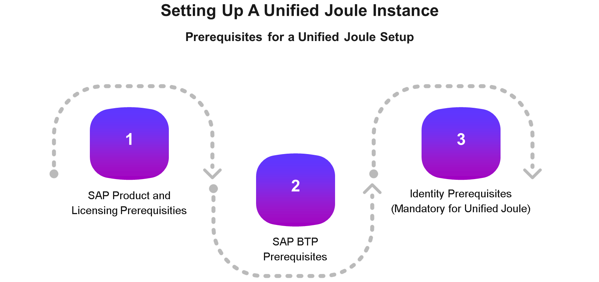
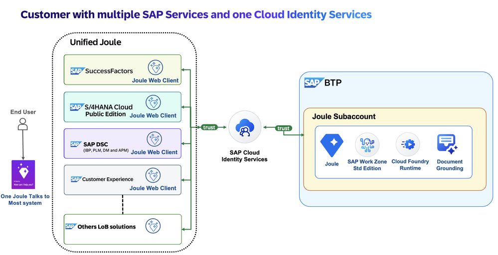
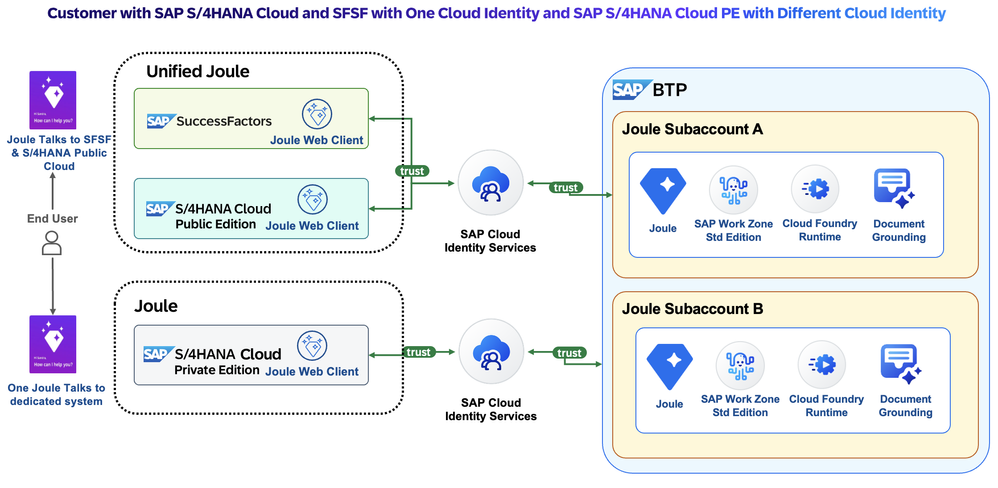
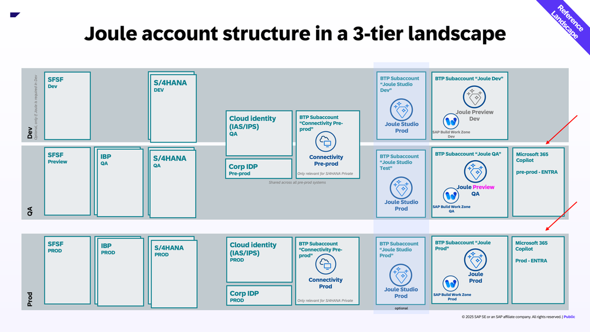
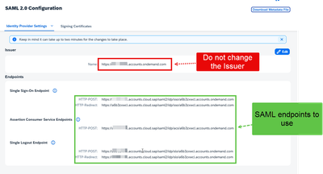
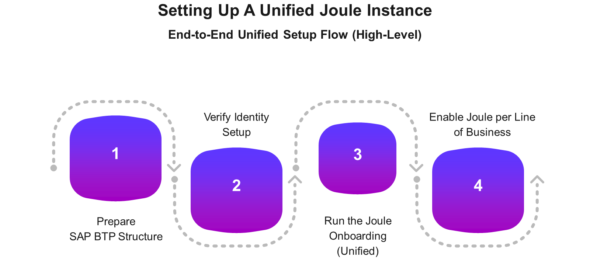
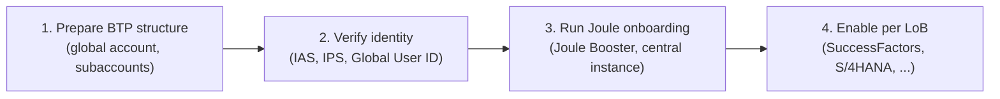

# Joule's identity and platform foundation

*Before any agent, skill, or activation guide matters, Joule has to trust who's asking — and that trust lives entirely on SAP BTP.*

> [!NOTE]
> **📍 At a glance**
> - **You will learn:** the IAM architecture Joule depends on, why Joule onboarding requires OIDC specifically, what "a unified Joule instance" actually means, and how S/4HANA Private and Public Edition activation differ
> - **You will build:** nothing — this is the platform layer every later activation chapter assumes you already understand
> - **Level:** beginner · **Time:** about 22 minutes
> - **Builds on:** nothing — this is the first chapter in the book. **Leads to:** [Extending Joule beyond a single application](btp-extending-joule.md)

**After this chapter you can:**

- Name the three IAM pillars and the four SAP Cloud Identity Services that implement them
- Explain why Joule onboarding requires OIDC and rejects SAML-based trust
- Say what makes a Joule instance "unified" rather than per-application
- Walk through the four-step end-to-end setup flow
- Explain why SAP S/4HANA Cloud Private and Public Edition activation differ
- Diagnose the three most common real-world identity failures: a blank Joule screen, a broken corporate-IdP setup, and SSO-only users working while password users don't

## 1. IAM is the real dependency

Before anyone "turns on" Joule, implementation consultants have to verify identity and access management readiness — a unified Joule experience depends on a consistent IAM foundation, not a feature flag.

SAP's IAM model for SaaS rests on three pillars: **Authentication & SSO**, **Identity Lifecycle**, and **Authorization**, with **SAP Cloud Identity Services** as the central interface standardizing all three across SAP solutions.

SAP Cloud Identity Services bundles four services:

| Service | Role |
|---|---|
| **Identity Authentication (IAS)** | Authentication and SSO |
| **Identity Provisioning (IPS)** | Identity lifecycle management — provisioning/replication across apps |
| **Identity Directory** | Central user store |
| **Authorization Management** | Policies and authorization services |

> [!WARNING]
> **⚠️ Pitfall: Joule onboarding trust is OIDC-only**
> Enterprise SSO across a landscape can use SAML2 and/or OIDC broadly. The trust configuration for **Joule onboarding specifically** uses **OpenID Connect (OIDC)** — SAML-based trust is explicitly not supported for Joule trust setup. If your landscape is SAML-only, that's the first thing to fix, not a detail to discover mid-setup.

- **SAP BTP** is the platform layer: Joule is integrated and configured through BTP, including trust setup and running the **Joule Booster** (the provisioning tool), and managed via BTP's system landscape and formations.
- **SAP Build Work Zone** resolves intent-based navigation and consumes exposed content from SAP solutions, for navigational scenarios.
- The target **SAP product** must already be integrated with Identity Authentication, because Joule reuses that product's existing IAS setup for user login — it doesn't introduce a second one.

## 2. What makes a Joule instance "unified"

Joule setup offers one centralized, repeatable onboarding process instead of custom per-application setup. A **unified Joule setup** means:

- One Joule instance on SAP BTP (with dev/test/prod — or just test/prod if you don't need custom Joule Agents)
- Shared across multiple SAP cloud applications
- Backed by **one consistent** SAP Cloud Identity Services configuration

Three prerequisite groups:

1. **SAP product and licensing** — a licensed SAP product that supports Joule (e.g. SuccessFactors, S/4HANA Cloud), running in an SAP data center, already integrated with Identity Authentication.
2. **SAP BTP** — an enterprise global account, with entitlements for **Joule and SAP Build Work Zone in the same global account**. Joule integrates with exactly one of three Work Zone editions: **Standard**, **Advanced**, or **SAP SuccessFactors Edition**.
3. **Identity (mandatory for unified Joule)** — every participating application must use the **same SAP Cloud Identity Services tenant**, with the **same Global User ID** (`user_uuid`) across all of them. Production systems share one production IAS tenant; non-production systems share one non-production tenant.

> [!IMPORTANT]
> **🏭 In production: different IAS tenants means different Joule instances, full stop**
> "Can I use different IAS tenants and still have unified Joule?" No. One IAS tenant per landscape tier (prod/non-prod) is the hard requirement — different tenants produce separate Joule instances, not a unified one. If your landscape isn't aligned yet, you *can* enable Joule per application anyway, but you've explicitly opted out of the unified model, not deferred it.

## 2a. Multi-tenant scenarios, concretely

SAP shorthand worth knowing: **J4B** (Joule for Business), **J4D** (Joule for Developers), **J4C** (Joule for Consultants) — the same unified-instance rule applies to each, with one hard exception: **J4C cannot share a subaccount with J4B**, full stop, not yet unifiable.

Three concrete landscape patterns:

| Case | Setup | Result |
|---|---|---|
| **1 (recommended)** | SuccessFactors, S/4HANA Public Edition, SAP DSC (IBP + PLM + Digital Manufacturing + APM), and others all trust one Cloud Identity Services tenant | One Joule subaccount, fully unified |
| **2** | Multiple IAS tenants already exist | Separate Joule instances per tenant — one can't answer another's Line-of-Business questions |
| **3** | S/4HANA **Private** Edition sits on a different IAS tenant than Public Edition + SuccessFactors | **Two separate BTP subaccounts required**, each with its own Joule instance |

> [!WARNING]
> **⚠️ Pitfall: today, only one S/4HANA edition can be unified per subaccount**
> Case 3 isn't a configuration gap waiting to be fixed — as of this writing, only **one of Private OR Public** S/4HANA edition can be part of a given subaccount's unified Joule instance, never both at once in the same subaccount.

- **Document Grounding's supported integration targets, named explicitly**: Microsoft SharePoint, **SAP Build Work Zone Advanced Edition**, and ServiceNow — not an open-ended "upload any documents."
- **Changing what's in a Joule formation doesn't require re-running the Booster**: including or excluding a system from an existing formation is a direct action on the formation itself.
- **Joule Preview** is a separate service (introduced 2025) recommended for non-production tiers (Sandbox/Dev/Test) specifically, to validate new capabilities before they reach production — it has no place in a Prod subaccount.

- Compliance note: EU/GDPR-constrained customers should look specifically at the **EU11** BTP subaccount region; running Joule across regions also means planning around **maintenance-window overlap** across time zones, a real operational cost of multi-region setups.

## 2b. Common identity setup questions, answered

A second, more hands-on source collects real recurring questions from unified-Joule setups. Framed as Q&A since that's the most useful shape for this material:

**Q: Our landscape's IAS tenants aren't aligned yet — can we still get some value from Joule?**
A: Yes, via separate per-app Joule instances — but you lose cross-app answering, and you now manage multiple subaccounts instead of one.

**Q: Which domain should trust configuration actually point at — `cloud.sap` or `ondemand.com`?**
A: Standardize new trust configuration to **`cloud.sap`** endpoints, since SuccessFactors already defaults there. The IAS admin console itself is reached at `https://<tenant>.accounts.cloud.sap/admin`, not the `.accounts.ondemand.com/admin` form.

> [!WARNING]
> **⚠️ Pitfall: don't confuse "which domain to standardize on" with "don't touch the Issuer"**
> The **Issuer** value in an existing SAML 2.0 configuration should be left exactly as-is — SAP's own source material is explicit about this. It's the *other* SAML endpoint URLs (SSO, Assertion Consumer Service, Single Logout) you configure in a connecting app's trust settings that should use the `cloud.sap` form going forward. A **"Sync SSO Cookies Between Domains"** toggle in Cloud Identity Services exists specifically for landscapes that can't be fully aligned to one domain yet.

**Q: Launching Joule shows a blank screen. What's wrong?**
A: Almost always a domain mismatch between the BTP subaccount's trust configuration and the app's own trust domain with IAS. Fix: align both to `cloud.sap`, or enable the cookie-sync toggle above as a stopgap. A second, officially documented cause of the same symptom: a corporate IdP (Azure AD/OKTA) is being used for login, but hasn't been set as the **Default** Identity Provider for the Joule application specifically in Identity Authentication — set it explicitly rather than assuming "it's already the only one configured" is enough.

**Q: We use a corporate IdP (Okta, Entra ID, etc.) — what does the Booster actually set up for us?**
A: It auto-creates an app in IAS named `das-ias-<appname>`. Its **conditional authentication** settings then have to be manually aligned to match the source app's own conditional-auth rules — this doesn't happen automatically.

> [!CAUTION]
> **🔒 A corporate IdP running in pure proxy mode breaks Joule outright**
> If IAS's **"Use Identity Authentication user store"** toggle (under Identity Federation) is disabled — i.e. IAS is a pure authentication proxy with no user store of its own — **Joule will not work**, because it depends on the **Global User ID (GUID)**, which only exists if IAS's own user store is actually populated. The fix is enabling that toggle (tenant-wide or per application) and maintaining real user profiles in IAS even though authentication itself is delegated to the corporate IdP.

**Q: Can two different corporate IdPs feed into one unified Joule instance, even on the same IAS tenant?**
A: No. IAS can't route one Joule instance's conditional authentication to two different corporate IdPs — this requires separate Joule instances, same as the different-IAS-tenant case.

**Q: The "Identity Provisioning" tab is missing from our IAS admin console.**
A: Either the admin user is missing the **"Manage Identity Provisioning"** permission, or the tenant is still on the older, separate **Neo-based IPS** console. Neo-based IPS still works with Joule, but SAP recommends migrating — the newer console unifies IAS/IPS administration, adds an out-of-the-box SAP Build Work Zone connector, and improves logging, the visual transformation editor, and job simulation.

**Q: Why does Joule need users synced into Work Zone at all?**
A: Specifically for **navigational** interaction patterns — without the sync, Joule has no way to route a user to a page or app they're authorized for.

**Q: The sync job ran, but navigational answers are still broken.**
A: Check the job's actual execution status, not just that it ran. Useful trace parameters for diagnosis: `ips.trace.skipped.entity[.content]`, `ips.trace.failed.entity.content`, `ips.trace.created.entity[.content]`, `ips.trace.deleted.entity`, `ips.trace.updated.entity`.

**Q: In SuccessFactors specifically, SSO users work fine but password-based users don't.**
A: Fix via conditional-authentication rules in IAS — group users by auth method (SSO vs. password) and route each group differently. Always point every user at the standard SuccessFactors tenant URL, never an IDP-initiated URL.

The same four-step sequence applies across every Line of Business:

1. **Prepare SAP BTP structure** — a global account, optional directories for separation, one or more subaccounts where Joule will be provisioned.
2. **Verify identity setup** — confirm IAS integration, IPS availability, and consistent Global User ID mapping *before* onboarding, not after.
3. **Run the Joule onboarding (unified)** — provisioned once, creating a central Joule instance with associated integration systems. This is the prerequisite that every later LoB-specific enablement builds on top of — not a separate instance.
4. **Enable Joule per Line of Business** — SuccessFactors-, S/4HANA-, Concur-, etc.-specific steps, all building on the *same* instance from step 3.

Here's how that instance actually connects back to SAP systems once provisioned:

- Inside the BTP subaccount, Joule reaches SAP Solutions through **Destinations and Connectivity** — the same secure-connectivity mechanism you'd use for any BTP app talking to a backend, not a Joule-specific channel.
- **Navigation Target Mapping** and **Capabilities** sit alongside Joule in the subaccount; **SAP Build Work Zone** is wired in for navigation resolution.
- Backend access flows through an **OData API** and a **CDM Provider** on the SAP Solutions side — content exposure and consumption are explicit, named flows, not implicit.

## 4. Private vs. Public Edition: why activation differs

Both S/4HANA Cloud editions need Joule + Build Work Zone entitlements in the global account and IAS configured — but how much of the setup is yours to manage differs sharply:

| | Private Edition | Public Edition |
|---|---|---|
| **Delivery model** | RISE with SAP, customer-managed infra | Multi-tenant SaaS, SAP-managed |
| **Network connectivity** | Customer sets up secure connectivity (e.g. **Cloud Connector**) | Not customer-configured |
| **Tenant/identity management** | Higher degree of customer-managed configuration | SAP manages tenant context and isolation — customers don't configure tenant identifiers |
| **Activation mechanism** | More manual: network, identity integration, content exposure, role design | Streamlined: relies heavily on the **Joule Booster** and SAP automation |
| **Role design** | Custom SAP Fiori roles needed: business catalogs, semantic objects, Fiori app IDs, target mappings | Largely handled by SAP's guided onboarding |

- If you're troubleshooting a Private Edition activation, the likely failure points are **trusted domains, Joule formations, Cloud Connector connectivity, or Identity Provisioning Service errors** — check those before anything else.

## 5. Added by Claude, not from the sources

- The "pick one of three Work Zone editions" framing is stated directly in the source; the observation that this is a hard one-to-one constraint (not "choose your favorite") is this book's emphasis.
- Section 2b's Q&A framing reorganizes a second source's running prose into direct question/answer pairs — the facts and fixes are the source's, the structure is this book's.
- Not run: this chapter is architecture and setup guidance, not code — nothing here was independently executed.

## 6. Interview corner

**What interviewers listen for:** you know Joule's trust setup is OIDC-only (not a detail you'd guess), you can explain *why* a unified instance requires one IAS tenant rather than reciting it, and you know which edition of S/4HANA makes you own network connectivity.

### 🟢 Basic

1. What are SAP Cloud Identity Services' four component services?

- Identity Authentication (IAS), Identity Provisioning (IPS), Identity Directory, Authorization Management

2. Which protocol does Joule onboarding's trust configuration require?

- OpenID Connect (OIDC) — SAML-based trust is not supported for Joule trust setup specifically, even though the broader landscape may use SAML2 for other SSO

### 🟡 Intermediate

3. A customer has two SuccessFactors tenants on two different IAS tenants and wants "one Joule" across both. What do you tell them?

- Not possible as stated — a unified Joule experience requires a single IAS tenant per landscape tier; two different IAS tenants produce two separate Joule instances
- *Stronger answer:* their options are to consolidate onto one IAS tenant, or accept two independent Joule instances (which is a valid but explicitly non-unified choice)

4. What's the practical difference in setup effort between S/4HANA Private and Public Edition?

- Private Edition requires the customer to manage network connectivity (Cloud Connector), tenant-level configuration, and custom Fiori role design; Public Edition is SAP-managed for tenant/infrastructure and relies on the Joule Booster for a streamlined activation

5. Launching Joule shows a blank screen. What's the single most likely cause?

- A domain mismatch between the BTP subaccount's trust configuration and the app's own trust domain with IAS
- *Stronger answer:* standardize both to `cloud.sap` endpoints, or enable the "Sync SSO Cookies Between Domains" toggle in Cloud Identity Services as a stopgap

### 🔴 Senior

6. A Joule activation on S/4HANA Private Edition is failing intermittently. Where do you start investigating?

- The four named common failure areas: trusted domain configuration, Joule formations, Cloud Connector connectivity, and Identity Provisioning Service errors
- *Stronger answer:* verify the identity prerequisites first (same IAS tenant, correct Global User ID mapping) — a surprising number of "Joule bugs" are actually identity misconfiguration surfacing as functional issues, per the course's own emphasis on Global User ID correctness

7. A customer has two SuccessFactors tenants, each behind a different corporate IdP (Okta on one, Entra ID on the other), but both sit on the same IAS tenant. Can this be one unified Joule instance?

- No — IAS can't route one Joule instance's conditional authentication to two different corporate IdPs, even on a shared IAS tenant; this needs separate Joule instances, the same outcome as using different IAS tenants entirely
- *Stronger answer:* this is a subtler failure mode than the usual "different IAS tenant" rule — same tenant, same Global User ID scheme, but still not unifiable, because the identity federation routing itself is the constraint

> [!TIP]
> **🧩 Design question**
> *"A customer runs SuccessFactors (public cloud) and S/4HANA Private Edition on RISE, and wants one unified Joule experience across both."* Talk about: confirming both are on the same IAS tenant (not just "both use IAS"), consistent Global User ID mapping across both, the Private Edition's extra network/role-design burden (Cloud Connector, custom Fiori roles) that the Public-cloud SuccessFactors side won't need, and provisioning the unified instance once before doing either LoB-specific enablement.

## Cheat sheet

| Concept | One-line definition |
|---|---|
| SAP Cloud Identity Services | IAS + IPS + Identity Directory + Authorization Management |
| Joule trust protocol | OIDC only — never SAML |
| Unified Joule instance | One BTP-hosted instance, one IAS tenant per tier, same Global User ID everywhere |
| Joule Booster | SAP's provisioning automation for Joule onboarding |
| Private Edition burden | Network (Cloud Connector), tenant config, custom Fiori roles |
| Public Edition | SAP-managed tenant/infra, Joule Booster-driven |
| Trust domain to standardize on | `cloud.sap`, not `ondemand.com` (don't touch an existing SAML Issuer though) |
| Blank Joule screen | Domain mismatch between subaccount trust config and app's IAS trust domain |
| Corporate IdP in pure proxy mode | Breaks Joule outright unless IAS's own user store (Global User ID) is populated |
| Two corporate IdPs, one IAS tenant | Still not unifiable — separate Joule instances required |
| J4C (Joule for Consultants) | Cannot share a subaccount with J4B |

## Recap

- Joule's real dependency is identity: three IAM pillars (Authentication/SSO, Identity Lifecycle, Authorization), standardized through SAP Cloud Identity Services
- Trust setup for Joule onboarding is **OIDC only** — SAML-based trust is explicitly unsupported there, even on SAML-capable landscapes
- A **unified** Joule instance requires one shared IAS tenant per tier and one consistent Global User ID — different tenants mean separate instances, not a design choice
- The setup flow is always: prepare BTP structure → verify identity → run Joule onboarding once → enable per LoB
- S/4HANA **Private** Edition pushes network, tenant, and role-design work onto the customer; **Public** Edition is SAP-managed and Joule-Booster-driven
- Only one S/4HANA edition can be unified per subaccount today — Private on a different IAS tenant than Public/SuccessFactors means two separate subaccounts, each with its own Joule instance
- Most real-world identity failures trace to one of a handful of causes: a trust-domain mismatch (blank screen), a corporate IdP in pure proxy mode (no Global User ID), two corporate IdPs on one IAS tenant, or SSO/password-user routing in SuccessFactors specifically

## Practice

1. Without looking back, name the four SAP Cloud Identity Services and what each does
2. Explain out loud why "different IAS tenant per app" breaks the unified Joule model, using the Global User ID concept
3. Sketch the four-step end-to-end setup flow from memory

## How this chapter was checked

- Units 1 and 2 (4 lessons: Exploring Joule's Technical Architecture, Setting Up A Unified Joule Instance, Setting Up Joule for SAP S/4HANA Cloud Private Edition, Setting Up Joule for SAP S/4HANA Cloud Public Edition) and both unit quizzes of "Setting Up Joule Across your Organizational System Landscapes" were read in full, 10 Nov 2026.
- All 4 images across these lessons are used here (saved to `images/`, never hotlinked): the IAM foundation diagram, the unified-setup prerequisites diagram, the end-to-end process diagram, and the BTP provisioning architecture diagram. Nothing was left out.
- Sections 2a and 2b were added 13 Nov 2026 from two further SAP Community sources (discovered via a partner resource hub and triaged for genuine new technical content). Section 2a's source had 14 images; 10 are genuine content diagrams (3 small decorative icons and 1 video-thumbnail were excluded after inspection — the video itself is linked, not downloaded), of which 3 are embedded here (the two multi-tenant case diagrams and the 3-tier landscape diagram) — the rest (BTP account hierarchy, roadmap slide, J4B/J4D/J4C panel example, provisioning/Joule-Preview split) are described in the body text without a dedicated figure, to keep this already-dense chapter readable, and are kept in `images/` (`sj015-*`) for reference. Section 2b's source had 1 image, used here. Every content image in both sources was opened and visually verified against its caption before being embedded, not captioned from alt text or DOM order alone.
- The blank-screen Q&A in section 2b was cross-checked against the official SAP Help troubleshooting doc ("Joule Troubleshooting Steps"), which confirms a second, independent cause (corporate IdP not set as Default IdP) — that doc has no images.
- Nothing in this chapter is code; nothing was run.

## Sources and further reading

- SAP Learning, *Setting Up Joule Across your Organizational System Landscapes* — https://learning.sap.com/courses/setting-up-joule-across-your-organizational-system-landscapes, Units 1–2 (read in full 10 Nov 2026)
- SAP Community, nageshcaparthy, *Joule - Unified Setup: Bridging Simplicity and Performance* — https://community.sap.com/t5/technology-blog-posts-by-sap/joule-unified-setup-bridging-simplicity-and-performance/ba-p/13924542 (read in full 13 Nov 2026)
- SAP Community, harjeetjudge, *Setting Up a Unified Joule Instance: Key Considerations and Common Questions* — https://community.sap.com/t5/technology-blog-posts-by-sap/setting-up-a-unified-joule-instance-key-considerations-and-common-questions/ba-p/14126614 (read in full 13 Nov 2026)
- SAP Help Portal, *Joule Troubleshooting Steps* — https://help.sap.com/docs/joule/integrating-joule-with-sap/troubleshooting (read in full 13 Nov 2026)

Previous: [SAP Joule book introduction](README.md) · Next: [Extending Joule beyond a single application](btp-extending-joule.md)
