# Enabling Joule for SAP S/4HANA Cloud Private Edition

*Same Joule, same architecture pattern — but Private Edition pushes network connectivity, role design, and multi-system scaling onto you, not SAP.*

> [!NOTE]
> **📍 At a glance**
> - **You will learn:** everything the Public Edition activation automates for you, done by hand instead — Cloud Connector with Principal Propagation, a dedicated RFC destination and function-module whitelist, and fully manual Fiori Technical Catalog/Business Catalog/PFCG role creation
> - **You will build:** nothing runnable here — this is BTP/S4 administration, not code — but you will walk through the exact screens and field values a real Private Edition activation requires
> - **Level:** advanced · **Time:** about 28 minutes
> - **Builds on:** [Joule's identity and platform foundation](btp-identity-foundation.md) (Private vs. Public Edition, section 4) and [Enabling Joule for SAP S/4HANA Cloud Public Edition](enabling-s4hana-public-edition.md) (the Public Edition baseline this chapter diverges from). **Leads to:** nothing specific

**After this chapter you can:**

- Name the three things Private Edition requires that Public Edition doesn't: Cloud Connector with Principal Propagation, a dedicated RFC destination, and manual Fiori role design
- Walk through the exact RFC whitelist Joule needs, and explain why it's narrower than "just open everything up"
- Build a Technical Catalog, Business Catalog, and PFCG role from scratch for Joule — entirely inside the ABAP system, not automated by any wizard
- Diagnose the single most common Private Edition symptom (generic-only answers) using the real role/Semantic-Object replication chain
- Know the real historical limit: one Joule instance per S/4 backend (and where multi-system support, now available, is documented)

## 1. Prerequisites and architecture

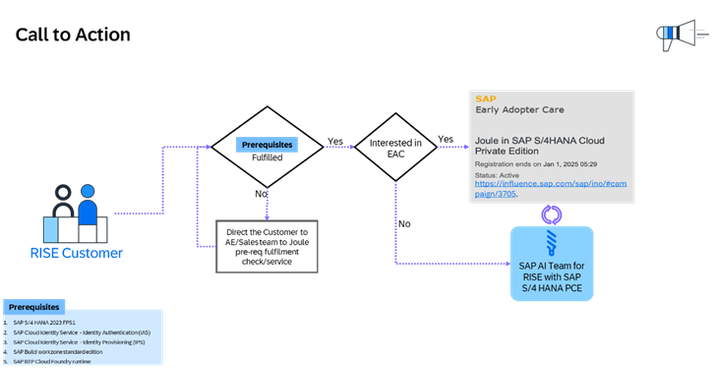

- **Entry via RISE with SAP only.** Two entitlement paths: a new RISE contract gets Joule automatically; an existing RISE customer has to request it from their Account Executive.
- Same BTP/identity foundation as every other chapter in this book: Joule entitlement, SAP Cloud Identity Services, SAP Build Work Zone standard edition.

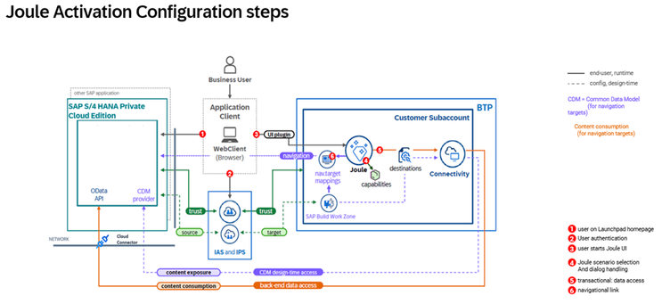

The extra box this diagram has, that Public Edition's doesn't: **Cloud Connector**, sitting between your BTP subaccount and the S/4 system itself — because unlike Public Edition, nothing here is SAP-managed network connectivity.

## 2. BTP entitlements and subaccount

Create a dedicated technical user in S/4 via `SU01`, with role profile **`SAP_BC_JSF_COMMUNICATION_RO`** (or `SAP_ALL` if you're not using granular roles):

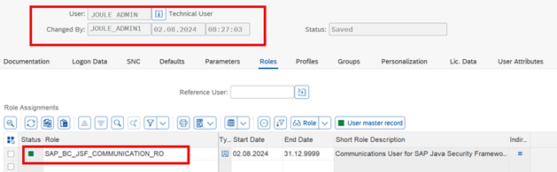

Confirm your S/4 Private Edition system shows up correctly in **System Landscape**:

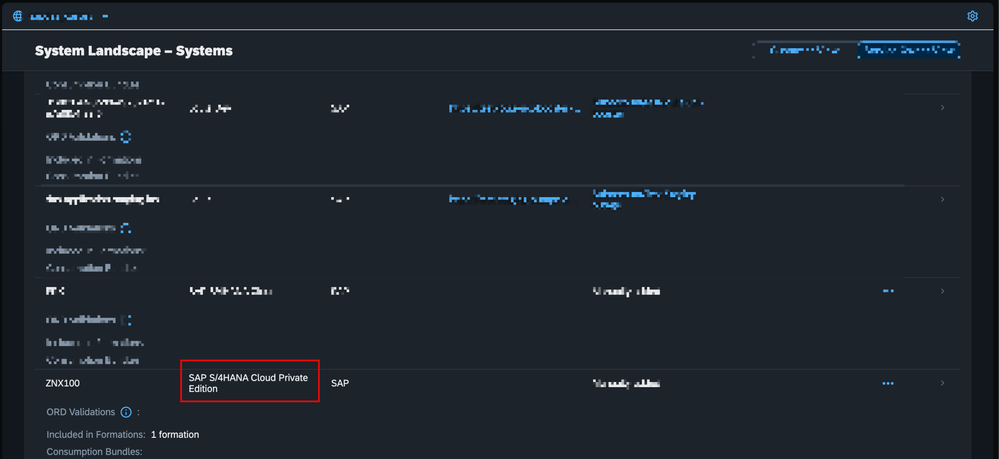

Create a dedicated subaccount for the Joule activation:

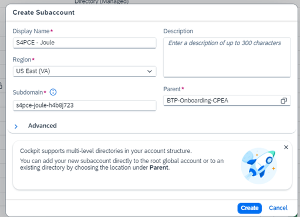

Add the required service plans — **Joule**, **SAP Build Work Zone standard edition**, **Cloud Identity Services**, and **Connectivity** — the same core set as every other activation in this book, before anything Private-Edition-specific begins:

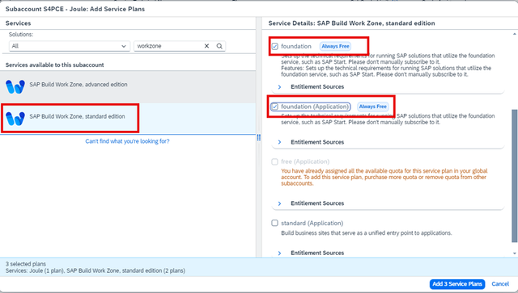
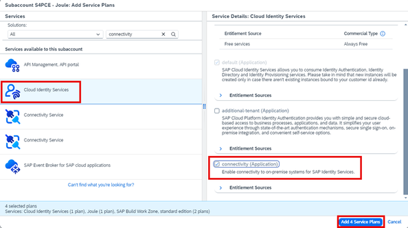

Run the Joule Booster. The Select Capabilities step looks identical to Public Edition's — same **"Store conversation data submitted by users for the improvement of Joule"** checkbox, same governance decision point — just with **SAP S/4HANA Cloud Private Edition** picked as the capability package instead:

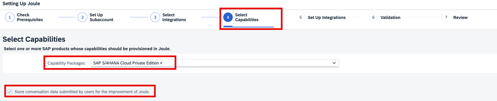
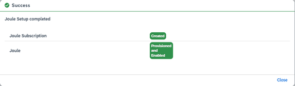

## 3. Cloud Connector: the step Public Edition doesn't have

This is the real architectural divergence. SAP doesn't manage network connectivity to your S/4 Private Edition system — you do, through the **Cloud Connector**.

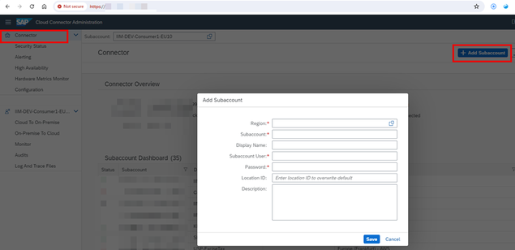

Create a **System Mapping** — an ABAP backend, reached via a **virtual** host/port that's deliberately different from the internal one:

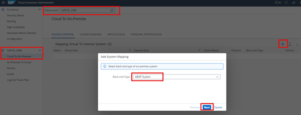

A second System Mapping, using **RFC** protocol specifically (needed for the IPS/role-replication side, separate from the HTTPS one above):

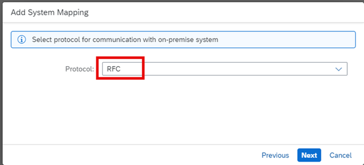

> [!CAUTION]
> **🔒 The RFC whitelist is deliberately narrow — resist the urge to open it wider**
> Joule needs exactly these function modules whitelisted on the RFC system mapping, nothing more: **`BAPI_USER_GETLIST`**, **`BAPI_USER_GET_DETAIL`**, **`PRGN_ACTIVITY_GROUPS_LOAD_RFC`**, **`PRGN_ROLE_GETLIST`**. Whitelisting broader RFC access "to be safe" defeats the purpose of Cloud Connector's resource-level access control — add exactly these four.

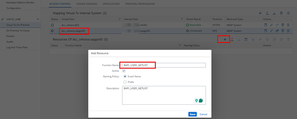
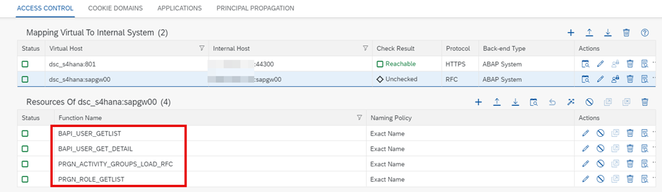

## 4. Destinations: 6 instead of 5, and different types

Public Edition needs 5 destinations, all fairly uniform. Private Edition needs **6**, and they're not uniform — different proxy types and authentication methods depending on what each one talks to:

| Destination | Proxy Type | Authentication |
|---|---|---|
| Design-time | OnPremise | Basic Authentication |
| Runtime | Internet | NoAuthentication, with `sap-platform=ABAP` and `sap-sysid`/`sap-client` properties |
| `privatecloud` (navigation) | Internet | **Principal Propagation**, routed through the Cloud Connector's Location ID |
| Single Sign-On (`S4HANA_PCE_SSO`) | — | — |
| `NavigationService` | Internet | OAuth2UserTokenExchange (same shape as Public Edition's) |
| A dedicated **RFC destination** for IPS | — | `jco.client.*` parameters, load-balancing vs. non-load-balancing variants |

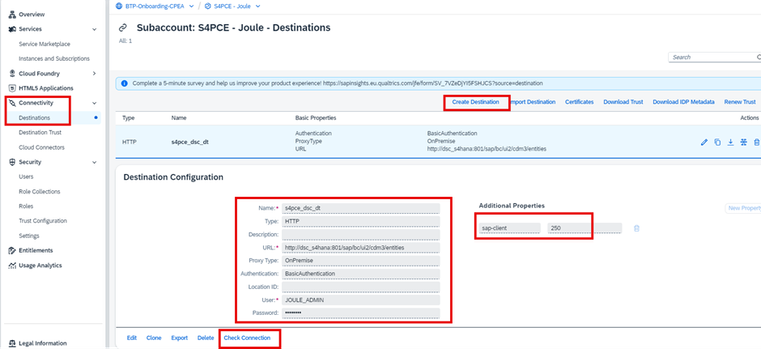
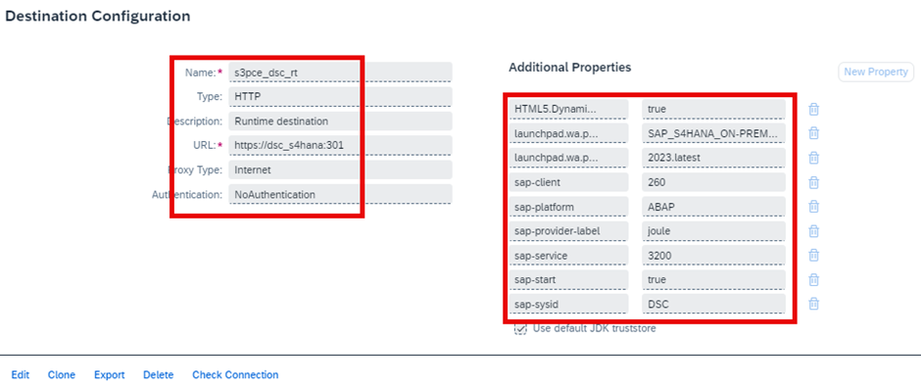
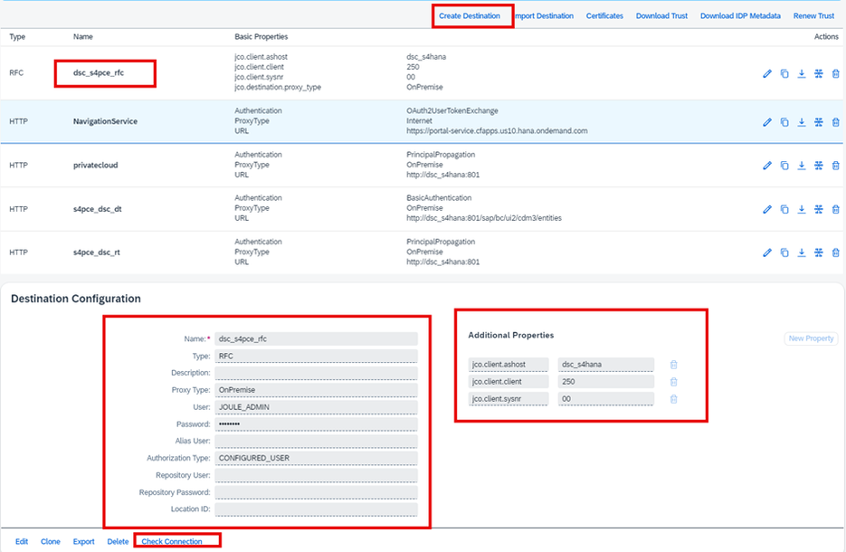

> [!NOTE]
> A `cflp.providerId` value here is tied to a **Content Provider you create yourself** in Work Zone's Channel Manager — more manual than Public Edition's equivalent, where the provider largely configures itself.

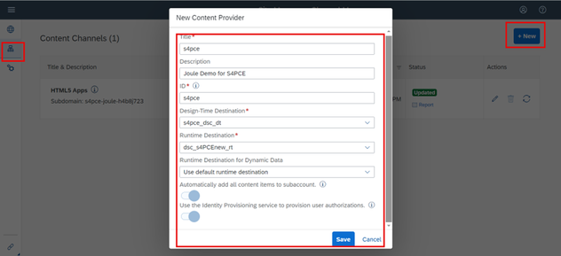

## 5. Identity Provisioning: source, target, and a real transformation bug

Source and target systems follow the same IPS pattern as every other chapter — but the actual transformation JSON used here is worth seeing, since **a real bug in SAP's own published version of it** is a confirmed, independently-reported issue (see section 7).

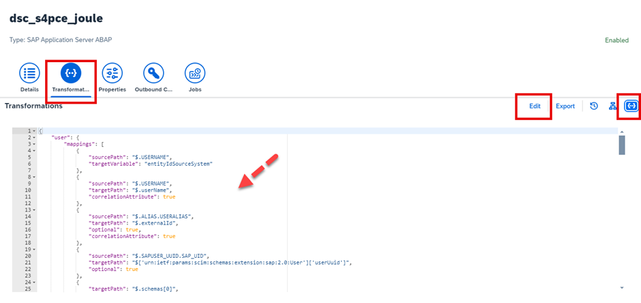

Run the Read Job, then confirm real (non-zero) entity counts in the job statistics — the same validation discipline as every IPS step in this book:

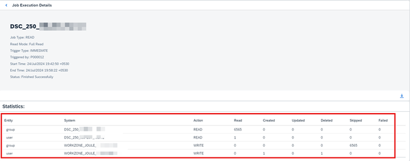

## 6. Fiori role design: entirely manual, inside the ABAP system

This is the other big divergence from Public Edition, where role exposure is largely handled by SAP's guided onboarding. Here, you build it yourself, in three steps:

1. **Create a Technical Catalog** in Launchpad App Manager (`/n/UI2/FLP` → Launchpad App Manager), with a Target Mapping: Semantic Object `Shell`, Action `plugin`, SAPUI5 Component ID `sap.das.webclientplugin.s4`, ICF Path = the Joule app URL + `/resources/public/webclient/s4`, Application Component ID `CA-FLP-ABA`.

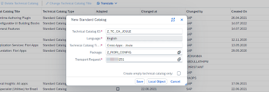

2. **Create a Business Catalog** in Launchpad Content Manager, with the Target Mapping referencing the Technical Catalog above.

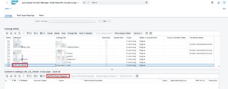

3. **Create a Single Role** via `/npfcg`, assign the Launchpad Catalog to it through the role's Menu tab, then assign users.

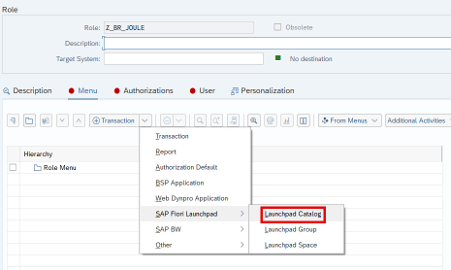
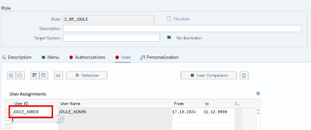

> [!CAUTION]
> **🔒 One Joule instance per S/4 backend — historically a hard limit**
> This guide's own text states this was a hard 1:1 constraint "until further update." Multi-system support for Private Edition now exists as a separate, newer capability — check `help.sap.com/docs/joule/integrating-joule-with-sap/multi-system-support` and its companion community blog before assuming a single-backend design is still your only option, but don't assume multi-backend support was part of this original activation flow either.

Once everything is wired up, the result is the same as every other activation in this book — a working Joule panel inside the Fiori Launchpad:

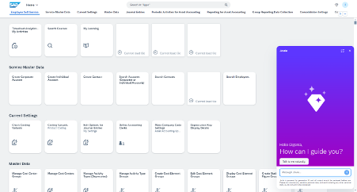

## 7. Field-reported fixes from the comment threads

Both the comprehensive guide (90 comments) and its troubleshooting companion (34 comments) have real, independently-confirmed fixes worth knowing before you hit them yourself:

- **The official help-portal's own IPS transformation code has a confirmed bug** ("Invalid mapping error / valueMappings is missing"). SAP's own team posted two corrected versions in the comments: one assuming the Global User ID (UUID) is populated in `SU01`, one for when it isn't (email-only correlation) — Private Cloud systems commonly don't populate the UUID, so check which situation applies before copying either template blindly.
- **"Content provider is empty" despite a successful Read Job**: root cause in one resolved case was the `portal-service` route not set under Channel Manager → Content Provider — a 404 on `portal-service.cfapps.<region>.hana.ondemand.com` is the telltale symptom.
- **The correct support component is `CA-JOULE-PRV`**, not `BC-CP-MP` — confirmed by SAP's own team in the comments after at least one reader was given the wrong one elsewhere.
- **Diagnostic tools not mentioned in the main guide**: `/UI2/FLPCA` and `/UI2/FLPCA_USER` (Launchpad Content Aggregator) show exactly which Semantic Objects/Actions and OData services are assigned to a given user — the fastest way to verify role replication actually worked, rather than guessing from the Fiori Launchpad's behavior alone.

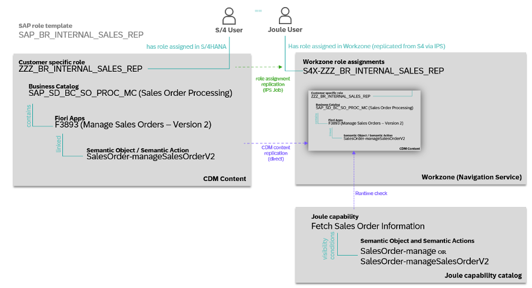

**13 documented troubleshooting issues**, symptom → cause → fix:

| # | Symptom | Cause | Fix |
|---|---|---|---|
| 1 | Joule refuses to connect after launch | Trusted domain not configured in both IAS tenant config and BTP Trust settings | Configure both; allow 15–20 minutes to propagate, retry in a private browsing window |
| 2 | "Digital Assistant not found" | The S/4 system is missing from the global account's system formation | Delete and recreate the Joule formation, or ticket `CA-JOULE-PRV` if formation creation itself errors |
| 3 | Content provider sync fails, unauthorized | Wrong DT destination credentials, or (on Cloud Connector >2.15) Principal Type not set to "X.509 certificate" | Check credentials; confirm Principal Type; user needs `SAP_FLP_ADMIN` + `SAP_FLP_EXP_USER` |
| 4 | IPS transformation edit fails with an unspecified error | A real bug in the published transformation JSON | Copy the corrected version from the help-portal page (see above) |
| 5 | Joule icon missing from the Fiori Launchpad | Missing Fiori business-catalog role, browser cache, blocked 3rd-party cookies, or a Fiori customizing conflict | Clear cache + run `/UI2/INVALIDATE_GLOBAL_CACHES`; check `/UI2/FLC` for customizing conflicts |
| 6 | "Corp IDP refused to connect" | Fiori Launchpad connected directly to a corporate IdP, bypassing Cloud Identity Services | Always route through the same IAS tenant used for Joule, never direct to the corporate IdP |
| 7 | Error adding Work Zone/IAS to the formation post-Booster | Identity Authentication not enabled in Work Zone | Enable it first |
| 8 | Cloud Connector can't connect to the subaccount | Stale authentication data | Download the subaccount's authentication data, re-upload into Cloud Connector |
| 9 | Joule gives only generic, informational answers — never transactional or navigational | A role/Semantic-Object mismatch between the user's actual S/4 roles and what's replicated to Work Zone (the single longest, most common issue) | Check SAP Note 3523238's Semantic-Object/Action-per-capability spreadsheet; **after any S/4 release upgrade, Exclude then Include the system in the Joule Formation to refresh the capability catalog**; check `/UI2/CDM3_EXP_SCOPE` → Preview Content; check Work Zone's Channel Manager content-read report; check Explore Role Assignments for the actual replicated roles |
| 10 | Joule doesn't greet the user by name / blank screen | Identity mapping mismatch between S/4's SAML2 Trusted Providers and the BTP subaccount's Trust Configuration domain | Verify both point at the same IAS tenant, and that the Global User ID (`SU01`'s external user ID) matches the Identity Directory's |
| 11 | "I'm having trouble connecting" | A broken link somewhere in Joule → Destination → Cloud Connector → Web Dispatcher → ICM → S/4 | Trace via `/n/IWFND/TRACES` |
| 12 | Need to open a support ticket | — | Component `CA-JOULE`, include the S/4 release version and a Correlation ID (SAP Note 3440333) |
| 13 | Navigation links not visible or working | The Runtime destination's Proxy Type is set to "On-Premise" instead of "Internet" | Set it to Internet — unconfirmed in the source why this specifically matters, worth independent verification before treating it as settled |

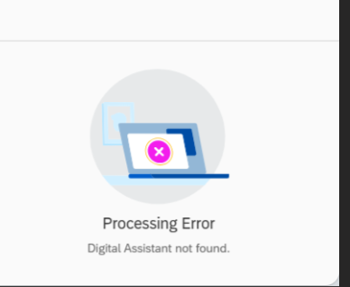
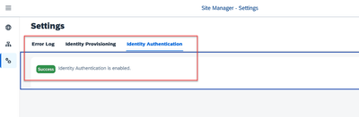
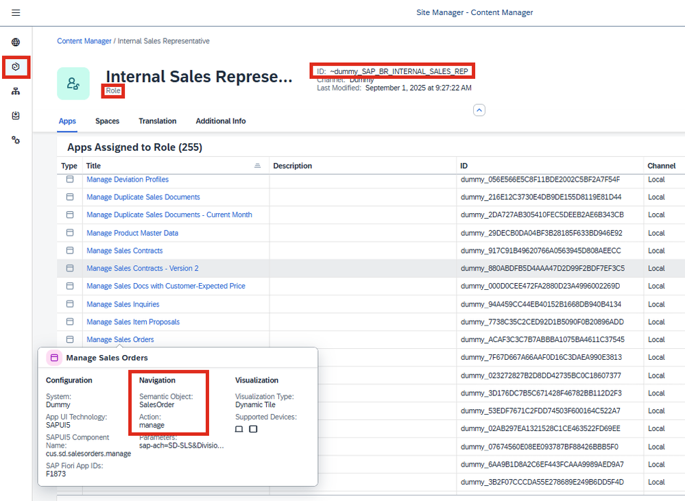
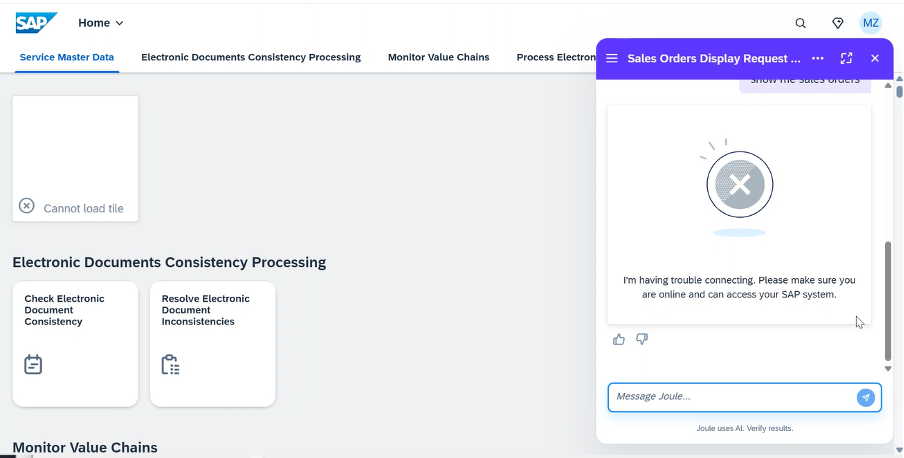

- **Unresolved, worth knowing about rather than assuming is solvable today**: regular (non-admin) users repeatedly prompted for credentials while the admin's own login works fine, with no fix posted in either comment thread; whether activation is reversible ("is this a point of no return?") was asked and never actually answered; a real reported pattern of Joule "stopping" transactional/analytical answers after previously working, with no destination changes — the only suggested (untested) workaround is deleting and recreating the BTP formation.
- **A genuine open architectural question, raised independently in both comment threads and never answered by SAP**: whether Joule can surface inside SAP Build Work Zone standard edition itself for a Private Edition customer, or only the on-premise Fiori Launchpad (with Work Zone used solely for provisioning users). Don't assume either answer — flag it as unresolved if it comes up.
- **SAP Note 3523238** (the Semantic-Object/Action/role mapping spreadsheet referenced throughout issue 9) is referenced extensively by both sources but is itself behind an SAP customer/S-user login wall — its content here is inferred only second-hand through what these two sources say about it, not independently verified.

## 8. Added by Claude, not from the sources

- Section 7's troubleshooting table and the architecture diagram's framing ("the role-replication chain") synthesize two sources' comment threads and body text into one structure — the facts and fixes are the sources', the organization is this book's.
- The explicit "6 instead of 5, and not uniform" framing in section 4 is this book's comparison against the Public Edition chapter already in this book — the individual facts are the source's.
- Not run: this chapter is BTP/S4 administration guidance, not code; nothing was independently executed. The field values and screenshots are the source authors' own activation, not a setup performed for this book.

## 9. Interview corner

**What interviewers listen for:** you can name the three concrete things Private Edition adds over Public Edition without hedging, and you know the single most common failure (issue 9, generic-only answers) traces to role replication, not to Joule being broken.

### 🟢 Basic

1. What does Private Edition require that Public Edition doesn't?

- Cloud Connector with Principal Propagation, a dedicated RFC destination with a specific function-module whitelist, and fully manual Fiori Technical Catalog/Business Catalog/PFCG role creation

2. Which four RFC function modules does Joule need whitelisted on the Cloud Connector RFC mapping?

- `BAPI_USER_GETLIST`, `BAPI_USER_GET_DETAIL`, `PRGN_ACTIVITY_GROUPS_LOAD_RFC`, `PRGN_ROLE_GETLIST` — and nothing broader

### 🟡 Intermediate

3. A user reports Joule only ever gives generic, informational answers — never transactional or navigational ones. Where do you start?

- Check for a role/Semantic-Object mismatch between the user's actual S/4 roles and what's been replicated to Work Zone — this is the single most common Private Edition symptom
- *Stronger answer:* if the S/4 system was recently upgraded, Exclude then Include it in the Joule Formation first to refresh the capability catalog, since a stale catalog produces exactly this symptom

4. What's the correct SAP support component for a Private Edition Joule issue, and why does this matter?

- `CA-JOULE-PRV` — a real, confirmed case where a different component (`BC-CP-MP`) was given out incorrectly elsewhere, delaying resolution

### 🔴 Senior

5. SAP's own published IPS transformation template throws "valueMappings is missing" when imported exactly as documented. How do you respond, and what do you need to know first?

- This is a confirmed bug in SAP's own help-portal documentation, not a configuration mistake — SAP's team has posted corrected versions in the comments of the troubleshooting blog
- *Stronger answer:* there are two corrected variants depending on whether the Global User ID (UUID) is populated in `SU01` — Private Cloud systems commonly don't populate it, so confirm which situation applies before picking a template

> [!TIP]
> **🧩 Design question**
> *"A customer on S/4HANA Private Edition says Joule worked fine for months, then suddenly started giving only generic answers after a release upgrade — with no configuration changes on their end."* Talk about: this matching the issue-9 pattern exactly (a stale capability catalog after an S/4 release upgrade), the Exclude-then-Include formation refresh as the fix, and why checking `/UI2/CDM3_EXP_SCOPE` and Explore Role Assignments would confirm the diagnosis before making any destination or network changes that aren't actually the problem.

## Cheat sheet

| Thing | Private Edition | Public Edition (for contrast) |
|---|---|---|
| Network connectivity | Customer-managed via Cloud Connector | SAP-managed |
| Destinations | 6, mixed proxy types/auth | 5, mostly uniform |
| RFC access | Whitelisted to 4 specific function modules | Not applicable |
| Fiori role exposure | Fully manual (Technical Catalog → Business Catalog → PFCG role) | Largely automated |
| Most common failure | Generic-only answers (role/Semantic-Object replication gap) | Communication System Host-field mismatch |
| Support component | `CA-JOULE-PRV` | `CA-FLP-EXT-JOU` |
| Historical scaling limit | 1 Joule instance per S/4 backend (multi-system support now separate) | 1 production system per application type, per subaccount |

## Recap

- Private Edition's three real divergences from Public Edition: customer-managed network connectivity (Cloud Connector + Principal Propagation), a narrow RFC function-module whitelist, and fully manual Fiori role design
- 6 destinations are needed, not 5, with genuinely different proxy types and authentication methods — not a uniform set like Public Edition's
- The single most common real-world symptom — generic-only answers — traces to a role/Semantic-Object replication gap, diagnosable via `/UI2/FLPCA`, Explore Role Assignments, and the Channel Manager content-read report
- A confirmed bug exists in SAP's own published IPS transformation template, with corrected versions posted by SAP's team in the comments — two variants depending on whether the Global User ID is populated
- One Joule instance per S/4 backend was a hard historical limit; multi-system support now exists as a separate, newer capability worth checking rather than assuming either way

## Practice

1. Without looking back, name the three things a Private Edition activation needs that a Public Edition one doesn't
2. List the four RFC function modules Joule's Cloud Connector whitelist needs
3. A user reports Joule only gives generic answers. Name the diagnostic tool that shows exactly which Semantic Objects/Actions are assigned to them

## How this chapter was checked

- The full SAP Community blog post "Joule for SAP S/4HANA Cloud Private Edition - A Comprehensive Setup Guide" (nageshcaparthy, Aug 2024, 259k views) was read in full, including its 90-comment discussion thread, 13 Nov 2026. Its given URL resolved to a comment-permalink path (`bc-p/...`); the canonical article root (`ba-p/13786453`) was located and read in full.
- Its troubleshooting companion, "Common configuration issues: Joule for SAP S/4HANA Cloud Private Edition" (Samir_Rai, Jun 2025, 34 comments), was also read in full.
- 100 DOM image elements were found on the comprehensive guide (98 unique after deduplication), plus 24 on the troubleshooting post — 122 total, all downloaded, 0 failures. 30 are embedded above, spanning every distinct configuration step and troubleshooting illustration; each one was opened and visually confirmed against its caption before being written into this chapter, including a spot-check pass across the full numeric range before final selection (not just the ones ultimately embedded). The remainder are additional sequential screenshots of the same multi-step wizard and ABAP transaction flows already illustrated above (e.g. further Launchpad Content Manager and PFCG sub-steps), kept in `images/` (`sj132-*`, `sj133-*`) without individual captions, since the steps they show are already conveyed by the embedded screenshots for that same flow.
- SAP Note 3523238 (`me.sap.com/notes/3523238/E`), referenced extensively by both sources as the authoritative Semantic-Object/Action/role mapping spreadsheet, is itself behind an SAP customer/S-user login wall — fully inaccessible without authenticated access. Its content is referenced here only as both sources describe it, not independently verified. This is explicitly flagged, not silently assumed.
- Nothing in this chapter is code; nothing was run. This is BTP/S4 administration guidance.

## Sources and further reading

- SAP Community, nageshcaparthy, *Joule for SAP S/4HANA Cloud Private Edition - A Comprehensive Setup Guide* — https://community.sap.com/t5/enterprise-resource-planning-blog-posts-by-sap/joule-for-sap-s-4hana-cloud-private-edition-a-comprehensive-setup-guide/ba-p/13786453 (article and comment thread, read in full 13 Nov 2026)
- SAP Community, Samir_Rai, *Common configuration issues: Joule for SAP S/4HANA Cloud Private Edition* — https://community.sap.com/t5/enterprise-resource-planning-blog-posts-by-sap/common-configuration-issues-joule-for-sap-s-4hana-cloud-private-edition/ba-p/14125996 (article and comment thread, read in full 13 Nov 2026)
- SAP Support Portal, SAP Note 3523238 — https://me.sap.com/notes/3523238/E (referenced extensively by both sources above; inaccessible without an authenticated SAP S-user, not independently read)

Previous: [Building your first Joule Skill in Joule Studio](joule-studio-first-skill.md) · Next: [Enabling Joule for SAP S/4HANA Cloud Public Edition](enabling-s4hana-public-edition.md)
